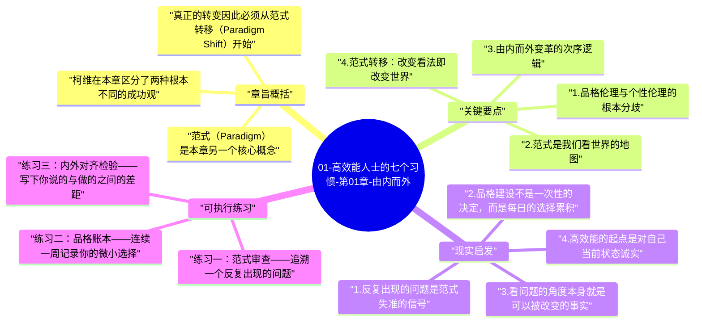

# 01-高效能人士的七个习惯-第01章-由内而外

第一章是整本书的哲学基础，也是柯维与绝大多数流行成功学划清界限的地方。在过去几十年间，大量关于个人效能的书籍都聚焦于技巧、方法与态度调整，教人如何更快达成目标、如何给人留下更好的印象、如何用话术提升影响力。柯维通过对近两百年成功文献的研究发现，二十世纪前期的著作几乎无一例外地强调品格——诚信、谦逊、忠诚、自律——而二十世纪中叶之后，成功文献开始大规模转向个性技巧，开始教人通过表现管理和人际策略来获得成功。他认为这个转变并非进步，而是某种危险的退行。

柯维并不是在否定沟通技巧或效率工具的价值，他真正要说的是：如果内在的品格与价值观是空洞的，任何外在技巧都只是脆弱的贴面装饰，一旦遭遇真实的压力与考验，就会剥落。持久的改变只能从内而外发生——先调整我们看世界的方式（范式），再从新的范式中自然生长出新的行为模式。这就是本章标题"由内而外"的真正含义：它不是一个励志口号，而是一个关于变革次序的严肃主张。

本章在全书中的位置极为关键。它是习惯一到习惯七的认识论前提。如果读者不接受"范式决定行为"这个基本命题，后续七个习惯就只会被当成七条操作建议，而不会被理解为一个整体性的人格转变系统。读懂本章，才算真正打开了这本书的门。

## 章旨概括

柯维在本章区分了两种根本不同的成功观。第一种他称之为"品格伦理"（Character Ethic），代表了近两百年来主流文化对成功的理解：成功的基础是内在美德，包括诚信、正直、勤勉、节制、黄金法则等。这些品质不是表演给他人看的，而是个人内在结构的组成部分，当面临艰难选择时，它们构成了行动的锚点。第二种他称之为"个性伦理"（Personality Ethic），是近代成功学的主流，它把成功定义为给他人留下好印象、学会影响他人、掌握特定的社交技巧与沟通公式。品格伦理与个性伦理的核心差异在于：前者要求你真实地成为某种人，后者则要求你学会表现得像某种人。

范式（Paradigm）是本章另一个核心概念。范式这个词来自科学哲学，指一套解读现实的基本假设框架。我们每个人都带着各自的范式在观察世界——关于他人的动机是什么、关于成功意味着什么、关于自己应该做什么样的人。范式如同眼镜，它是我们看世界的工具，但我们通常意识不到自己正在戴着它。柯维指出，大多数人际问题、自我管理困境，根源不在于缺乏某个技巧，而在于持有一个扭曲的范式——用一副度数不对的眼镜，无论多么努力地盯着书看，字迹都无法清晰。

真正的转变因此必须从范式转移（Paradigm Shift）开始。当我们意识到自己的某个基本假设是错误的，并用一个更接近现实的假设替代它，就会在不需要刻意努力的情况下，自然而然地产生新的感知、新的行为与新的结果。柯维举了一个令人震动的例子：一位父亲坐在地铁上漠然地任由孩子喧哗打扰乘客，看起来麻木不仁；但当他向柯维解释孩子的母亲刚刚在医院去世时，整个情景的意义瞬间被颠覆——同样的外在行为，在不同的内在框架下，意味着截然不同的现实。范式一旦转变，无需技巧指导，人的感受和反应就自然改变了。

## 关键要点

### 1. 品格伦理与个性伦理的根本分歧

品格伦理主张，外在成功必须建立在内在品德的土壤上。诚信意味着你说话算数，即便在没有人监督时也遵守承诺；正直意味着你的内在价值观与外在行为之间保持一致性；责任感意味着你不把人生的主导权交给外部环境。这些品质不是可以速成的技巧，它们需要在一次次真实选择中逐渐建立，也会在一次次妥协与逃避中逐渐侵蚀。柯维的核心洞察是：品格是能力的地基，能力建在地基上才能经历风浪；没有地基只有能力，在风平浪静时看起来光鲜，一旦遭遇真实压力就会倒塌。

个性伦理的问题不在于它所提供的技巧无效，而在于它把手段当作了本质。一个没有内在诚信却掌握了高超沟通技巧的人，他的人际关系迟早会因为这种内在空洞而崩解——他人会感受到那种难以言说的不真实感。更深层的危险是：当一个人长期专注于外在形象管理而忽视内在品格培养，他与自己真实状态之间的距离会越来越远，最终连自己都不再清楚自己真正相信什么、真正需要什么。

### 2. 范式是我们看世界的地图

柯维用地图来比喻范式。地图并不是地形本身，它是我们对地形的描述。如果地图精确，我们按图行事就能到达目标；如果地图有误，我们的努力越多，往往离目标越远——因为我们越来越快地在错误的方向上行进。人们通常不会质疑自己的地图，他们默认自己所看到的就是真实。当现实与预期不符，第一反应往往是"别人有问题"或"方法执行有问题"，而不是"我的基本假设可能有误"。

范式的形成有其历史积累性。我们的很多核心范式在童年和青少年期就已经固化，来自家庭、教育、文化和早期经验。这些范式在当时的环境中可能是适应性的，但当环境改变而范式没有随之更新，它们就成了成长的障碍。柯维强调，认识到自己范式的存在，并保持对范式的开放与反思，是成为高效能人士的第一步——因为只有承认地图可能有误，你才会愿意重新测量地形。

### 3. 由内而外变革的次序逻辑

大多数人面对问题时习惯于从外部寻找解决方案——找一个新方法、换一种话术、学一个工具。这种"由外而内"的逻辑在处理简单的技术性问题时往往有效，但在处理涉及价值观、关系和个人成长的深层问题时，它会制造一种幻觉：看起来在解决问题，实际上在回避问题的根源。柯维说，尝试在不改变内在状态的情况下改变外在结果，就像试图种植玫瑰却不愿意翻土施肥——你可以在土地表面摆放假花，但你无法种植真正的生命。

由内而外的变革需要一种特别的勇气：承认问题在于自己的看法，而不是外部环境。这并不意味着外部环境不重要，也不意味着他人的行为对你没有影响。它的意思是：对于那些你无法控制的外在条件，持续地愤怒或抱怨不会带来任何改变；而对于那些确实属于你内在的东西——你的价值观、你的反应方式、你看待事情的框架——你拥有完整的主权，而正是在这里，真正的改变才能发生。

### 4. 范式转移：改变看法即改变世界

柯维用多个案例说明，当一个人的核心范式发生转移，不需要任何努力，行为就会自动改变。这种经验在日常生活中并不陌生：当你得知一个一向让你不舒服的同事正在经历失去亲人的痛苦，你看待他的方式会立刻改变，不需要人告诉你"要更有同情心"——同情心自然流露，因为你对这个人的理解已经彻底改变了。这就是范式转移的力量：它改变的不是行为本身，而是产生行为的土壤。

范式转移不仅可以在接收到新信息时发生，也可以通过主动反思引发。当我们刻意地问自己"我为什么会对这件事有这样的反应？""这个假设真的成立吗？""如果换一种方式理解这个情况，我会怎么做？"——这种元认知练习本身就是在松动和检验自己的范式。随着时间积累，这种习惯性的自我觉察会带来深刻的内在转变，而这种转变是真实的、持久的，不依赖外部刺激来维持。

### 5. 原则：比价值观更稳定的北极星

在本章末段，柯维区分了原则（Principles）与价值观（Values）。价值观是个人赋予事物的主观意义，不同的人有不同的价值观，甚至同一个人在不同时期也会有不同的价值观。而原则是更基础的东西——它们是无论文化、时代和个人好恶如何变化，都持续适用的自然法则。"付出与回报成正比""种瓜得瓜、种豆得豆""信任需要时间建立""真实的关系需要真诚作为基础"——这些不是某种文化的发明，而是人类几千年经验中反复验证的规律。

以原则为中心的生活，意味着把这些经过检验的基本规律作为决策的最终依据，而不是把情绪、他人的评价或短期利益作为指南针。这不是教条主义，而是一种更高层次的稳定性：当所有外在条件都在变动时，内在原则提供了一个不动的参照点。柯维认为，这正是高效能人士与普通人的深层差异——他们不需要在每次决策时重新出发寻找方向，因为他们内心已经有了稳定的北极星。

## 现实启发

### 1. 反复出现的问题是范式失准的信号

当一个困难在生活中一再出现——同样的冲突在不同关系中重演、同样的挫败在不同项目中重现——这往往不是运气不好，也不是技巧不够，而是一个持续运作的错误范式在不断制造相同的结果。有效的做法是暂停技巧层面的调整，退后一步审问：我对这种情况的基本假设是什么？这个假设是否真实？如果换一个前提来理解这个情景，我会看到什么不同的可能性？这种反思往往比学习一百个新技巧更能从根本上改变状况。

比如，如果你总是觉得自己在职场中得不到应有的认可，表面的解决办法是"学习更好地展示自己的成果"。但更值得检视的问题是：你对"认可"的定义是什么？你的期待是否真实地与周围人的感知对齐了？你是否把"没有批评"误解为"没有认可"？你对权威的态度是否带入了早年经验中的某种模式？这些问题不好回答，但正是它们才指向真正的出路。

### 2. 品格建设不是一次性的决定，而是每日的选择累积

品格伦理的实践方式不是某个壮烈的宣誓时刻，而是由无数个日常微小选择积累而成的。当你在没有人看见时仍然选择诚实，当你面对压力时仍然遵守承诺，当你面对不公时选择以原则而非情绪回应——每一次这样的选择，都在强化你内在品格的结构。相反，每一次选择走捷径、每一次在压力下妥协自己的价值观，都在一点点腐蚀那个结构。品格不是天生的，但它确实在每一天的点滴选择中被雕刻。

这个洞察的实用含义是：不要等到面对重大考验时才去"展示品格"，因为届时你展示出来的，其实是你在日常小事中已经建立起来的东西。如果你在小事上习惯于随便应付，大事来临时的失守几乎是可以预期的。因此，品格建设的最佳场所不是什么宏大的道德考验，而是每天工作、生活中那些看似微不足道的选择时刻。

### 3. 看问题的角度本身就是可以被改变的事实

很多人把自己对某个情况的看法当作客观事实："这件事就是很糟糕""这个人就是不可理喻""这个处境就是没有出路"。但柯维提醒我们，我们所看到的不是客观事实本身，而是事实通过我们的范式过滤后呈现出的图像。这意味着，改变看法本身就是在改变我们的现实体验——不是在美化问题，而是在打开更多真实存在却被原有范式屏蔽掉的可能性。

这不是让人自我欺骗或假装问题不存在。而是认识到：同一个处境，可以用不同的框架来理解，而不同的框架会自然引导出不同的行动选项。一位员工被批评时，可以把它理解为"上司在打压我"，也可以把它理解为"这里有我尚未看见的成长机会"。这两种框架不一定哪个"更正确"，但它们引导出的行动路径截然不同，而后者通常能解锁前者永远关闭的可能性。

### 4. 高效能的起点是对自己当前状态诚实

由内而外的最初动作，不是立刻改变什么，而是真实地看清自己当前的状态——包括自己的恐惧、偏见、防御机制和根深蒂固的假设。这需要一种特殊的勇气，因为人类有强烈的本能要保护自我形象，避免看到让自己不舒服的真相。但如果你无法如实看见自己当前所站的位置，任何关于"我想成为什么样的人"的目标都只是空中楼阁。

这种自我诚实不是自我攻击，也不是无止境的内省消耗。它是一种平静的觉察：我现在的范式是这样的，我现在的品格建设程度是这样的，我现在在某些方面有盲点，这没关系，这是我的出发点，而不是我的终点。接受真实的出发点，才能规划真实的路径。这种诚实本身，就是由内而外变革的第一步。

## 可执行练习

### 练习一：范式审查——追溯一个反复出现的问题

选择一个在你生活中反复出现的困境，可以是某种类型的人际冲突、某种总是以失败告终的努力模式，或某种反复触发的负面情绪。用整整半小时，不去思考"怎么解决它"，而是专注于一个问题：我对这个情况的核心假设是什么？把这个假设写下来，然后问自己：这个假设从哪里来？它在什么情况下是真实的、在什么情况下可能是错误的？如果一个你尊重的智者用完全相反的假设看待这个情况，他会看到什么？这个练习的目标不是立刻找到答案，而是让长期运作于意识之下的范式第一次浮出水面，变得可见。

### 练习二：品格账本——连续一周记录你的微小选择

在接下来的七天内，每天晚上花十分钟写一份简短的"品格账本"。记录当天你面对过的3到5个微小选择时刻——那些通常不会被人注意的场景：你是否在独处时也遵守了对自己的承诺？你是否在面对方便的谎言时选择了诚实？你是否在感到不舒服时仍然按照自己的价值观行动？这个练习不是为了给自己打分或制造罪疚感，而是为了让你开始意识到，品格并不是在重大时刻被测试的某种特质，而是由这些日常细节时刻所构成的。七天之后，回看这份账本，你会开始看到自己品格建设中清晰的模式。

### 练习三：内外对齐检验——写下你说的与做的之间的差距

写下3到5条你通常对自己或他人声称自己相信的原则或价值观，例如"我重视诚实""我认为家庭比工作更重要""我相信持续学习的价值"。然后对照过去一个月的实际行为，诚实地评估：你的行为是否真实地反映了这些宣称的价值？在哪些地方你的实际行动与你所说的价值观之间存在明显落差？这个练习可能会带来不舒服的发现，但这种不舒服正是由内而外变革的起点——当你看见了内外之间的落差，你就不再需要被动地等待生活事件来告诉你该改变什么了。

---

## Mermaid 思维导图

### 图1

