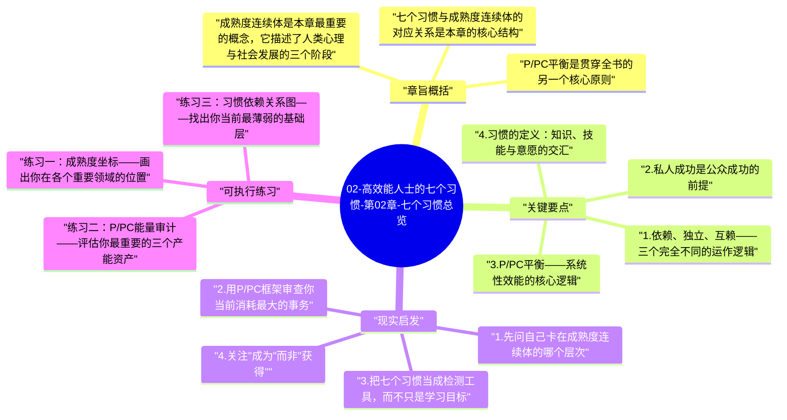

# 02-高效能人士的七个习惯-第02章-七个习惯总览

第二章承接第一章的哲学基础，开始为整本书的行动框架搭建脚手架。柯维在这里做的事情不是简单地列举七个习惯的名字，而是试图让读者理解这七个习惯为什么是这个顺序、它们如何形成一个相互支撑的系统，以及这个系统背后更深层的成长逻辑是什么。读完本章，你应该能感受到七个习惯不是七条彼此独立的建议，而是一条从内在自主走向外在协作再走向持续更新的完整路径。

柯维在本章引入了两个重要的理论框架：成熟度连续体（Maturity Continuum）和P/PC平衡原则。成熟度连续体描述的是人的成长路径，从依赖阶段（Dependence）经由独立阶段（Independence）最终走向互赖阶段（Interdependence）。P/PC平衡原则则来自伊索寓言中那只能生金蛋的鹅：P代表产出（Production），PC代表产能（Production Capability），高效能不是只看当下产出，而是同时维护产出能力，不竭泽而渔。这两个框架是理解后续所有习惯的底层逻辑。

本章在全书中起到了地图的作用。当你迷失在某个具体习惯的细节中时，回到这一章，能让你重新看清自己所处的位置和正在走的方向。这一章的价值不在于它教会你做什么，而在于它帮助你理解为什么要这样做、整个系统如何运转，从而让后续的学习有了全局性的参照。

## 章旨概括

成熟度连续体是本章最重要的概念，它描述了人类心理与社会发展的三个阶段。依赖阶段的人把自己的快乐、成功和问题的解决都寄托在外部——他人、环境、运气。这个阶段本身没有道德问题，婴儿天生如此，很多成年人也仍然停留于此。独立阶段的人开始相信自己可以自主做事，我能做到、我负责任、我可以选择，独立是成熟的重要里程碑，现代文化尤其崇尚这个阶段。但柯维认为，以独立为终点是一种误解，因为人类在本质上是相互依赖的存在，最高层次的成就总是在协作中产生的——互赖阶段的人理解"我们可以合力做到单独无法做到的事"，并真正擅长在这个层次上运作。

七个习惯与成熟度连续体的对应关系是本章的核心结构。前三个习惯（积极主动、以终为始、要事第一）对应私人成功，它们帮助人从依赖走向独立，让人能够真正掌控自己的行为、价值观和时间。中间三个习惯（双赢思维、知彼解己、统合综效）对应公众成功，它们帮助人从独立走向互赖，建立高质量的协作关系。第七个习惯（不断更新）是整个系统的维护机制，确保一个人在所有维度上持续成长而不被耗尽。柯维明确说明，公众成功建立在私人成功的基础上——在没有内在稳定性之前，人际技巧只是表面功夫，因为他人很快会感受到其中的不真实。

P/PC平衡是贯穿全书的另一个核心原则。柯维用那只金蛋鹅做比喻：如果你只关注今天的产出（金蛋），却忽视维护产出能力（鹅的健康），短期内你会得到更多金蛋，但最终鹅会死去，连带着产出能力也彻底消失。这个原则适用于所有领域：身体健康是个人效能的产能资产，你持续消耗不维护，健康会在某个时间点崩塌；人际关系是协作效能的产能资产，你持续提款不存款，信任账户会透支；专业能力是职业效能的产能资产，你持续使用不更新，在快速变化的环境中会迅速贬值。

## 关键要点

### 1. 依赖、独立、互赖——三个完全不同的运作逻辑

依赖阶段的人用"你"做主语来描述自己的状态：是你让我开心或不开心，是你让这件事成功或失败，是环境决定了我现在的处境。这不是一种道德上的软弱，而是一种尚未发展的心理结构。问题在于，依赖阶段的人无法可靠地为自己或他人的结果负责，因为他们的状态总是受制于外部变量，而外部变量的变化不在其掌控之内。依赖是一种固有的脆弱性，无论它表现为对他人认可的依赖、对稳定环境的依赖，还是对运气的依赖。

独立阶段是成熟度连续体上一个关键的跃升，但它本身也有局限性。独立的人相信"我可以做到"，这是自主性和责任感的体现，值得肯定。然而，如果一个人把独立当作终极目标，他会倾向于单打独斗，对协作产生抗拒，难以接受依赖他人的不确定性，也难以把荣誉分享给他人。真正高质量的协作需要双方都先具备独立性——因为只有当两个成熟个体相遇时，他们才能真正地选择合作，而不是被迫地相互利用或依赖。互赖的高明之处在于，它不是用依赖取代独立，而是在独立的基础上选择连结。

### 2. 私人成功是公众成功的前提

这是柯维在本章最重要的论断之一，也是他与很多流行人际关系书籍分道扬镳的地方。很多关于如何影响他人、如何建立人脉、如何提升领导力的书籍，都可以在一个品格空洞的人那里被应用——至少在短期内可以。但柯维坚持认为，这种应用是不稳定的，因为人际效能有一个底层基础，那就是个人的内在稳定性、可靠性和真实性。一个自己都无法管理自身时间和承诺的人，在组织他人的协作时，会遭遇自己内在混乱的投影。

私人成功不是自私自利，而是自我管理的完整性。在柯维的框架里，私人成功包括：对自己的行为负责（积极主动）、清楚自己真正重视什么（以终为始）、让优先级支配时间分配（要事第一）。这三者合力构成一个内在稳定的人格基础，当这个基础稳定，一个人才能真正腾出心力去关注他人的需求、理解他人的框架，并在差异中找到协同的可能性，而不是把他人的存在变成自己焦虑的来源。

### 3. P/PC平衡——系统性效能的核心逻辑

P/PC平衡的核心洞察是：效能不等于最大化当前产出，而是同时优化当前产出与未来产出能力的动态平衡。这个原则违反了短期最大化的直觉，却符合长期可持续的逻辑。一家公司压榨员工以完成当季财务指标，当季的P很高，但PC（员工能力、动力和忠诚度）在快速损耗，几个季度之后，这家公司会发现自己的人才流失、文化崩塌、创新枯竭——金蛋还在飞速产出，但鹅已经在病重垂死。

P/PC平衡需要一种时间视野的扩展——从只看"现在做得如何"延伸到"这种做法是否可以持续五年、十年"。这在实践中尤其困难，因为产能的损耗往往是缓慢的、不易察觉的，而产出的压力却总是紧迫的、清晰可见的。柯维的处方是：把维护产能当作一类本质上重要的事务，不允许它被当前的紧急需求无限期地挤压。这正是习惯三"要事第一"在系统层面的表达。

### 4. 习惯的定义：知识、技能与意愿的交汇

柯维在本章对"习惯"给出了一个深刻的操作性定义：习惯是知识（知道做什么以及为什么做）、技能（知道如何做）与意愿（想要做）三者的交集。这个定义很有洞察力，因为它解释了为什么很多人知道某件事是对的，却做不到——他们有知识，有时甚至有技能，但缺乏意愿；或者他们有意愿，但缺乏具体可操作的知识和技能。习惯的形成需要三个维度同时到位，缺一不可。

这个定义也解释了为什么阅读一本书通常不足以改变习惯：阅读主要提供知识，而技能需要练习才能建立，意愿需要真实的价值触动才能深化。柯维写这本书的野心不仅是知识传递，而是通过对原则的深刻阐释来触发意愿的改变，并通过具体的练习来建立技能。这种三维并行的设计意图，贯穿了这本书的全部内容。

### 5. 七个习惯的内在顺序不可颠倒

七个习惯并不是七条并列的建议，它们之间存在严格的序列依赖。习惯一到三的私人成功基础如果薄弱，习惯四到六的公众成功努力就会变成表演——你可能在某次会议上做到双赢，但无法持续地在日复一日中维持，因为一旦有压力，没有私人成功基础的人会本能地退回竞争与防御。习惯七（不断更新）则是整个系统的氧气——如果一个人停止了对身体、精神、智力和社会关系的持续投资，其他六个习惯会随时间缓慢退化，因为支撑它们的能量储备会逐渐枯竭。

这个序列关系也给了我们一个诊断工具：当我们发现自己在某个习惯上持续卡住，很可能不是因为这个习惯本身太难，而是因为它所依赖的前序习惯基础还不够稳固。如果你总是在人际协作中感到沮丧，先检查习惯一到三：你是否真的在为自己的结果负责？你是否清楚自己在这段关系中真正看重什么？你是否把时间和精力给了真正重要的人际投资？

## 现实启发

### 1. 先问自己卡在成熟度连续体的哪个层次

在面对任何持续存在的困境时——无论是职业发展的瓶颈、人际关系的僵局，还是个人成长的停滞——不要先想"我需要学什么新技能"，而是先做一个诚实的成熟度评估：我在这个领域的运作，更接近依赖模式、独立模式，还是互赖模式？依赖模式的特征是总在等待他人改变、把责任归因于外部；独立模式的特征是拒绝接受帮助、认为合作是麻烦；互赖模式的特征是能够同时给予和接受贡献，在相互之间的差异中找到协同而不是冲突。知道自己在哪里，才能知道下一步的方向。

### 2. 用P/PC框架审查你当前消耗最大的事务

每隔一段时间，对你在某个重要领域的投入做一次P/PC审查。方法是：列出你在这个领域最主要的产出来源，然后评估你维护相应产能的情况。如果你是靠自己的时间和精力换取收入，你在健康、专业技能更新和精力恢复上的投入是否足以支持这种产出的持续？如果你依赖某个重要的合作关系产生成果，你在维护这段关系的信任基础上的投入是否与提款速度匹配？P/PC失衡往往不是在某一天突然变得明显，而是经过很长时间的积累后，在某个压力点上突然崩塌。定期的P/PC审查能帮助你在崩塌之前看见危机。

### 3. 把七个习惯当成检测工具，而不只是学习目标

当你在某件事上感到卡住或不满时，可以系统地用七个习惯来做一次自我检查。积极主动的角度：我在这件事上是在抱怨外部因素，还是在专注于我能影响的部分？以终为始的角度：我真正想要的结果是什么，我现在的行动方向与这个结果是否一致？要事第一的角度：我在这件事上的时间投入是否真实反映了它对我的重要性？当这三个私人成功问题都能给出清晰的肯定答案，再检查公众成功的部分——这样的检查不仅有助于找到卡点，也会逐渐让你对这七个习惯产生真实的行动感，而不只是概念上的认知。

### 4. 关注"成为"而非"获得"

成熟度连续体最深刻的含义是：高效能不是一套可以学来直接套用的技术，而是一个关于成为什么样的人的持续过程。技术可以速成，品格不可以；技巧可以模仿，内在稳定性不可以；方法可以借鉴，价值观必须真实生长。柯维在本章反复强调，七个习惯的目标不是让你变得"更有效率"，而是帮助你成长为一个内外一致、真实可靠、能够在复杂人际中产生真正价值的人。这个"成为"的过程没有终点，但每一步都在积累真实的能力和深度。

## 可执行练习

### 练习一：成熟度坐标——画出你在各个重要领域的位置

选出5个对你来说重要的生活领域（职业、家庭、友谊、健康、个人成长），对每个领域诚实地评估：我在这个领域的典型反应模式更像依赖阶段（等待外部改变、把结果归因于他人）、独立阶段（拒绝帮助、单打独斗）还是互赖阶段（能够主动给予和开放接受，在协作中创造超越个人的结果）？把这个评估写成一张表格，并为每个领域写下一个具体的行动：如果我在这个领域向更高成熟度迈进一步，第一个具体的改变会是什么？

### 练习二：P/PC能量审计——评估你最重要的三个产能资产

识别你生命中最重要的三个"鹅"——可以是身体健康、某段关键关系、某项核心专业技能，或某种精神修养实践。对每一个，回答三个问题：过去三个月，我在多大程度上维护了这个产能资产？过去三个月，我在多大程度上提取了这个资产的产出？如果现有的维护与提取比率继续保持三年，这个资产会处于什么状态？这个审计会让你清晰地看到哪些地方正在发生P/PC失衡，以便在危机到来之前做出调整。

### 练习三：习惯依赖关系图——找出你当前最薄弱的基础层

在一张纸上画出七个习惯的序列结构：私人成功三习惯在下方作为地基，公众成功三习惯在中间层，不断更新在顶端作为维护机制。对每个习惯，用1到5分评估自己当前的实践程度（1分=基本没有做，5分=已经是稳定的生活方式）。重点关注：你在公众成功层面的困难，是否有对应的私人成功薄弱环节在支撑它？你的整体系统是否存在明显的短板，让其他习惯的收益无法充分实现？这张图不需要完美，但它会给你提供一个系统性的成长优先级视角。

---

## Mermaid 思维导图

### 图1

