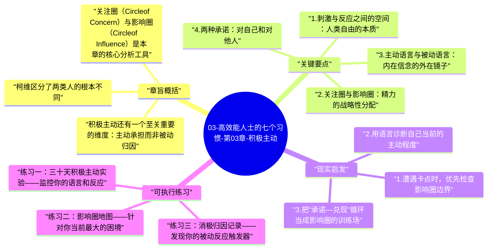

# 03-高效能人士的七个习惯-第03章-积极主动

第三章是七个习惯的起点，也是整本书最根本的命题所在。柯维把"积极主动"（Be Proactive）作为第一个习惯，不是偶然的。在他看来，如果一个人不接受"我对自己的反应有选择权"这个命题，那么无论后续学什么、理解什么，都只能停留在头脑层面的认知，而无法落地为真实的生命改变。积极主动不是一种性格特质，不是外向或热情，而是一种关于人类本质的基本命题：我们不是刺激驱动的机器，在刺激与反应之间，有一个属于人类独有的空间，那就是选择的自由。

这个洞察来自维克多·弗兰克尔（Viktor Frankl）的经历与理论。弗兰克尔是一位心理医生，在纳粹集中营中失去了几乎所有的亲人，自身也遭受了极端的身体与心理折磨。在这种极端条件下，他发现有些人保持了内在的尊严与意义感，而另一些人在同样的条件下彻底崩溃。弗兰克尔的结论是：在任何给定的处境中，人类最后的自由是选择自己对那个处境的态度。柯维借用这个框架，把它带入了日常生活的层次：我们或许无法选择老板说什么、天气如何、他人如何对待我们，但我们始终可以选择自己如何回应这些事情。

本章在全书中承担了基础建设的角色。如果第一章是认识论（我们如何看世界），本章就是实践论的起点：我如何真实地改变自己的运作方式。积极主动的原则是后续所有习惯的前提——没有它，以终为始只是空想，要事第一也只是道理，双赢思维更是奢望，因为一个把自己当作环境产物的人，根本没有足够的内在稳定性来实践这些更高阶的习惯。

## 章旨概括

柯维区分了两类人的根本不同。消极被动的人（Reactive people）像是感应器，外部条件直接触发内部反应：天气好了心情好，被人批评了就愤怒，工作顺利了就自信，遭遇挫折就沮丧。这不是虚弱，而是一种尚未被意识到的运作模式。这类人的内在状态完全依附于外部条件，他们对自己的情绪和行为缺乏真实的主权，尽管他们通常不会承认这一点。积极主动的人（Proactive people）则在刺激与反应之间打开了一个空间，在这个空间里，他们依据自己的价值观和判断来选择回应方式。他们仍然会受到外部事件的影响，但这种影响不会直接变成行为——它先通过内在的价值过滤和选择机制。

关注圈（Circle of Concern）与影响圈（Circle of Influence）是本章的核心分析工具。关注圈包含了一个人关心的所有事情：世界和平、气候变化、他人的看法、政治局势、家庭成员的选择、公司的战略决策……这个圈子非常大。影响圈则是这些关注事项中，你实际上能通过行动产生影响的那个子集。消极被动的人把大部分精力花在关注圈中超出影响圈的部分——抱怨、担忧、批评，在这些活动上投入了大量时间和情绪能量，却无法产生任何实际改变，最终感到无力和疲惫。积极主动的人把精力集中在影响圈内——做好自己能做的事，在自己的职责范围内发挥影响力，随着时间推移，他们的影响圈往往会缓慢扩大。

积极主动还有一个至关重要的维度：主动承担而非被动归因。消极被动的人在问题出现时的本能反应是寻找原因——是谁的问题、什么情况导致了这个结果、为什么这件事会这样。他们在寻找解释，而不是在寻找解决方案。积极主动的人也会分析原因，但他们的核心问题是：既然事情已经如此，我现在可以做什么？这两种问题导向的差异，在时间积累中会产生完全不同的人生轨迹——前者越来越精于解释失败，后者越来越善于从任何处境中找到前进的路。

## 关键要点

### 1. 刺激与反应之间的空间：人类自由的本质

弗兰克尔的核心洞察——在刺激与反应之间存在一个空间，人类有能力意识到这个空间并在其中做出选择——是积极主动习惯的哲学基础。这个命题听起来简单，但它在实际生活中的含义非常深远。它意味着我们不是生物决定论意义上的机器，基因、童年经历和当下的情绪状态不是我们行为的最终决定因素。它们是影响因素，但不是决定因素。这个区别极为重要，因为它是个人责任感的来源。

在日常生活的具体场景中，这个空间往往非常狭窄，需要刻意练习才能注意到它的存在。当有人对你说了一句冒犯的话，你的愤怒几乎是即时的；当你遭遇意外的失败，沮丧和自我怀疑几乎是自动产生的。积极主动的练习就是在这个几乎感觉不存在的空间里，开始注意到它，然后慢慢地、有时很艰难地，选择一个比本能反应更符合自己价值观的回应。这种练习不会消除负面情绪，但会改变负面情绪对行为的支配力。

### 2. 关注圈与影响圈：精力的战略性分配

影响圈的大小不是固定的，它会随着一个人行为模式的改变而改变。当一个人专注于影响圈内的行动——认真完成手头的工作、在力所能及的范围内建立关系、持续提升自己的专业能力——他的影响力会缓慢但真实地扩大，关注圈与影响圈的重叠面积会增加。相反，当一个人把大量精力花在批评关注圈中自己无法改变的事情，他的影响圈不会扩大，反而会因为持续的挫败感和无力感而缩小。这不是理论推断，而是在大量真实观察中得到验证的规律。

实践影响圈思维的关键是学会提出正确的问题。当遭遇不满意的结果时，影响圈思维的问题是："在这件事上，我能采取什么行动？""哪些因素是我可以改变或影响的？""我可以从哪里入手，让情况往更好的方向移动？"而不是"为什么会这样？""谁该为此负责？""为什么总是我碰到这种事？"前者是行动导向的，后者是解释导向的。这两套问题体系会在日复一日中训练出完全不同的思维习惯，进而产生完全不同的行动倾向。

### 3. 主动语言与被动语言：内在信念的外在镜子

柯维用语言模式来揭示内在信念的结构，这是本章最实用也最微妙的洞察之一。被动语言的特征是把主语从"我"转移到外部：我没有办法（I can't）、他让我很烦（He makes me angry）、我必须这样（I have to）、如果只是……就好了（If only...）。这些表达方式不仅仅是语言习惯，它们是底层信念的外在表现——一种把自己放在被动受体位置、把控制权和责任转移给外部的世界观。

主动语言的特征是把自主性和选择权拉回来：我选择不这样做（I choose not to）、我对自己的情绪负责（I control my feelings）、我希望做到（I will）、我来看看有什么可能（Let me see what I can do）。这不是语言游戏，而是一种内在重新定向的练习——每一次用主动语言替代被动语言，都是在强化"我有选择权"这个信念，而这个信念被强化得越多，真实的选择能力就越强。柯维建议，注意并有意识地调整自己的语言模式，是进入积极主动运作状态的一个实践入口。

### 4. 两种承诺：对自己和对他人

柯维把积极主动的实践浓缩为两种承诺：向他人做出承诺并守诺，以及向自己做出承诺并守诺。这两种承诺都是影响圈的训练场。每一次你做出一个小承诺并且真的做到了，你的影响圈就扩大了一点点——你对自己的能力和可靠性建立了新的证据；每一次你食言，不管是对自己还是对他人，你都在削弱自己的影响圈，因为你的内心和他人的信任都接收到了"我的话不算数"这个信号。

这个洞察引出了一个重要的实践建议：如果你还没有足够强大的能力守住大承诺，就从小承诺开始。给自己设定一个你确定能做到的小目标，然后做到它；再设定稍大一点的，做到它。这个正向循环会逐渐建立起你对自己可靠性的真实信念，而不是靠意志力强撑的表演。影响圈的扩大，永远是从这些微小而真实的承诺兑现开始的。

### 5. 积极主动不是乐观主义，也不是行动主义

这是本章常见的误解之一，值得专门辨析。积极主动不是要求人总是保持积极的情绪，也不是要求人对所有问题都立即采取行动，更不是无视现实困难地保持乐观。积极主动是关于意识和责任的——意识到刺激与反应之间有空间，承担起对自己反应方式的责任。一个积极主动的人完全可以清楚地看见困难的严峻性，承认自己的痛苦和愤怒，同时仍然选择不让这些情绪支配自己的下一步行动。

柯维甚至不要求积极主动的人立即解决所有问题。有时候最积极主动的选择是耐心等待、深入理解、或者接受自己目前无法改变的事实。积极主动与消极被动的区别不在于是否行动，而在于内在的主权感：我有意识地选择了这种回应方式，而不是被情绪和环境自动驱动到这里。这种内在主权感，即便在最外在受限的处境中也可以存在，弗兰克尔在集中营中的经历就是最极端的证明。

## 现实启发

### 1. 遭遇卡点时，优先检查影响圈边界

在任何让你感到无力、沮丧或愤怒的处境中，一个立即可操作的干预是停下来画出两个同心圆：我对这件事的关注点有哪些（外圈）？在这些关注点中，哪些部分我真的可以通过行动产生影响（内圈）？专注于内圈，哪怕内圈非常小，也会让你从无力感中找到一个出口。无力感的来源几乎总是同一个：人们把精力投入到了自己无法改变的部分，同时忽视了自己真正可以改变的部分。

这个练习特别适用于工作中的人际困境。当你感到被某个同事的行为持续困扰，不妨问自己：在这段关系中，我能影响的部分有哪些？我是否已经充分利用了这些可影响的部分？有没有什么沟通方式、边界设定、或请求支持的方式，是我还没有尝试过的？这些问题把你从"他怎么可以这样"（关注圈，且无法影响）拉向"我可以怎么做"（影响圈），这个视角转换本身就是力量的来源。

### 2. 用语言诊断自己当前的主动程度

在一天结束的时候，回想你当天说过或想过的话，看看被动语言和主动语言的比例。你今天说了几次"我必须""我没办法""他让我""都是因为……"？你今天说了几次"我选择""我决定""我可以尝试""我来负责这件事"？这个比例不是一个道德评判的工具，而是一个现实状态的诊断工具。它告诉你，在今天这一天，你在多大程度上真实地在自己影响圈的范围内运作，在多大程度上把精力花在了无法影响的部分。随着时间积累，这个比例的变化会让你清晰地看到自己积极主动程度的真实轨迹。

### 3. 把"承诺—兑现"循环当成影响圈的训练场

从本周开始，每天给自己设定一个小承诺——小到你可以百分之百确定自己会做到的程度，但又要真的需要一点点刻意努力。可以是每天早上做五分钟的呼吸练习，可以是给一个你一直想感谢的人发一条真诚的消息，可以是在一次你通常会冲动回应的对话中，先暂停三秒钟再说话。每次你做到了，暂停一下，让自己注意到：我说到做到了，我是一个言出必行的人。这个微小的内在记录会慢慢积累成一种真实的自我效能感，而不是靠激励课程或口号支撑起来的虚假信心。

## 可执行练习

### 练习一：三十天积极主动实验——监控你的语言和反应

在接下来的三十天内，做一个专项练习。每天在任何让你感到不满、愤怒或无力的情景中，做三件事：第一，暂停并注意自己最初的本能反应是什么；第二，问自己"在这个情景中，我的影响圈包括哪些部分"；第三，选择一个来自影响圈的回应行动，而不是顺从本能反应。不需要每次都完美，甚至不需要每次都成功，重要的是建立这种暂停—觉察—选择的内在习惯。三十天后，回顾：你在哪类情景中最容易被本能牵走？你在哪类情景中已经能够真实地保持选择的主权？

### 练习二：影响圈地图——针对你当前最大的困境

选出你目前生活中让你最感到无力或沮丧的一个困境。在一张纸上画两个同心圆，在外圆（关注圈）里写下所有让你担心或不满的因素；然后在内圆（影响圈）里，只写那些你真正可以采取行动影响的因素。用不同颜色标出：你已经在积极行动的因素，以及你还没有充分利用的影响机会。最后，为影响圈内还没被充分利用的那些因素，写下一个具体的下一步行动。这个练习会让你从弥漫性的无力感中，找到真实可行的行动锚点。

### 练习三：消极归因记录——发现你的被动反应触发器

连续一周，每当你注意到自己产生了"这是别人/环境的问题"的想法，把它记录下来，包括：情景是什么，你的第一反应归因是什么（谁的错、什么原因导致的），以及如果用积极主动的视角看这个情景，你能做的第一件事是什么。一周之后，回顾你的记录，你会发现某些类型的情景会反复触发你的被动归因模式——这些触发器是你积极主动训练最需要专注的地方，因为它们揭示了你的范式中最需要更新的那些部分。

---

## Mermaid 思维导图

### 图1

