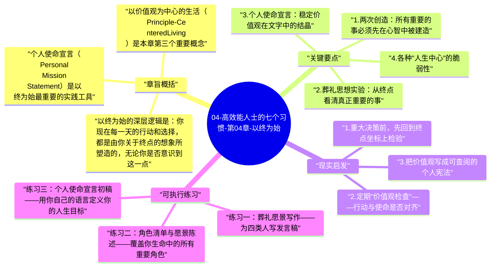

# 04-高效能人士的七个习惯-第04章-以终为始

第四章引入了七个习惯中最具哲学深度的一个——以终为始（Begin with the End in Mind）。这一章的核心命题是：所有事物都被创造两次，第一次是心智创造（Mental Creation），第二次是实体创造（Physical Creation）。无论是建一栋房子、写一本书、还是规划一段人生，它必须先在心智中被完整地构想，然后才能在现实中被创造出来。如果你跳过第一次创造直接进入行动，实体创造就会被各种情境压力、他人期待和短期冲动所左右，带你走向一个你并没有真正选择的方向。

柯维用一个强有力的思想实验来打开这一章：想象你出席了自己的葬礼。你的家人、朋友、同事和社区成员一个个上台，描述你是一个怎样的人，你的人生对他们意味着什么，你留下了什么。柯维问：你希望他们说什么？这个问题的力量在于它绕开了日常的功利计算，直接触碰到了一个人真正关心的东西。大多数人希望被描述为有爱的父母、可靠的朋友、正直的人、真正产生过贡献的人——而不是完成了多少项目、赚了多少钱或获得了多少头衔。葬礼思想实验是帮助人识别自己真实价值观的最有效的工具之一，因为它迫使人站在生命的终点往回看，而不是在每日的忙碌中身不由己地向前冲。

本章在七个习惯的序列中是一个关键转折点。习惯一（积极主动）告诉你，你有选择自己回应方式的能力；习惯二则要求你为这种选择提供一个方向——你选择回应，但你在为什么而选择？以终为始回答的正是这个问题。它把积极主动的能量引导向一个清晰的目的地，使得所有的选择不再是随机的、当下情绪驱动的，而是在一个更长时间视野中被验证为有意义的。

## 章旨概括

以终为始的深层逻辑是：你现在每一天的行动和选择，都是由你关于终点的想象所塑造的，无论你是否意识到这一点。如果你没有明确地定义自己的终点，你就默认地接受了别人或环境为你定义的终点——老板的期待、社会的标准、父母的未竟愿望、广告商所描绘的理想生活。以终为始是一种主权宣告：我要清楚地知道我在为什么而活，然后用我的每一天去检验自己是否真的在朝那个方向走。

个人使命宣言（Personal Mission Statement）是以终为始最重要的实践工具。柯维在这里借用了组织管理中使命宣言的概念，并把它带入了个人层面。一份真实的个人使命宣言不是激励口号的拼贴，而是对以下问题的深思熟虑的回答：我最核心的价值观是什么？我在生命中最想成为的那种人是什么样的？我希望在哪些关键角色上产生什么样的影响？当价值观相互冲突时，我的优先排序是什么？这些问题没有"正确答案"，但一个人越清楚自己对这些问题的回答，在面对复杂决策和诱惑时就越不容易迷失。

以价值观为中心的生活（Principle-Centered Living）是本章第三个重要概念。柯维列举了人们通常以什么为中心来运转自己的生活：以配偶为中心、以家庭为中心、以金钱为中心、以工作为中心、以享乐为中心、以宗教为中心……每一种中心都有其合理性，但每一种都有其局限性，因为它们都是外部的或相对的，都会随着环境变化而动摇。以原则为中心的生活，则是把那些经过时间检验、超越文化和个人偏好的基本规律作为核心——诚信、责任、成长、贡献——这些原则不会因为配偶生气、市场崩溃或机构政治的变化而改变，因此它们能提供最稳定的生活中心。

## 关键要点

### 1. 两次创造：所有重要的事必须先在心智中被建造

第一次创造是心智中的，第二次是物理现实中的，这个原则适用于一切有意义的事情。当一个建筑师绘制蓝图时，他实际上是在做第一次创造——如果蓝图有错误，修改蓝图的代价远远低于等到建筑竣工后再修改的代价。同样，一段人生、一段职业、一段婚姻，如果从未经过真正清醒的第一次创造，就会完全屈服于第二次创造中的各种偶然因素——机会出现了就抓住、压力来了就妥协、别人期待什么就做什么，最终在忙碌了许多年之后，发现自己站在一个从未真正选择过的地方。

第一次创造的质量决定了第二次创造的上限。一个在内心对某件事有清晰且真实的第一次创造的人，面对挫折时有更强的复原能力，因为他清楚地知道为什么要坚持；面对诱惑时有更强的抵御能力，因为他清楚地知道接受诱惑意味着什么代价；面对复杂抉择时有更清晰的判断框架，因为他有一个可以参照的内在标准。第一次创造不是一劳永逸的，但它是所有持久行动的起点。

### 2. 葬礼思想实验：从终点看清真正重要的事

葬礼思想实验之所以有效，是因为它创造了一种强制性的时间透视——它把你从当下的日常压力、社会期待和短期计算中拉出来，站到了生命的终点上往回看。从这个视角望去，很多平日里让人焦虑忙碌的事情突然变得无足轻重，而很多被推迟、被忽视、被视为"等忙完了再说"的事情，突然显示出了它们真正的分量。葬礼思想实验是一次强制性的价值观排序，它帮助人们分辨什么是真正重要的，什么只是紧急的。

这个练习的操作方式是：在一个安静的时间，认真地写下你希望葬礼上四类人所说的话——家人、朋友、同事或职业圈子、以及一个你参与其中的社群或组织。对每一类人，写出你最希望他们描述的你的品格特质、你对他们的贡献、以及你在他们生命中的位置。当你把这些写出来，你就拥有了一份非常私密却极为具体的价值观宣言——这是你真正在意的东西，而不是你觉得应该在意的东西。这份宣言可以成为你制定个人使命宣言的起点材料。

### 3. 个人使命宣言：稳定价值观在文字中的结晶

个人使命宣言的价值不在于它写得多优美、多激励人心，而在于它是否真实地捕捉到了你自己最深层的价值优先序。一份真实的使命宣言应该是私人的，因为每个人的价值排序是不同的；它应该是具体的，不能只是"成为更好的人"这类没有边界的表达；它应该是可以被实际检验的，你可以在面对真实决策时问自己：这个选择是否与我的使命宣言一致？如果经常出现不一致，要么是行为需要调整，要么是使命宣言本身需要重新思考。

写一份个人使命宣言不是一次坐下来就能完成的工作，通常需要数周甚至数月的反思与修改。柯维建议把它看作一个活的文件，随着人的成长和对自己理解的加深而持续演进。使命宣言的真正价值是日复一日地使用它作为决策的参照点，而不是把它写好后存在抽屉里供人参观。当一个人把个人使命宣言真正内化，它会开始影响他的日常决策，甚至在面临压力时自动浮现，提醒他自己真正站在哪里、要走向哪里。

### 4. 各种"人生中心"的脆弱性

柯维把不同类型的人生中心进行了系统的分析，揭示了每种中心的内在局限。以配偶或某段关系为中心的人，当这段关系遭遇危机，整个人生感和安全感就会崩塌；以金钱为中心的人，当市场波动或财富缩水，情绪状态会随之剧烈震荡，所有决策都被"是否有利于钱"所绑架；以工作为中心的人，当工作受挫或失去工作，会失去基本的身份认同；以他人认可为中心的人，每天生活在别人眼光的监视下，没有真正的内在稳定性。每一种中心都提供了某种程度的价值，但每一种都因为依附于相对的、可变的外部条件而带来脆弱性。

以原则为中心的生活之所以更稳定，不是因为它消除了生活的不确定性，而是因为原则本身不会因为外部条件的变化而改变。一个以原则为中心的人，当配偶生气时不需要失去自己的平衡，因为他的安全感不依附于配偶的情绪；当金融市场崩塌时不需要在恐慌中做出错误决策，因为他的自我价值感不依附于净资产；当工作出现挫折时不需要陷入身份认同危机，因为他的存在感来自于他一直在按照自己的价值观生活，而不是来自于外界对他成就的认可。

### 5. 以终为始应用于不同角色

柯维特别强调，我们每个人都同时扮演多个角色，而以终为始需要在每个角色维度上都得到落实。你是某人的孩子、某人的伴侣、某人的父母、某个组织的成员、某个社区的参与者、同时也是你自己的成长责任人。如果你只在职业角色上做了清晰的以终为始，却在家庭角色上完全随波逐流，你会在某一天发现，你在职业上建立了你想要的东西，却在家庭中错失了你本来最在乎的东西。

多角色的以终为始需要一种整合性的视野。个人使命宣言应该涵盖你生命中所有重要的角色，并且为每个角色定义清晰的愿景和价值承诺。这不是要把生活变成一个复杂的项目管理系统，而是要确保当你在某个角色上投入巨大时，你是在有意识地选择而不是无意识地忽视了其他同样重要的角色。以终为始的完整实践，最终是一种生命作为整体的整合性视野。

## 现实启发

### 1. 重大决策前，先回到终点坐标上检验

在面对任何真正重要的决策时——无论是职业转变、搬到新城市、终止一段关系，还是把大量资源投入某个目标——在开始分析利弊得失之前，先做一个终点检验。问自己：站在生命终点往回看，我会希望当初做了这个选择吗？这个选择是否与我对自己的愿景相符合？如果我在五年后回望这个时刻，我最可能后悔的是做了这件事，还是没有做这件事？这个终点视角不会替代具体的分析，但它能帮助你把决策从被当下压力驱动，提升到被长期价值导向。

### 2. 定期"价值观检查"——行动与使命是否对齐

以终为始不是一个一次性的规划工具，而是一个需要定期回访的参照系统。建议至少每季度一次，花一两个小时回顾：在过去这段时间里，我的时间和精力投入与我的核心价值观是否对齐？我是否在生命中真正重要的角色上做了足够的投资？有没有什么"紧急"的事物侵占了我本应给予"重要"事物的时间？这种定期回顾不是要制造罪疚感，而是一种导航校正——就像飞行员定期检查偏离航线并调整一样，人生的航行也需要定期的校正来防止在不知不觉中越走越偏。

### 3. 把价值观写成可查阅的个人宪法

当你把自己的核心价值观和生命愿景以文字形式固定下来，它就成为了一份可以在关键时刻查阅的个人宪法。这份文件不需要完美，可以从几句话开始，随着时间不断迭代。关键是当你面对复杂的诱惑或压力时，有一个已经在清醒状态下预先确立的内在标准可以参照，而不是在情绪激动或外部压力最大的时刻临时做价值判断——因为那种时刻的判断往往最不可靠。

## 可执行练习

### 练习一：葬礼愿景写作——为四类人写发言稿

找一个安静的时间，用至少一到两个小时，认真写下你葬礼上四类人的发言稿：最亲密的家庭成员、最好的朋友、工作中的同事或合作伙伴、以及你参与的某个社群成员。每份发言稿聚焦在以下几个问题上：你希望他们描述你的哪些品格特质？你希望他们提到你在他们生命中做过的哪些具体事情？你希望他们如何定义你的人生意义？写完后，把这四份发言稿并排放在一起，看看其中是否有共同的主题——那些反复出现的主题，就是你最深层的价值优先序，是你的个人使命宣言最重要的原材料。

### 练习二：角色清单与愿景陈述——覆盖你生命中的所有重要角色

列出你生命中目前承担的5到7个最重要的角色，可能包括：伴侣、父母、子女、职业人、朋友、社区成员、自我成长者。对每个角色，用两到三句话写下：在这个角色上，我在生命终点时最希望看到的是什么样的状态？这个理想状态与我现在的实际状态之间，最大的差距是什么？为了缩小这个差距，最重要的一步行动是什么？这个练习会把以终为始从一个抽象原则，变成覆盖你生命全局的具体地图。

### 练习三：个人使命宣言初稿——用你自己的语言定义你的人生目标

综合前两个练习的材料，尝试写出个人使命宣言的第一版草稿。这份草稿应该用你自己最自然的语言，包含以下内容：你最核心的两到三条价值原则，你在生命中最重要的两到三个角色及相应的承诺，以及你关于自己贡献的总体愿景。第一版不需要完美，只需要真实。写完后，把它放入一个你每周都能看到的地方，在接下来的三十天内，每隔几天重读一次，根据你的真实感受进行修改——哪些部分读起来感觉是真实的自己，哪些部分感觉是"应该说的话"？不断精炼，直到读起来感觉是在描述一个你真正想成为的、而不只是"应该成为"的自己。

---

## Mermaid 思维导图

### 图1

