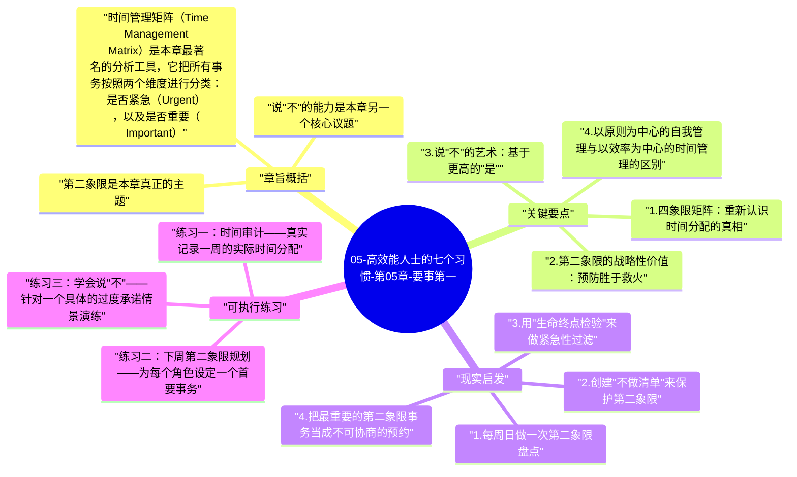

# 05-高效能人士的七个习惯-第05章-要事第一

第五章是习惯一和习惯二在时间与行动层面的实际落地。如果习惯一（积极主动）告诉你，你有能力选择自己的回应方式，习惯二（以终为始）告诉你，你应该为什么而选择，那么习惯三（要事第一）回答的是最后一个关键问题：你实际上应该把时间和精力放在哪里？柯维在这一章毫不遮掩地指出，绝大多数人的时间分配方式与他们声称的价值观之间，存在巨大的、通常没有被意识到的落差。我们都知道健康重要，但很少有人给锻炼安排了不可侵犯的时间；我们都知道重要关系需要投资，但"等有空了"的那天总是推迟到来；我们都知道长期能力建设至关重要，但为此投入的时间远少于我们处理紧急事务的时间。要事第一不是时间管理技巧，而是一个关于个人主权的严肃课题。

柯维认为，时间管理发展到现在经历了四代演变。第一代是备忘录和清单，记录事情以防遗漏；第二代是日历和时间安排，开始规划和准备；第三代是优先级排序和价值澄清，强调每天按重要性排序任务，这一代已经非常接近现代流行的生产力系统。但柯维认为第三代仍有根本性的局限：它过于专注于效率（把事情做对），而忽视了效能（做对的事情）。他提出第四代时间管理的核心不是管理时间，而是管理自己，根本原则是以原则和目标为中心进行整体规划，而不是以紧急性为中心进行碎片化的任务处理。

本章在全书中标志着私人成功部分的完结。习惯一建立了对自己反应的主权，习惯二建立了对自己方向的清晰度，习惯三则把这两种能力变成每天实际时间分配的现实。一个真正实践了这三个习惯的人，在面对他人或外部环境对自己时间的需求时，会有一个清晰的内在标准来决定"这件事值得我的时间吗"，而不是每天在外部压力的驱动下随波逐流。

## 章旨概括

时间管理矩阵（Time Management Matrix）是本章最著名的分析工具，它把所有事务按照两个维度进行分类：是否紧急（Urgent），以及是否重要（Important）。由此产生四个象限：第一象限是重要且紧急的事务，如危机处理、截止日期压力、紧急医疗需求；第二象限是重要但不紧急的事务，如长期规划、关系建设、预防性维护、能力提升；第三象限是紧急但不重要的事务，如某些会议、某些电话、某些他人的急切需求；第四象限是既不紧急也不重要的事务，如无意识的娱乐消遣和时间浪费行为。大多数人的时间分布呈现出一种可预测的失衡：在第一和第三象限花费了大量时间，以为自己在处理"重要"的事，实际上大量精力是被"紧急"而非"重要"所驱动，而第二象限——真正决定长期质量的地方——则长期投入严重不足。

第二象限是本章真正的主题。柯维把第二象限称为"高效能人士的心脏"。重要但不紧急的事务包括：维护身体健康（在它变成紧急医疗问题之前）、建立和深化重要的人际关系（在它们变成危机之前）、长期职业规划和能力建设（在当前能力变得过时之前）、制定清晰的个人使命和价值观（在大量错误决策已经付出代价之前）。这些事情之所以长期被忽视，恰恰是因为它们不会立刻产生危机——没人因为今天没去锻炼就立刻倒下，没人因为今天没有给重要朋友发条消息就立刻失去这段友谊。但这种不立刻的后果并不代表可以无限期延迟，它只代表代价在慢慢累积，直到某一天以更昂贵的形式爆发。

说"不"的能力是本章另一个核心议题。柯维指出，进入第二象限的唯一方式，是对第三象限和第四象限的事务说"不"。这很容易说，但极难做到，因为第三象限的事务往往带着他人的期待和社会压力——别人需要你帮忙，别人邀请你参加，别人希望你出席。对这些说"不"需要一种内在的安全感，这种安全感来自于清楚地知道你在为什么说"是"——你知道你把时间给了什么，你知道这个选择符合你的价值优先序，你不需要通过无休止地满足他人需求来证明自己的价值。这种内在安全感，正是私人成功三个习惯共同建立起来的基础。

## 关键要点

### 1. 四象限矩阵：重新认识时间分配的真相

在没有接触时间矩阵之前，大多数人对自己的时间分配有一个隐性的自我叙事：我很忙，都在做重要的事。时间矩阵的价值是强迫我们把这个叙事具体化，并检验它是否真实。一旦你开始追踪某一周的实际时间投入——哪些事真的是重要且紧急的，哪些是紧急但并不重要的，哪些是既不紧急也不重要却消耗了大量时间的——大多数人都会发现自己的实际时间分配与自己的价值宣称之间有令人不安的落差。这个发现不是为了制造罪疚感，而是让人第一次真实地看见问题所在。

时间矩阵的另一个深刻功能是帮助人区分忙碌与高效能。处于第一象限的人总是在扑火，总是在处理危机，这是高压但低效能的运作模式——因为很多第一象限的危机，其实是长期忽视第二象限积累的后果（生病是因为从没运动，关系危机是因为从没投资，职业危机是因为从没更新能力）。真正的高效能人士会努力扩大自己在第二象限的时间投入，这样随着时间推移，第一象限的危机会减少——因为他们在做预防性工作，而不是等问题爆发再救火。

### 2. 第二象限的战略性价值：预防胜于救火

第二象限思维的本质是时间视野的扩展。一个只看今天的人，几乎不可能优先处理第二象限的事务，因为第二象限的回报总是在未来才显现；而一个有五年、十年视野的人，会清楚地看见第二象限投资的复利效果。今天你多睡了一小时而没有去锻炼，明天看不出任何差别；但五年后看，坚持锻炼的人与从未锻炼的人，在体力、精力和健康资本上的差距是巨大的。同样的逻辑适用于关系建设、专业发展和个人成长——第二象限投资的复利需要时间才能显现，但正因如此，越早开始，复利效果越强大。

把第二象限真正落地的方法是使用以周为单位的规划（Weekly Planning）。柯维特别推荐以周而非以天为单位来规划重要事务，因为一周的时间窗口足够容纳生活中多个重要角色的事务，而以日为单位则太容易被当天的紧急事务所吞噬。每周开始时，先回顾自己的重要角色和当周的首要使命，再为每个角色中最重要的第二象限事务预留时间块，最后才处理其他紧急事务。这种顺序的规划方式，确保了重要的事情在一周中总能得到时间，而不是总被推到"下周"。

### 3. 说"不"的艺术：基于更高的"是"

柯维给"说不"做了一个重新定位：说不并不是拒绝，而是基于更高层次的"是"。当你清楚地知道自己在说"是"的是什么——你的健康、你的家庭、你的核心职业发展方向——拒绝那些会侵占这些时间的请求就变得容易多了，因为你不是在说"不"，而是在说"这件事不在我目前的首要使命范围内，我需要把这个时间给更重要的事情"。没有清晰的"是"，说"不"就变成了内疚和防御；有了清晰的"是"，说"不"就变成了一种负责任的自我管理。

在实践中，说"不"需要的不只是意志力，还需要一种特定的沟通方式。当有人邀请你参与一件第三象限的事务，你不需要冗长的解释，但需要清楚且诚实的回应："我目前有其他优先事务，无法参与这件事"是一个完整的句子，不需要道歉或过多说明。这种清晰回应不是冷漠，而是尊重——尊重对方的时间（让他们能够找到真正有时间和意愿参与的人），也尊重自己的时间（让自己能够专注于真正重要的事情）。

### 4. 以原则为中心的自我管理与以效率为中心的时间管理的区别

传统时间管理（包括绝大多数生产力工具和方法论）的核心逻辑是效率：如何在有限的时间内完成更多的事情。这个逻辑在第一象限是合理的，但在整体人生管理层面是误导性的，因为它假设"更多"总是更好，却没有追问"做更多什么"。你可以用最高效的方式完成第三象限的大量任务，每一件都做得又快又好，同时在第二象限的投入上几乎为零——这是极度高效但极度低效能的运作模式。

以原则为中心的自我管理的核心逻辑是效能：如何把时间和精力投入到真正重要的事情上，哪怕这意味着放弃某些看起来急迫的机会和要求。这种管理方式需要一种价值观层面的锚点——如果你不知道什么是真正重要的，你就无法做出这种权衡；如果你知道了，每一次对第三象限说"不"、对第二象限说"是"都会变得自然而然。这就是为什么习惯三必须建立在习惯二（以终为始，明确价值观）的基础上。

### 5. 委托授权：扩大影响圈的时间杠杆

柯维在本章还引入了委托授权（Delegation）的概念，把它定义为时间管理的重要杠杆之一。他区分了两种委托：指挥式委托（Gofer Delegation）和责任式委托（Stewardship Delegation）。指挥式委托是"你去做X"——你详细指定方法，被委托人只需执行；责任式委托是"我们一起明确期待的结果、可用的资源、以及问责机制，然后你来决定怎么做"——被委托人拥有完成任务的方法自主权，但对结果负责。柯维强调，真正有效的委托是责任式委托，它能够解放委托者的时间，同时发展被委托人的能力，这是P/PC原则在人际管理中的具体体现。

委托之所以重要，是因为人的时间和精力是有限的，而一个想要扩大自己的正面影响的人，必须学会借助他人的能力来实现超越个人能力上限的结果。但委托的前提是信任，而信任需要通过责任式委托的设计来建立——明确期待的结果、提供必要的资源支持、允许被委托人用自己的方式完成、在预定的时间点检查进度。这种模式对委托者和被委托人都更尊重、更有发展性，也更有可能产生持续的高质量结果。

## 现实启发

### 1. 每周日做一次第二象限盘点

每个周末花三十分钟，做三件事：第一，盘点刚刚过去的一周中，你在第二象限（重要但不紧急）的事务上实际投入了多少时间；第二，识别即将到来的一周中，你的重要角色（家人、工作核心项目、个人成长、关键关系）各有什么最重要的第二象限事务需要推进；第三，在日历上为这些事务预留具体的时间块，对这些时间块采用和重要会议同等的保护级别——不轻易挪动，不被紧急电话或临时请求随意占用。这个每周盘点的节奏，是第二象限思维从理论变成生活方式的核心实践。

### 2. 创建"不做清单"来保护第二象限

除了传统的待办清单，创建一个"不做清单"：列出那些在你过去一个月里消耗了大量时间、但回顾时发现几乎没有真实价值的活动——可能是某类低质量的会议、某类低价值的社交承诺、某类无意识的习惯性时间消耗。当你把这些活动明确写出来并决定不再参与，你就为第二象限的投资创造了真实的时间空间。很多人以为自己没有时间做第二象限的事，但实际上只要审视一下那些真正消耗了时间却没有产生对应价值的活动，往往会发现相当可观的时间缺口。

### 3. 用"生命终点检验"来做紧急性过滤

当一件紧急的事务突然出现并要求你立刻响应时，在之前用一秒钟问自己：五年后，这件事的结果对我的人生会有实质性影响吗？如果答案是否定的，它可能属于第三象限；如果答案是肯定的，它可能确实是第一象限。这个检验不是为了让你忽视所有紧急的事务，而是为了防止紧急感本身成为一种绑架——在情绪上，紧急的事情总是感觉比不紧急的事情更重要，但情绪感受与实际重要性并不总是一致的。每次做这个检验，你都在训练自己把重要性而不是紧急性作为时间分配的核心标准。

### 4. 把最重要的第二象限事务当成不可协商的预约

选出你生命中三到五件对长期结果最重要、但通常最容易被忽视的事务（通常是第二象限事务），把它们视为不可协商的定期预约，就像工作中最重要的会议一样。比如每周三次的锻炼、每月一次与核心导师或深度朋友的长谈、每周固定的深度学习时间。这些预约一旦设置，就不因其他事务的紧急性而取消——如果确实需要移位，立刻重新安排，而不是无限期推迟。对这些预约的保护程度，反映了你的价值观在实际行动上的真实优先级。

## 可执行练习

### 练习一：时间审计——真实记录一周的实际时间分配

用一张纸或一个应用，连续追踪你的时间使用整整五个工作日，每半小时记录一次你在做什么。周末整理这份记录，把每一项活动归入四象限之一。计算每个象限的实际时间百分比。然后对比你的期待：你认为自己在第二象限应该花多少时间？实际花了多少？差距有多大？这个审计往往是一次令人清醒的体验，它用真实的数据取代了关于自己时间使用的幻觉，让改进有了具体的基准线。

### 练习二：下周第二象限规划——为每个角色设定一个首要事务

回顾你生命中的5个重要角色（可参考习惯二的角色清单练习），为每个角色识别下周最重要的一件第二象限事务——那件如果你在下周做了，你会觉得这周对这个角色的投入是有意义的事。然后把这五件事写进你的日历，为每一件预留具体的时间。不需要每件事都花很长时间，关键是它们都得到了承诺的时间而不是被无限期地等待。这个规划在每周开始时重复，逐渐形成以第二象限为核心的周规划习惯。

### 练习三：学会说"不"——针对一个具体的过度承诺情景演练

识别你生活中目前存在的一个过度承诺情景——一个你其实不应该参与、但出于内疚、习惯或社会压力而接受的定期承诺。制定一个具体的退出或缩减计划，包括：你会如何向相关人解释这个变化（不需要过度解释，但需要诚实清晰）；你会把这部分时间重新分配给什么第二象限事务；以及你预计对方会有什么反应、你会如何处理这种反应。然后执行这个计划。这个练习的目的不是培养人变得自私，而是建立一种以价值观为基础的边界设定能力，这种能力是长期可持续高效能的关键条件。

---

## Mermaid 思维导图

### 图1

