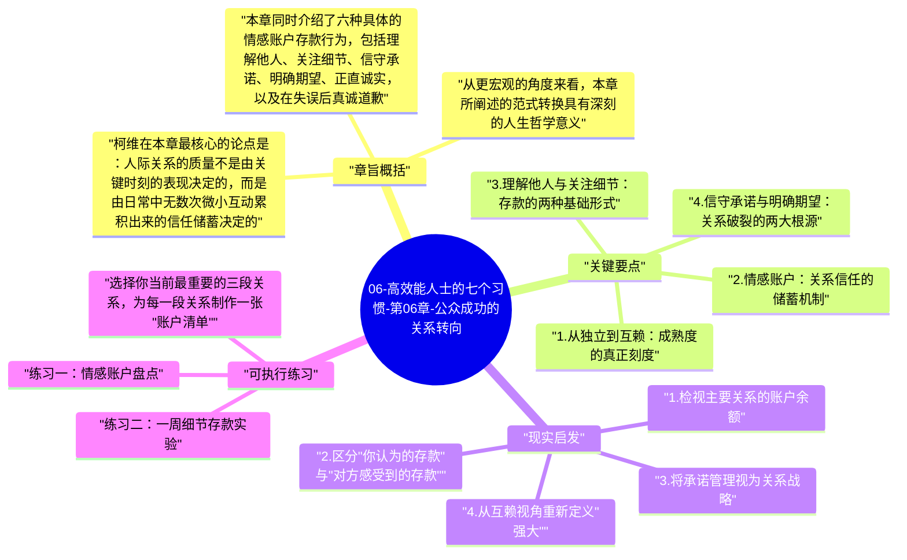

# 06-高效能人士的七个习惯-第06章-公众成功的关系转向

在柯维整体架构中，前三个习惯（主动积极、以终为始、要事第一）构建了个人独立的内在基础，而从第六章开始，全书进入截然不同的维度——公众成功的领域。这一章并不直接讲某个新习惯，而是作为过渡性的桥梁，帮助读者完成一次思维范式的根本转换：从"我能独立完成"到"我们能共同创造"。这种转换不是方向上的妥协，而是成熟度上的进阶。许多人在个人层面已经相当优秀，却在合作层面屡屡受挫，根本原因就在于他们把独立的思维模式原封不动地带入了需要互赖的关系中。

柯维在这一章提出了"情感账户"这一极具穿透力的比喻。他认为，所有人际关系都像一个银行账户，长期积累的信任是账户余额，而合作的质量取决于余额是否充足。每一次诚信兑现、每一次认真倾听、每一次无条件道歉，都是存款行为；而每一次言而无信、每一次不屑一顾、每一次傲慢评判，都是提款行为。当账户余额耗尽，任何形式的合作都会变得沉重、多疑、充满防御。理解这一点，才真正理解了公众成功的底层逻辑。

本章在全书中的位置是不可替代的。它提醒读者，后续三个习惯（双赢思维、知彼解己、统合综效）并非独立的沟通技巧，而是建立在这一关系转向的基础之上。没有情感账户余额的双赢谈判会流于形式，没有信任基础的移情聆听也会显得虚假。因此，这一章是公众成功的地基，是通往习惯四、五、六的真正入口。

## 章旨概括

柯维在本章最核心的论点是：人际关系的质量不是由关键时刻的表现决定的，而是由日常中无数次微小互动累积出来的信任储蓄决定的。这一观点颠覆了许多人对关系管理的直觉。大多数人认为，只要在重要时刻表现得体、表达真诚，关系就能维系；但柯维的研究指向完全相反的结论——真正的信任来自日积月累的可靠性，来自一贯的诚实与关怀，而非偶尔一次的道歉或感谢。

从更宏观的角度来看，本章所阐述的范式转换具有深刻的人生哲学意义。独立性是成熟的必要条件，但互赖性才是人类生存的本质形态。没有人能在完全孤立中实现真正的繁荣——我们的成就、意义感、快乐，都深深镶嵌在与他人的关系网络中。柯维并非在否定独立的价值，而是在指出：独立是进入成熟互赖的前提，而不是终点。一个在个人层面足够独立、稳固的人，才有能力在关系中给予而不是索取，合作而不是控制。

本章同时介绍了六种具体的情感账户存款行为，包括理解他人、关注细节、信守承诺、明确期望、正直诚实，以及在失误后真诚道歉。这六种行为构成了一套可操作的关系维护框架，而不仅仅是抽象的道德倡议。柯维特别强调，其中最具破坏力的提款行为，往往不是公开的冲突，而是持续的漠视与被动的不信任，这种隐性侵蚀最难被察觉，却最难修复。

## 关键要点

### 1. 从独立到互赖：成熟度的真正刻度

成熟度的成长路径在柯维的模型中分为三个阶段：依赖（Dependence）、独立（Independence）和互赖（Interdependence）。许多人把独立视为终极目标，认为"不需要任何人"是强大的标志。然而，柯维将这种理解界定为一种停滞，而非成熟。真正成熟的人能够独立处理自己的事务，同时也能清晰地认识到：在家庭、团队、社会等多维关系中，互赖不是软弱，而是更高层次的力量——它要求你既能贡献自我，又能接纳他人的贡献。

互赖范式要求人具备双重能力：一方面拥有足够稳定的自我，不会在关系中迷失或讨好；另一方面具备足够开放的姿态，能够真正看见他人的价值与需求。这两种能力缺一不可。缺少前者，人会在关系中变得依附、被动，将自我价值寄托于他人的认可；缺少后者，人会在关系中变得封闭、控制，用"独立"的名义拒绝真正的连接。只有当两者同时具备，真正意义上的合作才能发生，公众成功才有其坚实根基。

### 2. 情感账户：关系信任的储蓄机制

柯维的情感账户比喻之所以有力，是因为它将抽象的"信任"转化为可以日常操作的行为框架。账户余额充足时，合作双方具备足够的容错空间——即使出现误解或摩擦，也能迅速修复，因为有充足的信任储备作为缓冲。相反，当账户余额长期处于透支状态，任何一次小摩擦都可能引发不成比例的激烈反应，因为此时双方都处于高度防御状态，随时准备应对下一次伤害，合作的弹性消失殆尽。

情感账户的存款不能一次性完成。一次重大的诚信表现可以带来显著的余额提升，但无法替代长期小额积累的深层效果。更关键的是，存款和提款的行为认定权在对方手中，而不在自己。你认为是存款的行为（比如给对方一次"为他好"的建议），对方可能感受为一次提款（觉得你不尊重他的判断）。这要求我们在维护关系时，必须保持对对方真实感受的高度敏感，而不仅仅按照自己的意图和标准行事。

### 3. 理解他人与关注细节：存款的两种基础形式

第一种核心存款行为是理解他人（Understanding the Individual）。柯维认为，真正的理解意味着将对方视为独一无二的个体，而非某一类人的代表。许多人在关系中习惯性地投射自己的需求与偏好——他们给予对方他们自己想要得到的东西，而不是对方真正需要的东西。这种出于好意的错位，在关系中积累的不是存款，而是隐性的距离感，久而久之形成一种"我们是两个世界的人"的疏离。

第二种是关注细节（Attending to Little Things）。许多人等待"重要时刻"来修复或强化关系，却忽视了关系真正是在无数细节中被滋养或侵蚀的。一句认真的问候、一个被记住的细节、一次不必要但及时的关心——这些小事在情感账户中的累积效应，往往远超一次正式的、刻意的关系修复。柯维在这里揭示了一个反直觉的真相：关系最重要的不是仪式感，而是日常感，是那种"你总是在那里"的稳定存在。

### 4. 信守承诺与明确期望：关系破裂的两大根源

在所有情感账户的存款行为中，柯维特别强调信守承诺（Keeping Commitments）的分量。一次承诺的违背，往往带来数倍于存款的提款效果，而且这种提款往往很难通过后续的补救完全弥补。承诺是关系信任的核心货币——你言出必行的能力，是对方判断是否可以依赖你的主要依据。因此，不轻易许诺、但许诺必兑现，是建立高情感账户余额的最重要原则之一。

明确期望（Clarifying Expectations）则是另一种常被忽视的存款行为。很多关系中的失望与冲突，并非来自恶意，而是来自双方对期望的假设存在偏差。当一方认为某件事"理所当然应该这么做"，另一方却从未被告知这个期望时，矛盾的产生不可避免，而且双方都可能真诚地认为自己是受害者。柯维建议在任何重要关系进入深度合作之前，主动对期望进行清晰沟通，而不是等到期望落空时再去追责，因为那时修复的成本将远高于事先澄清的代价。

### 5. 正直诚实与真诚道歉：账户中的高价值存款

正直（Integrity）在柯维的体系中不仅仅是道德层面的要求，更是关系层面的战略选择。一个人在背后评价朋友、对不同的人讲不同版本的故事、在方便时遵守承诺、在困难时找理由逃避——这些行为即使从未被当事人直接发现，也会以某种方式渗透到关系的氛围中，积累出一种难以名状的不安全感。相反，一个言行一致、背后表里如一的人，会自然地散发出一种可以被信任的气场，这种气场是所有深层合作的先决条件。

真诚道歉（Apologizing Sincerely）则是情感账户的修复机制，也是最容易被误用的一种工具。柯维明确区分了真诚道歉与敷衍道歉的本质差别：真诚道歉要求承担责任、认清伤害、表达后悔，并给出具体的改变方向；而非简单地说"对不起我以后会注意"然后重复同样的行为。一次真诚、彻底的道歉可以将透支的账户重新拉回正数；而一次敷衍、逃避责任的道歉则会在已有的伤害上再补一刀，进一步损耗本就脆弱的账户余额。

### 6. 公众成功的真正前提：成为值得信赖的人

柯维在本章最终落脚的核心洞察是：公众成功的真正前提，不是学会更多沟通技巧，而是先成为一个值得信赖的人。所有人际影响力的源头都在于品格，而非技术。如果一个人的情感账户持续透支，那么他的双赢提议会显得虚伪，他的移情聆听会显得是在表演，他所有精心设计的沟通策略都会因为底层信任的缺失而失效，甚至适得其反。

这一洞察的实践含义是：在提升人际效能之前，必须先审视自己是否在日常关系中持续地进行存款行为。每一次守信、每一次真正理解他人、每一次对细节的关注，都是在为未来的公众成功打地基。柯维认为，这个地基工程没有捷径——它需要时间、需要一贯性、需要将"我如何对待他人"视为自我修炼的重要组成部分，而非仅仅在"需要合作"时才临时开启的模式。真正的信任，是用岁月和行动砌成的，不可速成。

## 现实启发

### 1. 检视主要关系的账户余额

花几分钟回想你生活中最重要的三段关系——可以是伴侣、搭档、上司或挚友。诚实地评估每一段关系的情感账户余额：你们之间是否有足够的信任缓冲来应对下一次误解或摩擦？如果余额不充足，是什么具体的存款行为或提款行为造成了这一状态？这种清醒的自我审视是改变关系质量的起点，它要求你摆脱"对方也有问题"的防御性解释，转而聚焦在"我能做什么来补充账户"这个可控的问题上。

### 2. 区分"你认为的存款"与"对方感受到的存款"

在重要关系中，主动询问对方"什么对你来说最重要"，是一种极其有价值的存款行为，同时也能帮助你避免投射式的好意。你认为的体贴，可能正是对方最不需要的干涉；你认为的支持，可能让对方感到被低估了的能力。真正有效的存款行为，要从对方的内心出发，而不是从你对"关系应该如何"的预设出发。理解这一点之后，你会发现高质量的关系从来不是单方面"付出了很多"，而是"付出了对方真正需要的东西"。

### 3. 将承诺管理视为关系战略

重新审视你在主要关系和团队协作中的承诺模式。你是否习惯性地做出超过自己能力的承诺，然后以"尽力了"为由为未兑现找理由？还是你过于保守、从不主动承诺，以至于对方无法形成对你可靠性的稳定认知？找到属于你的承诺失衡点，然后刻意调整——少承诺、多兑现，将会对你的情感账户余额产生深远的积极影响，这比任何一次漂亮的表态都更具说服力。

### 4. 从互赖视角重新定义"强大"

如果你长期认同"不依赖任何人"是强大的标志，这一章值得你认真质疑这一信念。真正的强大不是不需要他人，而是能够在不失去自我的前提下，真诚地依赖他人、也被他人依赖。检查一下你是否在某些重要关系中，因为不愿显示"软弱"而拒绝了本可以深化合作的机会，或因为过度强调独立而在无意间推远了愿意接近你的人。互赖不是放弃独立，而是在独立的基础上选择真正的连接——这需要比独立本身更大的勇气和成熟。

## 可执行练习

**练习一：情感账户盘点**

选择你当前最重要的三段关系，为每一段关系制作一张"账户清单"。在纸上分两栏，左侧写出最近三个月里你做过的可能构成存款的具体行为，右侧写出可能构成提款的行为。完成后，不要急于自我辩护，而是真正坐在对方的位置上问自己：如果我是他/她，我会感受到账户余额是充足还是透支？这个练习的目的不是自我批评，而是建立对关系实际状态的清醒认知，从而确定下一步需要重点投入的存款方向。

**练习二：一周细节存款实验**

在接下来的七天里，每天在一段重要关系中有意识地做一件"小但具体"的事情——记住并提及对方昨天说的某件小事、主动询问对方正在面对的压力、在对方不知情的情况下帮助解决一件小麻烦。不要将这些行为告知对方，也不要期待即时回报。七天之后，回顾这段关系的氛围是否有任何细微的变化，并记录下你自己内心的感受变化。这个练习帮助你亲身验证"细节决定信任"的原理，并养成将存款行为嵌入日常节奏的习惯，而非等待"重要时刻"才出手。

**练习三：承诺清单审核**

花一个小时，把你当前在各种关系和角色中已经做出但尚未完全兑现的承诺一一列出来。对每一条承诺，做出明确判断：是否仍然可以兑现？如果不能，是否已经主动告知对方并协商新的安排？对于长期悬置的承诺，主动提出沟通，要么给出明确的兑现计划，要么诚实承认无法兑现并诚恳道歉。这个练习可能会令你感到不安，但它是清理情感账户隐性债务、重建可靠性信誉的最直接方式，也是恢复关系透明度的重要一步。

---

## Mermaid 思维导图

### 图1

