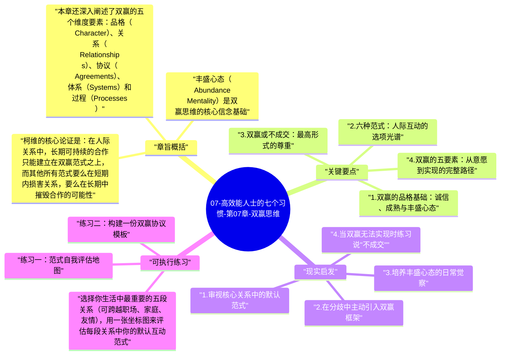

# 07-高效能人士的七个习惯-第07章-双赢思维

习惯四是七个习惯中最容易被误解的一个。"双赢"这两个字在日常语境中已经被过度消费，许多人将它理解为"各退一步"或"你好我好大家好"的圆滑处世之道。然而柯维所阐述的双赢思维，恰恰与这种表面上的和气截然不同——它不是讨好，不是软弱，更不是牺牲原则来换取暂时的和睦。真正的双赢，是一种建立在勇气（Courage）和体谅（Consideration）双重基础上的思维范式，它要求你既能清晰表达自己的需求与立场，又能真正关心对方的利益与感受，在这两者之间寻找真实可行的共同方案。

柯维在本章系统分析了六种人际互动的范式：双赢（Win/Win）、赢/输（Win/Lose）、输/赢（Lose/Win）、输/输（Lose/Lose）、只赢（Win）、以及双赢或不成交（Win/Win or No Deal）。这六种范式不仅仅是谈判策略，更是一个人内在信念体系的外化。你在与他人互动时所默认采用的范式，往往根植于你对"资源是否充足"的基本假设，以及你对"竞争与合作"的深层信念。柯维认为，改变范式必须从内心出发，而不能仅仅是在行为层面做出调整。

在全书架构中，本章承接了第六章的关系基础，向前推进到具体的互动层面。情感账户余额是双赢能否实现的前提条件——没有信任作为底层，双赢很快会退化为策略性让步，而非真正的合作创造。同时，本章也为后续的知彼解己（习惯五）和统合综效（习惯六）奠定了方向性基础：理解他人和协同创造，都以双赢思维为前提。

## 章旨概括

柯维的核心论证是：在人际关系中，长期可持续的合作只能建立在双赢范式之上，而其他所有范式要么在短期内损害关系，要么在长期中摧毁合作的可能性。赢/输思维固然可以在某次谈判中获得表面胜利，但它会不断消耗对方的信任与投入意愿，最终导致合作关系的瓦解。输/赢思维虽然表面上维持了和谐，却是以压抑自我、积累怨恨为代价，迟早会以更具破坏性的方式爆发。输/输则是两败俱伤，通常出现在双方都以"让对方也输"为目标的对抗情境中。

丰盛心态（Abundance Mentality）是双赢思维的核心信念基础。柯维将"匮乏心态"（Scarcity Mentality）界定为一种根深蒂固的内心信念，认为世界上的资源、机会、荣誉和爱都是有限的——别人的成功意味着你的失败，别人的赞誉意味着你的相对贬低。带着匮乏心态进入人际互动的人，无法真正实践双赢，因为他们在内心深处始终将任何合作视为零和游戏。只有相信"有足够多的东西让所有人受益"，才能在互动中自然地寻求共赢，而不是防御性地保护自己的那一份。

本章还深入阐述了双赢的五个维度要素：品格（Character）、关系（Relationships）、协议（Agreements）、体系（Systems）和过程（Processes）。这五个要素缺一不可，共同构成双赢从内在意愿到外部实现的完整路径。品格是出发点，关系是土壤，协议是果实，而体系和过程则是确保果实持续生长的环境支撑。

## 关键要点

### 1. 双赢的品格基础：诚信、成熟与丰盛心态

双赢的实现首先依赖于品格层面的三个基础：诚信（Integrity）、成熟（Maturity）和丰盛心态（Abundance Mentality）。诚信是指你对自己价值观的忠诚——你清楚自己真正在乎什么，并能在压力下坚守而不是随波逐流。没有诚信的双赢很快会变成一种表演，因为当真正的分歧出现时，你要么屈服于压力妥协（变成输/赢），要么以攻击性方式保护自己（变成赢/输）。

成熟则是柯维定义中最精微的品格要素，他将其界定为"在表达自身感受和信念时，同时体恤他人感受和信念的能力"。成熟不是压抑自我，也不是放弃立场，而是在清晰表达自我主张的同时，保持对他人现实的真诚好奇。这种能力非常稀缺，它要求一个人既有足够强大的内在安全感，不依赖他人的认可；又有足够开放的心态，不把"被反驳"等同于"被否定"。

### 2. 六种范式：人际互动的选项光谱

赢/输（Win/Lose）是最常见的竞争性范式，也是绝大多数人在教育和社会化过程中被训练出来的默认模式。在学校的排名体系、职场的晋升竞争、体育比赛的胜负文化中，我们都在反复强化一个信念：成功意味着比别人更好。这种范式在某些场合有其存在的合理性，比如单次商业谈判或体育竞技；但当它被带入需要长期维系的合作关系（伴侣、团队、合作伙伴）中时，它会以缓慢但不可逆的方式腐蚀信任的基础。

输/赢（Lose/Win）常被误解为一种谦逊或体贴的表现，但柯维对其有深刻的批判。习惯性输/赢的人通常内心充满未被表达的需求和压抑的愤怒，他们以牺牲自我为代价换取表面和谐，但这种代价最终会以失望、疏离、甚至突然性的攻击性爆发的形式呈现出来。更隐蔽的危险在于：长期输/赢的关系会让对方丧失真正的成长空间，因为他们从来没有机会面对真实的反馈与边界。

### 3. 双赢或不成交：最高形式的尊重

在所有双赢变体中，"双赢或不成交"（Win/Win or No Deal）是柯维最推崇的一种形式，也是最需要勇气的一种选择。它意味着：如果我们找不到真正让双方都受益的方案，那么我们宁可不合作，也不愿意接受一个让任何一方受损的协议。这种立场在短期内可能看起来是放弃机会，但从长期来看，它是对关系质量的最高形式的尊重——因为它拒绝了所有以关系损耗为代价的勉强合作。

在具体情境中，"不成交"需要极大的内在安全感。当一个人的经济状况岌岌可危，或者急于寻求认可时，"不成交"几乎是不可能的选择，因为内心的匮乏感会迫使他接受任何看起来"还不错"的条件。这再一次揭示了品格基础的重要性：只有当一个人的内在足够稳固，他才能在谈判桌上真正自由地选择——包括选择离开。

### 4. 双赢的五要素：从意愿到实现的完整路径

品格（Character）是双赢的出发点，它决定了一个人是否真正具备追求双赢的内在意愿，而不只是在策略上模拟双赢的语言。关系（Relationships）是双赢的土壤，它由情感账户余额决定。高余额的关系使双方在分歧中更容易信任彼此的动机；低余额的关系则使任何双赢提议都容易被解读为隐藏的操控意图。

协议（Agreements）是双赢从意愿落地为现实的工具。柯维特别强调，好的双赢协议必须包含五个要素：期望的结果（Desired Results）、行动指南（Guidelines）、可用资源（Resources）、问责标准（Accountability）以及评估奖惩（Consequences）。这五个要素的清晰化，能够将模糊的善意转化为可执行的承诺，避免事后因理解偏差而引发的分歧。体系（Systems）和过程（Processes）则确保双赢不是一次性的偶然，而是可以持续发生的结构性安排。

### 5. 匮乏心态与丰盛心态：范式背后的深层信念

匮乏心态是阻碍双赢最深层的心理障碍。持有匮乏心态的人对他人的成功会产生一种无意识的威胁感——当同事获得晋升时，他感到的不是欣慰而是隐隐的不安；当朋友获得赞赏时，他第一反应是反思自己是否被比下去。这种心态使得真正的双赢几乎不可能实现，因为它把所有合作都扭曲成一场内心深处的竞争。

丰盛心态则建立在一个相反的信念上：世界上有足够多的资源、机会和爱，别人的收获不会减少我的。拥有丰盛心态的人能够真诚地为他人的成功感到高兴，因为他们的自我价值感不依赖于相对排名。柯维认为，丰盛心态是一种选择，而非一种天赋；它可以通过持续地以原则为中心（而非以名利或他人认可为中心）来逐渐培养。当一个人越来越清楚自己真正是谁、真正在乎什么，他就越来越不需要从别人的失败中获得安慰。

### 6. 勇气与体谅的平衡：双赢的行为标志

双赢在行为层面表现为勇气（Courage）与体谅（Consideration）的同时高水平。许多人的默认行为模式是其中之一偏高另一偏低：高勇气低体谅产生赢/输；低勇气高体谅产生输/赢；两者皆低产生输/输；而只有两者皆高，才能产生真正的双赢。这个框架帮助我们精确诊断自己在具体关系中的行为模式，以及改进方向。

在实际对话中，双赢表现为一种特定的沟通节奏：首先花时间真正理解对方的需求、关切和立场（体谅），然后清晰、直接地表达自己的需求与立场（勇气），最后在这两套真实信息的基础上，探索是否存在一个真正让双方都更好的方案。这个过程不依赖妥协，而依赖创造——它要求双方共同构建一个比任何单方原始方案都更优越的新方案。

## 现实启发

### 1. 审视核心关系中的默认范式

花时间回顾你最重要的几段关系——职场搭档、家庭成员、长期合作者——诚实地辨识你在这些关系中的默认互动范式是哪一种。是否有某些关系长期处于赢/输的紧绷状态，让你赢得了局部优势却付出了信任代价？是否有某些关系让你持续处于输/赢的委屈中，以沉默的牺牲换取表面的平静？识别这些模式是改变的起点，因为范式层面的问题无法用技巧层面的调整来解决。

### 2. 在分歧中主动引入双赢框架

当下次谈判或分歧发生时，尝试在开场白中明确表达双赢意图："我希望我们能找到一个对双方都真正有价值的方案，而不仅仅是各自妥协。为了做到这一点，我想先完整了解你的关切和需求，然后再分享我的。"这个简单的框架转换，往往能够立即改变对话的氛围——从防御性的立场对抗，转向合作性的共同探索，让双方都更愿意真实地表达自己的核心需求。

### 3. 培养丰盛心态的日常觉察

每当你注意到自己对他人的成功产生威胁感时，把这个感受当作一面镜子而非一个攻击对象。问自己：这种威胁感的底层假设是什么？我在担心什么会被减少或失去？通常，匮乏感的根源在于将自我价值锚定在外部比较上。尝试将关注点从"我是否比别人更好"转向"我是否在按照自己的价值观成长"，这种锚点的迁移是培养丰盛心态最深层的路径。

### 4. 当双赢无法实现时练习说"不成交"

在下一次你明知对方条件无法令双方真正受益时，练习清晰而不带攻击性地提出暂缓或终止：不是因为对方有问题，而是因为现在的条件不足以让合作真正成功。这种做法在短期内可能让人不舒服，但它会为你积累一种极为珍贵的信誉——人们知道，当你说"是"的时候，那是真正的"是"，而不是压力下的妥协。

## 可执行练习

**练习一：范式自我评估地图**

选择你生活中最重要的五段关系（可跨越职场、家庭、友情），用一张坐标图来评估每段关系中你的默认互动范式。横轴代表"对他人的体谅程度"（低到高），纵轴代表"表达自身需求的勇气"（低到高）。将每段关系标注在这张图上：落在左下角的是输/输，左上角是赢/输，右下角是输/赢，右上角是双赢。完成后，针对每一段目前不在右上角的关系，思考是什么具体因素（信念、行为习惯、情境压力）导致了这种偏移，以及哪一个方向的改进最为紧迫。

**练习二：构建一份双赢协议模板**

选择你当前正在进行的一段重要合作，尝试按照柯维的五要素框架，为这段合作草拟一份明确的双赢协议：清晰定义双方期望的结果、行动的边界与原则、双方可调用的资源、如何定期评估进展、以及不同结果对应的奖惩安排。将这份草稿分享给对方，邀请他们修改补充。这个过程本身就是一次高质量的双赢对话——它将模糊的善意变成了透明的结构，大幅降低未来因理解偏差引发摩擦的概率。

**练习三：匮乏心态侦察日志**

在接下来的两周内，每天记录一次你观察到自己内心出现匮乏心态反应的时刻——比如对同事升职的羡慕、对他人获得赞美时的不安、对资源被分享时的抵触。对每一条记录，写下这个感受背后的假设（"我担心如果他成功，我会……"），然后写下一个基于丰盛心态的重新解读（"他的成功证明了……在这个环境中是可能的，我也可以……"）。这个练习不是为了消除负面情绪，而是为了逐渐拓宽你对"别人好"与"我好"之间关系的认知，让丰盛心态成为一种可以训练的思维习惯。

---

## Mermaid 思维导图

### 图1

