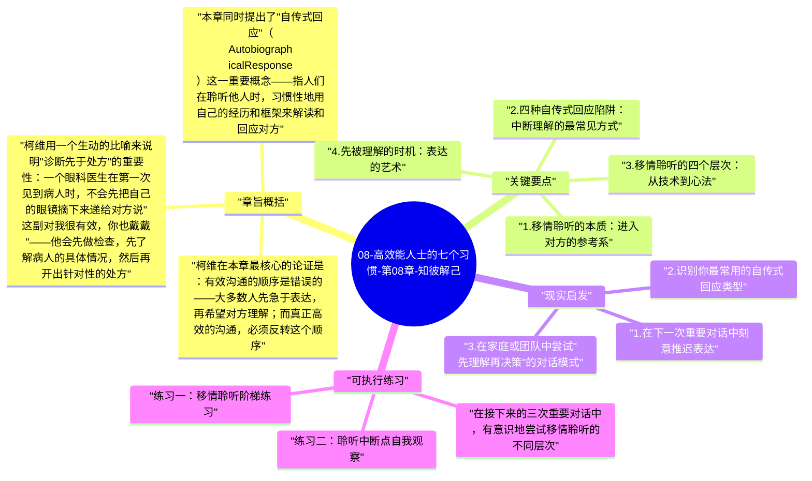

# 08-高效能人士的七个习惯-第08章-知彼解己

习惯五是七个习惯中对日常生活影响最直接、最深远的一个，同时也是最难真正践行的一个。柯维将其命名为"先寻求理解，再寻求被理解"（Seek First to Understand, Then to Be Understood），这八个字看似简单，却与绝大多数人的本能反应截然相反。在任何对话中，我们的本能是先表达——先辩解、先说明、先纠正、先给建议——因为我们假设自己已经理解了对方，而对方需要的是我们的见解和回应。柯维对这个假设发出了根本性的挑战：你真的理解了吗？

真正的理解，在柯维的定义中，是一种需要专门训练的深层能力——移情聆听（Empathic Listening）。它不是等待对方说完话再思考自己的回应，而是以真正进入对方参考系为目标的全然倾听。柯维指出，多数人在聆听时处于以下四个层次之一：忽视（Ignoring）、假装聆听（Pretending）、选择性聆听（Selective Listening）和专注聆听（Attentive Listening）。这四种都是"从自己的参考系出发"的聆听方式，唯有第五层——移情聆听——才是真正进入对方内心世界的聆听。而这一层，大多数人几乎从未到达过。

在全书中，本章与双赢思维（习惯四）和统合综效（习惯六）形成一个紧密的三角：没有真正的理解，双赢无法落地，因为你不知道对方真正在乎什么；没有移情聆听，统合综效更无从谈起，因为协同创造需要真正看见彼此的差异与贡献。习惯五是人际互动中最重要的信息获取工具，也是建立深度信任的最有效路径。

## 章旨概括

柯维在本章最核心的论证是：有效沟通的顺序是错误的——大多数人先急于表达，再希望对方理解；而真正高效的沟通，必须反转这个顺序。当你先花足够的时间真正理解对方，让对方感受到被理解，两件事会同时发生：其一，对方的防御感会显著降低，心理上的安全感会打开，使真正的信息交流成为可能；其二，你自己也会因为真正理解了对方的处境和需求，而大幅提升后续表达的精准度和说服力。这是一个正向循环，但它需要先打破"我要先说"的本能冲动。

柯维用一个生动的比喻来说明"诊断先于处方"的重要性：一个眼科医生在第一次见到病人时，不会先把自己的眼镜摘下来递给对方说"这副对我很有效，你也戴戴"——他会先做检查，先了解病人的具体情况，然后再开出针对性的处方。但在人际沟通中，我们做的恰恰是这种荒唐的事情：我们不了解对方真正面临的问题，就急着给出"对我有效的建议"。这种基于自我参考系的建议，不仅无效，还会让对方感到不被理解，进一步关闭沟通的大门。

本章同时提出了"自传式回应"（Autobiographical Response）这一重要概念——指人们在聆听他人时，习惯性地用自己的经历和框架来解读和回应对方。柯维识别出四种常见的自传式回应陷阱：评判（Evaluate，同意或不同意）、追问（Probe，从自己的角度提问）、建议（Advise，根据自己经验给解决方案）、诠释（Interpret，用自己的动机解读对方的动机）。这四种回应方式都会中断真正的理解，将对话从"我在进入你的世界"切换回"我要把你拉进我的世界"。

## 关键要点

### 1. 移情聆听的本质：进入对方的参考系

移情聆听的核心不是技术，而是一种根本的意图转换：从"我要理解这个情况以便做出回应"，转向"我要理解这个人是如何体验这个情况的"。这一意图的转换，决定了你聆听时的整个内心姿态。当你真正抱持着"让我进入你的世界"的意图，你的注意力会自然地指向对方话语背后的情感、未被说出的担忧、以及他们看待问题的独特角度——而不仅仅是表面的事实陈述。

柯维明确说明，移情聆听需要在身体语言、情感和智识三个层面同时与对方建立联结。它不是被动地点头，也不是机械地复述对方说的话（那是另一种技术性套路），而是真正暂时搁置自己的判断和议程，全身心投入到理解对方的参考系中。这需要消耗真实的心理能量，需要内在的安全感（因为真正聆听意味着你可能被对方的现实改变），也需要真正的关心——不是表演性的关心，而是真诚想要理解另一个人的意愿。

### 2. 四种自传式回应陷阱：中断理解的最常见方式

评判（Evaluate）是最常见的聆听陷阱之一。当对方分享一件事或表达一个想法时，我们内心立刻进入"我同意还是不同意"的评判模式，并将这个评判立即反馈给对方。这会立即将对话从"你的表达空间"切换成"我的判断空间"，对方感受到的不是被理解，而是被审判，防御感随之升起。

追问（Probe）表面上显得关心，实际上是从自己的议程出发提问，引导对话朝自己感兴趣的方向走。建议（Advise）则是最广泛被使用、也最广泛被批评的一种回应方式：对方还没说完，我们已经开始思考解决方案了。诠释（Interpret）则是将对方的行为和动机用自己的心理模型来解读——"我知道你为什么这么做，因为你其实是……"。这四种方式都有一个共同点：它们把对方的体验拉入了我们自己的参考系，而非我们进入对方的参考系。

### 3. 移情聆听的四个层次：从技术到心法

柯维描述了移情聆听可以操作的四个由浅入深的层次。第一层是复述内容（Mimic Content）——将对方说的话用自己的话重复一遍，这是最基础的聆听反馈，能够让对方感受到被听到，但深度有限。第二层是重述语意（Rephrase the Content）——用自己的语言来表达对方话语的核心意思，而不是逐字复述，这需要更深层的信息处理。

第三层是反映感受（Reflect Feeling）——不仅仅关注对方说了什么，还关注他们在说这些话时的情感状态。"你听起来很沮丧"、"这件事似乎让你很受伤"——这类回应直接触及对方的情感现实，比内容层面的理解更深、更能建立信任。第四层也是最高层次是既重述语意又反映感受——同时捕捉对方话语的事实内容和情感内容，并以整合的方式反馈给对方。到达这一层次的聆听，往往会让对方产生一种深度被理解的释然感，大幅降低防御，打开真正开放的对话空间。

### 4. 先被理解的时机：表达的艺术

柯维在本章的后半部分转向了"再寻求被理解"的部分，强调了表达的时机同样至关重要。有了移情聆听打下的基础，你的表达将在一个完全不同的氛围中被接收——对方不再处于防御状态，而是已经感受到被理解，因此更具开放性去真正倾听你说的话。这个时机点，是表达最有效的窗口。

柯维将希腊人对此的理解引入分析：希腊人将个人可信度分为三个维度——理性（Logos，言语与逻辑）、情感（Pathos，情感连结）和品格（Ethos，个人可信度）。在现代沟通中，Ethos 和 Pathos 往往比 Logos 更先发生作用：对方首先感受到"这个人是否真正在乎我"（Ethos），然后感受到"我们之间是否有真实的情感连结"（Pathos），最后才能真正听进你的逻辑（Logos）。移情聆听建立的，正是 Ethos 和 Pathos 的基础，使你的 Logos 能够真正被听见。

### 5. 聆听是最高级的人际礼物

柯维有一个深刻的洞察：在信息极度过载的现代世界，真正被聆听是一种极度稀缺的体验。大多数人在生命中几乎从未感受过被完全、不加评判、不被转移话题地深度聆听。当一个人给予另一个人这种体验时，它产生的心理效应是深远的——它不仅建立信任，还给予对方一种被承认（acknowledged）的感受，一种"我的存在和体验是真实且重要的"的确认。

这种体验的稀缺性，使得真正擅长移情聆听的人在任何关系中都拥有深不可测的影响力——不是操控性的影响力，而是那种来自深度信任的自然吸引力。柯维特别指出，许多咨询师、领导者和教育者之所以拥有非同寻常的影响力，并非因为他们的建议特别高明，而是因为他们真正做到了让人感受到被理解——这本身就已经是帮助的核心，因为真正的理解往往会激活人自身解决问题的资源。

### 6. 聆听习惯与自我认知的深层联结

柯维的一个隐藏洞察是：一个人的聆听能力，与他的自我认知水平高度相关。内在安全感不足的人很难真正聆听，因为他们时刻处于一种防御模式——对方的任何陈述都可能被解读为对自己的隐性攻击或挑战，必须立即给予回应和防卫。相反，内在安全感足够的人，能够以好奇而非防御的姿态进入他人的世界，因为他们知道自己不会因为"理解了对方的现实"而失去自己。

这意味着，提升聆听能力的根本路径，不仅仅是练习具体的聆听技术，更是深化自我认知、加固内在的价值稳定性。当一个人越来越清楚自己是谁、越来越不依赖外部认可来维持自我感，他就越来越能够在对话中保持真正的临在（Presence）——而真正的临在，正是移情聆听的基础。

## 现实启发

### 1. 在下一次重要对话中刻意推迟表达

选择一次即将到来的重要对话——可能是一次与家人的矛盾沟通、一次与员工的反馈会谈，或一次与合作伙伴的分歧讨论。在对话开始时，给自己设定一个内部规则：在对方说完并感受到被理解之前，我不会表达我的观点。不是刻意延迟，而是将"真正理解对方"作为前提条件。完成后，观察这次对话与你平时模式相比，氛围和结果上有何不同。

### 2. 识别你最常用的自传式回应类型

回顾最近一周你在关键对话中的聆听行为：你最常落入哪一种自传式回应陷阱——评判、追问、建议还是诠释？通常，每个人都有一种相对固定的主导模式，这种模式往往与个人性格和价值观有关（比如，高成就导向的人容易习惯性给建议；分析型的人容易习惯追问；评判型的人容易立即表态）。识别自己的主导陷阱，是打破它的第一步。

### 3. 在家庭或团队中尝试"先理解再决策"的对话模式

在下一次家庭决策或团队讨论中，先提议"在我们讨论解决方案之前，我想确保每个人的关切都被充分理解"，然后花时间让每个人表达自己对当前情况的感受和担忧，并用重述和反映感受的方式确认理解。这个前置步骤可能需要额外的时间，但它通常会大幅缩短后续分歧解决的时间，因为当所有人都感受到被理解，创造性合作的空间会自然地打开。

## 可执行练习

**练习一：移情聆听阶梯练习**

在接下来的三次重要对话中，有意识地尝试移情聆听的不同层次。第一次对话中，专注于只做第一层——完整复述对方说的内容，不加任何评价或建议。第二次对话中，尝试第三层——在复述内容之外，加入对情感的反映（"你说这些的时候，我感受到一些……是这样吗？"）。第三次对话中，尝试整合第四层——同时捕捉内容和情感，完整地反馈给对方。每次对话后，写下对方的反应和你自己的内心体验，观察层次提升对对话质量的影响。

**练习二：聆听中断点自我观察**

在接下来的一周内，专门观察自己在对话中"冲动地想要打断"的时刻。每次感受到这种冲动，不要立即行动，而是在内心记录：我现在想说什么？这是评判、追问、建议还是诠释？然后，刻意选择暂停，再多聆听三十秒。这个练习的目的不是永远不表达，而是培养对自己聆听习惯的实时觉察能力，使你能够有意识地选择何时以何种方式回应，而不是被本能反应牵引。

**练习三：诊断先于处方的对话实验**

选择一段当前你觉得"沟通困难"的关系。在下一次互动中，将整个对话的前半段完全用于理解——不提出任何观点、不给任何建议、不表达任何不同意见，只是不断地确认和加深对对方真实处境的理解。在确认对方已感受到被充分理解之后，再开始表达你自己的立场。记录这次对话与以往的差异，特别关注：对方的防御程度是否有变化？沟通的推进速度是否有所不同？这个实验将给你提供直接的、个人化的证据，说明习惯五的实际力量。

---

## Mermaid 思维导图

### 图1

