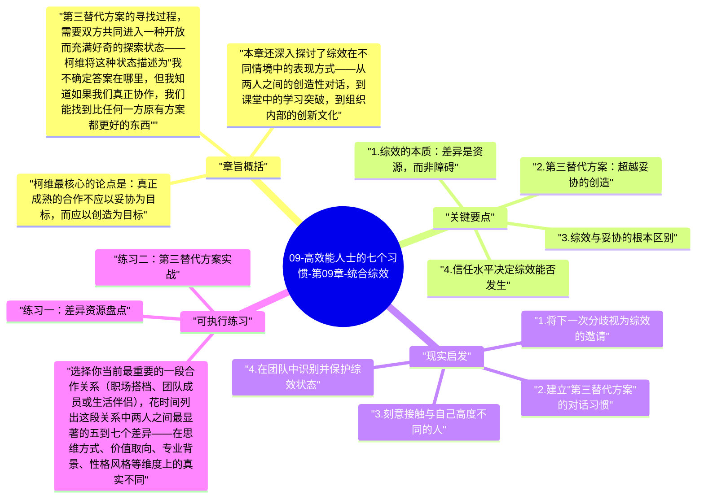

# 09-高效能人士的七个习惯-第09章-统合综效

习惯六是整个七个习惯体系中最令人振奋、也最难被真正理解的一个。"统合综效"（Synergy）这个词在现代管理语境中已经被滥用到几乎失去意义——它常常被当作"团队合作的积极结果"的同义词，或者作为PPT中的套话出现。但柯维所说的综效，是一个具有精确含义的概念：整体大于部分之和（The Whole Is Greater Than the Sum of Its Parts）。更具体地说，综效是指两个或多个人通过真正的创造性合作，产生出任何一方单独都不可能产生的结果——不是1+1=2，而是1+1=3或更多。

柯维在本章阐述的核心洞察是：差异（Difference）不是合作的障碍，而是合作最宝贵的原材料。两个在思维方式、背景经验、价值取向上高度相似的人，合作只能产生线性叠加的结果；而两个在这些维度上存在真实差异的人，如果能够以开放和信任的姿态相遇，则有可能产生指数级的创造性突破。综效的实质，是将人与人之间的差异从"需要克服的障碍"重新定义为"可以激活的资源"。

在全书架构中，统合综效是习惯四（双赢思维）和习惯五（知彼解己）的自然结合与升华。双赢思维建立了"我们都可以赢"的基本意愿，移情聆听建立了"我真正看见你的不同"的信息基础，而综效则是在这两者之上，进入"我们共同创造一个任何人单独都想不到的新方案"的创造层面。没有前两个习惯的铺垫，综效几乎不可能真正发生——它只会退化为表面上的"讨论"，实质上的立场对抗。

## 章旨概括

柯维最核心的论点是：真正成熟的合作不应以妥协为目标，而应以创造为目标。妥协意味着双方各自让步，最终在一个对谁都不完全令人满意的中间点达成协议——这是一个数学上的平均，而不是一个真正的新方案。综效则完全不同：它是在尊重双方差异的基础上，探索是否存在一个第三替代方案（Third Alternative），这个方案不属于任何一方的原始立场，但比两者的任何一个都更优越、更能满足双方的真实需求。

第三替代方案的寻找过程，需要双方共同进入一种开放而充满好奇的探索状态——柯维将这种状态描述为"我不确定答案在哪里，但我知道如果我们真正协作，我们能找到比任何一方原有方案都更好的东西"。这种状态的产生，依赖于足够高的情感账户余额（信任基础）、真正的移情理解（知道对方真正在乎什么）、以及对差异的基本尊重（相信对方的不同视角有其内在价值，而非仅仅是障碍）。

本章还深入探讨了综效在不同情境中的表现方式——从两人之间的创造性对话，到课堂中的学习突破，到组织内部的创新文化。柯维特别强调，综效不是一种可以用意志力强行制造的结果，而是一种当条件成熟时自然涌现的创造力。这些条件包括：高度的信任、真正的理解、对差异的尊重、以及双方共同放弃"我的方案必须赢"的执念。

## 关键要点

### 1. 综效的本质：差异是资源，而非障碍

理解综效的核心，首先需要重新认识"差异"在合作中的角色。在许多组织和关系中，差异被视为需要管理的风险——不同的意见会导致冲突，不同的风格会导致摩擦，不同的价值观会导致分裂。这种对差异的防御性态度，决定了大多数团队永远只能在"最小摩擦点"而非"最大创造点"上运作，产出的是最安全的平均方案，而不是最有可能突破的创新方案。

柯维的转换是根本性的：差异之所以能成为资源，是因为每个人的独特经历、独特视角、独特能力，都看到了现实的某个真实维度——而这些维度，从任何一个单一视角都是看不全的。当两个人的不同视角能够真正相遇（而不是相互排斥），就像两只眼睛的视差产生三维立体感一样，新的维度、新的可能性就会自然地显现出来。这是综效最深层的数学：不是相加，而是相乘；不是叠加，而是跃迁。

### 2. 第三替代方案：超越妥协的创造

柯维将"第三替代方案"（Third Alternative）定义为综效最具实践价值的具体成果。在任何分歧情境中，人们通常的思维模式是：我的方案 vs. 你的方案，我们要么说服对方，要么找到折中。第三替代方案则完全跳出这个框架——它不是我的方案和你的方案的平均，而是一个全新的方案，这个方案在对话发生之前，任何一方都还没有想到过。

寻找第三替代方案的过程，需要双方共同完成以下几个步骤：首先，都要真正清楚各自的核心需求和利益（不仅仅是立场）；其次，都要愿意放弃"我的方案必须被采用"的执念，转而以"我们能找到更好的"为共同目标；最后，需要进入一种真正开放的探索状态，允许任何新想法被提出，不急于评判，先让可能性充分展开。这个过程有时需要经历一段混沌——当双方都放弃了原有的方案，但新方案还没有出现时，会有一段不确定期。柯维认为，这段混沌期正是综效最有可能爆发的时刻，需要双方的信任和耐心来共同度过。

### 3. 综效与妥协的根本区别

妥协（Compromise）看起来是双赢，但实质上是"1/2 + 1/2 = 1"——双方都损失了一半，最终得到的是一个让所有人都不太满意的中间结果。它虽然解决了冲突，但没有真正发掘出合作的全部潜力。综效则是"1 + 1 > 2"——双方不仅都保留了自己的核心价值，还共同创造出了一个超越双方原有想象的新价值。这两者的区别，不只是结果上的数量差异，更是对合作本质的完全不同理解。

妥协背后的隐含信念是：我们的差异是零和的，我多你就少。综效背后的隐含信念是：我们的差异是互补的，结合之后我们都更多。这两种信念会产生完全不同的对话行为：妥协模式下，每个人都在暗中防守自己的底线，谈判的氛围充满了策略性的克制；综效模式下，每个人都在真诚地贡献自己的视角，对话的氛围充满了创造性的开放。

### 4. 信任水平决定综效能否发生

柯维用一个沟通水平的矩阵来说明信任对综效的决定性作用。当信任水平极低时，沟通停留在防御性沟通（Defensive Communication）的层面——人们小心翼翼地措辞，隐藏真实想法，保护自己不受攻击。当信任水平中等时，沟通进入妥协性沟通（Compromise Communication）——人们愿意表达立场，但仍然优先保护自己，合作的结果通常是折中。只有当信任水平足够高时，才能进入综效性沟通（Synergistic Communication）——人们可以完全开放地表达，愿意被对方改变，愿意共同进入未知的创造空间。

这意味着，培养综效的能力，在根本上依赖于前面所有习惯的积累：个人的原则稳固（习惯一到三）提供了内在安全感；情感账户的充足余额（第六章）提供了信任基础；双赢意愿（习惯四）提供了合作的正确框架；移情聆听（习惯五）提供了真正理解差异的工具。综效是所有这些努力的自然汇合点，是七个习惯体系中最令人振奋的结果状态。

### 5. 综效与多样性：差异越大，潜力越大

柯维有一个令人深思的洞察：在真正能够驾驭综效的团队或关系中，差异越大，综效的潜力就越大。这与许多人的直觉相反——人们通常认为，背景相似的人更容易合作、摩擦更少、效率更高。柯维承认这一点，但同时指出：背景相似的人合作效率高，是因为他们产生的差异更少，而综效的能量恰恰来自差异。低摩擦的合作是流畅的，但它的上限也是低的；高差异的合作在初期摩擦更大，但当信任和理解到位时，它可以达到的高度远超任何同质化团队。

这个洞察对于组织建设和个人择友都有深远的实践意义。刻意与和自己思维方式不同的人建立关系，不仅是扩展世界观的方式，更是接触到更高质量综效可能的战略选择。柯维自己在多年的教学中观察到，最具创造性的对话，往往发生在那些彼此高度不同但又高度信任的人之间。

### 6. 内心综效：与自我的不同维度协同

柯维在本章还提出了一个常被忽视的维度：综效不仅发生在人与人之间，也可以发生在一个人内心的不同维度之间。每个人的内心都存在理性与直觉、分析与感性、行动冲动与谨慎考量之间的张力。许多人试图压制这些内心的"分歧声音"，将其中一个声音彻底主导。但柯维认为，如果能够在内心为这些不同声音创造一个对话的空间，而非让它们彼此压制，同样可以产生内心维度的综效——更全面的洞察、更整合的决策、更有深度的行动。

这一洞察与后来的心理学研究高度吻合：内心整合程度高的人，往往在面对复杂问题时表现出更强的创造力和决策质量，因为他们能够同时访问并整合自己多个维度的资源，而非被某一个维度主导而看不见其他维度的信息。

## 现实启发

### 1. 将下一次分歧视为综效的邀请

当下一次你在重要关系中遭遇真实的分歧时，尝试在内心做出一个框架转换：把这个分歧不视为"需要解决的问题"，而视为"综效可能发生的信号"。真实的差异意味着双方都看到了现实的某个维度，而这两个维度放在一起，可能指向一个比任何一方原有方案都更完整的解法。带着这种好奇心进入对话，而不是带着"说服对方"或"找到折中点"的目标，往往会产生令人意外的创造性突破。

### 2. 建立"第三替代方案"的对话习惯

在重要的合作讨论中，当双方的分歧变得清晰时，主动提出一个问题："是否存在一个第三方案，比我们两个人的任何一个原有方案都更好？"单单提出这个问题，就足以将对话的性质从对抗转向探索。这个问题的前提是双方都同意暂时搁置各自的方案，共同进入一个开放的探索空间——而这个"暂时搁置"本身，就是一种需要练习的内在勇气。

### 3. 刻意接触与自己高度不同的人

检视一下你当前的主要关系网络：你身边的人在思维方式、专业背景、人生经历上与你有多少真实的差异？许多人在舒适区内构建关系网络，与自己相似的人交往，这虽然减少了摩擦，但也大幅降低了综效发生的可能性。有意识地拓展你与高度不同的人的深度对话，不仅是开阔视野的方式，更是实践综效、发展高维创造力的直接途径。

### 4. 在团队中识别并保护综效状态

当一个团队或对话进入真正综效的状态时，往往有一些可辨识的信号：对话节奏加快，想法快速涌现，每个人都在建构对方的想法而不是驳斥它，房间里有一种轻微的兴奋感。学会识别这些信号，并在它们出现时有意识地保护这个状态——暂停议程管控，允许对话自由发展，不急于收敛到结论——是领导者和合作者最有价值的能力之一。

## 可执行练习

**练习一：差异资源盘点**

选择你当前最重要的一段合作关系（职场搭档、团队成员或生活伴侣），花时间列出这段关系中两人之间最显著的五到七个差异——在思维方式、价值取向、专业背景、性格风格等维度上的真实不同。对每一个差异，不要评判它"好"或"坏"，而是思考：这个差异如果被充分利用，可能为我们的合作带来什么独特的视角或资源？这个练习的目的是帮助你将关系中的"摩擦点"重新解读为"创造潜力点"，从而在未来的合作中更愿意主动激活这些差异，而不是回避它们。

**练习二：第三替代方案实战**

选择一个当前你正在经历的真实分歧（可以是家庭决策、职场分歧或任何重要关系中的不同意见）。召集对方，明确表达你希望尝试寻找第三替代方案的意图，并共同进行以下三步：第一步，双方各自清晰表达自己的核心需求（不只是立场），确保对方完全理解；第二步，双方共同提出尽可能多的新想法，暂缓评判，只是让可能性充分展开；第三步，在所有想法的基础上，共同探索是否存在一个比任何单一想法都更优越的综合方案。记录这个过程中的体验，以及最终产生的方案与对话开始时双方原有方案的差异。

**练习三：综效日志**

在接下来的一个月内，每次你在对话或合作中感受到一种"比预期更好的东西正在涌现"的感觉时，立即记录下来：是什么条件使这次综效得以发生？信任水平如何？差异的类型是什么？双方各自贡献了什么独特的视角？通过积累这些真实的综效案例，你将逐渐建立对综效条件的直觉认知，并学会如何更主动地在未来的合作中创造这些条件。

---

## Mermaid 思维导图

### 图1

