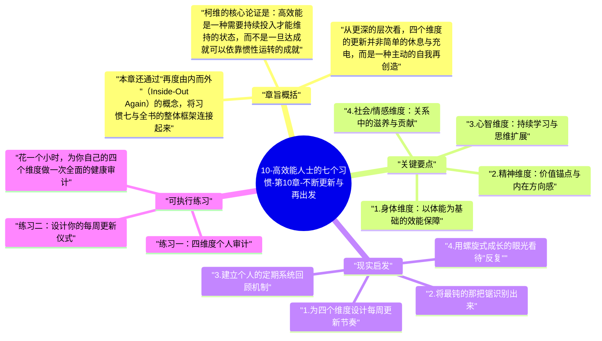

# 10-高效能人士的七个习惯-第10章-不断更新与再出发

习惯七是全书最后一个习惯，也是最容易被忽视的一个——不是因为它不重要，而是因为它处理的是那些看起来可以无限推迟的事情。"我先把手头这件事做完，然后再休息"、"等这个阶段过了，我再来照顾自己"——这类思维逻辑几乎人人都有，而柯维用一个极其简洁的比喻戳破了它：如果一个伐木工发现锯木的效率越来越低，但他拒绝停下来磨刀，理由是"我没有时间磨刀，我要赶紧锯木"，那么他的真正问题不是时间不够，而是他连续不断地在用一把越来越钝的锯子工作，而且拒绝承认这个事实。磨刀不误砍柴工——这句话放到个人效能的维度上，就是习惯七的全部精髓。

柯维将"持续更新"（Sharpening the Saw）定义为围绕四个维度的定期再充能：身体（Physical）、社会/情感（Social/Emotional）、心智（Mental）和精神（Spiritual）。这四个维度不是相互独立的，而是深度相互依存——其中任何一个维度的长期忽视，都会以某种方式渗透并削弱其他三个维度的运作。一个身体长期透支的人，心智的清晰度会下降；一个精神层面长期失落的人，即使身体健康、智识丰富，也会逐渐失去前进的动力；一个情感层面长期孤立的人，所有其他维度的努力都可能被内心的空洞感所抵消。

本章在全书中扮演的角色，远超一章内容的篇幅所能承载的重量。它是整个系统的能量来源——前六个习惯如果没有习惯七的持续支撑，迟早会因为内在资源的枯竭而崩塌。更重要的是，柯维在本章末尾提出了"螺旋式上升"的概念，揭示了高效能不是线性进步到某个终点，而是在每一次更新之后以更高的能力回到起点，开始新一轮的循环——这是成长最真实的形态。

## 章旨概括

柯维的核心论证是：高效能是一种需要持续投入才能维持的状态，而不是一旦达成就可以依靠惯性运转的成就。前六个习惯所建立的每一种能力——主动性、目标感、时间管理、双赢思维、移情聆听、综效创造——都需要内在资源来驱动，而这些内在资源如果不被主动补充，会随着时间和压力的消耗而递减。"不断更新"的习惯，本质上是对自己作为一个工具的持续维护与升级，是确保高效能可以跨越时间维度持续发生的必要投资。

从更深的层次看，四个维度的更新并非简单的休息与充电，而是一种主动的自我再创造。身体维度的锻炼不只是恢复体力，更是在培养意志力和身心一致性；精神维度的滋养不只是心理安慰，更是在深化价值观的稳定性；心智维度的学习不只是知识积累，更是在拓展解读世界的能力边界；情感维度的滋养不只是改善人际关系，更是在加深对人性和连接的理解。这四个维度的系统性投入，是一个人在漫长时间轴上保持成长轨迹的唯一可靠路径。

本章还通过"再度由内而外"（Inside-Out Again）的概念，将习惯七与全书的整体框架连接起来。柯维认为，七个习惯不是一条直线走完就结束的路径，而是一个不断重复的螺旋。每完成一个循环，站在更高层次的你，可以以更深的理解、更稳的基础、更丰富的资源重新走过这七个习惯，每一轮都比上一轮更有深度、更有效能。这就是所谓的螺旋式上升——不是重复，而是进阶式的重访。

## 关键要点

### 1. 身体维度：以体能为基础的效能保障

身体维度的更新包括有规律的体育锻炼、充足的睡眠、健康的饮食，以及压力的适当管理。柯维特别强调，有氧运动不仅仅对身体有益，它与心智的清晰度、情绪的稳定性、以及内在意志力的储备都有直接的联系。持续运动的人在面对压力时，往往具有更强的心理弹性，因为运动本质上是在练习一种能力：在不适中坚持，体验超越不适之后的力量感。

身体维度最容易被忽视，原因是它的投资回报具有一定的延迟性——今天的锻炼不会立即显现明天的高效，但三个月持续锻炼与三个月不动之间的差距，会在思维清晰度、情绪稳定性和持续专注力上以无可争辩的方式显现出来。柯维对身体维度的强调，是在提醒那些以"专注工作"为由持续忽视身体的人：你以为你节省了时间，实际上你在以利滚利的方式透支你最重要的工作平台。

### 2. 精神维度：价值锚点与内在方向感

精神维度的更新是最个人化、也最难以外部化的一个维度。它不一定与宗教信仰相关——柯维所说的精神更新，是指任何能够帮助一个人重新连接到内心最深层价值观和生命意义的活动或实践。这可以是冥想、祈祷、沉浸于自然中的独处、阅读启发性的文字、写日记，或者任何能够触及"我究竟为什么而活、我最深层在乎什么"这类核心问题的方式。

精神维度的更新之所以在四个维度中占据特殊地位，是因为它是所有其他维度活动的意义来源。一个人可以身体健康、智识丰富、关系良好，但如果精神层面长期空洞——不清楚自己为什么做这一切，不感受到自己的生命有方向和意义——他最终会陷入一种难以言说的疲惫和虚无。柯维引用维克多·弗兰克（Viktor Frankl）的研究指出，意义感（Sense of Meaning）是人类最深层的心理需求之一，也是在极端压力和逆境中维持心理韧性的核心资源。

### 3. 心智维度：持续学习与思维扩展

心智维度的更新围绕着持续学习、阅读、写作和批判性思维的培养展开。柯维特别推崇广泛阅读——不只是在专业领域深耕，更是跨学科、跨文化地接触不同的思想体系和叙事方式。这种广度不是为了成为"什么都知道一点"的浅薄者，而是为了积累足够多样的认知框架，使自己在面对复杂问题时，能够从多个角度同时审视，而不被任何一个单一框架所局限。

写作是柯维格外推崇的心智更新工具。将思想诉诸文字的过程，会迫使思维从模糊走向清晰——你以为自己理解了某个概念，直到你尝试把它写出来，才发现其中的逻辑漏洞和理解空白。定期写作（日记、读书笔记、思考整理）不只是记录，而是主动构建思维结构的过程。它帮助一个人将碎片化的见解凝聚成可操作的洞察，将短暂的感悟转化为持久的内在资源。

### 4. 社会/情感维度：关系中的滋养与贡献

社会/情感维度的更新，与外部的人际关系和内在的情感健康都密切相关。柯维认为，这个维度的更新主要通过两种方式实现：其一是深度的人际连接——不是泛泛的社交，而是真正相互理解、相互支持的关系；其二是服务（Service）——将自己的时间和能力投入到对他人有意义的贡献中，这种贡献会反过来深化自己的内在价值感和对生命意义的感知。

情感维度的健康，在柯维的框架中与"内在安全感"（Inner Security）高度相关。一个情感维度长期被忽视的人，往往会在关系中寻求外部的验证和认可，以填补内在的空洞感——这使他无法真正实践前几个习惯，因为双赢思维、移情聆听和综效创造都需要足够稳固的内在安全感作为前提。相反，情感维度健康的人，有充分的内在资源去给予、去连接、去在关系中真正贡献，而不只是索取。

### 5. 四个维度的协同：整体大于部分之和

四个维度的更新不是各自独立的投资清单，而是一个相互影响的整体系统。身体维度的健康支撑心智的敏锐；精神维度的清晰为情感维度的稳定提供锚点；心智维度的扩展为社会维度的互动提供更丰富的资源；情感维度的健康反过来为精神维度的深化提供人性的土壤。柯维认为，任何一个维度的长期严重忽视，最终都会以某种方式拖累其他三个维度——这种跨维度的相互依存，使得"全维度更新"成为唯一真正有效的维护策略。

在实践中，这意味着更新计划不能只是"去健身房"或"多读书"这样单维度的行动，而是需要有意识地设计一套覆盖四个维度的定期更新节奏。每周、每月、每年都应该有不同时间尺度的更新活动嵌入日程——从每天的身体锻炼和冥想，到每周的深度阅读和人际连接，再到每年的系统回顾和价值观重访。这种设计感，是习惯七从被动的"等到精疲力竭再恢复"升级为主动的"持续在能量充沛状态中运作"的核心区别。

### 6. 螺旋式上升：高效能是循环而非线性

柯维以"螺旋式上升"（Upward Spiral）作为全书的最终意象。人们常常将成长想象为一条从低到高的直线，或一个从起点到终点的旅程。但柯维的模型是：成长是一个不断回到起点、但每次都处于更高层次的螺旋。每完成一轮七个习惯的循环，你以更深的理解回到习惯一，开始新的一轮；每一轮更新，你都以更充沛的内在资源、更稳固的品格基础、更丰富的生命体验，重新审视自己的使命、关系和行动。

螺旋式上升的概念对于那些"已经读过这本书"的人尤其重要。柯维明确指出，理解这些习惯并不是目标，持续在生活中实践和深化它们才是。知道"要事第一"不等于真的将要事放在首位；理解"双赢思维"不等于在压力下仍能真正追求双赢。只有通过持续的实践、反思和更新，这些习惯才能从行为层面逐渐内化为品格，从有意识的努力逐渐成为自然的表达。

## 现实启发

### 1. 为四个维度设计每周更新节奏

审视你当前的每周时间安排，诚实地评估四个维度在其中各自占据多少有意识的更新投入。许多人发现，身体维度或许有运动习惯，但心智维度几乎没有系统性学习，精神维度完全缺席，情感维度依赖偶发的社交而非刻意的深度连接。设计一套每周的"更新日程"——不需要大块时间，每个维度每周哪怕只有几十分钟的刻意投入，累积效应也将在数月内显现出令你自己惊讶的变化。

### 2. 将最钝的那把锯识别出来

在四个维度中，你最长时间没有主动投入的那一个是哪个？在柯维的伐木工比喻中，这就是你最钝的那把锯。它当前消耗你最多的效能，但同时又是你最少关注的地方。诚实地面对这个最薄弱的维度，制定一个具体的、小步骤的补充计划——不是一个宏大的改变蓝图，而是可以从明天开始执行的第一个微小行动。这个维度的改善往往会带来连锁效应，影响其他三个维度的运作质量。

### 3. 建立个人的定期系统回顾机制

柯维强烈推崇周计划（Weekly Planning），以及更大尺度的定期回顾实践。建立属于你自己的月度或季度回顾习惯：用半个小时到一个小时的时间，回顾过去一段时间你在四个维度的更新情况，同时重访你的人生使命宣言和核心价值观，评估你的日常行为与这些核心价值之间的一致性。这个回顾不是自我批判的会议，而是一次校准——一次将罗盘重新指向正确方向的机会，确保你的日常行动仍然服务于你真正重视的目标。

### 4. 用螺旋式成长的眼光看待"反复"

当你发现自己在某个已知的习惯上"又退步了"，不要将这视为失败的证据，而要将其视为螺旋式成长的正常组成部分。每一次回到挑战点，你其实是以更深的理解重新面对它——即使感觉上像是原地踏步，你的内在资源已经比上一次更丰富。柯维的螺旋式上升模型意味着：终点不存在，成长永远在进行，而习惯七提供的持续更新机制，正是让这个螺旋持续向上而非向下的能量来源。

## 可执行练习

**练习一：四维度个人审计**

花一个小时，为你自己的四个维度做一次全面的健康审计。针对每个维度，回答以下问题：过去三个月里，我在这个维度做了哪些刻意的更新投入（具体列举）？这个维度目前的状态是充沛、疲惫还是枯竭？如果我继续以现在的方式对待这个维度，六个月后它会处于什么状态？基于这个审计，识别出你最需要立即加强投入的一个维度，并为它制定一个可以从本周开始执行的具体行动计划——不是理想计划，而是真正可操作的最小行动单元。

**练习二：设计你的每周更新仪式**

参考柯维的建议，设计一套属于你自己的每周更新仪式。这套仪式不需要超过两个小时，但需要涵盖四个维度：可以是周日早晨的一段完整时间，包括体能锻炼（身体）、冥想或日记书写（精神）、阅读或学习计划制定（心智）、以及有意识地连接一位重要的人（情感）。关键不在于仪式的内容，而在于它的一致性——每周重复，不受工作繁忙程度的影响。坚持这套仪式三个月，然后回顾它对你整体效能和内在状态的影响。

**练习三：为下一轮螺旋制定出发点**

在读完这本书的基础上，写一份"下一轮螺旋的出发点"宣言——不超过一页纸，但要涵盖以下内容：你现在理解最深的一个习惯是什么，以及你在实践中仍然最挣扎的一个是什么？你认为接下来三个月内，哪一个习惯的强化将对你的生命质量带来最大的改变？你愿意做出的最具体的一个行为承诺是什么？将这份宣言放在你每天能看到的地方，作为下一轮螺旋式成长的锚点。三个月后重访它，以实际发生的事情来检验和更新这份宣言，开始新的一轮。

---

## Mermaid 思维导图

### 图1

