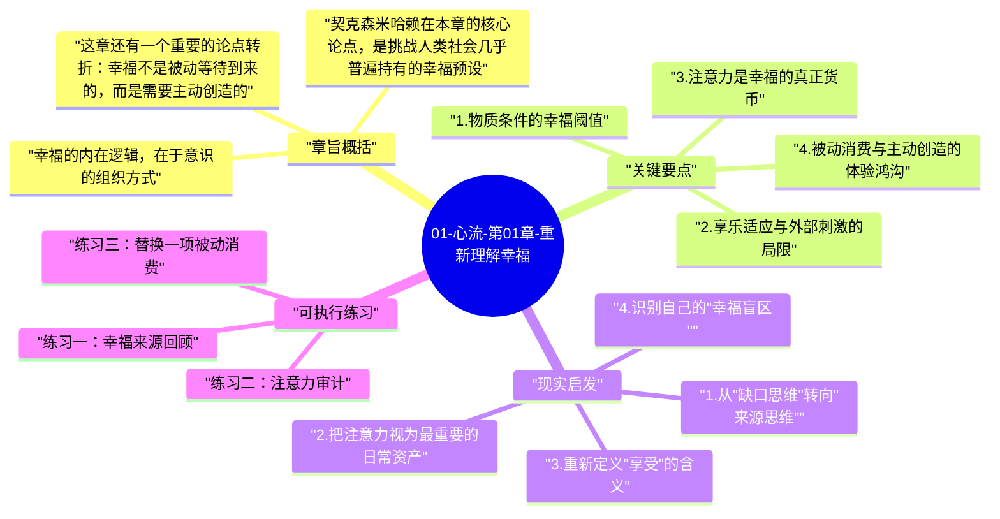

# 01-心流-第01章-重新理解幸福

《心流》的第一章，是整本书最根本的哲学奠基。契克森米哈赖没有急着定义心流，而是先问了一个几乎人人都问过却极少认真回答的问题：幸福究竟是什么？这章让人不安，因为它撬动了我们习以为常的答案——那些关于幸福的答案几乎都指向外部：更多的钱、更好的地位、更自由的时间。作者用数十年的研究温和而坚定地说：这些答案都只答对了一部分，甚至在某些方向上是反的。

这一章在全书中的位置，相当于地基对于建筑。如果读者还停留在"幸福是获得"的认知框架里，后面关于心流的一切讨论都会变成空中楼阁——你会把心流当成又一种快感来追逐，而非当成一种可以主动建构的体验结构。契克森米哈赖的高明之处在于，他不是用道德语言劝诫读者"别太物质"，而是用大量跨文化的实证研究说明：当物质条件超过基本需求之后，继续增加物质并不会持续提升幸福感，然而这一事实在日常生活中几乎从未被认真对待。

作者真正要说的，是一个认知上的颠覆：幸福不是一种外界给予的状态，而是意识内部有序化的产物。这意味着幸福是可以学习的，是可以设计的，但它的方向不是向外索取，而是向内建构。理解了这一点，才算真正进入了《心流》这本书的语境，才能明白为何作者花了整整一本书来讨论如何进入那种深度投入的最优体验状态。

## 章旨概括

契克森米哈赖在本章的核心论点，是挑战人类社会几乎普遍持有的幸福预设。现代社会以消费为导向，这套逻辑告诉我们，只要拥有足够多——足够的金钱、声誉、健康、娱乐——幸福就会自然到来。然而作者援引大量心理学研究指出，收入在超过某个阈值之后，对幸福感的贡献会迅速递减；赢得彩票的人，往往在一两年后回到原先的情绪基线；物质条件远不如现代人的古代文化或简单社会，人们同样可以报告出深刻的生命满足感。这说明幸福并非外部条件的线性函数，它另有内在逻辑，而这个逻辑是现代主流文化几乎从未认真讨论过的。

幸福的内在逻辑，在于意识的组织方式。当一个人的注意力能够有效地集中于当下、投入到具有挑战性的活动中、并清晰地感知到自己的行动与目标的对齐时，一种深层的满足感就会自然涌现。这不是因为外部给予了什么，而是因为意识自身处于一种高度有序的状态。作者把这种状态称为"最优体验"，并将其定位为幸福感的真正来源。反之，当意识处于无序状态——被焦虑占据、被漫无目的的信息流冲刷、被内在冲突撕裂——即便外部环境优渥，人也难以感到幸福，因为体验质量的决定因子在意识内部，而非在外部世界。

这章还有一个重要的论点转折：幸福不是被动等待到来的，而是需要主动创造的。这种创造不是努力"假装快乐"，而是学会如何主动安排自己的意识资源，把注意力引导到那些能够产生内在秩序的活动上。契克森米哈赖在这里埋下了全书最重要的伏笔：如果幸福是意识高度有序的体验，那么学会进入心流状态，就是学会主动创造幸福的过程。这一转变，要求我们从外部条件的被动接受者，变为内在体验的主动建构者，而这正是全书的核心主张。

## 关键要点

### 1. 物质条件的幸福阈值

人类历史上大多数时候，物质匮乏确实是痛苦的主要来源，因此积累物质、获取资源的本能深深烙印在我们的心理结构里。契克森米哈赖并不否认物质的基础价值——贫穷、饥饿、疾病会直接损害一个人的体验质量，物质条件的改善在达到基本需求门槛之前是真实有效的。但他指出了一个关键的拐点：当物质条件超过满足基本需求的门槛之后，继续增加财富并不会等比例提升幸福感，甚至常常反向——更多的财富往往带来更多的焦虑、更复杂的人际博弈和更高的期望值，这些都会消耗原本可用于高质量体验的意识资源。

这一发现在富裕社会中尤为深刻。许多生活在发达国家的人，拥有前几个世纪的国王都无法想象的物质条件，却普遍感到空虚、焦虑和缺乏意义感；与此同时，许多物质上远不富裕的群体，却能报告出更强的共同体感和日常满足感。这说明问题的根源不在于缺少什么，而在于我们对幸福的理解方向本就偏离了靶心。物质是幸福的必要条件之一，但绝不是充分条件；真正的幸福需要在物质基础之上，由意识的有序运作来完成建构，而这一步是物质本身无法自动完成的。

### 2. 享乐适应与外部刺激的局限

人对外部刺激的适应速度远快于我们的预期，这是心理学中有大量实证支持的"享乐适应"现象。买到新车的兴奋感，大约两周就会消退；升职的喜悦，在琐碎的新职责面前很快褪色；度假的快乐，往往在旅途结束后迅速归零，甚至在旅途中因为期待落差而变得比想象中平淡。这种适应机制是人类神经系统的基本特征，它保证我们不会因为持续的重复刺激而陷入麻木，但同时也使得以外部刺激为核心的幸福追求，从结构上就是一场永无止境的跑步机游戏。

契克森米哈赖用这一观察说明，依赖外部刺激来维持幸福感，从底层逻辑上就是不可持续的。真正稳定的满足感，必须来自一种不依赖具体外部条件的内在资源。这种内在资源，就是意识有序投入某个活动时产生的深层体验——它不会因为"习以为常"而快速褪色，因为它本身就是一种需要持续投入才能维持的过程体验，而非一次性的结果享受。心流体验的可贵，正在于它是过程性的而非结果性的，每一次投入都是新鲜的参与，而非等待一个奖赏的反复兑现。

### 3. 注意力是幸福的真正货币

在物质资源之外，契克森米哈赖提出了另一种更根本的资源：注意力。我们每天清醒的时间，本质上是一段可被分配的注意力总量，人的意识系统每秒大约能处理 126 比特的信息，每天能处理的信息总量是有限且珍贵的。这些注意力投向哪里，就决定了我们实际上"体验"了什么样的生活。即使客观上拥有绝佳的条件，一个人若无法把注意力集中于当下、持续在低质量刺激中漂浮，他实际经历的生活就是贫乏的。反之，即使处在不算理想的外部环境中，一个能够主动管理注意力的人，可以通过深度投入某项有意义的活动，创造出丰富的内在体验。

注意力是有限的，而现代社会的设计几乎都在争夺你的注意力——社交媒体的算法、娱乐内容的无限滚动、广告信息的持续轰炸——它们不是在为你的幸福服务，而是在消耗你最宝贵的意识资源，以换取流量与商业价值。理解了注意力作为"幸福货币"的本质，就能明白为何心流体验如此珍贵：心流发生时，注意力以最高效的方式被组织起来，没有任何一份意识资源被浪费在焦虑、白日梦或无意义的自我监控上，全部的意识容量都在服务于当下正在进行的活动，这才是意识资源利用的最高境界。

### 4. 被动消费与主动创造的体验鸿沟

现代生活中，大多数娱乐方式都是被动消费型的：刷短视频、追剧、消遣式的社交浏览。这些活动并非毫无价值，它们确实能带来放松和短暂的愉悦，在某种程度上是必要的精神休息。然而契克森米哈赖的经验抽样研究（Experience Sampling Method）发现，人们在这类被动消费中，实时报告的心理满足感和生命活力感，往往远低于他们主动从事某项有挑战性活动时的感受。更令人意外的是，人们在预期未来享乐活动时的期待值，往往高于实际体验；而在参与某些主动性的复杂任务时，事后报告的满足感往往远超事前的预期。

这一发现揭示了我们的大脑对主动参与和被动消费有截然不同的响应机制。主动参与某件需要技能投入、目标清晰的事情，会激活一种更深层的满足机制，这种机制来自人类数万年演化中对"有效行动"的内在奖励，而这正是幸福感的核心来源之一。被动消费则只能激活表层的奖赏回路，短暂且容易陷入倦怠感——这也是为什么很多人看了几个小时视频之后，反而感到比开始之前更空洞、更疲倦。从这个角度来看，真正提高生活质量，需要有意识地从被动消费模式逐步转向主动创造模式，而心流正是这种转变最完整的体现。

### 5. 最优体验的可设计性与可复制性

许多人把那些"难忘的美好时刻"归结为运气、偶然或特殊环境，认为它们是命运的馈赠，不可主动追求也无法复制。契克森米哈赖的研究却说明了相反的结论：这些最优体验虽然在主观上感觉神奇甚至神圣，但其背后有着一套相对稳定的心理结构。无论是攀岩者在岩壁上的专注、外科医生在手术中的忘我、棋手在对局中的沉浸，还是母亲与孩子玩耍时的全情投入，这些体验在心理结构上高度相似。当某些条件对齐时——挑战与技能的匹配、目标清晰、反馈及时——最优体验就更容易出现，而这些条件是可以有意识地去创造和维护的。

这一结论对于读者来说是一种解放，也是一种挑战。解放在于：你不必等待命运的眷顾，不必攒足钱才能感到幸福，不必依赖某些特定的人或场合，最优体验可以发生在洗碗时、通勤中、任何你有意识地投入的时刻。挑战在于：这要求你承担起主动设计自己意识体验的责任，而不是继续把幸福的控制权交给外界的安排。这种主动性，是贯穿《心流》全书的核心价值观，也是本章为读者留下的最根本的行动邀请。

## 现实启发

### 1. 从"缺口思维"转向"来源思维"

很多人在不快乐时的第一反应，是思考"还缺什么"——还缺多少钱、还缺什么样的伴侣、还缺什么样的工作或认可。这种向外寻找缺口的模式，本质上预设了幸福由外部条件决定，因此总能找到新的"缺口"来解释当下的不满足，而这个循环永远不会结束。理解了契克森米哈赖的论点后，一个更有效的自问方式是：在过去一周里，我在哪些时刻感到真正投入、有活力、忘记了时间的流逝？这些时刻的结构是什么？与其追问缺少什么，不如开始识别什么条件下自己最有生命感。这个认知转向，是整个幸福建构工程的起点。

当你开始系统地观察自己的体验质量，而不是观察自己的外部处境，你会发现一个令人惊讶的规律：那些最好的时刻，往往不是最安逸的时刻，而是你全神贯注、技能刚好与挑战匹配、感到自我在成长的时刻。这个认识本身，就已经是对幸福理解的一次根本升级，因为它意味着幸福的来源就在你能触及的活动结构之中，而不是在遥远的未来或他人手中。

### 2. 把注意力视为最重要的日常资产

如果承认注意力是幸福的真正货币，那么每天早上醒来，你最重要的决策不是今天能赚多少钱，而是今天的注意力将投向何处、以何种质量被使用。这是一种全新的日常优先级框架。具体来说，这意味着要有意识地为深度专注预留时间段，减少被动刷屏的时间，把最清醒的精力用在那些能产生主动投入感的活动上，而不是让算法决定你的注意力去向。

注意力管理不是压抑放松的需求，而是让放松也发生在更有质量的方式上。与其用刷手机消磨时间，不如用一次专注的散步、一段认真的阅读或一项手工劳动来完成休息。这些方式不仅能真正恢复精力，还往往能在轻度挑战中带来令人舒适的投入感，比纯粹的被动娱乐留下更深的体验痕迹和更持久的满足感。

### 3. 重新定义"享受"的含义

社会文化对"享受"的主流定义，是不费力、不需要思考、纯粹轻松——度假、消遣、刷剧、睡觉。契克森米哈赖的研究提示我们，这种定义是窄化的，甚至在某些方面是反直觉的。真正深刻的享受，往往发生在主动参与、技能被调动、挑战被克服的过程中。一个厨师在完成一道复杂菜肴时的愉悦，一个程序员解决了长时间困扰自己的 bug 时的满足，一个登山者到达顶峰时的喜悦，这些体验中包含了比纯粹休闲更丰富的生命感，因为在其中，人的意识以最完整的方式被调动了起来。

重新定义享受，意味着在日常生活中主动去找那些"值得投入"的活动，而不只是找那些"轻松"的活动。这个转变需要一段时间的适应，因为主动投入在开始时往往伴随着阻力和惰性；但随着技能的积累和投入习惯的形成，这种主动参与会变得越来越自然，越来越令人期待，进而成为一种新的、更高质量的享受方式。

### 4. 识别自己的"幸福盲区"

每个人都有一些习惯性地被低估的幸福来源，以及一些被高估却实际上效果有限的活动。契克森米哈赖的经验抽样研究发现，人们在实时报告自己的体验时，往往与事后的主观回忆存在明显差异——他们认为会让自己快乐的活动，实际体验的质量常常低于预期；而一些被认为"麻烦"或"费力"的投入性活动，实际的体验质量往往远高于预期。这个发现意味着我们对自己的幸福来源存在系统性的误判，而建立对自己体验的实时感知能力，是纠正这种误判、主动管理幸福的第一步。

## 可执行练习

### 练习一：幸福来源回顾

在接下来的一周，每晚花五到十分钟，回顾当天所有让你感到真正投入、活力充沛或深度满足的时刻。不要只关注"开心"，而要关注那些你忘记了时间流逝、感觉自己在做有价值的事、或者感到某种深层宁静与充实的时刻。把这些时刻记录下来，注明你当时在做什么、与谁在一起、任务的难度如何、你的注意力是主动集中还是被动漂移。一周之后，对比这些记录，找出其中的共同结构——这些就是你个人的心流触发器，是你独特的幸福地图的起点，也是你可以有意识地去复制和扩展的宝贵资源。

### 练习二：注意力审计

连续三天，以每两小时为间隔，用手机备忘录记录自己当时在做什么，以及主观体验的投入感与满足感（分别打 0 到 10 分）。周期结束后，统计哪类活动占据了最多的时间，以及这些活动带来了怎样的体验得分。这个练习的目的不是评判自己，而是建立一种清醒的注意力意识：你每天真正把意识投入在哪里，以及这些投入是否在回馈你真正想要的体验质量。这种意识是改变的前提，因为在没有观察的情况下，注意力会不由自主地跟随社会惯性与外部刺激走，而真正的选择只有在意识清醒时才能发生。

### 练习三：替换一项被动消费

在接下来的两周内，选择一项你习惯性的被动消费活动（例如睡前刷手机一小时），把它替换为一项具有轻度挑战性的主动活动（例如阅读一本书的一章、学一首简单的歌、画几张素描、整理一个你长期拖延的小任务，或者规划一个项目的第一步）。不需要选择很困难的活动，只需要它要求你主动参与和某种技能的调用即可。每次完成后，记录你的主观感受——与被取代的被动消费相比，你的能量状态、情绪质量有什么不同？这个对比体验，是理解被动消费与主动创造之间体验质量差异最直接、最个人化的方法，它会让你从书本上的道理变成亲身体验到的确信。

---

## Mermaid 思维导图

### 图1

