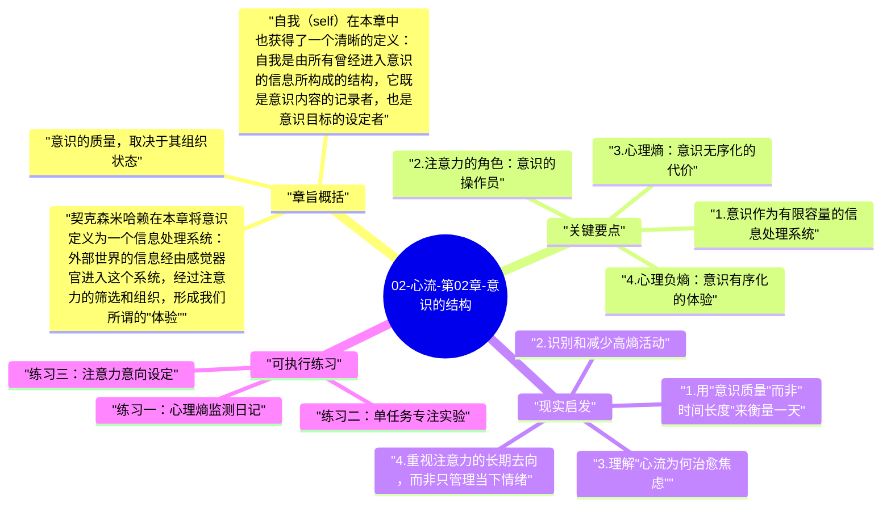

# 02-心流-第02章-意识的结构

如果说第一章是契克森米哈赖对幸福问题的哲学重定位，那么第二章就是他的科学地基。这一章的任务，是把心流这个现象从玄学话语中解救出来，用意识科学的语言重新描述它。意识是什么？注意力如何运作？为什么有些时刻人感到内心充实有序，而另一些时刻则感到混乱、焦虑或空洞？这些问题都在这一章得到了系统性的解答。理解了意识的结构，才能真正理解心流为何发生以及如何发生。

这一章在全书中扮演的角色，类似于一本建筑学著作中的"材料力学"章节——它讲的是构成体验的底层材料和基本规律。如果跳过这一章直接去读心流的实践部分，你可能会获得一些技巧，但无法真正理解这些技巧为什么有效。契克森米哈赖把意识理解为一个有限容量的信息处理系统，注意力是这个系统的"操作员"，而心流，就是这个系统在最理想状态下运转时的体验。这个框架一旦建立，后面所有关于心流触发条件、干扰因素和培育方法的讨论，都有了坚实的落脚点。

作者在这里真正想传达的观点是：人的主观体验质量，从根本上由意识的组织状态决定。一个意识长期处于高熵状态（心理熵）的人，即便外部条件优越，也难以体验到深层满足；而一个学会主动组织意识、有效分配注意力的人，能够在相对平凡的外部条件下创造出丰富的内在体验。这不是励志口号，而是有着严肃心理学支撑的结论，而这正是这一章需要认真读懂的核心。

## 章旨概括

契克森米哈赖在本章将意识定义为一个信息处理系统：外部世界的信息经由感觉器官进入这个系统，经过注意力的筛选和组织，形成我们所谓的"体验"。这个系统的容量是有限的，人的意识每秒大约能处理 126 比特的信息，这个数字听起来很大，但相比外部世界的信息总量而言极其有限。正是因为这种有限性，注意力的分配方式就成了体验质量的核心决定因子——你把这 126 比特用在哪里，你的体验就会是什么样的。理解这一点，是理解整本书的关键前提。

意识的质量，取决于其组织状态。当注意力能够集中于一个清晰的目标时，信息在意识中形成有序的结构，体验呈现为流畅、充实和有意义的状态，契克森米哈赖称之为"心理负熵"或"意识的有序状态"。反之，当注意力被拉向不同方向、内在冲突占据大量意识资源时，意识进入高熵状态——焦虑、无聊、空洞或分裂，这些不愉快的体验本质上都是意识无序的症状。心理熵（psychic entropy）这个概念，是本章最重要的理论工具，它直接解释了为什么某些环境和活动会让人感到精力耗尽，而另一些则令人感到充实有力。

自我（self）在本章中也获得了一个清晰的定义：自我是由所有曾经进入意识的信息所构成的结构，它既是意识内容的记录者，也是意识目标的设定者。注意力决定什么信息进入意识，而进入意识的信息又反过来塑造自我。这意味着每一次我们选择把注意力放在哪里，我们就在塑造自己的自我结构。长期选择把注意力投入到有意义、有挑战、有反馈的活动中，会建构出一个更丰富、更有弹性的自我；而长期在低质量的被动信息中漂移，则会使自我结构变得模糊和空洞。这一认识具有深刻的实践含义：管理注意力，不仅仅是管理当下的体验质量，也是在管理长期的自我建构过程。

## 关键要点

### 1. 意识作为有限容量的信息处理系统

契克森米哈赖借鉴认知心理学的研究成果，将人的意识描述为一个具有明确容量上限的信息处理系统。这个系统每秒能够处理的信息量大约是 126 比特，相当于同时追踪约七个相互独立的信息单元。单是一个人说话，理解其语言内容大约需要 40 比特每秒，这意味着我们的意识容量是相当有限的资源。这个发现的意义在于：意识不是一个无限透明的镜子，能够无偏见地反映外部世界的全貌；它是一个高度选择性的系统，永远只能处理被注意力筛选出来的那一小部分现实。

这个有限性具有深刻的实践含义。它意味着专注于一件事情的人，其体验与同时分心于十件事情的人，所经历的不只是效率上的差别，更是体验质量的根本差别。当意识容量被一个清晰的任务充分占用时，没有多余的资源去处理焦虑性的自我监控或无关的杂念，体验因此变得纯粹和完整。理解了这一点，就能从科学层面理解为什么专注本身就能带来体验质量的提升：它不是意志力的强行压制，而是意识容量被有效利用后的自然产物。

### 2. 注意力的角色：意识的操作员

如果意识是一个信息处理系统，那么注意力就是这个系统的操作员——它决定哪些信息被纳入处理，哪些被过滤在门外。注意力是主动的，而非被动的接收器；它可以被训练、被引导、被有意识地管理。契克森米哈赖特别强调，注意力的分配方式在很大程度上是习惯性的，大多数人的注意力分配模式是由文化、社会期待、情绪惯性和外部刺激共同塑造的，而非基于主动的内在选择。

这一认识揭示了一个令人警醒的现实：在没有主动管理注意力的情况下，人的体验质量实际上是被各种外部力量所决定的——算法、社会比较、焦虑回路、环境噪音。契克森米哈赖把这种状态下的人描述为意识的"被动接受者"，而把能够主动引导注意力的人称为意识的"主动组织者"。成为注意力的主人，是从被动体验走向主动创造幸福的根本转变，也是心流得以发生的前提条件。

### 3. 心理熵：意识无序化的代价

"心理熵"是本章最核心的理论概念，也是理解为什么人常常感到不快乐的关键解释框架。熵（entropy）本是热力学概念，描述系统的无序程度；契克森米哈赖将其引入心理学，用来描述意识内部的冲突、混乱和无组织状态。当一个人的内在目标与当前行动不一致时，当来自不同方向的欲望相互冲突时，当注意力被焦虑和自我怀疑持续占据时，心理熵就在上升，体验质量随之下降，即便外部环境并无异常。

心理熵的危险之处在于它的自我强化特性：高熵状态下的意识更难集中注意力，注意力的分散又进一步增加心理熵，形成恶性循环。这也解释了为什么有些人在压力状态下会陷入"越想越乱"的泥潭，以及为什么单纯的"想通"往往解决不了问题——因为问题不只在于思维内容，更在于意识的整体组织状态。降低心理熵的有效方式，不是强行压制负面想法，而是找到一个能够吸收注意力的清晰目标或活动，让意识从无序状态重新进入有序状态，而心流恰好是这种重新有序化的最高形式。

### 4. 心理负熵：意识有序化的体验

与心理熵相对的是"心理负熵"，即意识的有序状态。这种状态发生在注意力能够有效集中、行动目标清晰、自我内部没有冲突的时候。契克森米哈赖描述，心理负熵状态下的人，会感到一种流动的、自然的体验质量——不是刻意努力的紧张，而是当事情自然运转时的那种顺畅感。这种状态不仅体验上令人愉悦，还会产生一种强烈的"此刻值得"的感觉，一种生命在完整运作的内在确信。

心理负熵并不意味着没有挑战或困难，恰恰相反，它往往出现在挑战被主动迎接而非回避的时刻。一个正在全神贯注解决复杂数学题的人，意识中充满了高度的活跃与投入，但这种活跃是有序的——所有的注意力都指向同一个目标，没有内在冲突，只有行动与目标之间的清晰对话。这就是为什么心流体验虽然在客观上往往并不轻松，但主观上却令人感到深度满足：因为它是意识运作在最有序状态时的产物。

### 5. 自我的建构与注意力的长期影响

契克森米哈赖给出了一个关于"自我"的独特定义：自我是所有曾经进入意识的信息的总和，是一个通过注意力历史而被建构起来的动态结构。这不是一个固定不变的内核，而是一个持续被注意力选择所塑造的过程。你长期把注意力投向哪类信息、哪类体验、哪类行动，这些选择的累积就构成了你是谁。一个长期把注意力投向挑战性活动的人，会建构出一个充满活力和弹性的自我；而一个长期在被动刺激中漂浮的人，自我结构会变得脆弱和依赖外部维持。

这个理解的深刻意义在于它把注意力管理与个人成长直接挂钩。每一次选择专注于值得的活动，不只是在改善当下的体验质量，还在主动建构一个更强大的自我；每一次把注意力出让给外部算法或惯性焦虑，都是在小小地消蚀自我的建构基础。从这个意义上说，注意力是人类最根本的自主权——拥有它，你就拥有了对自我命运的决定权；丧失它，你就把自我的建构权交给了外界。

## 现实启发

### 1. 用"意识质量"而非"时间长度"来衡量一天

大多数人在评价一天过得好不好时，使用的是时间维度：完成了多少任务、休息了几个小时。然而契克森米哈赖的框架提示我们，更准确的衡量标准是意识质量：今天有多少时间你的意识处于有序投入的状态？有多少时间被心理熵占据？开始用这个维度来评价一天，会彻底改变你对"高效日子"和"浪费时间"的判断标准，进而推动你主动创造更多有序投入的时刻，而不只是机械地完成任务清单上的项目。

### 2. 识别和减少高熵活动

当你开始有意识地观察自己的日常体验时，你会发现有些活动或情境特别容易引发心理熵的上升：同时处理多个任务、长时间被动刷屏、在不清晰的目标中挣扎、或者参与充满内在冲突的对话。这些高熵活动不只是让人感到疲惫，还会消耗大量本可用于有价值投入的意识资源。识别出这些高熵模式，是主动降低心理熵、提升整体体验质量的第一步——不是要消除所有的压力和挑战，而是要识别哪些是"有益的紧张"（伴随成长的挑战）、哪些是"无益的熵增"（纯粹消耗而无收获的无序状态）。

### 3. 理解"心流为何治愈焦虑"

很多人有过这样的体验：开始做一件投入的事情之后，原本纠缠不休的焦虑突然消散了，不是因为焦虑的来源被解决了，而是因为注意力被有效占用，没有"剩余容量"去维持焦虑的运转。契克森米哈赖的意识理论对这个现象给出了精确的解释：焦虑是心理熵的表现，它需要消耗意识容量才能维持；当注意力被集中到一个清晰的目标上时，维持焦虑的意识资源被重新分配，焦虑自然消退。这意味着对抗焦虑的最有效策略之一，不是思考如何解决焦虑，而是找到一件值得全神贯注的事情去做。

### 4. 重视注意力的长期去向，而非只管理当下情绪

许多人的自我管理停留在情绪层面：今天心情不好，想办法让自己开心；今天压力大，想办法放松。这种管理方式是反应式的，而非建构式的。契克森米哈赖的自我建构理论提示我们，更重要的是注意力的长期去向——你把意识资源长期投向哪些活动，你就在建构成为哪种人。这意味着每天的注意力选择，都是一次微小但真实的自我塑造行为，这种积累的力量远超过任何一次情绪管理技巧的效果。

## 可执行练习

### 练习一：心理熵监测日记

连续一周，在每天结束时花十分钟记录当天的意识状态轨迹。重点不是记录发生了什么事，而是记录意识在什么时候处于有序集中的状态（感到流动、专注、有方向），什么时候处于高熵状态（感到分裂、焦虑、空洞、冲突）。记录时尝试找出触发高熵状态的具体情境和活动，以及哪些活动最容易帮助你恢复到有序状态。一周后，你会得到一张属于自己的"意识生态图"，清楚地显示出你的意识资源在何处被滋养、在何处被消耗。

### 练习二：单任务专注实验

选择一个你平时习惯在分心状态下完成的日常任务（例如吃饭时看手机、开会时回消息、听课时刷屏），在接下来的一周，每次执行这个任务时强制执行"单任务模式"——只做这一件事，关闭所有干扰源，把全部注意力投入其中。在任务结束后立即记录主观体验：与以往分心状态相比，完成质量如何？体验感受如何？精力消耗如何？这个实验的目的是让你亲身体验到意识有序化带来的体验质量提升，这种亲身体验是理解本章理论最有效的途径。

### 练习三：注意力意向设定

每天早晨，在开始当天的主要活动之前，花三到五分钟明确设定当天注意力的主要意向：今天我最重要的意识投入是什么？我选择把最清醒的注意力资源用在哪里？这不是制定任务清单，而是主动声明自己的意识优先级。这个练习的核心，是把注意力分配从被动反应模式（哪里有通知响、哪里有压力来就往哪里看）转变为主动选择模式。随着这个习惯的积累，你会发现自己对意识去向的主权感越来越强，而这种主权感本身，就是心理健康与高质量体验的重要基础。

---

## Mermaid 思维导图

### 图1

