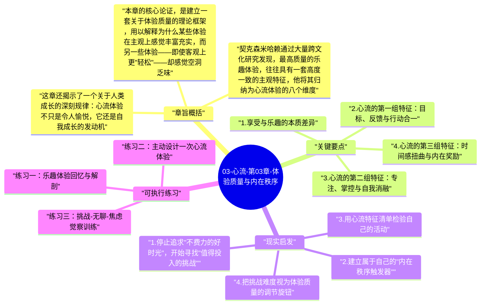

# 03-心流-第03章-体验质量与内在秩序

第三章是《心流》全书中最具说服力的一章，因为它直接回应了我们日常生活中一个反直觉的困惑：为什么有些非常费力的时刻，事后回忆起来却觉得无比充实，甚至是人生中最好的时刻之一？而有些极度轻松、什么都不用做的时光，却让人感到空洞甚至轻微的抑郁？契克森米哈赖在这一章给出了一个系统性的答案：体验质量的高低，不由舒适程度决定，而由意识的组织状态——即内在秩序的存在与否——来决定。这是一个深刻的反转，它挑战了人们关于"好体验等于轻松"的最基本假设。

这一章在全书中处于一个承上启下的位置：它承接了第二章关于意识结构与心理熵的理论，把这些抽象概念落地为具体的体验描述；同时为第四章关于心流触发条件的讨论铺路，因为在理解"什么决定体验质量"之前，我们首先需要理解"心流体验在主观上究竟是什么感觉"。契克森米哈赖在这里列出了心流体验的八个主观特征，这是整本书中最具可操作性的内容之一——它们让心流不再是一个模糊的感觉，而是一套可以对照检验的体验清单。

作者在这章真正要说的，是一个关于"乐趣"（enjoyment）与"享受"（pleasure）的本质区别。享受是被动的，它只要求你接受外界给予的刺激；乐趣是主动的，它要求你投入技能、维持专注、迎接挑战、并在这个过程中推动自我成长。心流是最高形式的乐趣，它发生在你恰好处于能力边界上、全力投入某件有意义的事情时。理解这个区别，是从被动的体验消费者转变为主动的体验建构者的关键一步。

## 章旨概括

本章的核心论证，是建立一套关于体验质量的理论框架，用以解释为什么某些体验在主观上感觉丰富充实，而另一些体验——即使客观上更"轻松"——却感觉空洞乏味。契克森米哈赖首先区分了两种不同的正面体验：享受（pleasure）和乐趣（enjoyment）。享受是满足生理或社会期望的愉悦感，例如饱食之后的满足、或者被他人认可之后的舒适——它依赖外部条件的给予，不需要主动投入，也不会带来自我的成长。乐趣则完全不同，它发生在一个人的能力被最大程度调动、挑战被主动应对的时候，它带来的不只是愉悦感，更是一种自我在行动中被扩展和深化的感觉。

契克森米哈赖通过大量跨文化研究发现，最高质量的乐趣体验，往往具有一套高度一致的主观特征，他将其归纳为心流体验的八个维度。这些特征包括：明确的目标感、行动与意识的合一、自我意识的暂时消融、时间感的扭曲（通常感到时间飞逝）、高度的专注与投入、清晰的即时反馈、掌控感（而非焦虑或无聊），以及体验本身具有内在奖励性（intrinsic reward）——做这件事本身就是目的，不需要外部奖励的驱动。这八个特征合在一起，描述了一种意识高度有序、自我完全沉浸于当下的状态，这正是"内在秩序"的完整表现。

这章还揭示了一个关于人类成长的深刻规律：心流体验不只是令人愉悦，它还是自我成长的发动机。每一次人处于心流状态，都意味着其现有技能刚好被挑战到了边界，而跨越这个挑战之后，技能水平随之提升。这种提升要求下一次进入心流，需要更高难度的挑战，从而形成一个向上螺旋——挑战推动技能，技能寻找更大挑战，心流在这个螺旋中反复出现。这意味着培养心流体验，本质上就是培养一条持续成长的生命轨迹。

## 关键要点

### 1. 享受与乐趣的本质差异

享受（pleasure）是人类最容易获得的正面体验，它来自基本需求的满足：饥饿后的饱食、疲劳后的休息、危险过后的安全感、社交认可带来的满足。享受是人类动机系统中的基础层，它本身是必要且有价值的，但它不会带来成长，也不会留下深刻的意义感。你享受了一顿美食，但第二天这种体验对你的自我结构几乎没有影响；你一觉睡到自然醒，感觉很舒服，但这种舒服不会推动你成为一个更深刻的人。享受是维持生命的基础，但不是让生命变得丰富的动力。

乐趣（enjoyment）则完全是另一回事。它发生在人主动投入、技能被调动、挑战被直面的时候。学会了一个复杂的吉他指法，完成了一篇写作困难但终于找到了突破口的文章，第一次成功做出了一道之前多次失败的菜——这些时刻的体验，不只是愉悦，更包含了一种"我做到了我以为做不到的事情"的深层确信。乐趣在带来愉悦的同时，也带来自我的扩展，这是享受无法给予的。理解了这个区别，就能明白为什么培养乐趣能力，远比追求享受更能为人生带来持久的充实感。

### 2. 心流的第一组特征：目标、反馈与行动合一

心流体验的前三个主观特征，构成了心流发生的基础结构。首先是清晰的目标感：在心流状态中，人清楚地知道下一步要做什么，没有目标的模糊性带来的迷失感。这个目标不必宏大，它可以小到"这个球要打到那个角落"，或者"这句代码需要完成这个功能"——关键是它的清晰性使注意力有了明确的锚点。其次是即时反馈：心流活动会立即告诉你做得如何，棋盘上的局势、音符是否准确、写出的句子是否通顺，这些即时的信息回路让意识能够持续修正，保持与目标的对齐。这两个条件合在一起，创造了第三个特征——行动与意识的高度合一，即"做什么"与"知道自己在做什么"之间的界限消失，行动变得自然流畅，不再需要刻意监控。

这三个特征相互支撑，缺一不可。没有清晰目标，注意力就会漂移；没有即时反馈，行动就会迷失方向感；而这两者缺失时，行动与意识的合一就无从实现。这也解释了为什么许多日常工作难以产生心流：任务目标常常模糊、反馈往往延迟数周甚至数月、而行动与整体目标之间的联系也不清晰。当这三个结构性条件缺失时，人自然进入焦虑或无聊的状态，而非心流。

### 3. 心流的第二组特征：专注、掌控与自我消融

心流的中间三个特征，描述了体验发展到深处时的独特感受。深度专注是心流最显著的表征：心流状态中，所有与当前任务无关的思想和感知都自动退出意识，不需要用意志力去压制它们——它们只是消失了，因为意识容量已经被当前任务完全占满。这种专注不是咬牙强撑的集中，而是自然而然的全情投入，就像水流进了一个天然的河道。随之而来的是一种独特的掌控感：不是对结果的掌控，而是对过程的掌控——感到自己有能力应对当下的挑战，行动与能力之间处于一种流畅的平衡。

最令人惊奇的特征，是自我意识的暂时消融。日常生活中，我们几乎时刻都在进行某种程度的自我监控——"别人怎么看我"、"我表现得好不好"、"我这样做对不对"——这些自我意识的噪音持续占据意识资源，制造大量心理熵。但在深度心流中，这层自我监控完全消失。人不再从旁观者的角度观察自己，而是直接成为行动本身。有趣的是，自我意识消失的同时，体验质量反而达到顶峰；而当心流结束后返回反思，人往往会感到更强的自我感，因为心流体验强化了自我与所做事情之间的内在联系。

### 4. 心流的第三组特征：时间感扭曲与内在奖励

心流体验的最后两个显著特征，是时间感的扭曲和体验的内在奖励性。时间感扭曲是心流最广为人知的特征之一：处于心流中的人，主观时间感觉与客观时钟时间显著脱离，大多数人描述为"时间飞逝"，几小时感觉只过了几分钟；少数情况下（尤其是高度精密的活动）时间感觉被拉长，每一个行动细节都清晰可辨。这种时间感的扭曲不是神秘现象，而是意识容量被完全占用后的自然产物——没有多余的意识资源去追踪时间的流逝，计时系统自然失准。

心流最核心的特征，是它的内在奖励性（autotelic experience）。"Autotelic"来自希腊语，意为"自我为目的"——心流活动之所以被从事，不是因为它会带来外部回报，而是因为活动本身就是有价值的。音乐家演奏，不只是为了掌声；攀岩者攀登，不只是为了证明什么；写作者写作，不只是为了发表。活动本身带来了一种无需辩护的内在满足。这是心流最重要的特征，因为它意味着心流是自驱动的，不依赖外部激励的维持，从根本上摆脱了"享乐适应"的陷阱——每一次心流体验都是完整的，不会因为重复而变得平淡。

### 5. 挑战推动自我成长的螺旋机制

契克森米哈赖揭示了一个关于成长与心流关系的重要机制：心流不只是令人愉悦的状态，它同时也是自我成长的发动机。每一次人在心流中成功应对某个处于自己技能边界的挑战，技能水平都会随之提升。然而技能提升之后，原来那个挑战就变得过于简单，无法再触发心流，只会带来无聊。要再次进入心流，就需要寻找难度更高的挑战。这形成了一个向上的螺旋：挑战推动技能成长，技能成长呼唤更大的挑战，心流在这个螺旋中不断在新的层次上被触发。

这个机制解释了为什么真正投入某一项活动多年的人，往往会越来越热爱它，而非越来越厌倦它——因为随着技能的深化，他们能够感知到越来越精细的挑战层次，发现越来越深的乐趣结构，每一次的心流体验都发生在一个比以前更丰富的能力层次上。与之相反，停留在舒适区、不再寻找新挑战的人，会逐渐陷入无聊，然后转移到其他领域，永远在浅尝辄止的循环中，无法体验到任何一个领域深处的心流。

### 6. 内在秩序的主动建立

所谓"内在秩序"，是契克森米哈赖对高质量体验状态的总体描述：意识内部没有冲突，注意力有明确的方向，行动与目标高度对齐，自我感到完整而非分裂。这种内在秩序不是自然到来的，在日常生活的默认状态下，意识往往处于某种程度的无序中——被过去的遗憾和对未来的焦虑拉扯，被各种未竟的目标所分散。内在秩序需要主动建立，而建立它的最有效工具，就是投入到那些能够吸收全部注意力的有意义的活动中。

一旦理解了这一点，就会发现日常生活中很多看似互不相关的实践——冥想、运动、手工、深度工作、艺术创作——其实都在做同一件事：通过创造一个能够吸收意识、建立内在秩序的场域，帮助人从无序的默认状态回到有序的投入状态。这些实践之所以让人感觉"充电"，不只是因为它们带来了放松，更是因为它们重建了意识的有序结构，让人以更完整的自我状态重新面对世界。

## 现实启发

### 1. 停止追求"不费力的好时光"，开始寻找"值得投入的挑战"

当你在安排休假、业余时间或每天的自由时段时，传统的思维是"找些轻松的事情做"。但契克森米哈赖的研究提示我们，纯粹的轻松往往带来体验的空洞，而非真正的充实。更有效的方式是问自己：这段时间里，有没有一件事情是我目前有能力迎接但还没有完全掌握的，一件真正需要我投入注意力和技能的事？这类事情，才是高质量体验最可靠的来源。这不是说要把休息变成痛苦的高压，而是要把"可以放松的时间"转化为"可以以轻松方式主动投入的时间"，两者在体验质量上有本质差别。

### 2. 建立属于自己的"内在秩序触发器"

每个人都有一些特定的活动，当他们做这些活动时，意识会比较容易进入有序、投入的状态。这些活动不一定要是复杂的技能，也可以是简单但需要全神贯注的事情——例如某种运动、烹饪某道菜、弹一段熟悉的曲子，或者做一件需要手眼协调的手工。识别出这些对你而言有效的"内在秩序触发器"，并在日常生活中有意识地保留这些活动，是维持体验质量稳定的重要策略。它们不只是爱好，而是你重建内在秩序、恢复清醒意识的工具。

### 3. 用心流特征清单检验自己的活动

当你在做某件事时，可以用心流的八个特征来检验当前体验：你有清晰的目标吗？你在得到即时的反馈吗？你的技能与挑战是否匹配（不太难也不太容易）？你感到专注吗？你在享受这个过程本身，还是只是等待它结束？这种检验不是要让你随时分析自己的体验（那会打断心流），而是作为一种事后复盘工具，用来识别哪些活动最接近心流状态，哪些结构性条件在你的具体情况下最容易失效。这种系统性的自我观察，是主动培育心流的有效方法。

### 4. 把挑战难度视为体验质量的调节旋钮

当你在某项活动中感到无聊时，不要立刻转移到别的事情，而是先尝试主动提升挑战难度：给自己设置更高的标准、尝试更难的变体、引入竞争元素或时间限制。当你感到焦虑时，也不要立刻逃避，而是先尝试降低挑战难度或拆解任务，让自己回到有能力应对的区间。把挑战难度视为一个可以主动调节的旋钮，而不是一个由外部决定的固定参数——这种主动性，是在日常生活中创造更多心流时刻的实际操作方法。

## 可执行练习

### 练习一：乐趣体验回忆与解剖

回忆过去六个月内，三个你感到真正投入、过后觉得充实、时间感觉飞逝的体验时刻。对每一个时刻，尽量回想：你当时在做什么具体的事情？挑战难度如何？你的技能是否被充分调动？你是否有清晰的目标和即时的反馈？整个过程中你对自己的关注有多少（自我意识强还是弱）？把这三个体验并排对比，找出它们的共同结构。这个练习的目的是为你建立一张具体的心流体验地图，让你对"什么样的条件下自己最容易进入心流"有清晰的个人化认知。

### 练习二：主动设计一次心流体验

基于上一个练习得到的认识，有意识地为自己设计并执行一次心流体验。选择一项你有一定技能基础的活动，把挑战难度调整到稍高于你舒适区的水平，预留至少一个小时的不被打断的时间，关闭手机通知，设定一个具体的目标，然后开始。在完成之后，立即记录整个过程中的体验：何时感到流动、何时出现分心、哪些条件最有效、哪些条件造成了中断。这个刻意设计的实验，是把心流从偶然发生变为可以主动创造的关键一步。

### 练习三：挑战-无聊-焦虑觉察训练

在接下来两周的日常活动中，特别注意识别自己处于以下哪种状态：无聊（挑战太低）、心流（挑战与技能匹配）、焦虑（挑战太高）。每次觉察到无聊或焦虑时，不要立刻切换活动，而是先尝试调整：如果无聊，给自己增加难度或约束；如果焦虑，把任务拆解成更小的步骤或降低标准。用两周时间持续练习这种主动调节，你会逐渐建立起一种对自己体验状态的精细感知能力，以及把自己引导回心流区间的实际技能。

---

## Mermaid 思维导图

### 图1

