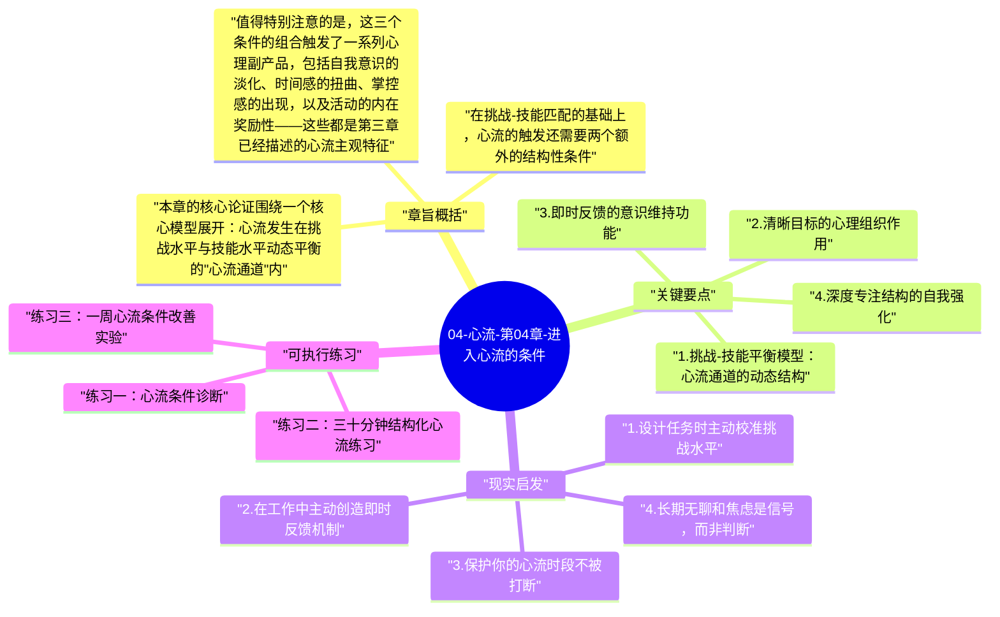

# 04-心流-第04章-进入心流的条件

第四章是《心流》全书中最具工程感的一章。如果说前三章是在构建理论框架，这一章就是在打开引擎盖——契克森米哈赖把心流这个看似神秘的状态，拆解成一套可以识别、可以检验、甚至可以有意识地设计的结构条件。这一章对很多读者来说是全书的高潮，因为它把"心流"从一个令人向往的概念，变成了一套可以付诸实践的蓝图。你不再只是在等待某个偶然降临的美好时刻，而是开始理解，那些时刻为什么会出现，以及如何提高它们出现的频率。

这一章在全书中处于核心枢纽的位置：它承接了第三章对心流体验主观特征的描述，并进一步追问这些体验是如何被触发的；同时为后面所有关于具体领域（身体、智识、工作、人际关系）中的心流讨论提供通用的结构原则。理解了本章的三大触发条件——挑战与技能的动态匹配、清晰的目标设定、及时且准确的反馈——你就获得了一把可以应用于任何领域的心流钥匙。无论是体育运动、艺术创作、程序设计、还是日常工作，这三个条件的逻辑是普遍适用的。

契克森米哈赖在这章真正想说的，是一个关于人类体验设计的深刻洞见：心流不是靠"放松下来"或"进入冥想状态"触发的，它的触发要求恰恰是一种积极的结构对齐——挑战恰好处于能力边界，目标足够清晰，反馈足够及时。这意味着心流是一种需要主动建构条件的状态，而不是一种被动等待的礼物。能够理解并运用这个原理的人，获得了主动设计自己体验质量的真正能力，而这种能力在作者看来，是现代人最需要培养却最容易忽略的内在资源。

## 章旨概括

本章的核心论证围绕一个核心模型展开：心流发生在挑战水平与技能水平动态平衡的"心流通道"内。契克森米哈赖用一个简洁的坐标系描述了这个模型：横轴是技能水平，纵轴是挑战水平。当挑战远高于技能时，人进入焦虑区；当技能远高于挑战时，人进入无聊区；只有当挑战与技能处于大体匹配、且两者都处于较高水平时，人才能进入心流区间。这不是一个静态的状态，而是一个需要持续动态调整的过程——随着技能的提升，需要不断提升挑战水平，才能保持在心流通道内。

在挑战-技能匹配的基础上，心流的触发还需要两个额外的结构性条件。第一是清晰的目标：不是模糊的方向感，而是在任何给定时刻，你都清楚地知道下一步应该做什么。这种目标清晰度不需要是宏大的人生目标，可以小到"这一句代码要实现这个功能"或"这一击要打到球网的正中央"——关键是它的清晰性为注意力提供了可以锚定的方向。第二是即时反馈：活动需要能够立即告诉你行动的效果——球有没有进、音符是否准确、代码是否通过了测试。这种即时的信息回路让意识能够持续修正行动，维持与目标的对齐，从而保持投入状态不因信息缺失而中断。

值得特别注意的是，这三个条件的组合触发了一系列心理副产品，包括自我意识的淡化、时间感的扭曲、掌控感的出现，以及活动的内在奖励性——这些都是第三章已经描述的心流主观特征。本章的贡献在于揭示了这些特征的发生机制：它们不是被直接追求来的，而是三个结构性条件满足后自然涌现的副产品。这个认识至关重要：如果你直接去追求"自我消融"或"时间飞逝"的感觉，往往会适得其反；但如果你专注于建立正确的结构条件，这些体验会自然出现。

## 关键要点

### 1. 挑战-技能平衡模型：心流通道的动态结构

契克森米哈赖的挑战-技能模型，是理解心流触发机制最核心的工具。这个模型说明，心流不是单一固定的状态，而是发生在挑战与技能动态匹配区间内的一个过程性状态。当挑战水平超过技能太多时，人感到焦虑——任务看起来无法应对，注意力被恐惧和不知所措所占据，心理熵急剧上升。当技能水平远超挑战时，人感到无聊——任务显得毫无意义，意识开始游荡，时间感觉漫长而空洞。两种状态都会阻止心流的发生，但原因完全不同。

这个模型的精妙之处在于它的动态性。随着一个人在某项活动中不断练习，技能水平会提升，原来产生心流的挑战水平就会变得过于容易，心流区间会上移。这意味着要持续体验心流，需要不断提升挑战水平——主动寻找更难的任务、更高的标准、更精细的目标。这也意味着停滞不前的人，虽然表面上"做着同样的事情"，却会逐渐失去对这件事的投入感，因为他们的技能超过了挑战，无聊的阴影开始笼罩。心流通道是一条需要不断向前行走才能保持在其中的路径，而非一个可以安稳停留的地方。

### 2. 清晰目标的心理组织作用

清晰的目标是心流触发的第一个结构性条件，其作用远不只是"知道要做什么"那么简单。在心理学层面，清晰的目标为注意力提供了一个可以锚定的焦点，使意识资源能够集中流向同一方向，而不是分散在各种可能性之间。当目标清晰时，意识系统不再需要花费资源来持续评估"我应该做什么"——这个问题已经被回答了，所有的意识资源都可以用于"如何做好它"。这是一种从"方向选择"模式到"执行模式"的切换，后者的意识利用效率远高于前者。

许多人在试图进入心流时遭遇的最大障碍，恰恰是目标的模糊性。"今天要学习"不是一个清晰的目标；"今天要理解量子纠缠的基本原理"才是。"要把这个项目做好"不是清晰目标；"接下来两小时，要完成这个功能模块的核心逻辑，让测试通过"才是。目标的具体性越高，注意力的锚定效果越好，心流越容易发生。学会把模糊的意图转化为具体的行动目标，是主动培育心流最基础也最关键的技能之一，它并不难，但需要一种习惯性的自我追问：我现在具体要完成什么？

### 3. 即时反馈的意识维持功能

即时反馈是心流触发的第二个结构性条件，它的功能是让意识能够持续知道自己的行动是否与目标对齐。反馈是意识-行动-修正这个循环的关键环节：没有反馈，行动就变成了对着虚空发力，意识无法获得任何关于效果的信息，自然无法维持集中和投入。契克森米哈赖特别指出，心流活动之所以特别容易产生心流，往往是因为它们天然具有即时反馈的结构——音乐中每一个音符的准确性立即可辨，体育中每一次动作的效果立即可见，下棋中每一步的影响立即在棋盘上呈现。

许多现代工作场景中，反馈的延迟是心流难以发生的主要障碍之一。一篇报告写完了，需要等几周才能知道客户的反应；一段代码完成了，需要等整个系统集成后才知道是否有问题；一个学习计划执行了，需要等到考试才知道是否有效。这种反馈延迟使意识难以维持与目标的对齐，投入感因此断裂。解决方案是主动为自己创造即时反馈的机制：代码要写可以即时测试的小模块、报告要先和可以即时反馈的人讨论草稿、学习要用即时验证的题目来检验理解。当你主动设计反馈机制，你就在为心流的发生创造必要条件。

### 4. 深度专注结构的自我强化

当挑战-技能匹配、目标清晰、反馈及时这三个条件都满足时，一个自我强化的专注结构就会建立起来。这个结构的特点是正反馈循环：注意力的集中使行动更有效，有效的行动带来正向反馈，正向反馈进一步强化注意力的集中。在这个循环运转顺畅时，进入心流状态所需的"意志力"越来越少，状态本身开始驱动自己向前——这正是"流"这个隐喻的精准之处，就像进入河流主流后，水流本身就在推动你前进，不再需要每一步都用力划水。

这个自我强化结构也解释了为什么心流状态的维持往往比进入更容易：一旦三个条件对齐、循环开始运转，打断它反而需要某种外力（例如外部干扰或突然的任务挫折）。这也是为什么职业运动员、艺术家和深度工作者非常重视保护自己的"心流时段"——他们知道，一旦这个循环被打断，重新启动它需要额外的能量和时间。为深度专注创造不被打断的环境，不是奢侈的自我放纵，而是保护最高效的工作状态的必要投资。

### 5. 自我意识淡化与行动-意识合一

在三个结构性条件满足、深度专注建立之后，心流会产生一系列的心理副现象，其中最值得深入理解的是自我意识的淡化。契克森米哈赖描述，在高度投入的状态中，平时几乎无处不在的自我监控意识——那个时刻评价"我表现得好不好"、"别人会怎么看"、"我有没有足够能力"的内在旁观者——会逐渐淡出。这不是因为自我消失了，而是因为意识容量被完全占用，没有空间留给自我监控的噪音。人变成了行动本身，而不再是观察自己行动的人，这正是"行动与意识合一"的心流特征的发生机制。

这个现象有一个深刻的悖论：自我意识的消融，往往在事后带来自我感的强化。心流结束后，人往往感到一种奇特的完整感和确信感——"我刚刚做到了某件真实的事情，我更了解自己是谁"。这是因为在心流中，自我通过行动得到了真实的检验和表达，而不只是在焦虑和自我批评的内在剧场中循环。这意味着，培养心流不只是改善当下体验质量的方法，也是长期建构更强大、更真实的自我感的途径。

## 现实启发

### 1. 设计任务时主动校准挑战水平

当你开始一项任务时，养成这样的习惯：先评估任务的挑战水平与自己当前技能水平的关系。如果任务太容易（你闭着眼睛都能做），主动为它增加挑战：给自己设置时间限制、提高质量标准、在原有任务上增加额外约束、或者要求自己以更精细的程度完成它。如果任务太难（让你感到焦虑），主动把它拆解为更小的步骤，从你有能力应对的部分开始，逐步建立掌控感和专注度，再向更难的部分推进。这种对任务挑战水平的主动校准，是日常生活中创造心流时刻最实用的方法。

### 2. 在工作中主动创造即时反馈机制

识别你当前工作或学习中反馈最慢的环节，并主动为它设计更快的反馈机制。对于编程，可以使用测试驱动开发，让每一小段代码都能立即验证；对于写作，可以用大声朗读的方式获得对文字质量的即时感知；对于学习，可以用"用自己的语言解释刚学的内容"来立即检验理解深度；对于项目管理，可以用每日站会或者白板可视化来让进展状态更实时可见。每一个反馈加速机制的引入，都在为心流的发生提供更有利的条件，同时也往往会直接提升工作的效率和质量。

### 3. 保护你的心流时段不被打断

如果你通过上面的方法成功进入了心流状态，接下来最重要的事情是保护它不被打断。手机通知、开放办公室的噪音、频繁的会议打断，都是心流的天敌。识别出你一天中最容易进入心流的时间段（通常是精神最清醒的早晨），在这段时间内主动建立物理和数字边界：关闭所有通知、找到相对隔离的工作环境、告知周围人你需要不被打断的时间。这些保护措施不是特权，而是高质量工作和体验的必要条件，值得作为优先级明确地纳入你的日程设计中。

### 4. 长期无聊和焦虑是信号，而非判断

如果你发现自己在某个领域长期感到无聊，这是一个信号：你已经超越了当前的挑战水平，需要主动寻找更高难度的挑战，否则这项活动会越来越难以带来心流。如果你长期感到焦虑，这也是一个信号：挑战水平超过了技能，需要通过学习和练习来提升技能，或者通过任务拆解来降低单次面对的挑战难度。这两种状态都不是在评判你的能力或意志力，而是在告诉你挑战-技能的匹配需要调整。把无聊和焦虑视为调整工具，而非评判自我的证据，是保持心流状态的成熟心理态度。

## 可执行练习

### 练习一：心流条件诊断

选择你生活中一项你想要更深入投入但一直觉得难以进入状态的活动（例如写作、某种乐器、编程、或者某项运动）。对照心流的三个触发条件，逐一诊断：挑战水平与你当前技能的匹配度如何（太高/匹配/太低）？每次执行这项活动时，你是否有足够清晰的具体目标？你能在过程中获得足够及时的反馈吗？把诊断结果写下来，找出最薄弱的那个条件，然后针对它设计一个具体的改善方案。这个诊断过程，往往能揭示出你之前没有意识到的结构性障碍，而针对性的改善通常能立竿见影地提升投入感。

### 练习二：三十分钟结构化心流练习

选择任意一项有一定技能门槛的活动，按照以下结构执行三十分钟的心流练习。首先，花两分钟设定一个具体的、可验证的小目标（例如"完成这首曲子的前两小节不出错"）。然后，确保环境内没有任何会打断你的干扰源，开始执行。在执行过程中，每隔大约五分钟，给自己的专注状态打分（0 到 10），并记录是什么导致了分心（如果有的话）。三十分钟后，复盘这次体验：哪些条件运作良好？哪些条件导致了中断？下一次如何调整？这个结构化练习，是把心流条件理论转化为个人体验知识的最直接方法。

### 练习三：一周心流条件改善实验

在接下来一周内，选择你每天都会从事的一项主要活动（工作中的核心任务、学习中的主要课程，或者某项爱好），刻意针对上面诊断出的最薄弱条件进行一周的改善实验。如果是目标不清晰，每次开始之前用五分钟写下当次的具体目标；如果是反馈不及时，设计一个每次行动结束后立即进行自我评估的机制；如果是挑战-技能不匹配，调整任务难度。一周后，对比这一周的投入感与上一周的差异，记录你观察到的变化。这个一周实验，会让你对心流条件的调节产生直接的经验感知，远比任何理论描述都更有说服力。

---

## Mermaid 思维导图

### 图1

