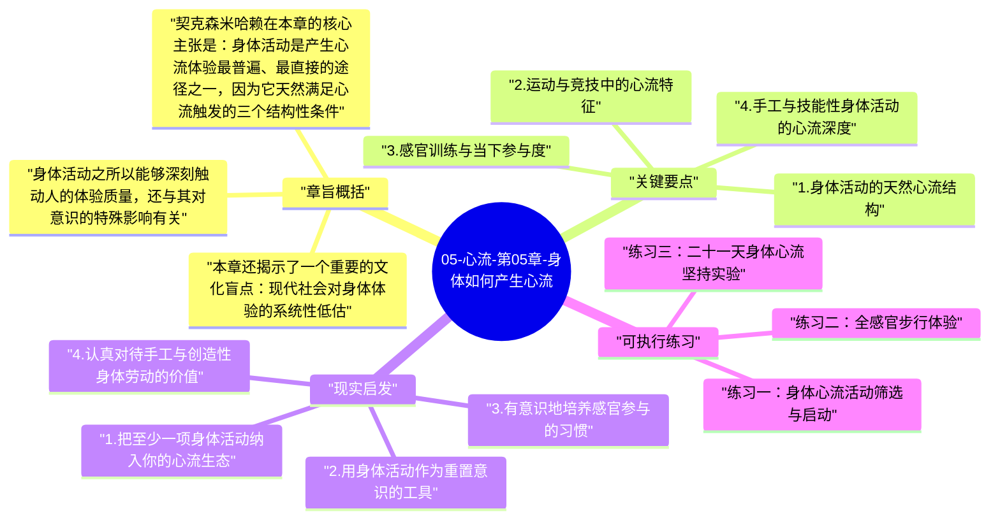

# 05-心流-第05章-身体如何产生心流

第五章是《心流》全书中最具体感、最贴近日常生活的一章。前四章建立的理论框架，在这一章遭遇了一个非常真实的问题：如果心流需要目标清晰、反馈及时和挑战匹配，那么最简单、最容易获得的心流入口在哪里？契克森米哈赖在这一章给出了一个出乎许多人意料的回答：答案就在我们的身体里。身体活动——运动、舞蹈、手工、感官体验——天然具备触发心流的结构性条件，因为它们提供的挑战是具体的、反馈是即时的、参与是全身性的。身体，从来不是意识的累赘，而是进入最优体验最直接、最可靠的通道。

这一章对于那些习惯于在智识活动中寻找心流的读者，是一个重要的扩展和校正。许多人认为只有在"高大上"的活动——音乐演奏、学术研究、艺术创作——中才能获得心流，而忽略了自己的身体活动中潜藏着同样丰富甚至更容易进入的心流可能性。契克森米哈赖通过大量研究表明，无论是职业运动员在赛场上的状态，还是业余爱好者在山间徒步时的专注，或者是一个工匠在手工活中进入的忘我，这些都是同等真实、同等有价值的心流体验。身体活动的民主性，使它成为所有人触手可及的心流入口。

作者在这章真正想传达的，是一个关于身心统一的深刻洞见：现代文化倾向于把身体和心智对立起来，认为身体活动是低级的、心智活动是高级的。但契克森米哈赖的研究说明，这种对立是错误的。最优体验的本质是意识的高度有序状态，而身体活动恰恰是实现这种有序状态的绝佳媒介——因为身体运动会强制意识专注于当下，将抽象的焦虑转化为具体的感知任务，使人从游荡的思维世界返回到真实的当下体验。这不是逃避，而是返回。

## 章旨概括

契克森米哈赖在本章的核心主张是：身体活动是产生心流体验最普遍、最直接的途径之一，因为它天然满足心流触发的三个结构性条件。在大多数身体活动中，挑战是具体可见的（这座山有多陡、这个动作有多难、这个节奏有多快），技能水平是可以感知的（我现在能做到什么程度），两者之间的匹配程度也是实时可以评估的。反馈是即时的，每一次动作的效果都会立即体现在身体的感受、运动的结果、或者他人的反应中。目标在大多数身体活动中也相对清晰，无论是跑完全程、完成一个动作序列、还是手工作品成形的每一个步骤。这种天然的结构性优势，使得身体活动成为心流最友好的入口。

身体活动之所以能够深刻触动人的体验质量，还与其对意识的特殊影响有关。当人进行需要全神贯注的身体活动时，意识会被强制拉回到当下的具体感知——肌肉的张力、平衡的调整、节奏的维持、空间的判断。这些具体的感知任务会自动排挤焦虑性的抽象思维，因为两者争夺同一段意识容量。这也解释了为什么很多人在跑步、游泳、打球之后，会感到精神状态的明显改善——不只是因为生理上的运动效益，更是因为在运动过程中，意识从高熵的焦虑状态被强制带回到了低熵的专注状态，整个意识系统得到了一次"重置"。

本章还揭示了一个重要的文化盲点：现代社会对身体体验的系统性低估。我们倾向于认为，真正重要的体验发生在思想的领域，而身体活动只是维持健康的工具或消遣性的娱乐。但契克森米哈赖的研究表明，许多人在体育、舞蹈、手工等身体活动中报告的心流体验，其深度和意义感并不亚于任何智识活动中的心流。忽视身体维度的心流潜力，是许多人错失大量高质量体验机会的重要原因；而学会主动开发身体活动的心流价值，是扩展个人体验质量版图的一条被低估的有效路径。

## 关键要点

### 1. 身体活动的天然心流结构

与许多抽象的工作任务相比，身体活动在心流触发条件上有一个独特的先天优势：它的挑战是具体的、反馈是即时的、参与是全身性的，这三个特点恰好对应心流触发的三个核心条件。当一个人在攀岩时，岩壁的难度是具体可见的挑战，每一次抓握的成功与否是即时的反馈，整个身体的投入使注意力无法轻易漂移。当一个人在学习一段舞蹈时，动作的精确度是清晰的目标，肌肉的反应和协调感是即时的反馈，技能的进步是可以感知的。这种具体性和即时性，使身体活动在很多情况下比抽象的脑力工作更容易触发心流。

更重要的是，身体活动的参与是全身性的，而非仅仅动用大脑的部分区域。这种全身投入会使意识更难以分心——当你的整个身体都在处理一个即时的物理任务时，抽象的担忧和杂念没有足够的"落脚点"来占据意识。这也是为什么很多人在体育活动中会体验到一种思维的"清空"——这种清空不是刻意努力的结果，而是身体活动的结构性副产品，是全身性参与自然排除认知噪音的效果。

### 2. 运动与竞技中的心流特征

竞技运动和有挑战性的运动活动，是契克森米哈赖研究中报告最高频心流体验的领域之一。职业运动员描述的"巅峰状态"（peak state）与心流的主观特征高度吻合：时间感扭曲、自我意识消失、行动感觉不费力、专注度达到顶峰、对结果有一种超越言语的把握感。但心流并不只属于职业运动员，普通爱好者在他们自己的技能水平上，只要挑战与技能匹配，同样能体验到相似强度的心流。一个业余跑者在全力冲刺最后一公里时的状态，一个初学者第一次完整打完一场羽毛球的投入，都可以是真实的心流体验。

运动心流的特别之处，在于它对身体状态有直接的改善效果，而这种改善反过来又为更深度的心流创造了条件。规律的运动能提升体能基础，使人能够在更高的挑战水平上维持专注；同时运动带来的神经化学变化（内啡肽、多巴胺）会提升整体的情绪基线，使意识在其他活动中也更容易进入有序状态。运动心流因此具有一种"溢出效应"——它不只改善运动时的体验，还通过改善身体和神经系统状态，提升了整个生活的心流发生频率。

### 3. 感官训练与当下参与度

感官体验是身体维度心流的另一个重要入口，但它也是现代人最容易忽视和低估的心流来源。我们的感官能力是可以被有意识地训练和深化的——学会细细品鉴一杯茶的层次，学会在音乐中分辨每一件乐器的音色，学会在绘画时感知光影的细微变化，这些都是感官能力的深化，也是扩展心流体验领域的有效途径。当感官能力得到训练和发展时，原本平淡无奇的日常体验会打开新的维度，每一次感知都可能成为一次小型的沉浸体验。

感官训练的深层价值，在于它提高了人对当下时刻的参与度。现代人的一个普遍状态，是身体在场而意识缺席——物理上存在于某个地方，但注意力却在过去的遗憾、未来的忧虑或无关的思绪中游荡。感官训练是对抗这种状态的有效工具，因为感官本质上只能感知当下——你品尝到的味道只能是现在口中的，你听到的声音只能是此刻耳中的。当你主动投入感官体验时，你就在强制性地把意识拉回到当下，而当下是心流唯一可能发生的时间。

### 4. 手工与技能性身体活动的心流深度

手工活动——木工、编织、陶艺、烹饪、园艺——是契克森米哈赖特别重视的心流来源之一，因为这类活动具有一个独特的结构：它们需要持续的技能投入，同时结果在手中成形，提供了极其具体和满足感极强的即时反馈。一个木匠看到木头在自己手中变成一件精确的家具，一个陶艺师看到泥土在旋转中变成一个碗，这种物质世界中的直接转化，能带来一种其他类型活动中难以复制的实体满足感。手的工作，使人与当下、与物质世界、与自己的创造力之间建立起一种直接而真实的联系。

手工活动的特别之处，还在于它对现代人意识的特殊治愈价值。在一个大量工作都是抽象符号处理的时代，手工活动提供了一种"锚定于物质现实"的体验，这种体验能有效缓解符号工作带来的意识飘离感。程序员、文案、分析师等从事抽象工作的人，往往在接触手工活动时有特别强烈的解脱感，因为他们的意识终于找到了一个可以完全锚定的具体对象。这不是逃避现实，而是通过身体与物质的直接接触，恢复意识的具身感和当下感。

### 5. 身体心流对精神状态的改善效应

契克森米哈赖的研究揭示了一个关于身体与精神关系的重要发现：身体活动中的心流体验，对整体精神状态有显著的改善效果，这种改善超越了单纯的生理健康效益。当人在身体活动中体验到心流时，意识从习惯性的焦虑或无聊状态中被带出，获得了一种清醒和完整的体验；这种体验在活动结束后会产生一种"余韵"，一种持续数小时的清醒感、满足感和较低的心理熵状态。这种余韵效应，使得规律性的身体心流活动成为维持整体精神健康最有效的工具之一。

更深刻的是，身体心流能够打破"意识困在内部"的循环。当一个人陷入焦虑、抑郁或自我怀疑的循环时，这些状态往往是自我强化的——思维在负面模式中循环，越想越陷越深。身体活动，尤其是需要全神贯注的挑战性身体活动，能够强制中断这种内部循环，把意识从"想象中的威胁"带回到"真实世界的挑战"。这不是否认内在问题的存在，而是通过改变意识的参与模式，临时解除焦虑循环的自我强化，为问题的更清醒解决提供条件。

## 现实启发

### 1. 把至少一项身体活动纳入你的心流生态

如果你的生活中目前缺乏规律性的、具有技能成长维度的身体活动，现在是时候引入一项了。这不必是剧烈运动或高难度技能——可以是瑜伽、游泳、乒乓球、骑行、舞蹈、或者任何需要全身参与且具有清晰进步路径的活动。关键是它需要有"挑战的阶梯"——不只是重复同样简单的动作，而是随着技能提升，可以不断探索更高难度的层次。一项这样的身体活动，会成为你整个心流生态中最可靠的"低阻力心流入口"，在你需要从内心焦虑或思维疲劳中恢复时，提供一条随时可以走进的路径。

### 2. 用身体活动作为重置意识的工具

当你发现自己陷入思维的重复循环——同一个焦虑在脑海中反复出现，思绪无法安静下来——不要试图用更多的思考来解决它。这时候，最有效的方法之一是立刻切换到一项需要全身投入的身体活动，哪怕只是十五到二十分钟的快速步行、一段即兴舞蹈，或者整理一个凌乱的空间。这些活动能强制意识从抽象的内部循环返回到具体的身体感知，切断焦虑循环的自我强化。在活动结束后，原本纠缠不清的问题，往往会以更清晰的面貌重新呈现，甚至在活动过程中就无声地获得了解答。

### 3. 有意识地培养感官参与的习惯

在日常生活中，选择一到两个原本是"自动驾驶"模式的日常活动（例如吃饭、淋浴、步行通勤），刻意把它们转化为感官全参与的体验。吃饭时不看手机，专注于食物的味道、质感、温度和气味的变化；步行时放下耳机，把注意力完全放在周围的声音、空气的触感、脚踏地面的感觉上。这些刻意的感官参与练习，不只能提升这些时刻本身的体验质量，还在训练意识"当下锚定"的能力——这种能力一旦被训练强化，会在更复杂的活动中自然展现，使你更容易进入心流状态。

### 4. 认真对待手工与创造性身体劳动的价值

不要把手工活动视为"没有生产力"的消遣。如果你有兴趣学习某种手工技能，或者恢复已经搁置多年的手工爱好，给它一个认真的机会。哪怕是每周两三个小时，投入一项需要手的技能——木工、陶艺、刺绣、烹饪的精进、修缮家居——都会给你的精神状态带来可感知的改善。这类活动之所以有效，不只是因为它们能触发心流，还因为它们能给人一种在抽象劳动为主的时代里越来越稀缺的实体满足感：用自己的双手在物质世界中留下了真实的改变。

## 可执行练习

### 练习一：身体心流活动筛选与启动

回顾你过去的身体活动体验，找出一到两项在进行时最容易让你感到时间飞逝、全神贯注、事后感到充实（而非疲惫）的活动。如果暂时想不到，尝试回忆童年或青少年时期，有哪些身体活动是你自发地沉浸其中、不需要任何人督促就能连续做好几个小时的。把这些活动列出来，从中选择一项目前最有条件重新投入的，制定一个具体的开始计划：第一次从什么时间开始、持续多久、在哪里进行。这个计划越具体，实际执行的可能性就越高，而执行一次之后，回忆中的体验质量会成为你持续投入的最好动力。

### 练习二：全感官步行体验

选择一天，进行一次三十分钟的"全感官步行"。在这次步行中，刻意不携带手机或不戴耳机，把全部注意力放在即时的感官体验上：脚踏地面时的触感变化（水泥、草地、土路各有何不同）、周围的声音层次（近处的步伐声、远处的交通声、偶尔的鸟鸣或风声）、皮肤感知到的温度和微风、眼睛看到的光影和色彩。当发现注意力漂移到思绪时，温和地将它带回到当下的感官输入，不加评判。在步行结束后，立即用几句话记录这次体验与普通步行的差异。这个练习是感官训练最简单的入口，也是训练意识当下锚定能力的有效工具。

### 练习三：二十一天身体心流坚持实验

选定一项身体活动（运动、舞蹈、手工均可），承诺连续二十一天进行，每次至少三十分钟，并遵循心流的三个条件：每次开始之前设定一个具体的目标（不是"练习"，而是"完成……"），在过程中追求即时的技能感知，并在活动难度上逐步适当提升。每三到四天，在日记中记录以下三点：这几天身体活动后的精神状态与之前相比有何变化、哪些条件最有助于进入心流、哪些干扰最容易打断投入状态。二十一天后，你将获得一份关于自己身体心流模式的个人化记录，以及一个已经建立初步习惯基础的高质量体验来源。

---

## Mermaid 思维导图

### 图1

