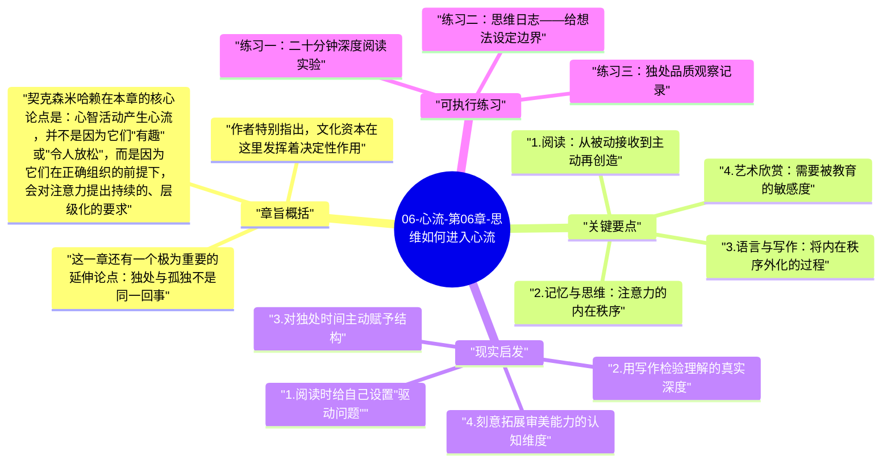

# 06-心流-第06章-思维如何进入心流

前几章的心流案例大多发生在身体行动中：攀岩者抓住岩壁、外科医生专注切开组织、舞蹈演员踩准节拍。这些场景清晰、直观，容易让人相信心流是一种"动"的状态。但米哈里·契克森米哈赖在第六章提出了一个更深的问题：如果一个人只是坐在椅子上读书，或者只是凝视窗外沉思，这种安静的心智活动能否同样产生最优体验？答案是肯定的，但前提远比表面看起来更苛刻。

心智活动的心流并非自动发生。大脑如果只是被动地接收信息——漫无目的地浏览、毫无问题意识地阅读、在话题之间跳来跳去——意识不会进入有序状态，而会陷入一种表面热闹、实则空转的消耗。真正的思维心流要求主动构造：读者必须提出问题、将新内容与已有框架碰撞、在理解缝隙中感到拉力。这种主动构造与攀岩者面对岩壁时的选择本质上没有区别，只是发生在内部，不留下任何外部痕迹。

本章在全书结构中承担着扩展疆界的功能。在作者证明了身体活动与感官体验可以产生心流之后，这一章将心流的适用范围推进到人类最独特的能力领域——语言、记忆、逻辑和艺术审美。如果读者理解了这一章，便会意识到：无论一个人的身体状况如何受限，只要具备训练过的心智，就能在任何环境中自行创造最优体验。这是一种几乎不受外部条件制约的内在自由。

## 章旨概括

契克森米哈赖在本章的核心论点是：心智活动产生心流，并不是因为它们"有趣"或"令人放松"，而是因为它们在正确组织的前提下，会对注意力提出持续的、层级化的要求。记忆活动要求人主动提取并组织信息；语言活动要求精确理解词语背后的意图与语境；阅读在最深层次上是一种对话，读者必须不断预测、验证、修正自己的理解模型。这种持续的认知工作，与心流的结构条件完全吻合——清晰目标、即时反馈、技能与挑战的动态匹配。

作者特别指出，文化资本在这里发挥着决定性作用。一个从未受过音乐训练的人站在音乐厅里听交响乐，他能接收声音，但很难真正参与其中，因为他缺少解读这些声音所需的认知结构。同样，一个从不主动思考哲学问题的人捧起尼采，很可能只能滑过文字表面，而无法感受到思想对抗带来的张力与乐趣。这意味着享受心智活动的能力本身就是一种需要长期培养的技能，而不是人人天生就有的权利。

这一章还有一个极为重要的延伸论点：独处与孤独不是同一回事。孤独是一种痛苦的状态，意识在没有外部支撑的情况下失去秩序，陷入焦虑和无聊。而独处是一种能力，是能在没有社会刺激的条件下仍然自主创造有意义体验的能力。具备丰富心智资源的人，独处是自由；缺乏心智资源的人，独处是折磨。契克森米哈赖的立场非常明确：培养思维心流，就是培养真正意义上的内在自由。

## 关键要点

### 1. 阅读：从被动接收到主动再创造

阅读是日常生活中最常见的心智活动之一，但大多数人的阅读并不会产生心流，原因在于他们处于纯粹被动的状态。被动阅读意味着眼睛在文字上滑动，大脑接收表面信息，但不对这些信息提出任何要求：为什么这个结论成立？这个论点与我已知的事实是否矛盾？作者的真实意图是什么，他说的和他隐含的有什么差别？没有这些内部提问，阅读只是一种低强度的感官刺激，和看一段无聊的视频没有本质区别。

真正能产生心流的阅读，是一种高强度的认知对话。读者必须把新信息不断纳入已有的理解框架，同时在两者不吻合时感受到认知张力，并主动尝试解决这种张力。这个过程在神经层面上非常耗能，但在体验层面上会带来深刻的满足感——那种"啊，我明白了"或"等一下，这里有问题"的感受。契克森米哈赖强调，阅读能力的高下，很大程度上就是这种主动构造能力的高下，而这种能力是可以通过长期练习持续提升的。

### 2. 记忆与思维：注意力的内在秩序

记忆在日常理解中通常被视为一种存储功能，但契克森米哈赖赋予它更主动的意义。记忆是意识将过去经验整合进当前理解的能力，它决定了一个人在面对新问题时能调取多少"工具"。一个记忆丰富、组织良好的人，在遇到复杂问题时，会感到思维空间是宽阔而有结构的；而一个记忆贫乏或杂乱的人，则会在同样的问题面前感到一片空白和无力。

思维活动若要产生心流，需要一个关键条件：清晰可辨的问题边界。完全开放的"随便想想"几乎不会带来心流，因为没有边界就没有反馈，没有反馈就没有满足感。思考一道有具体边界的数学题、分析一个真实案例的利弊、试图用语言精确表达一种复杂感受——这些活动都有足够清晰的目标和即时的反馈回路（我有没有把它说清楚？这个论证有没有漏洞？），因此更容易引发沉浸状态。契克森米哈赖建议，养成给思维活动设定明确问题的习惯，是提升心智心流频率的最直接方法。

### 3. 语言与写作：将内在秩序外化的过程

语言是人类意识活动的最重要载体，它不仅仅是表达工具，更是一种组织思维的结构。当一个人试图用准确的语言描述一种复杂情感或一个模糊想法时，他实际上是在强迫自己的意识进入更高的秩序状态——他必须辨别细节、排除歧义、在近义词中做出选择。这个过程本身就是一种高强度的心智工作，也是为什么写作者常常报告在写作过程中进入深度心流状态的原因。

写作的特殊价值在于它同时提供了创造过程的挑战性和完成后的可见成果。一个好的句子写出来，作者立刻就能感受到"对了"的反馈；一段论证写完，回头阅读时若发现漏洞，这种自我评审本身也是一种参与感。契克森米哈赖将写作视为一种"将内在秩序外化"的实践，它让抽象的思维过程留下痕迹，这些痕迹既是自我理解的证据，也是下一轮思考的起点。即便不以发表为目标的私人写作，也因此具有很高的心流价值。

### 4. 艺术欣赏：需要被教育的敏感度

欣赏艺术常被认为是一种被动的、只需"感受"的体验，但契克森米哈赖对这一观点提出了明确挑战。他指出，没有任何认知框架的艺术欣赏，充其量只是感官刺激，不可能产生深层的心流体验。音乐欣赏需要了解和声结构、节奏语言和作曲家的意图，才能在每一次主题发展时感受到期待与解决的张力；绘画欣赏需要理解构图原则、色彩关系和历史语境，才能在凝视一幅画时感受到思想层次的展开。

这个论点有着深刻的民主含义：艺术欣赏能力不是少数"天才"或"富人"的特权，而是任何人通过系统学习都可以培养的能力。但代价是真实的投入——必须真正花时间去学习，而不是指望单靠"感受"就能突破。契克森米哈赖在这里其实是在反驳一种懒惰的文化相对主义：并不是所有欣赏方式都是平等的，具备更丰富认知框架的欣赏确实能带来更深层的体验，这不是精英主义，而是心流的内在逻辑所决定的。

### 5. 独处能力：心智自给自足的标志

契克森米哈赖将独处能力定义为"在没有外部刺激的情况下，能够自主维持意识秩序的能力"。这种能力之所以重要，是因为任何人都不可能永远依赖外部刺激来填充意识——每天总有一些时间是独自的，这些时间的质量在很大程度上决定了整体生活体验的基底。一个独处能力弱的人，会在安静中立刻感到焦虑、无聊或自我怀疑；而独处能力强的人，则会把这些时间变成思考、创造或深化感知的机会。

培养独处能力的本质，是建立一套不依赖社会认可就能自行运转的内在意义系统。这包括：知道自己真正感兴趣的问题是什么，拥有可以随时深入的知识领域，具备将当下感受转化为有结构的思考的语言能力。契克森米哈赖指出，这种能力并非天生，而是通过长期刻意实践逐步积累的。那些在独处中仍能感到充实的人，往往是在多年积累了足够丰富的心智资源之后才达到这一状态的。

### 6. 心智复杂性：越丰富越容易进入心流

贯穿本章的一个核心洞见是：心智活动的心流潜力与心智的复杂性正相关。一个知识广博、思维有层次的人，面对同样的事物时，能看到更多维度、发现更多值得探索的问题，因此在日常环境中就能持续产生心流的条件。反过来，认知资源贫乏的人必须依赖强烈的外部刺激才能维持意识有序，一旦外部刺激消失，意识就会立刻滑入混乱。

这一规律解释了为什么许多博学多才的人表现出一种令外人不解的"永远不无聊"的特质。他们不是因为有趣的事情特别多，而是因为他们拥有更强的能力，能从平常事物中提取更多可供探索的层次。契克森米哈赖将这种能力称为心智的"自我复杂性"，它是心流能力的深层基础。这意味着，投资于学习和深度阅读，不只是在积累知识，更是在扩展自己产生心流体验的能力半径。

## 现实启发

### 1. 阅读时给自己设置"驱动问题"

许多人读书时感到收效甚微，原因不是书不好，而是他们以纯接收状态进入阅读，没有主动的认知任务来激活参与感。在开始阅读一本书或一篇文章之前，花一两分钟明确一个驱动问题——"这本书的核心论点是什么？""作者想推翻哪种常见认知？""这个观点和我原有的理解有什么冲突？"——可以立刻将阅读状态从被动转为主动。这个问题不需要多么复杂，但它的存在会持续激活注意力，让大脑在每一段中都在寻找与这个问题相关的内容，从而更容易进入投入状态。

### 2. 用写作检验理解的真实深度

当你自认为理解了某个概念或某段论证时，真正的检验不是"我感觉明白了"，而是"我能否用自己的语言把它说清楚"。在读完一章内容后，尝试用三到五句话写出它的核心论点，不借助原文。这个简单的动作会立刻暴露理解的边界——哪些地方真正清晰，哪些地方只是在脑海中留下了一个模糊的印象。写作在这里的价值不是表达，而是检验，是强迫意识进入更高秩序的工具。长期坚持这种写后反思的习惯，会显著提升心智活动产生心流的频率和深度。

### 3. 对独处时间主动赋予结构

如果你发现自己在独处时容易感到空洞或烦躁，这往往不是性格问题，而是心智资源的分配问题。可以尝试为独处时间预先设定一个主题——不是安排具体任务，而是确定一个思考方向或探索领域。比如，确定在这段时间里专门思考一个正在面对的决策，或者深入阅读某个一直想了解的领域。这种轻量级的结构足以给意识提供一个锚点，让注意力在独处中不至于漂浮分散，从而更容易进入沉浸状态。

### 4. 刻意拓展审美能力的认知维度

在日常生活中，找一个你目前觉得"欣赏不来"但直觉上值得深入的领域，比如古典音乐、建筑设计或某种文学风格，系统性地花三到四周时间学习其基础认知框架。了解这个领域的核心概念、历史脉络和评价标准。然后回头再次接触这个领域的作品，观察你的感受是否有变化。这个实验会直接印证契克森米哈赖的论点：审美体验的深度与认知准备程度高度相关，而这种准备是完全可以主动建立的。

## 可执行练习

### 练习一：二十分钟深度阅读实验

选取一篇你认为有价值但曾经读了却感觉没有收获的文章。在开始阅读之前，写下三个你希望从这篇文章中找到答案的具体问题。然后用二十分钟完全专注地阅读，不打断、不看手机，在阅读过程中用笔标注每一处与你的问题有关的段落。读完后，不看原文，试着写出这三个问题的答案以及你认为最重要的一个新认知。对比阅读前后的感受差异，留意专注阅读与漫读之间体验质量的区别。

### 练习二：思维日志——给想法设定边界

在接下来一周里，每天挑选一个困扰你或让你感兴趣的问题，用以下结构写一段思维日志：首先，用一句话精确定义这个问题是什么；其次，写出你目前相信的答案，并说明理由；最后，写出一个可以挑战这个答案的反驳观点，并回应它。整个过程不超过十五分钟，但要求每个部分都用完整的句子写出，不用项目符号。这个练习的目的不是解决问题，而是训练给模糊想法划定边界的能力——这正是思维心流最重要的入口条件。

### 练习三：独处品质观察记录

连续五天，每天安排一段三十分钟的"无手机独处时间"，在这段时间里只允许自己做以下三件事之一：阅读纸质书、手写思考、静坐观察周围环境。每天结束后，用五分钟写下这段时间的体验质量评分（1-10分）和一句话描述。在五天结束后，对比每天的记录，观察哪些内容让独处时间质量更高，哪些状态让意识更容易维持秩序。这个练习的目标是建立独处体验的自我观察能力，为长期改善独处质量提供数据基础。

---

## Mermaid 思维导图

### 图1

