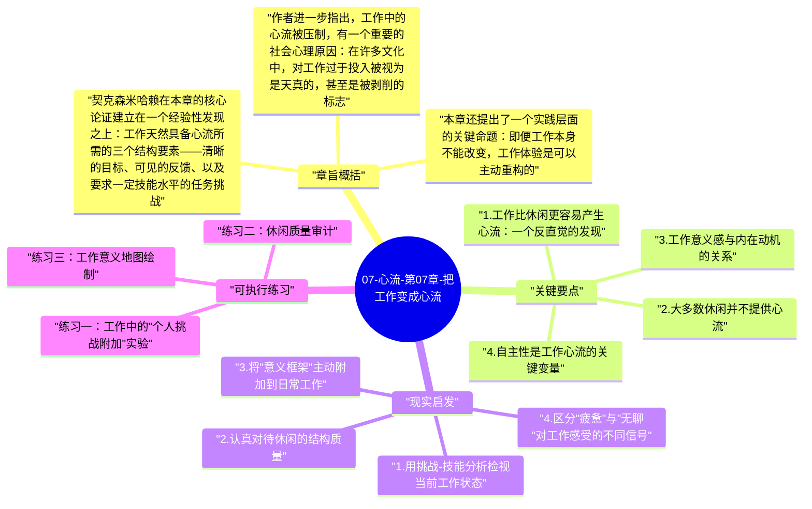

# 07-心流-第07章-把工作变成心流

现代文化对工作有一种根深蒂固的偏见：它是负担，是不得不履行的义务，真正的生活在下班之后才开始。人们用"TGIF"（感谢老天终于到了星期五）来表达这种集体情绪，用假期照片来证明自己的幸福。然而米哈里·契克森米哈赖在第七章中提出了一个令人不安的反命题：大量的经验取样研究表明，人们在工作中体验到心流的频率，往往远高于他们在休闲娱乐中的体验频率。更令人不安的是，即便在报告工作心流的同时，许多人依然声称自己"不想工作，只想休息"。

这种矛盾不是个人的前后不一，而是揭示了一个深刻的文化认知错位。人们用态度来评价工作（"工作是痛苦的"），却用体验来评价休闲（"休假感觉不错"），但两种评价所用的标准根本不同。如果统一用主观体验质量来衡量，结论往往是：工作时的注意力更集中、成就感更清晰、意识状态更有序；而大多数休闲——刷手机、看电视、漫无目的地闲逛——并不提供真正意义上的心流，只是提供了一种疲惫的放松感，意识在这些时间里实际上处于低秩序状态。

本章是全书中最具颠覆性的一章，因为它挑战的不是某一种行为，而是整个现代文化对工作与生活关系的基本叙事。契克森米哈赖并不是在为剥削性工作制度辩护，也不是在要求人们热爱一切工作；他的论点更精确：工作这一活动形式本身，在结构上非常适合产生心流，而问题在于人们往往不知道如何利用这种结构，或者主动选择不去利用它。

## 章旨概括

契克森米哈赖在本章的核心论证建立在一个经验性发现之上：工作天然具备心流所需的三个结构要素——清晰的目标、可见的反馈、以及要求一定技能水平的任务挑战。一名外科医生清楚手术目标，能够实时感知操作是否准确，需要极高的专注度；一名程序员知道代码需要实现什么功能，编译错误是即时反馈，逻辑挑战需要技能应对。这些特征与登山或下棋没有本质区别，而这些活动早已被确认为心流的典型场景。问题不在于工作是否具备心流条件，而在于许多工作者从未意识到这些条件的存在，或者主动压制了在工作中投入的冲动。

作者进一步指出，工作中的心流被压制，有一个重要的社会心理原因：在许多文化中，对工作过于投入被视为是天真的，甚至是被剥削的标志。"为什么要这么卖力？又不是给自己干的。"这种态度形成了一道防御墙，把自我与工作体验隔离开来。一个人可以身体上在工作，但心理上却处于不参与状态——他完成了任务，但没有允许自己在完成过程中感受到挑战与成就。这种自我保护的代价是极高的：它不仅消除了工作中可能的心流，还把数千小时的清醒时间变成了主观体验上的空白。

本章还提出了一个实践层面的关键命题：即便工作本身不能改变，工作体验是可以主动重构的。通过调整自己关注的任务维度、为无聊的环节设置个人挑战、在标准要求之上加入自我设定的卓越目标，一个人可以在制度不变的情况下显著提升工作时的主观投入感。这种策略后来被研究者发展为"工作重塑"（job crafting）理论，而契克森米哈赖是最早在理论上系统阐述其心理学基础的人之一。

## 关键要点

### 1. 工作比休闲更容易产生心流：一个反直觉的发现

契克森米哈赖的经验取样研究（ESM）对数百名受试者进行了随机时刻的体验报告采集，要求他们在被呼机随机叫停时，立刻记录当前的活动、专注程度、挑战感和满足感。结果显示，在工作状态下，受试者报告高度专注和挑战匹配的频率，比在自由时间中要高出许多。工作环境倾向于让人明确自己在做什么，任务的边界相对清晰，因此更容易激活注意力的集中状态。

然而与此同时，同一批受试者在态度层面的报告却与此相反：他们希望减少工作时间，增加休闲时间，认为休闲才是真正的满足来源。这个数据上的矛盾正是本章的核心悖论。契克森米哈赖认为，这是因为人们用"我应该感觉如何"来评价工作，而不是用"我实际感觉如何"。文化的脚本告诉他们工作是负担，他们便接受了这个脚本，即便实际体验与之背道而驰。解开这个悖论，需要学会区分文化期待与真实体验，并以后者为准重新理解自己的生活状态。

### 2. 大多数休闲并不提供心流

如果工作比人们以为的更容易心流，那么休闲又是什么状态？契克森米哈赖的数据同样揭示了一个令人不适的事实：大多数人所享受的休闲活动——看电视、刷社交媒体、被动地参加派对——在主观体验质量上往往低于工作。这些活动的共同特征是：几乎不需要技能，几乎没有明确目标，反馈是弱的或滞后的。看电视时，观众不需要做任何决定，不需要调用任何已有技能，内容直接进入意识，消耗注意力而不创造任何内部成就。

这并不意味着休闲是错误的选择，而是说明大多数人选择的休闲形式在心理学意义上是低效的。它们带来的是解脱——从工作压力中短暂撤离——但不带来充能。真正能使人恢复精力的休闲，是那些同样具备心流结构的活动：主动体育运动、烹饪一道复杂菜肴、与朋友进行深度对话、园艺或手工制作。这些活动要求技能、提供反馈、有明确目标，因此能在休闲的形式下产生工作级别的心流体验，而这才是真正意义上的恢复。

### 3. 工作意义感与内在动机的关系

一项工作是否能产生心流，在很大程度上取决于工作者是否理解自己的工作对更大目标的贡献。当一个人把自己的日常任务纳入更宏观的意义框架时，同样的动作会产生完全不同的体验质量。三个砌砖工人面对同样的工作，一个说"我在砌砖"，一个说"我在建造一堵墙"，一个说"我在建造一座大教堂"——最后一个人在工作时拥有最丰富的心流潜力，因为每一块砖对他来说都是更大意义单元的一部分，每一块砖的精准摆放都是可以感到自豪的。

这个道理延伸到现代职场意味着：如果一个人不理解自己的工作在更大系统中的位置，即便工作结构再完善，心流也难以持续。这不是要求每份工作都崇高伟大，而是要求工作者主动建立自己与工作之间的意义连接。很多时候，这种连接的建立不需要工作本身发生任何改变，只需要工作者改变看待工作的方式——这正是契克森米哈赖所说的"内在动机"优先于"外在条件"的核心含义。

### 4. 自主性是工作心流的关键变量

在所有影响工作心流的因素中，自主性——对如何完成工作拥有选择权——是最重要的单一变量之一。即便工作内容本身枯燥，如果工作者能够自主决定节奏、方法和优先顺序，主观投入感会显著提升。这是因为自主性将工作的结果与自我的决策直接挂钩：我选择了这样做，因此结果是我的。这种"这是我的选择"的感受，会把外部任务转化为内在投入，使工作更接近心流状态。

相反，强制性极高、监督极严的工作环境，即便任务本身有挑战性，心流也难以持续出现——因为注意力的一部分始终被用于应对外部控制，无法完全投入任务本身。这一发现对管理者有重要启示：给予员工更多自主空间，在其他条件不变的情况下，就能显著提升工作体验质量。但契克森米哈赖同时指出，自主性的价值只能由具备足够技能的人来充分利用；如果技能不足，自主只会带来焦虑，而不是心流。

### 5. 工作重构：在制度约束中主动创造心流条件

即便不能改变工作内容或工作环境，工作者仍然可以通过主动的心理重构来改变工作体验。契克森米哈赖描述了一个工厂流水线工人的案例，这名工人将单调的重复操作转化为一种个人挑战游戏：他为自己设定了比规定更高的速度目标，同时不允许质量下降；他跟踪自己的个人最佳记录，并尝试突破。结果，同样的工作环境，他的工作体验完全不同于身边的同事，他的满足感和专注程度都达到了心流水平。

这种主动重构需要的不是外部资源，而是一种特定的心理态度：将当前任务视为技能展示和自我超越的舞台，而不是外部强加的负担。契克森米哈赖将这种能力称为"自动目的性"（autotelic experience）倾向，它不是每个人天生都有的特质，但可以通过刻意练习来强化。关键步骤是：清晰化目前任务的目标，为自己设定略高于当前舒适区的挑战标准，并创建某种形式的自我反馈机制来追踪进展。

### 6. 职业认同与心流的双向强化

一个人与自己工作的认同程度，会与工作心流形成双向强化关系。认同度高的人更愿意投入，投入产生心流，心流加深认同，认同促进进一步投入。反过来，一个对工作持距离感的人，会因不投入而错过心流，缺少心流的体验会进一步强化"工作没有意义"的判断，形成负向螺旋。这解释了为什么两个能力相近、工作条件相似的人，可以在同一岗位上有截然不同的长期发展轨迹——其根源不在于外部机遇，而在于他们与工作关系的基本定性。

这一论点的重要推论是：职业发展规划不能只关注"找到对的工作"，还必须关注"与当前工作建立正确关系"。因为对工作的认同感，在很大程度上是可以主动选择和主动建构的。契克森米哈赖并不是在说人应该对任何工作都逆来顺受，而是说，在选择改变工作之前，先真正诚实地检验自己是否穷尽了在当前工作中创造心流的可能性——因为如果缺少这种能力，换到任何工作也会重蹈覆辙。

## 现实启发

### 1. 用挑战-技能分析检视当前工作状态

在任意一个工作日结束后，花五分钟做一次简单的反思：今天哪些任务让你感到轻微的"拉力"——既不是压倒性的焦虑，也不是无聊的重复？那些任务最接近心流的结构条件。如果发现大多数任务都落在"无聊"区间，下一步的问题不是"换工作"，而是"我能否为这些任务设定更高的个人标准或更复杂的挑战方式？"如果大多数任务都在"焦虑"区间，则需要考虑是否缺少必要的技能支持，并制定补强计划。这个分析工具非常简单，但能有效将模糊的工作不满情绪转化为可操作的调整方向。

### 2. 认真对待休闲的结构质量

如果发现自己在大量休闲之后依然感到疲惫或空虚，这是一个信号：当前选择的休闲形式没有提供真正的心理充能。尝试用一个月时间，将一部分原本用于被动休闲（屏幕娱乐）的时间，替换为具有心流结构的主动休闲——游泳、学习一件乐器、系统学习一门感兴趣的学科。观察这种替换是否改变了整体的精力恢复感。这个实验的意义在于重新定义"休息"：真正的休息不一定是停止活动，而是切换到一种不同维度的有结构投入。

### 3. 将"意义框架"主动附加到日常工作

选择工作中一项你认为最机械、最无趣的例行任务，尝试用三种不同的角度重新解释它与更大目标的关系：它如何服务于你的客户或同事？它如何是你整体专业能力的一个训练维度？如果你做得特别好，它如何体现你对自己工作标准的承诺？这个重框练习不是在假装枯燥不枯燥，而是在测试意义感对体验质量的实际影响。契克森米哈赖的理论预测这会有效；你的实际体验将告诉你对你个人而言效果如何，以及哪种角度的重框最能激活你的投入感。

### 4. 区分"疲惫"与"无聊"对工作感受的不同信号

工作后的疲惫有两种截然不同的质地：一种是深度投入之后的满足性疲惫，类似于运动后的肌肉酸痛，身体虽累但意识清晰、有完成感；另一种是长期低投入状态下的消耗性疲惫，不是因为用力过猛，而是因为注意力长期处于无聊的悬浮状态，被低强度却持续的无意义感消耗。学会区分这两种疲惫，对于理解自己的工作心流状态极为重要。前者意味着心流正在发生；后者意味着需要主动寻找方法重新激活投入感。

## 可执行练习

### 练习一：工作中的"个人挑战附加"实验

选择本周内一项你认为最例行化的工作任务，为这项任务设定一个比常规要求略高的个人标准——可以是速度、精度、创意程度或完整性的任何维度。这个标准必须是你自己设定的，而不是外部要求的；它必须稍高于你的舒适区，但不至于难到令你绝望。在执行这项任务时，专注于追踪自己是否达到了这个个人标准，并在每次完成后做一个简短的自我评分。坚持一整周，记录这种"附加挑战"对你工作时注意力状态的影响——它是否改变了你对这项任务的态度，是否让你感到更加投入？

### 练习二：休闲质量审计

在接下来的七天里，每天晚上用三分钟记录当天休闲时间的分配：做了什么、持续多久、结束时的主观感受（1-10分），以及这段时间是否让你感到充能还是进一步消耗。七天结束后，统计不同休闲活动的平均评分，识别哪类活动真正给你带来了恢复感，哪类活动的分数低于预期。根据这个数据，在接下来一周有意识地减少低分休闲活动，增加高分活动的比例。这个练习的目标不是消除放松，而是建立对自己真实休闲需求的更准确认知，从数据而非惯性来设计休闲时间。

### 练习三：工作意义地图绘制

花二十分钟，在纸上画出你当前工作的"意义地图"：中心是你的主要日常工作内容，向外画出这些工作如何服务于直接受益者（同事、客户、用户），再向外画出这些受益关系如何汇入更大的社会或专业价值链。不需要写得精确，重点是视觉化地呈现你的日常行动与更宏观目标之间的连接。完成后，审视这张地图上有没有你从未意识到的有意义的连接，有没有长期被你忽视的贡献维度。这张地图不是要美化工作，而是要让你更清楚地看到：你的日常投入实际上是接入了哪些更大的意义脉络。

---

## Mermaid 思维导图

### 图1

