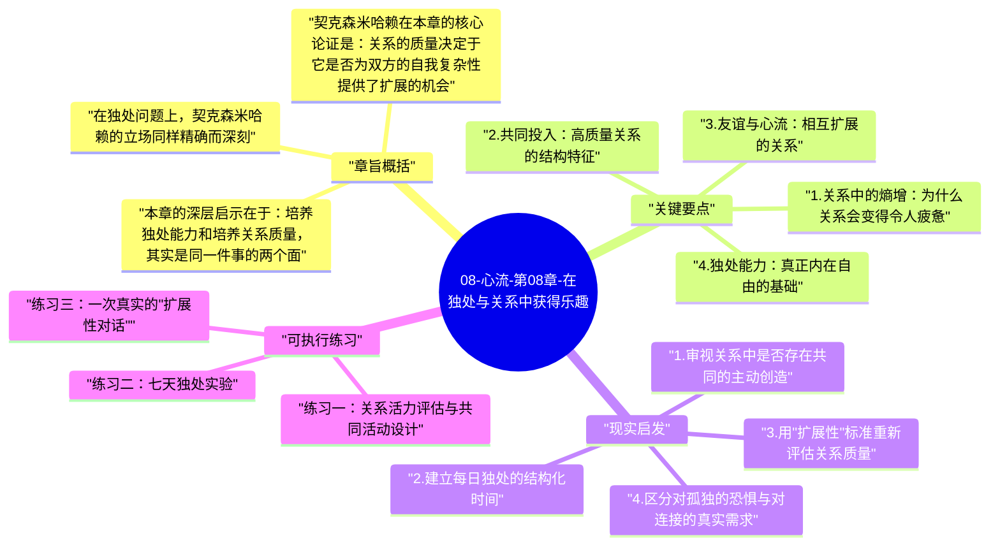

# 08-心流-第08章-在独处与关系中获得乐趣

当人们谈论幸福的来源时，关系总是排在前列：朋友、家人、爱人、社群。然而米哈里·契克森米哈赖在第八章中提出了一个更为精细的论断，他不满足于"关系好所以幸福"这种简单等式，而是深入到关系的内部结构，追问：什么样的关系能够产生心流？什么样的独处能够带来最优体验？为什么有些人在人群中感到孤独，另一些人却能在独自一人时感到充实？这些问题的答案，要求我们彻底重新思考社交与独处的意义。

关系与独处看似是人类存在的两极，但契克森米哈赖揭示了它们更深的共同结构：两者都只是意识状态的容器，容器的质量取决于内部体验的组织方式。一段关系可以是高熵的——充满控制、依赖、无聊和逃避——也可以是低熵的——充满共同投入、相互扩展和真实连接。独处同样可以是混乱的意识漂浮，也可以是有结构的内在丰富。决定体验质量的，不是人是否在场，而是意识是否有序。

本章在全书架构中承担着重要的现实化功能：它将心流从个人体验扩展到人际领域，证明最优体验不只发生在专注工作或孤独攀岩的时刻，也可以在日常的对话、家庭互动和独处沉思中稳定出现。对大多数读者而言，这一章的洞见最贴近日常生活，因为关系和独处几乎填满了所有非工作时间。理解这一章，意味着有机会系统性地提升生活中最大量的那部分时间的体验质量。

## 章旨概括

契克森米哈赖在本章的核心论证是：关系的质量决定于它是否为双方的自我复杂性提供了扩展的机会。他将高质量关系定义为"能够不断为双方带来新挑战、新视角和新技能的互动系统"。这与通常意义上的"和谐关系"有本质区别——表面和谐的关系可能建立在双方的相互迁就和自我压缩之上，而真正高质量的关系要求双方都在关系中不断成长，不是变得相同，而是因为对方的存在而变得更复杂、更有能力。这样的关系是双方共同创造的心流场，而不是情绪的相互消耗场。

在独处问题上，契克森米哈赖的立场同样精确而深刻。他区分了两种根本不同的独处体验：一种是能力性独处，拥有足够的心智资源在没有外部刺激的情况下维持内在秩序，能主动创造意义和体验；另一种是匮乏性独处，意识在独自面对自身时陷入焦虑、无聊或自我怀疑，迫切需要外部刺激来填充意识。后一种状态的人，正是因为独处能力弱，才在关系中产生过度依赖，把关系变成填补内心空缺的工具而非共同成长的平台。

本章的深层启示在于：培养独处能力和培养关系质量，其实是同一件事的两个面。一个能独处的人，带入关系的是完整的自我，而不是半空的容器；一个真正投入关系的人，会在关系中发展出在独处时也能使用的心智资源。这种良性循环的起点是独处能力的建立——学会在一个人的时候也能感到充实，是真正高质量人际关系的先决条件，而不是它的对立面。

## 关键要点

### 1. 关系中的熵增：为什么关系会变得令人疲惫

契克森米哈赖用热力学的"熵"概念来描述关系的退化过程。一段关系在没有持续投入的情况下，会自然趋向熵增——互动变得重复，对话变得程式化，双方在对方面前的行为越来越可预测，最终关系变成了一种习惯性的舒适感而非真实的连接。这种状态不一定令人痛苦，但它极少产生心流，因为它缺少心流的核心条件：挑战性和成长空间。

熵增的关系之所以难以察觉，是因为它的退化往往是渐进的、舒适的。人们进入一种低要求的互动模式，减少真实表达、减少分歧、减少对彼此的好奇，换取表面的和平。但这种和平是以体验质量的持续降低为代价的。契克森米哈赖指出，维护关系中的"负熵"——主动对抗熵增——需要双方持续投入创造共同新体验的意愿，这不是一次性的建立，而是需要终生维护的动态过程。

### 2. 共同投入：高质量关系的结构特征

真正能产生心流的关系，最鲜明的特征是双方对共同活动的投入，而不仅仅是对彼此情绪状态的关注。契克森米哈赖注意到，很多人对"好关系"的想象是"你懂我、我懂你"——主要是情感层面的相互理解。但他的研究表明，最高质量的关系往往是那些围绕共同目标或共同兴趣建立起来的关系：一起攀岩的伙伴、共同演奏的音乐家、在同一个科研项目上并肩工作的同事。这些关系之所以深刻，是因为共同的挑战创造了共同的心流，而共同的心流比单纯的情感交流更能建立持久的纽带。

这一洞见对家庭关系同样适用。契克森米哈赖发现，在他研究的家庭中，那些报告最高家庭幸福感的家庭，往往是那些有共同活动——共同做饭、共同运动、共同探索某个兴趣领域——而不只是共同消费娱乐内容的家庭。共同看电视和共同做一道复杂菜肴，在表面上都是"家人在一起"，但在心流结构上完全不同：前者是共同被动消耗，后者是共同主动创造，只有后者能带来真正的连接感。

### 3. 友谊与心流：相互扩展的关系

契克森米哈赖对友谊的分析揭示了一个往往被忽视的维度：最好的友谊不是让你感到最被接受的那段，而是让你的自我边界不断扩展的那段。真正的朋友会把你引向你原本不会去探索的思想领域，会对你的观点提出诚实的挑战，会因为他们的存在而让你发展出新的技能或视角。这种"扩展性"是高质量友谊与仅仅"合得来"的关系之间的核心区别。

反过来，让你永远感到舒适、从不构成任何挑战的关系，虽然令人愉快，却很难产生深层的心流。契克森米哈赖并不是在说友谊应该充满摩擦，而是说，友谊中存在一定程度的认知和情感挑战，是这段关系具有生命力的标志。如果一段关系已经许多年没有给你带来任何新的视角或思考角度，值得认真思考：这段关系是在维持你的成长，还是仅仅在维持你的舒适感？

### 4. 独处能力：真正内在自由的基础

契克森米哈赖将独处能力视为人格成熟度的核心指标之一。他定义独处能力为"在没有他人在场的情况下，能够不依赖外部刺激而自主维持有序意识的能力"。这种能力的缺乏，在现代社会中极为普遍：人们对手机的依赖、对背景音乐的需要、对永不停歇社交的渴望，很多时候都是独处能力不足的表现——意识无法在没有外部支撑的情况下自我组织，因此持续需要外部刺激来填充。

独处能力的建立，需要两个条件：一是足够丰富的内在心智资源（知识、问题、想象力、审美感知），提供独处时的材料；二是足够强的注意力调控能力，能够在独处时主动选择将注意力投向有价值的内部活动，而不是让它随机漂浮。这两个条件都不是天生的，都需要长期培养。但一旦建立，独处就从折磨变成礼物——每一段独自的时间，都成为不被打扰地深化理解、整理思维或沉浸体验的机会。

### 5. 孤独与独处：两种根本不同的状态

孤独（loneliness）和独处（solitude）是两个常被混淆但本质不同的概念。孤独是一种痛苦状态，意识在缺少社会连接时感到空缺和威胁；独处是一种能力状态，意识能够在独自一人时保持充实和秩序。一个人可以在人群中感到极度孤独——当周围的人无法理解他的内心世界时；也可以在完全独处时感到极度充实——当他的内心世界足够丰富可以自给自足时。

契克森米哈赖的观点是，减少孤独感的最根本方式，不是增加社交活动的数量，而是发展能够在独处中维持意识秩序的内在能力。因为如果一个人只有在他人在场时才能感到有意义，那他的幸福感将永远取决于一个不稳定的外部因素——他人是否愿意陪伴。而当一个人具备了真正的独处能力，他不再是因为"需要他人"而与他人在一起，而是因为"选择与他人共同创造"而与他人在一起，这种关系的基础更牢固，质量也更高。

### 6. 家庭作为心流场所：共同成长的系统

家庭是大多数人最重要的关系系统，但家庭也是熵增最迅速、最难察觉的场所之一。契克森米哈赖对家庭的分析揭示了一个反直觉的发现：家庭成员相处的时间长，并不自动带来更深的连接；决定家庭关系质量的，是相处时间的结构——这些时间有多少用于共同的主动创造，有多少用于各自的被动消费。一个家庭若只是共同住在一个屋子里、各看各的屏幕，在空间上是在一起的，但在心流意义上是完全分离的。

契克森米哈赖建议，家庭中的高质量时间，应该是围绕共同挑战和共同目标组织的：共同学习某种技能、共同规划一次旅行并在过程中分工、共同完成一个有创意的项目。这些活动的价值不只在于其结果，而在于过程中共同面对困难和享受成就的体验，这些体验会成为家庭记忆的核心，是家庭凝聚力最深厚的来源。相比之下，共同消费——看同一部电影、在同一家餐厅吃饭——带来的联结感要浅薄得多，因为它们没有要求共同的主动投入。

## 现实启发

### 1. 审视关系中是否存在共同的主动创造

检视你目前最重要的几段关系——伴侣、最好的朋友、家人——在过去一个月里，你们共同做了哪些需要主动投入的事情？如果答案主要是"一起吃饭"、"一起看电视"、"一起刷手机"，这意味着这些关系正在以被动消费为主要黏合剂，心流含量极低。不需要大幅改变日常，只需要在现有相处时间中加入一个共同的主动活动——共同烹饪一道从未尝试过的菜、共同学一个新技能、共同规划一个有具体挑战的项目——就能显著改变关系的体验质量。

### 2. 建立每日独处的结构化时间

如果你发现自己很难一个人待着，或者独处时间总是以刷手机结束，可以尝试为每天设定一段短暂但结构化的独处时间——十五到三十分钟，在这段时间内只允许自己做一件具有心智活动特征的事：写作、阅读、沉思一个具体问题、或者只是在没有任何媒体的情况下坐着观察自己的思绪。这个练习的目的不是立刻产生心流，而是逐渐建立意识在独处中的自组织能力。随着时间推移，这段独处时间会从"无聊的煎熬"转变为"期待的充电"。

### 3. 用"扩展性"标准重新评估关系质量

在评估一段关系时，除了"我在这段关系中感觉是否舒服"，加入一个新标准：这段关系在过去一年里是否让我的视野、技能或自我理解有任何扩展？如果答案是否定的——这段关系没有给你带来任何新的观点、挑战或成长——值得认真思考这段关系的价值定位：它是一段能够共同成长的关系，还是仅仅提供舒适感和情感安全感的避风港？两者都有价值，但清楚地知道每段关系的定位，能帮助你更理性地分配投入，也更清楚地设定期望。

### 4. 区分对孤独的恐惧与对连接的真实需求

下次感到"需要找人说话"或"需要看看手机"的冲动时，先暂停一秒，诚实地识别这种冲动的来源：是真实的连接需求——想与特定的人分享一个真实的体验——还是独处焦虑——意识在失去外部支撑时的求救信号？如果是后者，练习不立刻响应这个冲动，而是继续独处五到十分钟，观察焦虑是否会自然消散。这个识别练习能帮助你逐步区分"需要他人"与"想要他人"的差别，前者是依赖，后者是真实的连接意愿——它们在体验上非常相似，但来源和影响完全不同。

## 可执行练习

### 练习一：关系活力评估与共同活动设计

选择你最重要的一段关系，回顾最近三个月的相处记录，列出所有共同做过的事情，并为每项活动标注：这是主动投入型（需要技能、有目标、有挑战）还是被动消费型（观看、等待、消遣）。计算两者的比例。如果主动投入型活动少于30%，花十分钟与对方共同设计一个在接下来一个月内可以一起尝试的新的主动活动，条件是：双方都不擅长、需要协作、有明确的目标或成果。执行这个活动，并在结束后各自记录体验感受。

### 练习二：七天独处实验

连续七天，每天为自己安排二十分钟的"纯独处"时间：没有手机、没有音乐、没有任何媒体。在这二十分钟里，可以阅读纸书、写作、或者只是坐着思考。每天结束后记录三件事：这段时间里你的注意力主要落在哪里、这段时间结束时的主观感受评分（1-10），以及今天独处时间和昨天相比有什么变化。七天结束后，回看你的记录，观察独处体验的质量是否有任何趋势性变化，以及什么类型的独处活动对你个人最有效。

### 练习三：一次真实的"扩展性对话"

选择一个你认为有深度的朋友，主动发起一次非日常性质的对话：不是分享生活琐事，而是共同探讨一个真实的智识或存在问题——你们对某件事情的根本分歧是什么、为什么你们的判断会不同、对方理解世界的方式和你有什么本质差异。在对话中，练习真正的倾听——不是在等待说话机会，而是真正试图理解对方看待世界的方式。对话结束后，写下一件你在这次对话中学到的、改变了你某个想法的内容。这种有意识的"扩展性对话"实践，是将友谊从情感维系层面提升到共同成长层面的最直接方法。

---

## Mermaid 思维导图

### 图1

