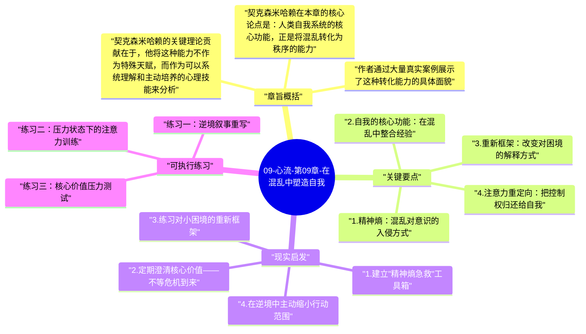

# 09-心流-第09章-在混乱中塑造自我

前八章的心流讨论，大多建立在一个隐含的条件之上：生活基本正常，外部世界提供了足够的稳定性，一个人可以自主选择活动、设定目标、追求挑战。但真实的人类生活并非总是如此。失业、疾病、事故、亲人离世、关系破裂、身陷囹圄——这些无法选择的灾难性处境，会以极快的速度将一个人的意识秩序彻底打乱。米哈里·契克森米哈赖在第九章将心流理论带入这些最严峻的场景，追问：当外部混乱无法避免时，人是否仍然可以在内部维持秩序？这种能力是如何运作的？它能否被培养？

契克森米哈赖在本章中描述了一种他称之为"转化性应对"（transformative coping）的心理能力：将逆境本身转化为自我成长原材料的能力。这不是盲目的乐观主义，也不是对痛苦的否认，而是一种精确的认知-意志操作：在承认困境真实存在的前提下，主动选择对这种困境进行有意义的解释，并从中提炼出可以采取行动的任务方向。这种能力不是每个人天生都有的，但它可以通过理解其机制和系统性练习来逐步建立。

本章在全书中处于转折位置。前几章展示了心流在顺境中的面貌，这一章则展示心流在逆境中的面貌——事实上，这才是心流理论最深刻的意义所在。如果心流只在顺境中才能发生，它的价值就是有限的；但如果人能在逆境中同样保持对意识的主动组织，那么心流就不只是一种享受方式，而是一种存在策略，一种在任何外部条件下都能维持尊严和方向的内在能力。

## 章旨概括

契克森米哈赖在本章的核心论点是：人类自我系统的核心功能，正是将混乱转化为秩序的能力。他指出，每一个重大的外部冲击——无论是失业还是失去所爱之人——都会对意识注入大量"精神熵"（psychic entropy），即混乱的、无法整合的信息，这些信息会占据注意力，阻止目标导向的行动，产生焦虑、绝望或麻木的感受。一个心理脆弱的自我系统，会在这种精神熵的冲击下瓦解；而一个具备转化能力的自我系统，会逐渐找到方法将这些混乱信息重新纳入有意义的框架，恢复意识的有序状态，并在这个过程中实际上扩大和强化了自身。

作者通过大量真实案例展示了这种转化能力的具体面貌。他提到一位在集中营中存活下来的人，即便在最极端的剥夺条件下，仍然主动维持对内心世界的控制：记忆诗歌、在脑海中构建建筑、为自己设定小型的认知挑战。他提到一位在车祸中失去双腿的运动员，最终在轮椅竞技中找到了同样深度的挑战感和成就感。他提到在慢性病中找到新的生活节律和意义感的患者。这些案例的共同点不是外部条件有多好，而是当事人主动决定不让外部灾难完全主宰自己的内部体验。

契克森米哈赖的关键理论贡献在于，他将这种能力不作为特殊天赋，而作为可以系统理解和主动培养的心理技能来分析。他识别出几个核心机制：将注意力重新定向到可控任务上，对困境进行重新框架，从逆境中提炼出可以学习和成长的具体方向，以及建立一种不依赖外部条件的内在意义参照系。这些机制的组合，构成了他所说的"韧性"的实质内容——韧性不是硬撑，而是一种有结构的、主动的意识组织能力。

## 关键要点

### 1. 精神熵：混乱对意识的入侵方式

契克森米哈赖将"精神熵"定义为意识中混乱信息的积累——那些无法整合进现有目标框架、因此持续占据注意力的信息流。灾难性事件会在短时间内向意识注入大量精神熵：一次裁员让人同时面对经济焦虑、身份认同危机、对未来的恐惧和对自我价值的怀疑，这些信息相互冲突，无法同时处理，导致意识陷入瘫痪性的混乱。这种状态不只是"心情不好"，而是意识架构层面的暂时性崩溃。

精神熵的危险不仅在于它的即时冲击，更在于它的自我强化倾向。一旦意识陷入混乱，人就会失去设定目标和推进行动的能力，而目标和行动的缺失会进一步加深混乱感，形成一个向下的螺旋。契克森米哈赖指出，打破这个螺旋的关键是主动介入这个循环——不是等待混乱自然消退，而是在混乱仍然存在的情况下强行建立哪怕极小的局部秩序：明确一个今天可以完成的小任务，让意识重新进入目标模式，用这个小锚点逐步牵引整体状态向有序回归。

### 2. 自我的核心功能：在混乱中整合经验

人类的自我系统，在契克森米哈赖的理论框架里，本质上是一个持续将新经验整合进已有意义结构的动态系统。顺境时，这个整合过程是顺畅的——新经验与已有目标和自我认知高度一致，不需要太多处理工作就能融入。逆境时，整合工作的难度陡增：灾难性事件带来的经验与已有的自我认知（"我是有价值的人"、"世界是可预测的"、"我的努力会有回报"）产生根本冲突，要整合这些冲突，自我系统必须进行深层的重构。

正是这种必要的重构，使逆境成为自我成长的最强动力之一。契克森米哈赖注意到，那些经历了重大逆境并成功完成整合的人，往往比未曾遭遇严峻挑战的人拥有更复杂、更强韧的自我结构。他们对自身局限有更清醒的认识，对他人困境有更深的共情，对生命本质有更精确的理解。这种复杂性的增加，是真实自我成长的标志——它不是凭空产生的，而是通过真实的痛苦整合过程赢得的。

### 3. 重新框架：改变对困境的解释方式

"重新框架"（reframing）是转化性应对的核心认知工具。它不是在粉饰困境或假装痛苦不存在，而是在承认困难真实存在的基础上，主动寻找一种对这种困难的解释方式，使其能够与某种有意义的目标或成长方向相连。一场重病可以被解释为"毁掉了我的生活计划"，也可以被解释为"强制我重新审视什么是我真正看重的"——两种解释都是真实的，但后者为意识提供了一个可以行动的方向，前者只提供了一个封闭的苦难叙事。

契克森米哈赖特别强调，重新框架不是一个简单的思维技巧，而是一种需要练习的认知能力，它的有效性依赖于一个前提：当事人真正相信这个新框架，而不只是表面上接受它。这意味着重新框架必须是诚实的——找到困境中真实存在的、对自己有价值的维度，而不是强行给痛苦贴一个"积极"的标签。做到这一点需要相当程度的自我认识和认知弹性，而这两者本身都是可以通过日常练习来培养的。

### 4. 注意力重定向：把控制权归还给自我

在混乱状态下，注意力往往被动地被最紧迫、最威胁性的信息所劫持：反复思考那些无法改变的失去、持续担忧那些无法控制的未来。这种注意力模式在进化上有其合理性——威胁需要被关注——但当威胁是慢性的、系统性的，并且部分或完全不可控时，持续将注意力指向这些威胁只会加深精神熵，而不能产生任何有效行动。

转化性应对的关键技能是主动将注意力重定向：不是回避威胁（这是逃避），而是识别当前处境中哪些方面是可以行动的，并主动将注意力和精力集中在这些可行动的维度上。这个技能在极端情况下会变得非常细微：失去工作的人可以聚焦于今天更新简历这一小步；罹患重病的人可以聚焦于今天完成某项有价值的对话。这些小型聚焦不能消除宏观困境，但它们每一次都在为意识重建局部秩序，阻止精神熵的进一步扩散。

### 5. 韧性的本质：组织经验而非压制感受

契克森米哈赖的韧性概念与流行文化中的"坚强"概念有本质差异。流行文化的坚强意味着压制负面感受、表现出不被打倒的外表；而契克森米哈赖所说的韧性是一种内在的经验组织能力，它不要求压制感受，而是要求在感受真实存在的情况下，仍然能够找到行动方向。真正韧性强的人，并非不感到痛苦，而是在痛苦中仍然保持了意识的主权——他们知道自己是谁，知道自己在乎什么，因此知道下一步可以做什么，即便这个"下一步"极其有限。

这种韧性有一个深层的认知基础：对自我核心价值的清晰认识。一个清楚知道自己真正看重什么的人，在任何处境下都有一个内在参照系来判断哪些行动是有意义的。这个参照系在顺境中很少被需要（顺境会自动提供方向感），但在逆境中却是意识不迷失的唯一保障。契克森米哈赖因此将对核心价值的持续澄清，视为逆境准备工作中最重要的一环——不是在危机发生后才开始问"什么对我真正重要"，而是在平时就建立清晰的答案。

### 6. 从逆境中提炼成长：后创伤成长的机制

心理学研究已经确认，许多经历重大创伤的人在创伤后报告了某些维度上的心理成长，包括更深的人际关系、更清晰的生命优先级、更丰富的精神生活。契克森米哈赖的框架提供了理解这种现象的机制：创伤迫使人进行深层的自我重构，而这种重构如果成功完成，会产生一个更复杂、更有能力应对多样状况的自我系统。成长不是因为苦难本身有价值，而是因为成功整合苦难的过程要求动员和发展了大量原本处于休眠状态的心理能力。

然而契克森米哈赖同时保持清醒：并非所有逆境都能转化为成长，也并非所有人都能做到这种转化。转化的发生需要条件：一定程度的安全基础（不是绝对安全，但需要有）、一定程度的支持性关系，以及当事人主动寻求意义的意愿。当这些条件不具备时，逆境可以击垮人而不是升华人。这是一个重要的诚实声明——承认转化性成长的真实条件，而不是将所有苦难都浪漫化为必然的成长礼物。

## 现实启发

### 1. 建立"精神熵急救"工具箱

在生活相对稳定的时期，主动为自己建立一套可以在高压或混乱时刻立即调用的工具。这个工具箱的核心是三到五个高度具体的"注意力锚"：在意识失序时，可以立刻将注意力引向的可行动任务，比如去跑步、写下三件当前可以做的最小行动、阅读某本在任何情绪状态下都能专注的书。这些工具的价值不在于它们能解决问题，而在于它们能在最混乱的时刻为意识提供一个临时的组织结构，防止精神熵进一步扩散。在平时练习使用这些工具，能确保在真正需要它们时知道如何调用。

### 2. 定期澄清核心价值——不等危机到来

每六个月花一次时间认真回答以下问题：如果在接下来的一年里我只能全力投入三件事，它们是什么？如果我明天失去了当前所有的外部成就和身份标签，什么是仍然属于我的？什么事情即便没有外部奖励我也愿意持续做？这些问题的答案，就是你的核心价值地图。这张地图不需要完美，但需要真实。逆境时期，这张地图将成为你意识秩序的基本参照——当所有外部结构都瓦解时，它告诉你自己是谁、以及可以从哪里开始重建。

### 3. 练习对小困境的重新框架

不必等待重大逆境来训练重新框架的能力。日常生活中的小困境——计划被打乱、工作中的失败、一段关系的短暂冲突——都是练习的机会。每次遇到令你感到沮丧或愤怒的事情，尝试做一个简短的"双重解释"练习：先完整写出你对这件事的原始解释（它是如何损害了你），然后写出另一个同样诚实、但指向成长可能性的解释（它如何可以成为你某方面能力或认识的训练机会）。不要强迫自己接受第二种解释，只是练习找到它。长期进行这种练习，会显著提高在真正的困境中快速进行认知重框的能力。

### 4. 在逆境中主动缩小行动范围

当面临压倒性的困境时，最有效的短期策略往往是极大地缩小注意力范围：不去考虑三年后怎么办，只考虑今天可以做的一件有意义的事。这个"缩小行动范围"的策略，与注意力重定向原理完全一致：它不是在回避大问题，而是在大问题无法立刻解决的情况下，确保意识不陷入对无法控制的事物的无谓消耗。每完成一件在缩小范围内的小任务，意识都会获得一次微小的秩序恢复，这些微小的秩序恢复积累起来，会逐渐为处理更大问题提供必要的认知资源和情绪稳定性。

## 可执行练习

### 练习一：逆境叙事重写

选择你人生中一段你认为"很糟糕"的经历，为它写两个版本的叙述。第一个版本是你通常讲述它的方式：它如何影响了你，你失去了什么，它如何是不公平或不幸的。第二个版本是从成长视角重写：这段经历迫使你发展了哪些能力、改变了你对哪些事情的看法、让你对什么有了更真实的理解。第二个版本不能是假的，必须真实反映你实际发生了什么变化。写完后，比较两个版本，观察不同叙事框架对你当下情绪状态和行动意愿的影响。这个练习不是要你否认损失，而是要训练找到同一经历中被通常叙事遮蔽的维度的能力。

### 练习二：压力状态下的注意力训练

在下一次感到明显压力或焦虑的时刻，用以下步骤做一个简短的注意力审计：首先，花三十秒识别你的注意力目前集中在哪里——是在某个无法改变的过去事实上、某个不确定的未来上、还是某个现在可以行动的维度上？然后，主动将注意力迁移到一件今天可以采取行动的事情上，越具体越好。执行这个行动，哪怕只需要五分钟。完成后观察你的压力感受是否有任何变化。这个练习的目标是建立在压力状态下主动调用注意力重定向的肌肉记忆，让它在真正的危机中成为自动反应。

### 练习三：核心价值压力测试

写下你认为最重要的三个核心价值或生命优先项。然后，对每一个做一个"压力测试"：如果明天这个价值对应的外部条件全部消失（比如，你最重要的关系结束、你的职业成就归零），这个价值本身是否仍然对你有意义？它能否在新的条件下以不同的形式继续指导你？这个思想实验不是在预测灾难，而是在测试你的价值观的真实稳健度——真正的核心价值应该在外部条件极端改变的情况下仍然保持引导意义，而不是与特定外部结果捆绑。如果发现某个你以为是"核心价值"的东西无法通过这个测试，这是一个有价值的自我认识信号。

---

## Mermaid 思维导图

### 图1

