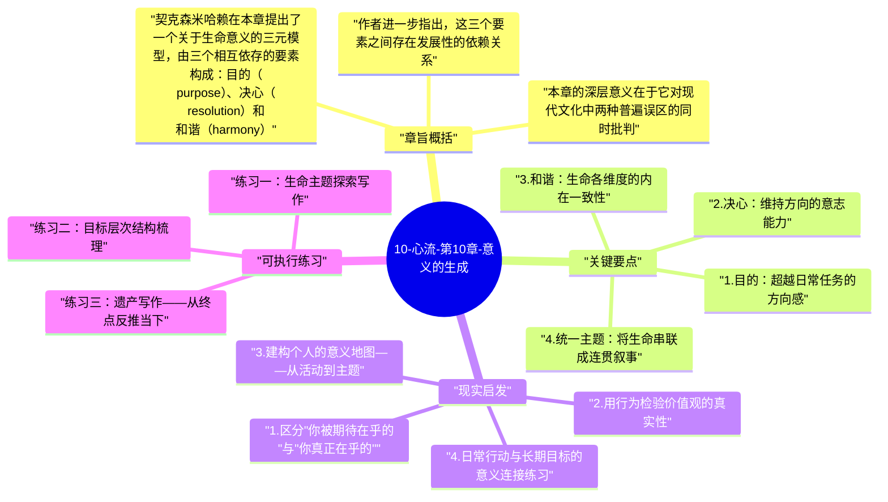

# 10-心流-第10章-意义的生成

在前九章里，米哈里·契克森米哈赖建立了一套关于最优体验的完整理论：什么是心流、心流如何在不同活动类型中发生、如何在工作和关系中主动创造心流条件、如何在逆境中维持意识秩序。但在全书最后一章，他面对一个更根本的问题：即便一个人能够频繁体验心流，这些片段性的最优体验是否就足以构成一个完整、有意义的人生？答案是否定的。契克森米哈赖指出，单次的心流体验只是局部的、暂时的意识秩序，它们不会自动整合成一种更持久的幸福感；只有当这些体验被纳入一个更宏大的、有方向感的生命叙事时，它们才能转化为真正的意义感和持久的心理福祉。

这一章的写作意图非常明确：它是对前九章内容的整合和升华，将心流从一种体验技术提升为一种人生哲学。契克森米哈赖在这里不再只谈"如何进入心流"，而是在问"进入心流是为了什么"，以及"如何将分散的心流时刻串联成一个具有内在一致性的生命"。这是一个人文性问题，而作者以心理学家的严谨与人文学者的深度同时处理它，使得这一章成为全书最密度最高、也最有哲学分量的部分。

本章在全书中承担收束和超越的双重功能。它收束了前九章关于体验的论述，指向一个终极问题：什么样的生命值得过？同时，它超越了个人心理学的范畴，触及人类存在的本质困境：在一个没有先验意义保证的宇宙中，人如何为自己的生命创造出真实可信的意义？契克森米哈赖的回答既谦逊又有力：意义不能被发现，只能被创造；而创造意义所需的一切工具——目的、决心和和谐——都在每个人的内心深处，等待被主动召唤和组织。

## 章旨概括

契克森米哈赖在本章提出了一个关于生命意义的三元模型，由三个相互依存的要素构成：目的（purpose）、决心（resolution）和和谐（harmony）。目的是指一个人拥有超越日常任务的长期方向感，这个方向不需要是宏大叙事，但必须是真实内化的——它必须是当事人真正相信和在乎的东西，而不是社会期待他相信和在乎的东西。决心是指为实现这一目的持续投入行动的意志能力，它不是盲目的坚持，而是有反思的、能够在遭遇困难时调整策略但不放弃方向的持续承诺。和谐则是指当一个人的目标、行动和价值观相互一致时产生的内在整合感，这是心流在人生层面的对应物——就像单次心流是意识在时间切片上的秩序，和谐是意识在整个生命维度上的秩序。

作者进一步指出，这三个要素之间存在发展性的依赖关系。目的提供方向，但目的本身不足够——没有决心，目的只是空想；没有和谐，决心可能变成自我戕害式的强迫。当三者同时运作时，一个人的日常行动与长期目标之间会形成持续的意义共鸣：每一个当下的投入都能被感知为更大图景的一部分，每一次具体的心流体验都不只是孤立的享受，而是在实现某种更持久的自我建构。这种状态，契克森米哈赖称为"自动目的性人格"（autotelic self）的完整实现——一个人不只是偶尔体验心流，而是将整个生命组织成一个持续产生内在满足的结构。

本章的深层意义在于它对现代文化中两种普遍误区的同时批判。第一种误区是享乐主义：以为幸福是累积足够多的快乐时刻的结果，而忽视这些时刻是否被整合进有方向感的生命叙事。第二种误区是目的主义：以为设定了崇高目标就能获得意义，而忽视目标必须与日常体验真实相连才能转化为意义感。契克森米哈赖的答案是：意义既不在纯粹的享乐中，也不在纯粹的理想中，而在两者的有机整合——在一个将当下的充分投入与更大方向感有机连接的生命结构中。

## 关键要点

### 1. 目的：超越日常任务的方向感

契克森米哈赖所说的"目的"，不是职业目标或人生规划清单，而是一个更为根本的方向性承诺：一个人愿意为之持续投入注意力和能量的核心关切。这个关切可以是创造、可以是理解、可以是关爱特定的人或社群、可以是对某种技艺的精进——它的具体内容不如它的真实性重要。一个假装在乎崇高目标但内心冷漠的人，与一个真实在乎某件看似平凡之事的人相比，前者的目的对意义生成毫无助益，后者却可以将日常行动渗透进真实的满足感。

目的的另一个关键特征是其层次性：它必须能够为不同时间尺度上的行动提供意义。一个程序员如果其目的是"理解并创造优雅的系统结构"，这个目的既能解释为什么今天要花三小时调试一个算法（它是整体理解的一部分），也能解释为什么选择这个职业方向（它是实现目的的最佳路径）。这种跨时间尺度的意义连贯性，使每一个当下的行动都能感受到与更大目标的真实联结，而不是作为孤立的任务完成后立刻被遗忘。

### 2. 决心：维持方向的意志能力

在确立了真实目的之后，决心是将目的转化为持久行动的执行机制。契克森米哈赖的决心概念不是日常语境中的"意志力"或"毅力"，而是一种更为精密的能力：在遭遇挑战、失败、外部诱惑或内部疑虑时，能够回归初心并继续推进的能力。这种能力之所以重要，是因为任何有价值的长期目标都必然遭遇阻力——事实上，遭遇阻力是目标真实性的信号，因为只有触及真实复杂性的目标才会遭到真实的阻力。

决心的特别之处在于它与弹性的关系。契克森米哈赖明确区分决心与固执：固执是在策略失败时仍然坚持同一策略，决心是在策略失败时坚持方向但调整路径。一个真正有决心的人，知道自己最终要去哪里，但愿意为这个目的地选择不同的路径。这种区别在实践中意味着：具有真正决心的人会主动学习、主动寻求反馈、主动修正错误，因为这些都是服务于长期目标的工具；而固执的人拒绝反馈，因为反馈威胁的不只是策略，而是他用来定义自身价值的那个方向本身。

### 3. 和谐：生命各维度的内在一致性

和谐是三元素中最难描述、也最难实现的一个。契克森米哈赖将其定义为：一个人的目标、日常行动、价值判断和自我认知之间达到高度一致的状态。处于和谐状态的人，他的工作方式与他的价值观一致，他的人际关系方式与他的世界观一致，他的自我认知与他实际展现的行为模式一致。这种一致性创造了一种深层的内在平静——不是因为所有事情都顺利，而是因为自己的所有部分都在同一个方向上运作，没有内耗和自我分裂。

相反，缺乏和谐的状态是现代人中极为普遍的一种精神困境：一个人公开标榜某些价值观，但日常行为与之矛盾；他声称某些关系是最重要的，但时间分配完全不反映这一优先级；他对自己有某种自我认知，但当真实的行为模式被指出时，他感到错乱和防御。这种内在不一致会持续消耗心理能量——维持矛盾需要大量认知资源用于自我辩护和选择性注意，这些资源本可以用于有意义的投入。契克森米哈赖认为，追求和谐不是追求完美的自我一致性，而是持续进行诚实的自我对质，减少已知的自我矛盾，让生命的各个部分逐渐朝同一个方向校准。

### 4. 统一主题：将生命串联成连贯叙事

契克森米哈赖引入了"统一主题"（unifying theme）的概念来描述一种生命叙事的最高形态：当一个人能够回顾自己的全部经历，并在其中看到一条内在一致的意义线索时，他的人生就拥有了叙事上的统一性。这不意味着人生必须沿着预设的轨道发展，而是意味着即便是意外的转折、痛苦的失去、似乎与原计划相悖的变化，最终也能被解释为同一个核心主题的不同展开。这种叙事能力，是人类意识最强大的功能之一——它能将片段性的经历赋予整体意义，使人感到自己的生命不是一系列偶然事件的堆积，而是一个有内在逻辑的展开过程。

建立统一主题并非一次性的顿悟，而是一个逐步澄清的长期过程。很多人在中年之前都不清楚自己的统一主题是什么，甚至有些人终其一生都没有发现。契克森米哈赖并不认为缺少统一主题就意味着失败，但他认为主动寻找和建构这一主题，是一个人能为自己的幸福做出的最重要的长期投资之一。这种寻找不必通过孤立的哲学思辨来进行，更有效的方式是持续留意：什么样的活动让你在疲惫之后仍感到充实？什么样的付出你愿意不计回报地继续？什么样的成长让你感到"这才是真正的我"？这些问题的答案，共同指向统一主题的轮廓。

### 5. 心流与意义的层次关系

单次的心流体验在意义链条中处于什么位置？契克森米哈赖的答案是：心流是意义的必要条件，但不是充分条件。没有心流的生活——长期处于无聊、焦虑或漫无目的的状态——很难产生真正的意义感，因为意义需要真实的投入和真实的体验。但心流本身不能自动生成意义，因为意义还需要方向感：如果一个人的每次心流体验都朝向不同、相互矛盾的方向，它们的累积不会产生和谐，而只是一种更丰富的混乱。

这个层次关系有一个重要的实践推论：在设计自己的心流活动时，不只要考虑"这项活动能否产生心流"，还要考虑"这项活动的心流是否服务于我的更大目标或统一主题"。一个职业赌徒可能在赌桌上体验高频心流，但如果这些心流与他更深的价值观和人生方向相矛盾，它们不会带来意义感，反而可能加深内在的分裂。契克森米哈赖的意义观因此有一种内在的一致性要求：有意义的生活是一个整合系统，每个部分都在服务于同一个核心方向，而不是一系列孤立的高峰体验的堆砌。

### 6. 自动目的性人格：意义生成的完整实现

全书的终极理想是"自动目的性人格"（autotelic self）的完整实现——一个人能够从几乎任何处境中提取意义和投入感的人格状态。这不是超人，而是一种高度整合的心理状态：他拥有清晰的目的，能够在任何挑战中找到可以主动参与的维度；他拥有足够的决心，能够在困难中维持方向不迷失；他拥有内在的和谐，他的行动、价值和自我认知相互一致，不产生消耗性的内耗。他不需要外部条件完美才能感到幸福，因为他具备主动创造最优体验的内在能力。

契克森米哈赖用一系列真实人物的案例来展示这种人格状态的实际面貌：维克多·弗兰克尔在集中营中维持意义感、历史上的伟大创造者在物质贫乏的条件下仍然充实地工作、普通人在普通工作中找到深层满足感。这些例子的共同点不是外部条件的优越，而是主动建构内在意义系统的能力。契克森米哈赖的最终信息是清晰的：这种能力不是天赋，而是选择——选择承担起主动建构自己生命意义的责任，而不是将这个责任外包给社会期待、文化规范或外部奖励系统。

## 现实启发

### 1. 区分"你被期待在乎的"与"你真正在乎的"

许多人的生命方向，在很大程度上是由社会期待、家庭期待或文化惯性所塑造的，而不是由真正内化的个人价值驱动的。这两者在外部行为上可能完全相同，但在内心体验上截然不同：前者即便成功了也感到空洞，后者即便遇到困难也感到值得。识别这两者的差异，是开始建构真正意义系统的第一步。一个有效的自我审问方式是：如果没有人知道我做了这件事，没有人认可我、没有人为此奖励我，我还愿意做它吗？如果答案是否定的，这件事所服务的可能是外部期待而非内在目的。

### 2. 用行为检验价值观的真实性

价值观的真实性，只能通过行为而非言语来证明。如果你声称家庭是你最重要的价值，但回顾一周的时间分配，发现用于深度家庭互动的时间远少于你用于工作、娱乐或社交媒体的时间，这是一个诚实的信号：家庭可能是你期望自己在乎的，但尚未成为你实际驱动行为的核心价值。这种行为与言辞之间的落差，是和谐缺失的一个直接指标。定期进行这种行为-价值对比检验，不是为了自我批判，而是为了建立更诚实、更有根基的自我认知，这是追求和谐的实际起点。

### 3. 建构个人的意义地图——从活动到主题

尝试梳理你在过去五年里感到最充实、最有意义的十个时刻或活动。这些时刻可以非常不同——也许包括完成一个复杂项目、一次深度对话、照料某人的困难时期、独自完成一次体验式旅行。将它们列出来，然后观察：这些时刻中有哪些共同的品质或主题？也许它们都涉及创造、都涉及连接、都涉及理解复杂事物、都涉及帮助他人度过困难？这些共性，就是你个人统一主题的原始素材。这张意义地图不需要精确，但它提供了一个由你自己的真实体验归纳出来的生命方向指南，远比从外部导入的目标设定更真实可靠。

### 4. 日常行动与长期目标的意义连接练习

在开始一天的工作之前，花两分钟做一个简短的意义连接：今天我要做的最重要的事情，如何是我长期目标的一个具体步骤？这个连接不需要宏大——"今天认真完成这份报告，是为了建立我在这个领域的深度专业积累"就足够。这种每日的意义连接练习，逐渐将原本孤立的日常任务纳入更大的意义框架，让每一天的投入都感受到与更长远方向的联结。长期坚持这种练习，意义感不再是需要特意寻找的东西，而是内嵌在日常行动结构中的、持续存在的体验底色。

## 可执行练习

### 练习一：生命主题探索写作

连续三天，每天花二十分钟进行一次自由写作，主题依次是：（第一天）我一生中感到最"对"的三段经历是什么，它们有什么共同之处？（第二天）如果我可以重新选择，我的生命中最不想错过的是什么类型的体验，为什么？（第三天）回想那些让我感到"这才是我真实模样"的时刻，这些时刻中的自己有什么共同特征？三天写完后，回顾所有内容，尝试用一个短语提炼出这些回答中反复出现的核心主题。这个提炼不需要完美，但它会成为你个人意义地图的第一个有意识的轮廓，是建构统一主题的起点。

### 练习二：目标层次结构梳理

画一张目标层次图：在最上层写下你认为自己最重要的长期方向（可以是五到十年尺度的，不需要精确），然后在第二层写下为了实现这个方向，你目前正在推进的中期项目（一到三年），在第三层写下本年度最重要的具体目标，在第四层写下本月可以推进的行动。然后审视这个层次结构：每一层是否真正服务于上一层？是否存在中期项目或年度目标与长期方向不一致的情况？如果存在，这些不一致是有意的战略选择，还是目标层次结构中真正的价值冲突？这个梳理会揭示你的目标系统中尚未对齐的部分，为追求和谐提供具体的工作方向。

### 练习三：遗产写作——从终点反推当下

想象自己在生命最后一天，以清醒和满足的状态回顾整个生命。在这个想象中，你希望说"我的生命中真正重要的是……"这句话之后接的内容是什么？不是你希望别人如何评价你，而是你自己感到真正值得的是什么？写下这段遗产叙述，不少于三百字，要求是：诚实的，不受社会期待的影响，只是你自己最深的认知。写完后，与你目前的实际生活状态对比：当前你的时间、能量和注意力的分配，是否在服务于这段遗产叙述所揭示的真实优先项？如果差距明显，写下一件你可以在本月内做出的、使当前生活更接近这个远景的具体调整。

---

## Mermaid 思维导图

### 图1

