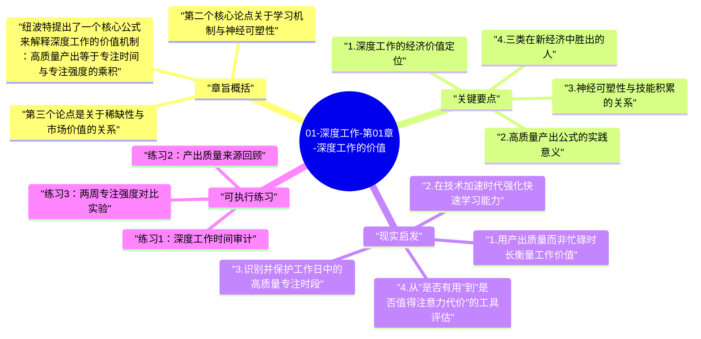

# 01-深度工作-第01章-深度工作的价值

卡尔·纽波特在《深度工作》的开篇章节中，选择用经济学逻辑来为整本书的建议体系奠基。这并非偶然——在一个充满自我提升建议的出版市场里，纽波特清楚地知道，如果读者不能首先相信深度工作具有真实的经济价值，那么后续任何关于习惯改变和生活重组的建议都只会显得像是苦行僧式的自我折磨。因此，第一章的核心使命是回答一个具体问题：为什么在当今这个时代，深度工作不仅有意义，而且有明确的竞争价值？

纽波特的论证策略是从宏观经济转型出发。他指出，我们正处于一场和工业革命规模相当的经济重组之中：智能机器与自动化技术正在取代越来越多的常规认知任务，劳动力市场的价值结构正在发生根本性重写。在这一背景下，真正能够脱颖而出的人，是那些能够快速掌握复杂工具、并将其转化为高质量成果的人。而这两种能力——快速学习复杂事物与持续产出高水准成果——都高度依赖于一种正在变得稀缺的能力：长时间的深度专注。

本章在全书中处于"为什么"的位置，后续所有章节关于"如何"的讨论，都建立在这一章所建立的价值基础之上。如果说后面的章节是实践手册，第一章就是整本书存在的理由——它从根本上论证了为什么改变工作方式值得付出代价，让读者在接受后续挑战之前先在内心确立一个价值信念。

## 章旨概括

纽波特提出了一个核心公式来解释深度工作的价值机制：高质量产出等于专注时间与专注强度的乘积。这个看似简单的公式却有着深刻的含义——它意味着同样是八小时的工作时间，一个能保持高度专注的人与一个被频繁打断的人之间，产出差距可以是数倍之多。大多数知识工作者认为忙碌就是生产力，但纽波特的观察恰恰相反：真正有价值的产出往往来自深度投入的少数时段，而非表面繁忙的大多数时间。

第二个核心论点关于学习机制与神经可塑性。纽波特援引神经学研究指出，大脑中包裹神经回路的髓鞘质会随着专注的重复刺激而加厚，从而让与该技能相关的神经网络变得更快、更高效。这意味着刻意练习——那种需要全神贯注、排除干扰的高强度练习——并不只是一种学习策略，而是从字面意义上改造大脑结构的过程。碎片化的注意力无法触发这个机制，因为大脑需要持续、无干扰的激活才能形成真正的技能沉淀。

第三个论点是关于稀缺性与市场价值的关系。如果深度工作确实是产生高质量成果的必要条件，而深度工作的能力又在当代工作环境中越来越稀缺，那么掌握它就构成了一种真实的竞争优势。纽波特不是在讲"专注有好处"这类泛泛的道理，而是在指出：在一个注意力被平台和工具系统性分散的时代，保持专注本身就是一种高价值的市场竞争力，稀缺性决定价值，而专注的人正在变得越来越稀缺。

## 关键要点

### 1. 深度工作的经济价值定位

在当今的知识经济中，最有价值的工作越来越依赖于所谓的"认知深度"——在处理复杂问题时能够维持高强度专注，同时排除环境噪音与内部分心的能力。纽波特把这种能力与工业经济中的熟练工艺作类比：就像19世纪的技艺娴熟工匠能够将原材料转化为高价值产品，21世纪的深度工作者能够将信息和创意转化为高价值知识成果。这种转化能力的背后，是大量不被打断的专注时间所积累起来的技能深度。

理解这一点的关键是认识到，知识工作中的价值并不均匀分布在所有工作时间里。研究表明，专业人士在状态良好的专注时段内完成的工作量，往往是普通分心状态下的两到三倍，而质量差距更为显著。这意味着一个能够每天保持三到四小时真正深度工作的人，其实际产出往往超过一个整天看起来都在忙碌但从不真正专注的人。深度工作不是工作时间的简单增加，而是工作质量的根本性提升。

### 2. 高质量产出公式的实践意义

纽波特提出的公式——高质量产出 = 时间 × 专注强度——给了我们一个重新审视日常工作的框架。大多数人在提升工作质量时，本能地选择"花更多时间"这条路，但这条路有物理上限。另一条路是提升每单位时间内的专注强度，而这条路的提升空间要大得多，且没有自然上限。许多顶级知识工作者每天真正的深度工作时间不超过四小时，但正是这四小时创造了他们绝大部分的核心价值。

这个公式也揭示了为什么频繁切换任务和持续待命对产出的伤害如此之深。每次注意力切换都会产生所谓的"注意力残余"——当你从一个任务切换到另一个任务时，前一个任务的思绪并不会立刻消失，而是会在新任务的处理过程中持续产生干扰，降低专注深度。如果一天的工作被二十次消息打断，那这二十次打断所造成的注意力残余，实际上使得一天中很难出现真正的深度专注时段，产出质量因此大打折扣。

### 3. 神经可塑性与技能积累的关系

神经科学的研究结果对纽波特的论证提供了坚实的生理学支撑。大脑的可塑性是双向的——它既能因为深度专注的刺激而强化某些神经回路，也会因为长期的分心习惯而削弱维持注意力的神经通道。更重要的是，髓鞘化过程（神经回路被髓鞘质包裹的过程）需要的是高强度、持续性的神经激活，而非低强度的偶尔刺激。这意味着刻意练习所需要的那种深度专注，不仅是一种有效的学习策略，而且从字面意义上是建构大脑硬件的必要条件。

由此可以推导出一个重要结论：碎片化的工作方式不只是效率低下，而且从根本上阻止了技能的真正积累。一个程序员在被打断中工作了八小时，和一个程序员在四小时不被打断的深度状态中工作，获得的技能提升是完全不同量级的。前者可能完成了表面上更多的任务，但后者在同样的时间里更深入地触发了技能神经回路的强化过程，从长期来看，其技能成长速度要快得多，职业竞争力的积累也更为扎实。

### 4. 三类在新经济中胜出的人

纽波特识别出在智能机器时代能够获得优厚回报的三类人。第一类是高技能工作者——能够与智能机器协同工作、驾驭复杂工具的人。这类人不会被机器取代，因为他们能做的是理解和指导机器，而这需要深入的领域知识和系统性思维，两者都依赖深度工作的积累。第二类是顶尖人才——在其领域内处于能力分布顶端的人。在数字化经济中，地理边界消失了，顶尖人才能够服务全球客户，市场份额高度向少数顶尖者集中。第三类是资本所有者，但这一类路径对大多数人而言门槛极高。

对大多数知识工作者而言，最可及的路径是成为高技能工作者或者在某一领域成为顶尖人才。而这两条路径都有一个共同的前提：你必须能够快速掌握复杂的新技能，并将这些技能转化为高水平的实际成果。快速学习复杂技能需要集中、无干扰的练习时间；产出高水平成果需要持续的深度专注。换言之，无论走哪条路，深度工作能力都是不可绕过的核心基础设施。

### 5. 专注稀缺性的时代背景

理解深度工作价值的另一个关键维度是理解为什么它现在特别有价值，而不是任何时代都同等重要。纽波特的观察是：人类注意力正处于史无前例的竞争压力之下。社交媒体平台、即时通讯工具、新闻推送、娱乐内容——所有这些都在争夺人类有限的注意力资源，并且它们都是由世界上最聪明的工程师和心理学家精心设计以最大化用户黏性的。在这种系统性争夺注意力的环境中，长时间专注的能力正在作为一种群体性能力而衰退。

这种衰退创造了一种逆向的价值效应。当大多数人的专注能力因为环境驯化而下降时，那些保持并培养了深度专注能力的少数人，便获得了越来越明显的相对优势。这就像是一个整体体能下降的社会中，坚持体能训练的人会变得相对更强壮——不是因为他们变得更强了，而是因为其他人变弱了。深度工作能力的稀缺性正在因为环境的系统性侵蚀而加剧，这使得坚持培养它的人具有了超出其绝对能力本身的相对竞争优势。

### 6. 深度工作与职业资本的积累逻辑

纽波特在其早期著作《优秀到不能被忽视》中提出了"职业资本"的概念，在本章中，这个概念与深度工作形成了直接的连接。职业资本是指一个人在职业市场上能够提供的稀缺且有价值的技能与能力储备，它决定了一个人对优质职业机会的谈判能力。积累职业资本需要刻意练习，而刻意练习需要深度工作。因此，每一小时的深度工作不只是完成了当前的具体任务，而且是在积累未来职业发展所需的资本。

这个视角改变了我们看待时间分配的方式。如果把深度工作视为短期任务的完成手段，它的价值是直接且有限的。但如果把它理解为职业资本的积累机制，它的价值就是长期复利式的——每一小时的深度工作都在为未来几十年的职业轨迹加速。这也解释了为什么纽波特认为深度工作值得牺牲其他事项来保护：因为它不只是一种工作方式，而是决定职业发展轨迹的基础性投资，其回报会随着时间推移而持续放大。

## 现实启发

### 1. 用产出质量而非忙碌时长衡量工作价值

许多职场人习惯于用"工作了多少小时"来衡量自己的努力程度，但纽波特的框架提示我们，这种衡量方式从根本上是错误的。真正重要的不是你花了多少时间在工作上，而是在这些时间里你实际产出了多少高质量的成果。一旦接受这一认知转变，你就会开始用完全不同的眼光看待自己的工作日：那些被会议和消息切碎的、无法进行深度思考的时段，其生产价值是非常有限的；而那些真正进入专注状态的时段，才是价值创造真正发生的地方。

这种认知转变的实际影响是：你会开始主动寻找和保护那些能够进行深度工作的时段，而不是被动地接受任何打断。你会意识到，拒绝一个不必要的会议不是在偷懒，而是在保护真正的价值创造时间。你会开始思考如何重组工作日，让最重要的深度任务获得最优质的专注时段，而不是把好时间用在回复消息、参加状态会议这类浮浅工作上。

### 2. 在技术加速时代强化快速学习能力

我们所处的时代有一个特别残酷的特征：技术工具和工作方法的迭代速度正在持续加快。今天掌握的技能，五年后可能已经部分过时；今天最流行的工具，明天可能被更强大的替代品取代。在这种环境中，真正的长期竞争力不再是掌握某一套具体的技能，而是能够快速学习和掌握新的复杂技能的元能力。而快速学习复杂技能，正是深度工作能力最直接的应用场景之一，没有深度工作，快速学习将沦为口号。

这意味着培养深度工作能力有一种特殊的战略意义：它是一种在快速变化环境中保持竞争力的适应性资源。每次你成功地在深度工作状态下掌握了一门新技术或一个新领域，你不仅获得了具体的知识，而且强化了"快速深度学习"这种元能力本身，使得下一次学习变得更加高效。深度工作者的技能积累因此具有复利效应——越练越快，优势越来越明显，时间越长，与浅层工作者之间的差距越大。

### 3. 识别并保护工作日中的高质量专注时段

大多数人的工作日中都存在一些自然的深度工作时段，只是往往没有被有意识地识别和保护。有些人在早晨精力最旺盛，能够在外部干扰到来之前进行一两个小时的深度工作；有些人在下午特定时段的专注力特别好；还有些人发现在办公室之外的场所更容易进入专注状态。识别这些自然的高质量时段，并主动保护它们不被打扰，是实践深度工作的最直接的第一步。

保护深度时段的策略可以因人因环境而异，但核心原则是相同的：在这些时段内，主动切断所有可能的注意力劫持源——关闭消息通知、把手机放在够不到的地方、告知同事在这段时间内不要打扰。最初可能只能保持30分钟的深度专注，但随着刻意训练，专注持续时间会逐渐延长。关键是把这种保护行为变成一种日常习惯，而不是偶尔奢侈的特殊安排。

### 4. 从"是否有用"到"是否值得注意力代价"的工具评估

纽波特在第一章已经隐含地提出了一个重要的工具评估框架：任何工具或工作方式的真实成本，不仅仅是它直接占用的时间，还包括它对专注能力的侵蚀代价。一个每天只花20分钟但持续打断注意力节奏的工具，其实际成本远高于表面看起来的20分钟。理解这一点，有助于我们做出更明智的工具选择和工作流程设计，在评估是否继续使用某个习惯性工具时，应当纳入其对深度工作能力的间接影响。

## 可执行练习

### 练习1：深度工作时间审计

在接下来的一周里，每天记录你实际花在深度工作上的时间。深度工作的标准是：你在做一件具有认知挑战性的任务，且在这段时间里没有被任何外部事物打断，也没有主动去查看消息或刷任何信息流。每天结束时，统计你的实际深度工作时间，并将其与你预期或希望的时间做对比。很多人第一次进行这个审计时会发现，他们真正的深度工作时间远少于他们以为的，有时甚至不到一个小时。这种清醒的认知是改变的起点——只有知道自己的基准线在哪里，才能有针对性地提升，而不是在模糊感觉中原地踏步。

### 练习2：产出质量来源回顾

选择你最近一个月中自己最满意的三到五个工作成果，回想每个成果产生时的工作状态。你会发现，这些高质量成果几乎都来自那些你记得特别清晰、思维特别流畅的专注时段，而不是来自被打断的日常工作流中。用这个回顾来强化一个认知：你最好的工作，来自你最专注的时刻。这种认知一旦建立，就会自然地驱动你去保护和创造更多这样的时刻，而不是把它们当作偶然发生的幸运，或者把注意力继续分散在低价值的浮浅任务上。

### 练习3：两周专注强度对比实验

选定一项你目前正在进行的需要深度学习或深度思考的任务，做一个为期两周的对比实验。第一周，用你平时的方式处理这个任务——随时查看消息，允许打断，在任务间自由切换。第二周，每天为这个任务安排一个固定的、绝对不被打断的90分钟深度工作时段，其他时间你可以照常工作。两周后，比较你在这个任务上的进展速度和成果质量。几乎可以确定的是，第二周的实际进展会显著优于第一周，尽管第二周中你花在这个任务上的绝对时间可能更少。这个实验会给你一个切实的、基于自身经历的证据，证明深度工作的价值不只是理论。

---

## Mermaid 思维导图

### 图1

