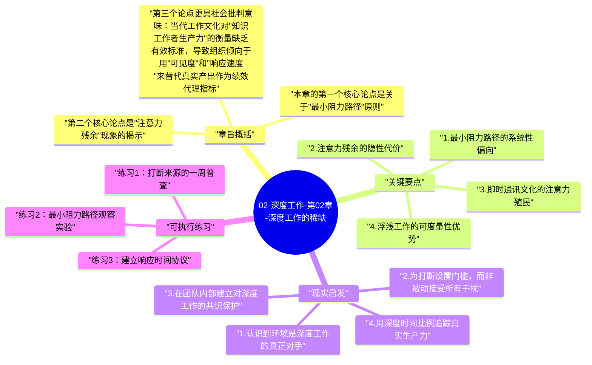

# 02-深度工作-第02章-深度工作的稀缺

如果说第一章回答的是"为什么深度工作有价值"，那么第二章要解决的核心疑问则是：既然价值如此明确，为什么深度工作在现实中却越来越少见？这一章的角色是诊断——它不是在重复鼓励读者专注的老话，而是在认真分析和拆解那些系统性地阻碍深度工作发生的力量。只有清楚了解对手的面目，才能有针对性地与之对抗。

纽波特的核心发现是：深度工作的减少，并不主要是因为人们懒惰或缺乏意志力，而是因为当代工作环境中存在着一系列结构性的激励机制，正在持续地奖励浮浅工作、惩罚深度工作。这些机制包括组织文化对"随时在线"的隐性奖励、即时通讯工具对响应速度的无限要求、以及注意力切换所带来的心理代价。个人的努力很难对抗这些系统性的环境力量，除非能够清晰认识它们并主动建立对抗性结构。

本章在全书中起着承上启下的作用：它完成了从"价值论证"向"实践困境"的转折，为后续章节中提出的各种深度工作策略提供了问题背景。理解这一章，就是理解为什么深度工作不能只靠决心，而必须靠制度和环境设计来保护。

## 章旨概括

本章的第一个核心论点是关于"最小阻力路径"原则。纽波特观察到，在缺乏明确衡量标准的知识工作环境中，员工往往会倾向于选择那些最容易被他人看见、最能快速证明自己"在工作"的行为方式。频繁发送和回复消息、参与多个会议、快速响应同事需求——这些都是高度可见的工作形式，即使它们并没有产生实质性的价值增量。相比之下，深度工作的成果通常需要较长的酝酿周期才能显现，在短期内难以被组织文化识别和奖励。这种奖励机制的偏差，使得组织层面的工作文化自然地向浮浅端漂移，形成一种难以被个人单独抵抗的系统性压力。

第二个核心论点是"注意力残余"现象的揭示。心理学家索菲·勒罗伊的研究表明，当一个人从任务A切换到任务B时，与任务A相关的思绪并不会立刻清空，而是会在处理任务B时持续残留并消耗认知资源。这种"注意力残余"现象意味着每次任务切换都会在一定时间内降低新任务的处理质量。在现代工作环境中，一个人每天可能经历数十次这样的注意力切换，而每次切换的代价都在悄悄积累，使得整个工作日的有效专注时间大幅压缩。更糟糕的是，大多数人对这个机制毫无察觉，他们只是隐约感到疲惫和低效，却无法准确识别原因。

第三个论点更具社会批判意味：当代工作文化对"知识工作者生产力"的衡量缺乏有效标准，导致组织倾向于用"可见度"和"响应速度"来替代真实产出作为绩效代理指标。这种替代效应具有自我强化的特性——一旦"随时在线"成为组织的隐性期望，那些为了深度工作而选择关闭消息通知的人，就会面临被认为"不积极"或"不配合"的职场风险。这使得深度工作不仅是一种习惯挑战，而且是一种需要勇气的职场选择。

## 关键要点

### 1. 最小阻力路径的系统性偏向

在没有清晰绩效反馈的工作环境中，人类的自然倾向是选择能够减少不确定性和即时焦虑的行为路径。频繁查看和回复消息能够给人一种"正在处理事情"的掌控感，这种即时的心理满足感是非常真实的，尽管它与实际产出并无直接关联。这就是纽波特所说的"最小阻力路径"——它不是一种有意识的懒惰选择，而是人类心理在特定环境激励结构下的自然反应。

这种路径偏向的危险之处在于它的隐蔽性。一个整天在回复消息、参加会议、处理琐碎请求的人，完全可以在主观上感觉自己非常忙碌、非常努力，而其实际深度工作的时间为零。这种忙碌与生产力的分离，是当代知识工作中最普遍也最难以被发现的效率陷阱。人们用忙碌来麻痹对深度缺失的察觉，而组织文化往往也无意中强化了这种麻痹。

### 2. 注意力残余的隐性代价

索菲·勒罗伊的注意力残余研究是纽波特在本章中引用的最重要的科学证据之一。研究发现，即使一个人在形式上已经切换到了新任务，其大脑依然会有相当比例的处理资源留在上一个任务上，持续数分钟乃至更长时间。这不是意志力软弱的表现，而是大脑认知切换的生理机制决定的。每次任务切换都相当于对专注资源征收一笔"切换税"，而这笔税的总金额随着切换次数的增加而急剧累积。

更值得警惕的是，在注意力残余尚未清除的状态下进行的工作，其质量会系统性地低于完全专注状态下的工作质量，而且当事人往往无法准确感知到这种质量下降。这意味着那些认为自己"多任务处理"能力强的人，很可能只是对注意力残余的代价不够敏感——他们能够在多个任务间快速切换，但每个任务的实际处理质量都在悄悄下降，只是这种下降被工作的表面流畅度所掩盖。

### 3. 即时通讯文化的注意力殖民

即时通讯工具从根本上改变了工作场所中的注意力归属权。在即时消息出现之前，打断一个人工作需要显性的物理行为——走过去敲门，或者打电话。这种显性成本天然地过滤掉了很多不必要的打断。但即时消息降低了打断的发起成本至几乎为零，同时又通过"已读"功能和响应时间期望，将快速回复塑造成一种职业礼貌。结果是：发起打断变得极为廉价，而保持专注变得需要主动对抗巨大的社会压力。

这种动态在组织层面造成了一种结构性困境：每个个体都可能意识到频繁打断在降低生产力，但每个个体又都在通过自己的发送行为制造对他人的打断。这不是某个人的问题，而是系统设计的问题。纽波特的这一分析帮助读者理解：在不改变组织沟通规范的情况下，单个个体试图保护深度工作时间，必然面临与集体期望的冲突，这种冲突需要明确的策略来管理，而不能只靠个人意志力扛住。

### 4. 浮浅工作的可度量性优势

浮浅工作之所以在组织中如此盛行，还有一个很少被明确讨论的原因：浮浅工作的完成情况非常容易被测量和展示。一天回复了多少封邮件、参与了多少次讨论、更新了多少个状态——这些都是可以被记录、被展示、被用于自我评价和向上汇报的指标。相比之下，深度工作的价值通常体现在复杂问题的解决、高质量文章的完成、系统设计的突破这类很难用日常指标衡量的成果上。

这种可度量性的不对称导致了一种职场行为的选择偏差：在所有其他条件相同的情况下，人们倾向于选择那些能够更容易向自己和他人证明"工作了"的活动。这种偏差不需要任何恶意或懒惰来驱动，它是一种在模糊评估环境下的理性适应。理解这一机制有助于我们更客观地看待自己的工作习惯，并认识到改变它不只是个人意志力的问题，而是需要重新建立更有效的个人绩效评估框架。

### 5. 社交媒体与网络工具的注意力切割

社交媒体和各类网络通知工具的普及，为浮浅工作倾向提供了一种永不停歇的燃料供应。这些工具被设计成在间歇性的随机奖励机制下运作——偶尔出现的点赞、评论、新消息，通过不可预测的时间间隔触发多巴胺释放，建立起一种强烈的检查冲动。这种冲动一旦建立，就会在工作时持续出现，使得保持连续专注变得需要持续对抗自己的神经反应。

纽波特的关键洞察是：这不是软弱，而是被设计的结果。这些平台投入了巨大的资源来研究如何最大化用户的注意力占用时间，它们是世界上最昂贵的注意力工程学的产物。一个普通知识工作者试图用个人意志力对抗这种工程学设计，就像是用徒手对抗专业机器——成功的可能性不是零，但代价是持续性的高消耗，而且这种消耗本身就在消耗本可以用于深度工作的认知资源。

### 6. 量化个人工作中的浮浅与深度比例

纽波特建议每个知识工作者都应该尝试量化自己工作中浮浅工作与深度工作的实际比例。这个量化过程本身就是一个重要的认知工具——它迫使人们以具体数字而非模糊感受来面对自己的工作现实。大多数人在第一次做这个统计时都会感到不安，因为浅层工作占据的时间比例远超出他们的预期，有时高达70%甚至更多。

这种量化揭示的不是个人的道德问题，而是工作系统设计的结构性问题。当你看到浅层工作占据了工作日的绝大部分时间，你不会自我谴责，而会开始认真思考这个系统是如何运作的，以及哪些部分是可以被重新设计的。这种从道德判断到系统分析的视角转变，是第二章给读者最重要的认知礼物，也是后续章节中所有实践策略的出发点。

## 现实启发

### 1. 认识到环境是深度工作的真正对手

一个重要的认知校正是：深度工作的最大障碍不是你自己的意志力不够强，而是你所处的工作环境本身在结构上对深度工作是不友好的。当你在保持专注方面遭遇挫折时，首先应该问的不是"我为什么这么容易分心"，而是"是哪些环境因素在主动拉走我的注意力"。这种视角的转变将问题从个人缺陷移向了系统设计，从而打开了系统性解决方案的可能性，而不是陷入徒劳的自我指责循环。

理解环境力量的系统性后，你就能更客观地评估改变的难度，也能更有策略地选择对抗点。与其试图在全天候的干扰环境中依靠意志力保持专注，不如把精力用在改变环境本身——建立物理上的隔离、设置明确的响应时间窗口、与同事和管理者建立关于工作响应预期的明确协议。这些系统性的改变比意志力的独自挣扎要有效得多，也可持续得多。

### 2. 为打断设置门槛，而非被动接受所有干扰

理解了打断的真实代价之后，一个直接的实践结论是：你需要主动管理打断的发生频率，而不是被动地接受所有到来的打断。这不意味着变得不合作或不响应，而是意味着区分哪些打断是真正紧急且必要的，哪些只是习惯性的即时反应。大多数即时消息并不需要在五分钟内得到响应，但我们的心理习惯让我们表现得像每一条消息都是急救信号。

在实践中，可以通过设置明确的消息响应窗口来实现这一点：比如每天在固定的两三个时段集中处理消息，而在这些时段之外，保持消息通知的关闭状态。这种做法最初可能会让人感到不安，因为它违背了"随时在线"的文化期望。但大多数实践者很快会发现，绝大多数"紧急"的消息在一两个小时内依然等得了，而消息批处理制度带来的专注时间质量提升，远远超过了轻微的响应延迟所带来的不便。

### 3. 在团队内部建立对深度工作的共识保护

对于在团队中工作的人来说，个人的深度工作保护策略如果得不到团队层面的认可，往往难以持续。一个更有效的策略是在团队或项目层面引入对深度工作时间的结构性保护，例如设立专注时段，在这些时段内整个团队暂停即时通讯，专注于各自的核心任务。这种集体性的规范比个人单独行动更容易被组织文化所接受，也更容易产生持续的效果。

推动这种变化不需要大张旗鼓的改革倡议，可以从小范围的实验开始：与最近的几个同事达成试行协议，在某个固定时段暂停消息回复，然后在几周后评估这一安排对工作质量的影响。如果效果明显，这个小实验就自然地成为了向更大范围推广的证据基础。变化往往从局部的成功案例开始积累，而不是从宏大的制度宣言开始推行。

### 4. 用深度时间比例追踪真实生产力

对个人工作质量最有用的一个追踪指标，不是工作了多少小时，而是在这些工作小时中有多少比例是真正的深度工作时间。建立这个指标的习惯，能够为你提供一个持续的、非自欺欺人的工作现实反馈。当你看到某天的深度时间比例只有15%时，你会有具体的信息来分析原因，并制定改进计划；当你看到某天的深度时间比例达到50%时，你能够将这种状态与当天的工作成果质量做对应，强化对深度工作价值的切身体验。

## 可执行练习

### 练习1：打断来源的一周普查

连续一周，每当你的工作被打断时，记录下打断的来源（消息通知、同事走过来、自己主动去查邮件等）和大致的时间成本（包括打断本身的时间加上重新进入专注状态所需的恢复时间）。一周结束后，统计各类打断的频率和累积时间代价。这个普查将帮助你从模糊感受转向具体数据，清晰识别出你工作环境中最主要的注意力威胁来源，从而能够有针对性地采取对策，而不是在整个宽泛的"分心问题"上原地打转。

### 练习2：最小阻力路径观察实验

在接下来的两天里，每次你发现自己想要去检查邮件、回复消息或者切换任务时，先停下来，用5秒钟问自己一个问题：我现在切换任务，是因为当前任务有真实的停顿点，还是只是因为在这个困难任务上遇到了认知阻力？诚实记录你的回答。很多人在做这个实验后发现，自己绝大多数的任务切换冲动都发生在遇到认知阻力的时刻——当思考变得困难、方向不清晰、需要持续高强度思考的时候，切换到一个轻松的消息回复任务提供了一种即时的心理解脱。这个认知是理解自己浅层工作倾向的重要突破口。

### 练习3：建立响应时间协议

选择你最频繁使用的一种即时通讯渠道，与经常联系的主要协作者明确沟通一个新的响应时间协议：在工作日内，你会在每天的固定两个时段集中处理这个渠道的消息，除非是明确标记为紧急的内容，否则不会实时响应。观察这个协议执行两周后的效果——不仅要看你的深度工作时间是否增加，还要观察你的协作者对这个安排的实际反应。很可能你会发现，大多数人对合理响应延迟的接受度远高于你的预期，而那些真正紧急的事情，也自然会通过电话或其他更直接的方式找到你。

---

## Mermaid 思维导图

### 图1

