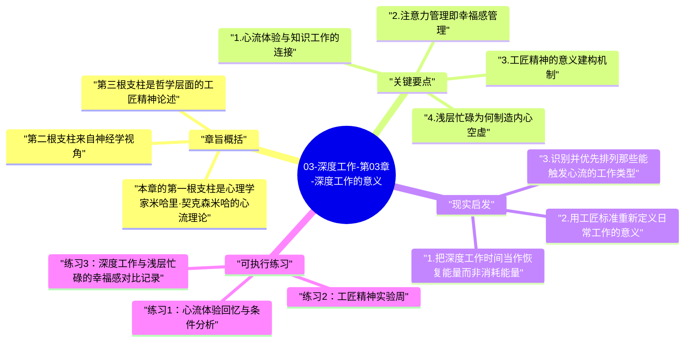

# 03-深度工作-第03章-深度工作的意义

在前两章用经济逻辑论证完深度工作的价值与稀缺之后，纽波特在第三章做了一个重要的视角扩展：他不再只谈深度工作能带来什么外在成就，而是开始追问一个更根本的问题——深度工作为什么能让人感到生命是有意义的。这一章是全书情感与哲学层面的核心，它回答的不是"如何工作更有效率"，而是"什么样的工作体验让人感到真正活着"。没有这一章的深度，整本书就只是又一本生产力技巧手册，而不是一本试图改变人与工作之间关系的深刻著作。

纽波特从三个截然不同的学科视角展开论证：心理学（心流理论）、神经学（大脑的幸福机制）、哲学（工匠精神与意义建构）。这三个视角虽然语言不同，但都指向同一个核心结论：人在全力投入复杂工作的状态中，会体验到一种独特的充实感和尊严感，而这种体验是浅层忙碌无法提供的。当一个人处于真正的深度工作状态时，他不只是在完成任务，而是在经历一种让生命感到厚重的存在方式。

这一章的位置也很有意思：它紧跟在两章诊断问题的内容之后，在全书进入实践建议之前，起到了精神再充电的作用。读到这里，读者不仅知道深度工作有价值（第一章），也知道它正在消失（第二章），现在他们还知道了为什么深度工作值得为之重新排列人生优先级——因为它和人类意义感的获取直接相关。

## 章旨概括

本章的第一根支柱是心理学家米哈里·契克森米哈的心流理论。心流是一种人在高度专注地完成与自身能力匹配的挑战性任务时所进入的最优心理体验状态：时间感消失，自我意识淡退，行为与意识高度合一，内在满足感达到顶峰。契克森米哈在数十年的研究中发现，人类报告感到最幸福、最有意义的时刻，往往不是在放松休闲中，而是在专注、挑战性的活动中——在攀岩、演奏音乐、解决复杂问题的过程中。纽波特将这一发现直接连接到深度工作：深度工作就是知识工作者进入心流状态的主要通道。因此，保护深度工作不仅是提升生产力的手段，也是创造高质量心理体验的生活策略。

第二根支柱来自神经学视角。纽波特引用了神经科学家关于注意力方向与幸福感之间关系的研究。研究表明，人的主观幸福感并不由客观处境决定，而是在很大程度上由注意力的指向方式决定。当注意力高度集中于一项具有意义的任务时，大脑的工作记忆被充分占用，没有空间去反刍烦恼、放大焦虑、进行无益的自我比较。相比之下，当注意力涣散、在各种刺激之间漂移时，大脑的默认模式网络（DMN）高度活跃，这个模式与消极情绪、反刍思考和幸福感下降密切相关。从这个角度看，深度工作实际上是一种通过结构化专注来管理心理健康的方式。

第三根支柱是哲学层面的工匠精神论述。纽波特借用了哲学家休伯特·德雷弗斯和肖恩·多兰斯·凯利在《万物闪耀》中对工匠精神的论述：在一个后宗教、后形而上学的世俗时代，意义不再由神授或宇宙秩序给予，而是可以通过人对工作的深度投入来自我建构。一个木匠全神贯注地打磨一把椅子，在这个过程中不只是在制造一件产品，而是在参与一种具有内在价值标准的活动，并在这种参与中体验到超越个人的意义感。深度工作是现代知识工作者获得这种意义体验的现实路径。

## 关键要点

### 1. 心流体验与知识工作的连接

契克森米哈的心流理论为深度工作提供了最直接的心理学支撑。心流状态的产生需要三个核心条件：任务的挑战性与个人能力的匹配（太容易会无聊，太难会焦虑）、目标的清晰性（知道自己在做什么、方向是什么）、以及反馈的即时性（能够感知到自己的进展）。深度工作恰好能够为知识工作者创造这三个条件：你选择一个恰当难度的认知任务，清晰定义它的目标，并在专注工作中逐渐看到问题被解决、文章被写成、代码在运行。

理解心流对深度工作实践的指导意义是双向的。一方面，它解释了为什么深度工作会让人感到满足——不是因为完成了任务，而是因为进入了心流的体验本身；另一方面，它也给出了如何进入深度工作状态的提示——你需要选择一个难度适当的任务，设定清晰的工作目标，并且排除会打断心流连续性的外部干扰。心流体验不会在分心的工作状态中发生，它需要持续的专注作为前提。

### 2. 注意力管理即幸福感管理

神经科学对注意力与幸福感之间关系的研究，为深度工作提供了一个意想不到的理由——它不只是一种提升生产力的策略，而且是一种维护心理健康的实践。哈佛大学研究人员的一项大规模研究发现，人在走神、注意力涣散时的幸福感，要显著低于注意力集中于当下任务时的幸福感，而且这种差异与任务本身的愉悦程度关系不大——即使是做一件平淡无奇的工作，注意力集中时的幸福感也高于做愉快的事情但同时走神时的幸福感。

这个发现有一个深刻的推论：如果你想要感觉更好，最有效的方式不是去做更多让你快乐的事情，而是提升你做任何事情时的注意力质量。深度工作通过建立高度集中的注意力状态，本质上是在训练一种更有利于幸福感的存在方式。相比之下，被无数通知和刺激持续打断的分心状态，不只是低效的，而且从字面意义上是令人不快乐的——大脑默认模式网络的高度活跃，是焦虑、消极反刍和幸福感下降的生理基础。

### 3. 工匠精神的意义建构机制

纽波特通过工匠精神的讨论，提出了一个反直觉的洞察：意义不在于你做的工作是什么，而在于你如何做这项工作。通常我们认为，只有"有意义的工作"——比如医生拯救生命、艺术家创作杰作——才能让人感到生命有价值。但纽波特引用的哲学分析表明，一个以工匠精神全神贯注于自己工作的程序员、写作者或分析师，完全可以从工作中获取深刻的意义感，而这种意义感来自于投入的深度和标准的严苛，而非工作的社会地位或宏大目标。

这个观点有着重要的实践含义：你不需要等到找到"使命级别"的工作才能开始体验工作的意义。通过在当前的工作中培养深度投入的工匠态度——提高自己对质量的要求、全神贯注地完成每一个任务、把每次深度工作都当作精进技艺的机会——你可以在任何工作中开始建构意义感。这种意义建构的能力本身，就是深度工作者与浅层工作者之间最根本的生命质量差异。

### 4. 浅层忙碌为何制造内心空虚

纽波特对这一章的另一个重要贡献是，他解释了为什么浅层忙碌往往让人感到空虚，而不只是无聊。这个解释是多层次的。在认知层面，浅层工作不需要充分调动人的认知能力，人在做浅层工作时大脑处于半激活状态，既没有充分休息（不像真正的休闲），也没有充分投入（不像深度工作），处于一种无效的中间状态。在心理层面，浅层工作无法触发心流体验，而这种体验正是人获得即时意义感的重要来源。

在更深的存在层面，浅层忙碌制造了一种自我价值感的危机。当一个人整天都在做不需要真正动脑、不需要真正技能的工作时，他会逐渐感到自己的能力没有被认真对待，自己的存在只是一个消息传递节点，而不是一个有独特价值的思考者和创造者。这种感觉是真实的，因为浅层工作确实没有给人提供展示和发展其认知深度的机会。深度工作则相反——它让人感到自己的思维被认真使用，自己的能力在被真正发展，这是一种对人类尊严更深层次的满足。

### 5. 深度工作与自我超越的体验

在心理学中，存在一种被称为"峰值体验"或"自我超越"的状态，指人在某些高度专注、全力以赴的活动中体验到一种超越日常自我的存在感——时间消失了，自我与任务融为一体，感到自己在做某件有着超越个人重要性的事情。这种体验在宗教传统中通常被归因于与神圣的接触，但在心理学研究中，它更多与深度投入的活动相关。深度工作者，尤其是那些在某个领域长期精进的人，往往能够定期体验到这种状态的某种版本。

这种体验的可贵之处在于它的真实性和不可替代性。没有任何娱乐活动、社交媒体浏览或被动消遣能够触发这种体验，因为这类体验需要一种主动的、全力投入的认知参与。纽波特通过这一论点传达了一个更宏大的信息：深度工作不只是一种工作策略，而是一种通向人类体验中最有价值的状态的入口。这种状态——专注、投入、全力以赴——是人类能够拥有的最充实的存在方式之一。

### 6. 从被动消费者到主动创造者的转变

当代数字文化在很大程度上把人训练成被动的消费者：消费内容、消费信息、消费他人的工作成果。这种消费模式虽然能提供短暂的刺激，但无法提供真正的满足感，因为消费行为不要求人充分调动自己的认知和创造能力。深度工作则完全相反——它是一种主动的创造行为，它要求人将自己最好的认知资源投入到产生新思想、新作品、新解决方案的过程中。这种主动创造的体验，是消费永远无法替代的。

纽波特的洞察是：幸福感和意义感更多来自于创造，而不是消费。这不是道德劝诫，而是基于心理学研究的实证观察。当你在一天结束时回顾今天创造了什么——写了一篇有洞见的分析、解决了一个困扰了团队很久的技术问题、完成了一段精心打磨的代码——你体验到的满足感，与今天刷了多少有趣视频所带来的感受是完全不同量级的。这种差异不是偏见或价值判断，而是人类认知系统对主动投入与被动接受的不同响应方式。

## 现实启发

### 1. 把深度工作时间当作恢复能量而非消耗能量

一个常见的误解是，深度工作是"消耗性"的活动，应该在精力最充沛的时候进行，平时要省着用。但纽波特的论证表明，深度工作实际上是一种能量再生机制：当你进入心流状态并从中出来时，你感到的不是疲惫，而是一种特殊的充实感和满足感。相比之下，浅层忙碌虽然在体感上似乎"更轻松"，但它实际上消耗了大量认知资源却没有创造对应的充实感，造成一种特殊的精神空耗状态。

这意味着你可以用一种新的方式来看待深度工作：它不只是一种产出工具，而且是一种心理补充来源。当你感到空虚、无聊或焦虑时，安排一段深度工作往往比刷手机或看视频更能有效地恢复内在能量。这种认知转变会改变你面对深度工作时的心理预期，让你从"这很耗力，我要做好准备才能开始"转变为"这是我恢复意义感的方式，我应该主动为自己创造这样的机会"。

### 2. 用工匠标准重新定义日常工作的意义

无论你现在的工作是什么，都有可能用工匠精神的方式来重新参与它。工匠精神不是要求你的工作必须具有宏大意义，而是要求你在做每一件工作时都以最高标准要求自己，并全神贯注地完成它。一个以工匠态度写代码的程序员，会在写每个函数时思考它的优雅性、效率和可维护性；一个以工匠态度写报告的分析师，会仔细雕琢每一个逻辑推论和每一个表达的准确性。这种态度不是完美主义的焦虑，而是一种对卓越的主动追求。

培养这种工匠态度的起点是主动提高自己对"好工作"的定义标准。许多人的工作满足于"完成了任务"，但工匠追求的是"这个任务被完成得足够好了吗？有没有我可以做得更精准、更深入的部分？"这种自设标准的习惯，会逐渐改变你与工作之间的关系——从一种被动完成任务的执行者，转变为一个对自己的工作有真实投入感和所有权感的创造者，而这种转变带来的意义感是真实且持久的。

### 3. 识别并优先排列那些能触发心流的工作类型

每个人对什么类型的工作最容易触发心流状态，都有自己独特的答案。有些人在写作时最容易进入心流；有些人在代码调试时；有些人在分析数据时；有些人在设计方案时。识别对你来说最容易触发心流的工作类型，并在日程安排中给予这类工作最优质的专注时段，是将深度工作的意义价值最大化的关键策略。这不是偏袒某些工作而忽视其他工作，而是认识到不同类型的工作对专注质量的要求不同，需要区别对待。

当你有了这种认识，你就会开始自然地保护那些能触发心流的工作时段，而不是让它们被会议和消息随意占用。你会意识到，安排一个下午的完整深度工作时段来完成一项高质量的分析工作，不是奢侈，而是对你最有价值的工作方式的尊重。这种自我尊重，最终会转化为更高质量的成果、更强烈的意义感，以及对工作的更持久的热情。

## 可执行练习

### 练习1：心流体验回忆与条件分析

花30分钟回忆你过去六个月里体验到最强烈的心流感的两三个时刻——那些你完全沉浸其中、时间感消失、结束时感到充实而不是疲惫的工作状态。仔细分析每次心流体验的共同特征：你在做什么类型的任务？任务的难度与你的能力是如何匹配的？当时的物理环境是什么？有哪些条件让这些时刻成为可能？把这些分析写下来，形成你自己的"心流触发条件清单"，然后思考：你是否可以主动在未来的工作安排中更系统地重现这些条件？

### 练习2：工匠精神实验周

选择你日常工作中的一项核心任务，在接下来的一整周内，以工匠精神全力对待它。具体的操作是：在开始这项工作前，明确定义你对这项工作的最高质量标准（不是"完成"，而是"做得足够好"的标准）；在工作过程中，全神贯注于这个标准，主动寻找每个可以更精准、更深入的细节；工作结束时，对照你设定的标准进行自评。一周后，反思这种工匠态度对你的工作体验（不只是产出，而是体验本身）有什么改变。许多人在做这个练习后发现，同样的工作用工匠精神来做，感受到的意义感和满足感是截然不同的。

### 练习3：深度工作与浅层忙碌的幸福感对比记录

连续两周，每天工作结束时在日记中记录三件事：今天完成的最有深度的工作是什么、今天总体的幸福感和充实感分数（1-10分）、今天大约有多少比例的时间处于真正的深度专注状态。两周后，分析深度工作时间占比与当天幸福感分数之间的相关性。这不是一个严格的科学实验，但它会给你一个基于自身体验的、直观的数据，证明或验证深度工作与主观幸福感之间的关系。对大多数人来说，这两个变量之间的正相关会比他们预期的更为明显。

---

## Mermaid 思维导图

### 图1

