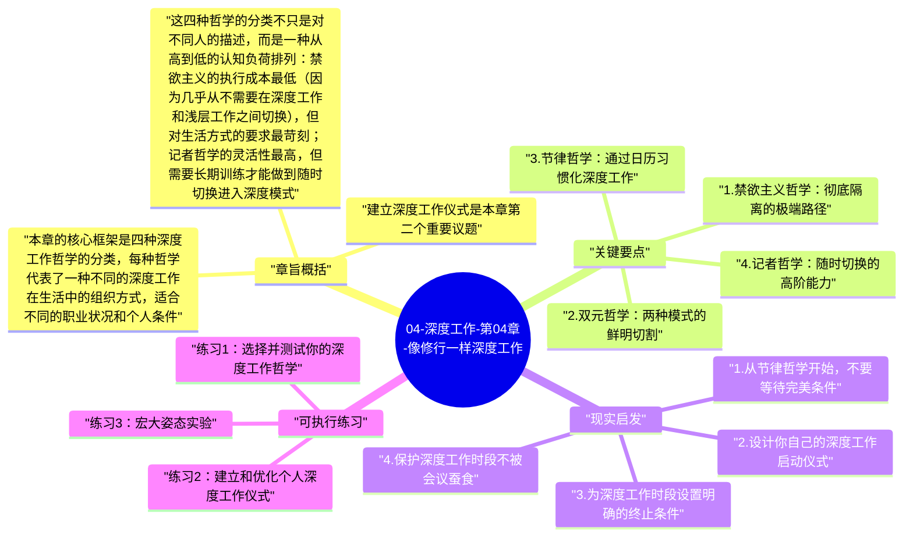

# 04-深度工作-第04章-像修行一样深度工作

第四章是《深度工作》从理论论证转向实践指导的真正起点。前三章建立了为什么深度工作有价值、为什么它正在消失、以及为什么它对人生意义至关重要的完整认知框架。从这一章开始，纽波特的核心问题变成了：一个现实中的知识工作者，如何在充满干扰和竞争性需求的实际生活中，系统地把深度工作变成可持续的日常实践？这是一个截然不同的挑战——它不再是认知理解层面的，而是行为设计层面的。

纽波特在这一章的核心论点是：深度工作必须被仪式化、制度化，而不能只靠临时决定和当天的意志力。这个论点听起来平淡，但其含义是深刻的。它意味着"今天我想好好工作"这种想法，不论多么真诚，都不足以产生持续的深度工作实践。真正能产生效果的，是你提前为深度工作设计的结构——固定的时段、特定的地点、明确的启动仪式、清晰的工作规则。这些结构的作用是降低每次进入深度工作的摩擦力，让深度工作从一个需要每次重新做决定的艰难选择，变成一个几乎自动发生的习惯性状态。

章节标题中的"修行"比喻是经过深思熟虑的。修行者不是等到心情对了才去打坐，也不是在有灵感的时候才念经——他们有固定的时间、固定的仪式、固定的地点，这些外部结构帮助内在状态的一致性转化。纽波特要传达的是：对待深度工作，应该用类似对待修行的严肃态度——不是作为一种偶尔的奖励，而是作为需要刻意守护的日常纪律。

## 章旨概括

本章的核心框架是四种深度工作哲学的分类，每种哲学代表了一种不同的深度工作在生活中的组织方式，适合不同的职业状况和个人条件。禁欲主义哲学（Monastic Philosophy）主张将几乎所有浅层工作从生活中清除，让深度工作占据绝对主导地位。双元哲学（Bimodal Philosophy）主张将时间明确划分为两种截然不同的模式：完全隔离、全力深度工作的时段，以及正常生活与工作的时段。节律哲学（Rhythmic Philosophy）主张在每天的固定时段进行深度工作，通过日历上的重复来建立习惯。记者哲学（Journalist Philosophy）主张像职业记者那样随时利用任何出现的时间空隙进行深度工作，不需要提前规划固定时段。

这四种哲学的分类不只是对不同人的描述，而是一种从高到低的认知负荷排列：禁欲主义的执行成本最低（因为几乎从不需要在深度工作和浅层工作之间切换），但对生活方式的要求最苛刻；记者哲学的灵活性最高，但需要长期训练才能做到随时切换进入深度模式。纽波特明确指出，大多数人应该从节律哲学开始——它的规律性使得深度工作能够通过重复建立习惯，而不需要每次都依赖强大的意志力。

建立深度工作仪式是本章第二个重要议题。纽波特提供了仪式设计的三个基本维度：在哪里工作（工作地点的选择和物理设置）、工作多长时间（预设深度工作的持续时长）、工作时遵循什么规则（比如禁止查看互联网、必须先完成X才能休息）。这三个维度的明确化，能够显著降低进入深度状态的摩擦力，并帮助大脑形成"这个地点+这个时间+这些规则=深度工作模式"的条件反射。

## 关键要点

### 1. 禁欲主义哲学：彻底隔离的极端路径

禁欲主义深度工作哲学代表了最极端的一种形式：通过最大程度地消除所有浅层工作义务，让深度工作完全占据工作生活。理论物理学家、小说家、或某些学术研究者可能选择这种模式——他们的核心价值创造完全依赖于无干扰的长时深度工作，而他们的工作性质也允许他们对外部联系的要求做出最大程度的拒绝。纽波特本人在一定程度上实践了这种哲学的温和版本：不使用社交媒体，极度谨慎地控制外部承诺，保护大块的写作和研究时间。

然而，禁欲主义哲学对大多数人来说是不现实的，因为现代职业生活中几乎不存在完全脱离协作和沟通需求的工作。它的价值在于提供了一个参照点：如果你能从禁欲主义哲学中汲取其核心精神——把浅层工作视为需要主动管理和控制的东西，而不是无限接受的默认状态——即使不能完全实践，也能帮助你建立一种更主动的、而非被动的工作态度。

### 2. 双元哲学：两种模式的鲜明切割

双元哲学的核心逻辑是：深度工作和浅层工作需要完全不同的思维状态，因此应该被放置在时间上完全隔离的模式中，而不是在同一个工作日内相互混杂。实践双元哲学的人，可能会保留每周的三天或每年的某个季节专门用于深度工作，在这段时间内完全切断外部联系，拒绝会议和消息；其余时间则正常运作，接受所有的浅层工作需求。荣格是纽波特经常引用的双元哲学实践者——他在苏黎世维持繁忙的诊疗实践的同时，在波林根塔楼保留了完全隔离的深度工作时间。

双元哲学的挑战在于需要有足够的职业自主性来保护大块的隔离时段，以及有管理预期的能力——你需要让周围的人理解并接受你有时会在一段时间内完全不可达。对于能够实践这种模式的人来说，它的优势是巨大的：大块的隔离时间能够让人进入比短暂专注时段更深、更完整的深度工作状态，完成那些需要长时间持续思考才能产生突破的复杂工作。

### 3. 节律哲学：通过日历习惯化深度工作

节律哲学是纽波特认为最适合大多数知识工作者的深度工作组织方式。它的核心原则非常简单：每天在同一时段进行深度工作，通过日历上的固定重复来建立习惯，从而让进入深度工作状态不再需要每次的意志力决定，而是变成一种自动触发的日常习惯。就像跑步者不需要每天早上重新决定"今天要不要跑步"，而是因为已经建立了习惯而自动穿上跑鞋，深度工作者通过节律哲学让深度工作也进入这种自动化的习惯轨道。

节律哲学的另一个优势是它的可见性。当深度工作时间被标注在日历上，就像会议一样占有明确的时间块时，它就获得了一种制度化的保护——别人不容易在这个时段安排会议，你自己也不容易随意将它挪用于其他事务。这种可见性创造了一种心理上的承诺感，使深度工作从一个虚无缥缈的愿望变成了一个具体的计划，而具体计划的执行率要远高于模糊愿望的执行率。

### 4. 记者哲学：随时切换的高阶能力

记者哲学以新闻记者的工作模式为原型：职业记者需要在嘈杂的编辑室、出差途中、或任何可用的片段时间里，随时切换进入深度写作模式，快速完成高质量的稿件。纽波特把这种能力称为"记者哲学"，并明确指出它是最难掌握的一种深度工作模式，不适合深度工作实践的初学者。它需要多年持续训练才能获得的能力：能够在任何地点、任何时间段，几乎没有预热时间地进入深度专注状态。

理解记者哲学的重要性在于认识到，专注能力是可以被训练到相当高水平的——你不是天生就只能在某些特定条件下才能工作深入。随着深度工作实践的积累，进入深度状态的预热时间会越来越短，对环境条件的要求也会越来越低。记者哲学是一个长期目标：在你发展出这种灵活的深度专注能力之前，更严格的时间和地点结构是必要的支撑；当你发展出这种能力之后，你就能在更多元的情境中维持深度工作的产出。

### 5. 仪式设计的三个维度

仪式设计是纽波特在本章中另一个核心贡献。他指出，仪式的作用是通过创造一套固定的前置行为序列，帮助大脑快速识别并切换到"深度工作模式"。仪式不是迷信，而是一种条件反射建立机制：当你每次在开始深度工作前都重复同样的行为——走到特定的地点、泡一杯特定的饮料、关闭特定的软件、打开特定的音乐——这些行为的重复组合会逐渐与深度工作状态形成强烈的神经关联，使得进入深度模式所需的时间越来越短。

仪式设计需要考虑三个核心问题：在哪里工作（专用于深度工作的地点，或者能够将某个普通地点转化为深度工作环境的信号）、工作多久（预先设定工作持续时间，避免无限期的工作焦虑）、工作时遵循什么规则（明确允许和不允许的行为，比如禁止查看任何非必要的网页，要求写完X字才能休息）。这三个维度的清晰化，能够将深度工作的启动从一个需要意志力的决定，转变为一套几乎能自动触发的程序。

### 6. 宏大姿态与环境变化的专注增益

纽波特在本章中引入了一个有趣的策略：宏大姿态（Grand Gestures）。这指的是通过采取某种不寻常的行动或创造某种特殊的工作环境，来增加深度工作的心理份量，从而更容易进入和维持深度状态。比如，J.K.罗琳在写《哈利·波特》最后一部时专门在一家豪华酒店租了房间，以阻断日常生活的所有干扰。比尔·盖茨每年两次的"思考周"也是一种宏大姿态——完全切断外部联系，在偏远的小屋中进行高强度的深度阅读和思考。

宏大姿态的心理机制在于：通过一种不寻常的、有一定成本的行动，向大脑发送一个清晰的信号——这件工作很重要，值得这种特殊对待。这种信号增加了工作的心理重量，使人更容易在面对困难时坚持下去，也更容易抵抗分心的诱惑。你不需要在豪华酒店租房，但找一个特别的地点、花一定的时间和精力准备工作环境，这种投入本身就是一种承诺信号，能够显著提升深度工作时段的质量。

## 现实启发

### 1. 从节律哲学开始，不要等待完美条件

对于大多数现代知识工作者来说，建立深度工作实践最务实的起点是节律哲学：每天选择一个固定时段（比如早晨的前两小时），不论今天有多少其他事情要处理，先完成这个固定的深度工作时段，然后再去处理其他一切。这种"深度工作优先"的日程原则，比任何其他策略都更能在充满竞争性需求的日常生活中保护深度工作的存在。

很多人等待"有完整时间的那天"再开始深度工作，但那一天往往永远不来。真正的策略是接受不完美的条件，并在不完美的条件中建立一个可以持续的小规模深度工作习惯，然后随着习惯的巩固逐渐扩大深度工作的比例。每天90分钟的深度工作，持续一年，等于大约23个完整工作日的深度工作时间——这是一个巨大的累积效应，而它来自于每天一个并不惊天动地的固定时段安排。

### 2. 设计你自己的深度工作启动仪式

花时间思考和设计你自己的深度工作仪式，是一种高回报的前期投资。这个仪式不需要复杂，但需要一致性：每次开始深度工作之前，你都要执行同样的几个步骤。这些步骤可以包括：把手机放到另一个房间、关闭所有消息通知、打开你用于深度工作的特定音乐或背景音、在纸上写下今天深度工作时段的具体目标。这些步骤本身花不了多少时间，但它们积累起来形成的条件反射，会让你的大脑在执行仪式的过程中就开始切换到深度工作模式，大幅缩短正式进入专注状态所需的热身时间。

### 3. 为深度工作时段设置明确的终止条件

许多人的深度工作失败，不是在开始阶段，而是在持续阶段——他们无法在深度工作中保持足够长的时间，要么很快被外部干扰打断，要么自己提前放弃。一个有效的对策是预先设定深度工作时段的明确终止条件，而不是依靠感觉来判断"什么时候工作够了"。终止条件可以是时间性的（工作90分钟后休息）、也可以是任务性的（完成这个章节的初稿后才能休息）。有了清晰的终止条件，在工作进行中遇到认知阻力时，你更容易说服自己"再坚持一会儿，终点不远了"，而不是在遇到第一个困难时就放弃。

### 4. 保护深度工作时段不被会议蚕食

在组织化工作环境中，最常见的深度工作杀手是被不断安排进日程的会议。一个有效的系统性保护策略是将深度工作时段在日历上标记为"已预约"，并养成在接受新会议请求时默认说"这个时段我已有安排，能换一个时间吗"的习惯。这不需要解释"我在做深度工作"——只需要像对待其他重要约定一样保护这个时段。久而久之，周围的人会形成"在那个时段不去打扰他"的预期，深度工作时段就获得了一种自然的制度性保护。

## 可执行练习

### 练习1：选择并测试你的深度工作哲学

仔细阅读四种深度工作哲学（禁欲主义、双元、节律、记者），根据你的实际职业状况和生活节奏，选择一种最适合你当前阶段的哲学，然后将其具体化为一个可以在接下来四周内执行的深度工作计划：明确你将在哪些时段进行深度工作、每次持续多长时间、在哪个地点、遵循什么规则。四周后，评估这个计划的实际执行情况和效果，根据评估结果做出调整。这个四周实验不是为了找到"完美方案"，而是为了建立真实的数据和经验，而不是停留在理论层面的自我规划。

### 练习2：建立和优化个人深度工作仪式

设计一个包含三到五个步骤的深度工作启动仪式，然后在接下来的三周内，每次开始深度工作时都严格执行这个仪式，不跳过任何步骤。三周后，反思：哪些仪式步骤让你感到确实有助于切换状态？哪些步骤感觉多余或反而增加了摩擦？基于这个反思优化你的仪式设计，使它既足够一致（能产生条件反射效果），又不会因为过于繁琐而让你在疲惫时想跳过。一个好的仪式应该感觉像是在"帮助你进入状态"，而不是"需要先完成的繁重准备"。

### 练习3：宏大姿态实验

为你目前最重要的一个深度工作项目（一篇重要的报告、一个技术设计、一段需要突破的学习），安排一次"宏大姿态"式的工作时段：选择一个特别的地点（图书馆的隔间、安静的咖啡厅、或者家里一个平时不用于工作的空间），提前准备好所有需要的材料，安排一个不被任何其他事务打扰的完整半天或一天，然后全力以赴地在这个特别环境中推进这个项目。之后，比较这次宏大姿态式工作与你平时普通工作状态下对同一项目的进展速度和质量。大多数人会发现，这种特别安排的工作时段所产生的成果质量和数量，要显著优于同等时长的普通工作日。

---

## Mermaid 思维导图

### 图1

