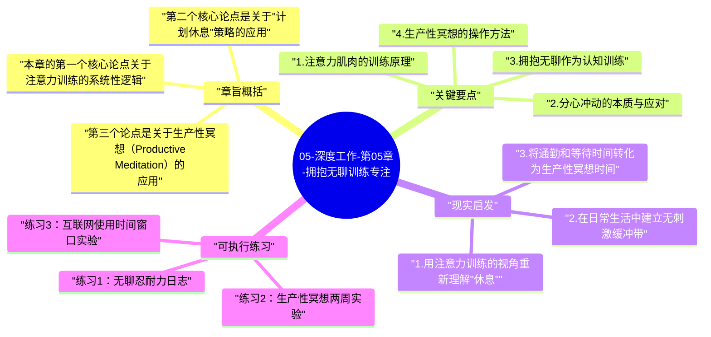

# 05-深度工作-第05章-拥抱无聊训练专注

第五章触及了《深度工作》中最容易被忽视却最为关键的一个洞察：深度工作能力的建立，不只是关于工作时间的安排，而是关于注意力本身的训练。这是一个质性的区别——大多数关于提升专注的讨论，都只关注"工作时不要分心"，却忽略了一个更根本的问题：如果你的大脑在工作之外的每一个空闲时刻都在接受持续的刺激训练，那么当你真正需要专注工作时，你的大脑已经习惯于短暂刺激的节奏，根本没有能力维持长时间的单一焦点。

纽波特的核心论点可以用一个类比来理解：你不能在平时一直吃高糖食物、只在运动前才吃健康食物，然后期望能有良好的运动表现。同样，你不能在工作时间之外持续用碎片化刺激喂养自己的大脑，然后在工作时突然要求大脑切换到高强度专注模式。注意力是一种需要全天候训练的能力，而不是可以在需要时临时召唤的开关。因此，要培养真正的深度工作能力，必须同时训练工作外的注意力使用方式——特别是学会与无聊相处，而不是每次遇到无聊就立刻用刺激填充。

这一章在全书实践部分（第4-7章）中的位置是独特的：第四章讲如何安排深度工作的时间结构，第五章讲如何建立深度工作所需的内在注意力能力，第六章讲如何减少注意力被社交媒体侵占，第七章讲如何压缩浅层工作。第五章处理的是最底层的能力建设问题——如果没有这一层，其他章节的方法论将没有坚实的执行基础。

## 章旨概括

本章的第一个核心论点关于注意力训练的系统性逻辑。纽波特将专注力与肌肉力量做类比：就像肌肉力量需要通过系统的抗阻训练来建立，而不能只依赖日常活动，专注力也需要通过刻意的注意力训练来建立，而不能只依靠偶尔的专注工作时段。这个类比的关键推论是：如果你在工作之外的时间里，持续用检查手机、浏览社交媒体、切换各种刺激来"休息"，你实际上是在用一种与深度工作完全相反的注意力模式来占用你大脑的大部分清醒时间。久而久之，这种模式成为你的注意力默认状态，而深度专注变成一种异常状态，需要巨大的意志力才能短暂维持。

第二个核心论点是关于"计划休息"策略的应用。纽波特提出了一个反直觉的策略：与其计划何时使用互联网，不如计划何时休息。具体来说，他建议在工作日开始时就规划好一天中允许使用互联网（包括查看邮件、社交媒体等）的具体时间窗口，在这些窗口之外，完全不使用互联网。这个策略的目的不是减少互联网使用量，而是练习在认知上控制分心冲动的能力——当你知道"再过45分钟就可以查邮件了"时，你必须发展出忍受45分钟的"非即时满足"的认知能力，这种能力本身就是深度工作所需的注意力控制能力。

第三个论点是关于生产性冥想（Productive Meditation）的应用。纽波特建议将身体活动（散步、慢跑、开车等需要有限认知资源的活动）时间，转化为对一个具体问题进行高度专注思考的时间。这种实践一举两得：它利用了原本可能会被消极地用于刷手机的时间，同时训练了一种非常有价值的认知能力——在没有外部引导和即时反馈的情况下，独立地维持对一个复杂问题的深度思考。

## 关键要点

### 1. 注意力肌肉的训练原理

专注力不是一种稳定的、不会随使用习惯变化的能力，而是一种高度可塑的认知能力，其质量和持续性直接受日常使用模式的塑造。当一个人长期以碎片化的方式使用注意力——每隔几分钟就在不同任务和刺激之间切换——大脑中负责维持持续专注的神经回路会因为缺乏训练而逐渐弱化，而处理快速切换和多源输入的回路则因为频繁使用而得到强化。这个过程不是有意为之的，而是大脑根据使用频率进行的自动优化——哪种注意力模式用得最多，哪种模式就会得到最多的神经资源支持。

这个原理的实践含义是令人清醒的：如果你每天有16小时的清醒时间，其中只有2-3小时用于深度工作，而其余13-14小时都在用碎片化的方式使用注意力，那么你每天对深度专注模式和碎片化模式的训练比例是1:5到1:7。在这种训练比例下，期望能够在那2-3小时的工作时段内维持真正高质量的深度专注，几乎是在要求大脑做一件它没有被充分训练的事情。改变这个比例，或者至少主动提升非工作时间内注意力使用质量，是提升深度工作能力的根本策略。

### 2. 分心冲动的本质与应对

当人们试图在工作中保持专注时，经常遇到的最大挑战不是外部打断，而是来自内部的分心冲动——一种突然想要检查消息、浏览网页或切换任务的强烈冲动。许多人认为这种冲动的出现就意味着他们"需要休息了"，于是顺从了这个冲动。但纽波特的观察是：在大多数情况下，这种冲动的出现与真正的疲劳无关，而是与认知阻力有关——当当前任务变得困难、需要更深入思考时，大脑会自动产生一种逃向更轻松任务的冲动，作为一种回避认知挑战的防御机制。

学会区分真正的疲劳信号和认知阻力引发的逃避冲动，是训练深度工作能力的重要技能。当一个分心冲动出现时，可以先暂停并问自己：我是真的需要休息，还是只是在这个任务上遇到了困难，想要逃到更轻松的事情上去？如果是后者，则应该把这个冲动视为一个训练机会——刻意忍住这个冲动，继续在困难的任务上多坚持一段时间，这个坚持本身就是在强化注意力控制能力。就像举重时最后几次最困难的重复才是真正建立肌肉力量的，工作中最困难时刻的坚持，才是真正建立注意力持久力的机会。

### 3. 拥抱无聊作为认知训练

在当代数字文化中，无聊几乎已经成为一种不被允许的状态——任何时间空隙都可以被无限的数字内容填充，从等电梯的30秒到睡前的一小时。这种对无聊的系统性消除，看起来是一种生活质量的提升（因为你不再感到无聊），但实际上是一种认知能力的削弱：它让大脑从来不需要自己生成内在的注意力焦点，永远都在被动地跟随外部刺激，永远不需要练习"在没有外部引导的情况下保持关注"的能力。

有意识地拥抱无聊，是重建这种能力的直接训练方式。在等待的时候不拿出手机，在独处时不立刻寻求娱乐内容，在通勤时让自己的思维自由游走而不是立刻戴上耳机——这些做法不是在浪费时间，而是在给大脑提供练习"无辅助的内在专注"的机会。一开始会感到不舒服，因为这种不舒服感正是长期缺乏这种训练的体现。但随着练习，大脑会逐渐重新习得在没有外部刺激的情况下产生和维持内在焦点的能力，而这种能力，正是深度工作能力的基础之一。

### 4. 生产性冥想的操作方法

生产性冥想是纽波特在本章中提出的一个具体的注意力训练技术，值得深入理解其操作方式。它指的是在进行一种需要有限意识注意力的体力活动（如散步、慢跑、做家务）时，将全部的认知资源集中于一个具体的专业问题，并持续深化对这个问题的思考。这种实践要求你首先明确定义你要思考的问题——不是模糊地"想想工作上的事"，而是一个具体的、有明确边界的问题，比如"为什么这个系统的性能出现了下降？有哪些可能的原因？"

生产性冥想的训练价值在于两个层面。第一，它直接产出有价值的思考成果——在散步30分钟的过程中，你可能真正推进了对一个复杂问题的理解，这是对时间的高质量利用。第二，它训练了一种在没有文字、界面或外部引导的情况下，纯粹依靠内在注意力驱动维持深度思考的能力。这种能力是所有深度工作的前提，但在日常工作环境中很少有机会被纯粹地训练——生产性冥想提供了这个机会。在实践过程中，你会发现注意力经常会漂移到其他事情上，这很正常——每次将注意力拉回到目标问题上的动作，就是一次明确的注意力控制训练。

### 5. 互联网使用的计划性与随意性

纽波特提出的"计划互联网使用"策略，其深刻之处在于它揭示了一个我们通常不会注意到的问题：当你可以随时使用互联网时，你从来不需要发展"忍受无即时反馈期间"的认知能力；而当你给互联网使用设定了时间窗口，你就被迫在这些窗口之外发展这种能力。这种能力的学术名称是"延迟满足能力"，它与自我控制、注意力持续性和认知韧性高度相关，而这些恰好都是深度工作所需的核心认知特质。

实践这个策略的关键是认真对待窗口外的"禁用"期。当分心冲动在窗口外出现时（这必然会发生），策略的要求不是永远不屈服，而是至少坚持到下一个预定的互联网使用窗口才去查看。每次这种坚持，都在建立注意力的弹性。纽波特特别指出，如果你确实需要使用互联网处理紧急事项，可以将窗口时间提前，但不要就地打破计划——这种区别看起来是形式主义，但它保留了你对自己注意力的主动控制感，而不是让分心冲动随时都能获胜。

### 6. 记忆训练作为专注能力的侧门训练

纽波特在本章中提出了一个有趣的附加建议：记忆训练可以作为训练专注能力的侧门路径。记忆竞技运动员使用的记忆术（特别是记忆宫殿技术）要求在脑海中建立和导航复杂的心理图像，这种练习高度依赖维持专注注意力的能力——你无法在注意力飘散的情况下有效执行记忆术。因此，定期进行记忆术练习，实际上也是在直接训练维持专注的神经能力。

这个建议的价值不在于每个人都应该成为记忆竞技选手，而在于它提供了一种有趣的、以具体技能获取为目标的注意力训练方式。相比于单纯的冥想（很多人发现枯燥难以坚持），以记忆术训练为目标的注意力训练有一种内在的游戏化奖励机制：你能记住越来越长的数字序列或越来越复杂的信息，这种进步本身就是持续参与训练的动力。注意力训练不一定是痛苦的苦行，它可以被嵌入有趣的挑战性活动中。

## 现实启发

### 1. 用注意力训练的视角重新理解"休息"

重新理解休息的概念，是这一章最重要的实践启示之一。传统上，我们把"刷手机"和"看视频"视为休息，因为它们感觉轻松和被动。但从注意力训练的角度看，这些活动并没有让负责深度专注的神经回路得到真正的休息——它们只是将注意力从一种活跃模式（工作）切换到了另一种活跃模式（追踪碎片化刺激）。真正有利于恢复深度专注能力的休息，是那些允许注意力系统真正下线的活动：发呆、轻度散步、闭目养神，或者进行不需要持续注意力的简单体力活动。

这种对休息的重新定义，意味着"高质量的休息"不等于"接触最多娱乐内容的时间"，而是指注意力真正得到恢复的时间。一个30分钟不做任何事情的安静发呆，对注意力系统的恢复效果，可能远好于30分钟刷不停更新的信息流。理解这一点，能够帮助你做出更明智的休息方式选择，从而在下一段工作时段开始时带着更高质量的专注资源。

### 2. 在日常生活中建立无刺激缓冲带

除了刻意的生产性冥想练习之外，更广泛的无刺激缓冲带建立，是培养注意力耐受力的日常训练场地。具体而言，可以在日常生活中刻意保留一些"无数字陪伴"的时间：吃饭时不看手机（即使是独自用餐）、上厕所时不带手机、等待时不掏手机。这些时段可能每次只有几分钟，但它们的累积效果是显著的：你的大脑会逐渐习惯于在没有外部刺激的情况下自己产生内容，而这种自主产生内容的能力，正是深度工作时深度思考的基础。

刚开始时，这些无刺激时段会让人感到不舒服，甚至有些焦虑——这种不适感是你长期缺乏这种训练的直接表现。把这种不适感当作一个有用的信号，而不是需要立刻消除的问题：它告诉你，你的注意力系统已经在某种程度上被训练成了对刺激的依赖状态，而修复这种依赖需要时间和耐心。每一次忍住去拿手机的冲动，都是一次真实的注意力控制训练。

### 3. 将通勤和等待时间转化为生产性冥想时间

对于大多数城市工作者来说，通勤时间是一笔被大量浪费的认知资源。把它转化为生产性冥想时间，是一种高回报的时间再投资。选择一个你目前正在深度工作中面临的具体问题，在开始通勤之前明确定义这个问题，然后在整个通勤过程中（驾车、乘车、步行）将注意力持续保持在对这个问题的深度思考上。不要带耳机，不要看手机，让自己的思维完全聚焦于这个问题。

开始实践这个方法时，你会发现注意力很快就会飘走——想到购物清单、想到昨天的一件事、开始回忆一首歌。每次这种飘移发生时，温和地把注意力拉回到目标问题上，不要自我批评。这种拉回动作的积累，就是注意力训练的实质。经过几周的持续练习，你会发现两件事同时发生：你对目标问题的思考深度明显提升（通勤时间产生了真实的思考成果），以及你在正式工作时维持专注的持续时间也有所延长（注意力控制能力的整体提升）。

## 可执行练习

### 练习1：无聊忍耐力日志

连续一周，记录每天你成功忍住拿手机冲动的时刻（比如等候时、排队时、独处时）以及你的感受变化。在每次成功忍住的时刻，简短记录：冲动有多强烈（1-5分）、你实际等待了多久才有了其他事情可做、这段时间你的思维自然漂向了哪里。这个日志的目的不是计量成就，而是建立一种关于自身注意力状态的自我觉察，让你开始看见那些本来自动发生、完全无意识的分心习惯模式。觉察本身就是改变的起点。

### 练习2：生产性冥想两周实验

选择你目前最重要的一个工作挑战，然后连续两周，利用每天至少一次的步行或其他低认知体力活动时间（每次20-30分钟），专门进行关于这个挑战的生产性冥想。在每次冥想开始前，在纸上或手机备忘录中写下你这次要思考的具体子问题，冥想结束后立刻把产生的关键思路记下来。两周后，审视你在这个工作挑战上的思考进展——很可能你会发现，这20次左右的生产性冥想时段，带来的思考推进超过了你预期，同时你的整体注意力控制能力也有了可感知的提升。

### 练习3：互联网使用时间窗口实验

选择工作日中的一天，提前规划你在这一天中被允许使用互联网（包括邮件、社交媒体、任何网页浏览）的具体时间窗口，比如上午10:00-10:30、午饭后12:30-13:00、下午16:00-16:30。在这些窗口之外，完全不使用任何互联网功能。在第一次实践这个方案时，记录每次分心冲动出现的时间，以及你当时正在做的具体工作。这个记录会揭示你的分心冲动最集中出现在哪类工作的哪个阶段——这是关于你自身认知阻力触发模式的宝贵信息，可以指导你如何更有针对性地强化在那些阶段的注意力控制。

---

## Mermaid 思维导图

### 图1

