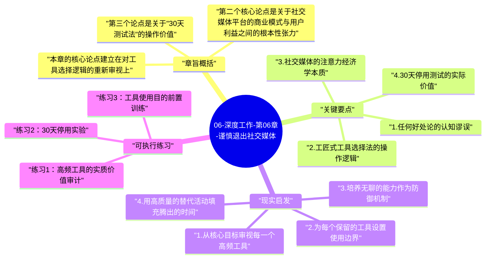

# 06-深度工作-第06章-谨慎退出社交媒体

第六章处理的是一个看似简单实则复杂的问题：在数字工具泛滥的时代，如何做出关于哪些工具值得保留、哪些工具应该放弃的明智判断？纽波特在这里的立场需要被准确理解——他不是一个反技术的卢德主义者，也不是在告诉每个人都应该删掉所有社交媒体。他真正要做的，是挑战一种几乎成为时代默认共识的思维框架：只要一个工具有任何一点好处，就应该保留它。纽波特认为，这个框架从根本上是不严谨的，它没有考虑工具的真实代价，也没有在工具价值与使用成本之间做任何权衡。

在整本书的结构中，第六章是专门针对数字工具选择的一章，但它与第五章有着深刻的关联：第五章说明了分心习惯对注意力能力的系统性损伤，第六章则给出了一个更具操作性的工具评估框架，帮助读者识别并减少那些对注意力损伤最大的工具。两章合在一起，构成了"保护注意力生态系统"的完整策略。

理解这一章的另一个重要背景是：纽波特在这里讨论的，不只是社交媒体对时间的占用，而更是社交媒体对注意力质量和注意力习惯的长期塑造效应。一个每天花两小时在社交媒体上的人，不只是失去了两小时可用于深度工作的时间，而且这两小时的碎片化浏览，正在持续训练大脑的快速切换模式，并在行为层面建立起"有空就检查更新"的自动化习惯，这种习惯的影响会渗透到工作时间中，远超过那两小时本身。

## 章旨概括

本章的核心论点建立在对工具选择逻辑的重新审视上。纽波特批评了他所称的"任何好处论"（Any-Benefit Mindset）——即一种只要一个工具在某方面有益就应该使用的思维方式。他指出这种思维方式的问题在于它完全忽略了工具的使用代价，而在注意力这个维度上，代价是极为真实且深远的。替代的框架是他所提倡的"工匠式工具选择法"（Craftsman Approach to Tool Selection）：从你的核心目标出发，评估每个工具对实现这些目标的实质性贡献，以及使用这个工具所需要付出的注意力代价，只有当贡献明显超过代价时，才保留这个工具。

第二个核心论点是关于社交媒体平台的商业模式与用户利益之间的根本性张力。纽波特指出，社交媒体平台的商业价值来自于用户注意力的持续占用，因此这些平台被设计成最大化注意力黏性，而非最大化用户的真实利益。无限滚动的信息流、间歇性的社交奖励（点赞和评论）、不断推送的通知——这些设计都是经过刻意优化的注意力捕获机制。理解这一点，是能够从用户的被动消费者立场转变为主动评估者立场的关键：你需要问的不是"这个平台有没有用"，而是"这个平台的设计是为了我的利益，还是为了它自己的商业利益"。

第三个论点是关于"30天测试法"的操作价值。纽波特建议对任何你考虑放弃的工具，先进行30天的完全停用，然后评估两个问题：在这30天里，这个工具的缺失是否严重影响了你的工作或生活？在这30天里，有没有人因为找不到你而感到显著的困扰？如果两个问题的答案都是否定的，那就有充足的理由永久放弃这个工具。这个测试法的价值在于它用真实体验代替假设，很多人在做这个测试之前，确信自己"离不开"某个平台，但30天后发现，那种"不可或缺感"往往是习惯性依赖制造的幻觉。

## 关键要点

### 1. 任何好处论的认知谬误

"任何好处论"是当代技术使用文化中最普遍也最具破坏性的思维错误之一。它的运作方式是这样的：当有人建议减少使用某个工具时，使用者会立刻想出一个这个工具带来的具体好处（"我在Twitter上认识了一个有用的联系人"、"我在Facebook上找到了一个旧朋友"），然后用这个好处来证明继续使用的合理性。这个论证看起来有道理，但它存在一个根本性的逻辑缺陷：它只评估了一侧的方程，没有评估另一侧——使用这个工具的真实代价。

任何好处论的危险在于，几乎任何工具都能找到某种好处。问题不是"有没有好处"，而是"好处是否足以抵消代价"。对于注意力密集型工具来说，代价包括：直接占用的时间、对注意力习惯的塑造效应（训练大脑期待快速切换和即时刺激）、以及创造的"随时检查"冲动对深度工作时段的渗透。一旦把这些代价也纳入评估框架，许多看起来"有用"的工具，其实质性净收益就变得相当可疑了。

### 2. 工匠式工具选择法的操作逻辑

工匠式工具选择法的关键在于方向性的颠倒：不是从工具出发寻找使用理由，而是从核心目标出发评估工具是否服务这些目标。一个木匠不会因为某把工具有某种可能的用处而把它加入工具箱——他会问"对于我要完成的工作，这把工具是否提供了重大且不可替代的支持"。如果答案是否定的，这把工具就没有进入工具箱的理由，不论它有多少其他方面的小用途。

将这个逻辑应用于数字工具评估，需要先完成一个前置工作：明确定义你的核心目标——无论是在职业发展、个人成长还是人际关系上，你真正在追求的是什么。有了明确的核心目标，你就可以对每个你使用的工具问一个具体的问题：这个工具是否在实质性地帮助我实现这些核心目标？这里的"实质性"是关键词——不是"可能有某种间接关联"，而是"如果没有这个工具，这个目标的实现会受到重大阻碍"。很多工具在这个检验下，其实质性贡献会比使用者想象的要小得多。

### 3. 社交媒体的注意力经济学本质

要理解为什么对社交媒体需要特别谨慎的评估，就需要理解社交媒体平台的商业模式。这些平台的核心资产不是用户数据（虽然数据很重要），而是用户的注意力——广告商购买的是用户的注意力时间和质量。因此，平台的产品设计目标，是从用户那里获取尽可能多的高质量注意力时间。这个目标与用户希望保护注意力用于深度工作的目标，在根本上是相反的。

理解这种利益对立，会让你用完全不同的眼光看待那些"吸引人"的平台设计特征。无限滚动消除了"看完了"的感觉，使你永远不会自然地停止；通知系统在你不主动访问平台时把你拉回去；点赞和评论系统建立了对社交认可的间歇性奖励期待。所有这些设计都在做同一件事：让你在平台上花费更多的注意力时间。你不需要对平台抱有敌意，但你需要清醒地认识到，当你在使用这些平台时，你是这个注意力交易中的产品，而不是顾客。

### 4. 30天停用测试的实际价值

30天停用测试是纽波特提出的一个极具实践价值的工具评估方法，它的设计逻辑非常精巧。首先，30天的停用时间足够长，能够让初期的戒断不适感消退，让你看到真正没有这个工具的生活是什么样的，而不是只看到最初几天的强烈不适。其次，30天后的回顾问题设计得非常具体：不是问"你想念它吗"（因为习惯会制造想念感，即使是对实际上不必要的东西），而是问"它的缺失是否造成了实质性的伤害"——这是一个更客观的评估标准。

很多人在做这个测试之前，有一种对某个平台的"不可或缺感"，这种感觉非常强烈，以至于他们甚至不敢进行测试。但纽波特引用的案例和许多人的亲身经历表明，这种不可或缺感往往是习惯性依赖的产物，而非真实的功能性需求。当你真正完成30天的测试，并发现生活和工作并没有因为缺少这个平台而遭受任何实质性损失时，那种"不可或缺感"就会显现出它真实的虚假性——它不是工具价值的体现，而只是习惯的力量。

### 5. 互联网使用的质量而非数量

纽波特的论证有一个微妙之处值得强调：他关注的不只是互联网或社交媒体的使用时间总量，而更是使用方式的质量。相同数量的互联网使用时间，如果是专注于一个具体目的（比如查阅特定信息、完成特定研究），对注意力的影响与漫无目的地浏览信息流完全不同。前者是有意识的工具使用，后者是被工具的设计所引导的被动消费。区分这两种使用方式，是在数字时代保持注意力主权的关键技能。

这种区分在实践上意味着：减少社交媒体使用的目标，不应该只是"少花时间"，而应该是"从被动消费者转变为主动使用者"。主动使用者在使用一个工具之前，明确知道自己要用它完成什么具体目的；被动消费者打开一个应用时，没有任何具体目的，只是感到"无聊"或"想看看有没有什么新东西"。这种区别，决定了同样的使用时间是在增益注意力能力还是在消耗注意力能力。

### 6. 网络孤独与真实联系的重新定义

纽波特在这一章还挑战了一个常见的社交媒体保留理由——"它帮助我维持人际关系"。他的反驳是：社交媒体所提供的，通常是一种浅层次的、低质量的社交连接，而非真正有深度的人际关系。双向关注、点赞、偶尔的评论——这些互动在感觉上像是维持了联系，但它们提供的社交满足感是薄弱的，因为它们不包含真正的关注、真正的理解、真正的相互投入。如果你停止使用社交媒体，你会发现真正重要的人际关系并不会因此消失——真正关心你的人会通过电话、面对面见面或其他更直接的方式保持联系。

真正消失的，是那些与你没有真实深厚联系的"社交网络连接"——而纽波特的观点是，失去这些其实没有多大损失，因为这些连接提供的社交价值本来就非常有限。如果这个观点让你感到不安，那可能是因为我们的文化已经把"联系数量"误认为"关系质量"太久了。深度工作者需要的是少而精的深度人际关系，而不是广而浅的社交网络存在感。

## 现实启发

### 1. 从核心目标审视每一个高频工具

花一个小时列出你目前使用最频繁的五到十个数字工具（包括应用、平台、服务），然后对每一个工具做一个两步评估。第一步：明确写下这个工具的主要用途——不是"我用它来..."的一般性描述，而是"在过去三个月里，这个工具有没有帮助我在某个核心目标上取得实质性进展？请举出具体的例子"。第二步：估算这个工具每周占用的注意力时间（包括直接使用时间加上它产生的分心冲动的间接时间），并评估这个注意力代价是否合理。这个评估过程往往会带来很多意外的发现——很多我们认为"有用"的工具，在这个框架下展现出与其注意力代价完全不成比例的实质价值。

### 2. 为每个保留的工具设置使用边界

对于那些通过评估决定保留的工具，仅仅"使用它"还不够，还需要明确定义如何使用它。具体来说，应该为每个保留的高频工具设置三类边界：时间边界（什么时候使用，每次多长时间）、目的边界（使用这个工具要完成什么具体目的）、以及位置边界（在哪些设备或地点使用）。这三类边界的建立，使你从被工具的设计逻辑引导的被动用户，转变为根据自己目标主动使用工具的主动用户，这种转变在注意力管理上的影响是深远的。

### 3. 培养无聊的能力作为防御机制

纽波特在第五章和第六章的策略之间有一个深层的连接：能够忍受无聊，是减少对注意力捕获平台依赖的最重要的内在能力。许多人无法减少社交媒体使用的根本原因，不是这些平台"太有用了"，而是他们无法忍受没有即时刺激填充的空白感。一个已经习惯了无聊的人，在减少或放弃某个社交媒体平台时，会比一个无法忍受无聊的人面临小得多的心理阻力。因此，第五章的无聊训练，实际上也是第六章工具断舍离的情绪前提。

如果你发现自己无法通过理性评估来减少某个平台的使用，尽管你在理性上认同这个平台对你的帮助有限，那么问题可能不在工具本身，而在于你的无聊耐受力。先从第五章的无聊训练开始，建立足够的无刺激忍耐力，然后再来处理工具断舍离，你会发现后者容易得多。

### 4. 用高质量的替代活动填充腾出的时间

当你减少了某些数字工具的使用时间后，关键问题是：这些时间去了哪里？如果答案是"漂移到其他同类型的浅层活动"，那么减少工具使用的意义就大打折扣。真正有价值的做法，是用事先规划好的高质量活动来填充这些时间——阅读实体书、发展一个需要深度练习的兴趣爱好、进行高质量的面对面社交，或者就是有意识的独处和思考。这种主动填充，能够防止被腾出的时间自动被其他注意力消耗工具所占据，真正实现注意力资源的重新分配。

## 可执行练习

### 练习1：高频工具的实质价值审计

选择你使用最频繁的三个社交媒体或网络信息消费工具，为每个工具写一份一页纸的"价值报告"。报告包含三个部分：第一，这个工具在过去六个月里为你带来的最具体的三项价值（要非常具体，不能是"它让我了解信息"这类模糊描述，而应该是"它让我了解到X，而X导致了Y这个具体的正面结果"）；第二，你每周平均花在这个工具上的总时间（包括主动使用和被通知拉回的时间）；第三，这三项价值是否有其他成本更低的方式可以获得。完成这份报告后，你会对每个工具的实质性价值有更清晰的认识，从而能够做出更理性的去留决定。

### 练习2：30天停用实验

选择一个你怀疑自己对其依赖程度超过其实际价值的平台，进行严格的30天完全停用实验。在停用开始时，通知你最常通过该平台联系的人，告诉他们接下来一个月你不会在那个平台上出现，并留下其他联系方式。30天后，回答以下问题：在这段时间里，有没有因为无法使用该平台而导致的、无法通过其他方式弥补的具体损失？有没有人因为无法通过该平台联系到你而出现了无法解决的问题？这段时间里，你注意到自己的注意力质量有什么变化？这些答案将给你提供远比事先猜测更真实的关于该平台价值的证据。

### 练习3：工具使用目的前置训练

选择一周时间，实践一个简单的规则：每次准备使用社交媒体或其他信息流工具之前，先在心里或纸上明确说出你这次打开这个工具的具体目的是什么。如果你无法说出一个具体目的，就不打开这个工具。一周后，统计你有多少次能说出具体目的，有多少次无法说出。无法说出具体目的的次数，就是你的被动消费次数——这个数字会很直观地展示你对这些工具的习惯性依赖程度，而非目的性使用程度。这个练习不会立刻改变你的使用习惯，但它会建立起一种关于自身工具使用模式的清醒觉察，而这种觉察是主动改变的先决条件。

---

## Mermaid 思维导图

### 图1

