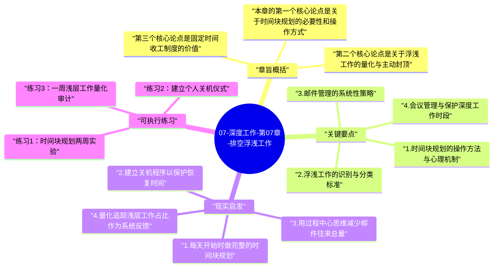

# 07-深度工作-第07章-排空浮浅工作

第七章是《深度工作》实践部分的最后一章，也是将全书所有理论和策略落地到每日工作现实中的收尾章节。前面几章建立了深度工作的思想框架（第1-3章）、时间结构（第4章）、注意力能力（第5章）和工具管理（第6章），这一章要解决的是最后一个核心问题：当所有这些准备都做好之后，在一个充满不可避免的浮浅工作需求的现实日程中，如何真正为深度工作挤出稳定的空间？

纽波特在这一章的立场是务实而非理想主义的。他不是在说"消除所有浮浅工作"——他明确承认，浮浅工作在大多数职业中是无法完全消除的必要组成部分：邮件需要回复，会议需要参加，行政任务需要处理。问题不是如何消灭浮浅工作，而是如何阻止它从"必要的少数"膨胀成"无限扩张的多数"，把本应用于深度工作的时间全部吞噬。这种膨胀是自然发生的，因为浮浅工作有强大的自我增殖能力——每封邮件都会引发更多邮件，每次会议都会产生更多跟进事项，每个临时请求都会创造更多的响应期待。

这一章的核心贡献是提供了三个具体的日程管理工具，来系统地限制浮浅工作的扩张：时间块规划（Time-Block Planning）、浮浅工作量化与封顶、以及固定时间收工制度（Fixed-Schedule Productivity）。这三个工具共同构成了一套日常工作管理系统，能够在尊重现实约束的前提下，最大化深度工作在工作日中的占比。

## 章旨概括

本章的第一个核心论点是关于时间块规划的必要性和操作方式。纽波特主张，每天的工作应该在开始之前就得到详细的时间块规划——不是大致的任务清单，而是每个时间段做什么的具体安排，包括深度工作时段的保护、浮浅工作的集中处理窗口、以及预留给意外事项的缓冲块。这种规划的价值不在于严格按计划执行（计划几乎总会需要调整），而在于它迫使你在工作开始之前就主动做出关于时间分配的决策，而不是被动地让日程被最小阻力路径决定。当你提前规划时，你是在以清醒状态做时间决策；如果不规划，你是在被各种实时冲动和临时请求驱动，而这两种状态下的决策质量有着本质的差异。

第二个核心论点是关于浮浅工作的量化与主动封顶。纽波特建议知识工作者养成记录和量化浮浅工作时间比例的习惯，并为自己设定一个浮浅工作的时间上限——比如"浅层工作占工作时间的比例不超过30%"。这个量化目标的重要性在于它将一个模糊的愿望（"我想减少浮浅工作"）转变成一个具体的可追踪指标。当你有了这个具体指标，你就能实时评估某个新的工作请求是否会使你超过这个上限，并以此为据做出相应的接受或拒绝决定。这种量化管理，是将深度工作从愿望转变为稳定实践的重要基础设施。

第三个核心论点是固定时间收工制度的价值。纽波特主张在一天的工作中设定一个固定的收工时间（比如下午5:30），并严格遵守——即使任务未完成，也在这个时间结束工作模式。这个策略看似与"提升产出"的目标相悖，但纽波特的论证是：固定收工时间实际上会提升深度工作的产出，因为它制造了一种"稀缺性压力"——知道工作时间有限，会自然地驱动你把最有价值的深度工作排在最高优先级，而不是让浅层工作把所有时间填满。充足的非工作时间也为下一天的深度工作补充了真正的认知资源，使得每天的深度工作质量能够保持在较高水准，而不是随着长时间工作的疲劳积累而持续下降。

## 关键要点

### 1. 时间块规划的操作方法与心理机制

时间块规划不同于普通的任务清单，它的关键特征是时间的具体分配而非任务的简单列举。一个有效的时间块规划应该覆盖工作日的每一个小时，包括深度工作时段（明确标注为"深度工作——任务X"）、浅层工作批处理时段（集中处理邮件、消息、行政事务的时段）、以及若干缓冲时段（用于应对意外事项和超时任务的时间储备）。规划的目的不是让你机械地执行计划，而是让你在面对各种竞争性需求时，能够以这份规划为参照，做出更有意识的时间分配决定。

时间块规划的心理机制有两个层面。在即时层面，它减少了"接下来做什么"的决策成本——你不需要在每个任务结束时重新决定下一步，而是直接按照规划执行，这种自动化降低了认知摩擦。在系统层面，每天制作时间块规划的行为本身，是一种对自己时间主权的日常主张——你在向自己和环境声明："我的时间不是随机可用的资源，而是被规划好的稀缺资源"。这种声明会改变你与来自外部的时间请求（会议邀请、临时任务）的关系，从默认接受转变为主动评估。

### 2. 浮浅工作的识别与分类标准

在有效控制浅层工作之前，首先需要能够清晰地识别什么是浅层工作。纽波特给出了一个实用的识别测试：想象一个聪明但缺乏专业知识的大学生，他经过适当的说明后能在多短时间内完成这项任务？如果答案是几天之内，这项任务很可能是浅层工作；如果答案是需要几个月甚至更长时间的专业积累，这项任务更可能是深度工作。这个测试的价值在于它排除了"熟悉感偏差"——我们往往因为某项工作对自己来说感觉重要而高估其复杂度，这个测试能够帮助更客观地评估工作的真实认知深度要求。

识别浅层工作之后，还需要进行分类管理，因为不同类型的浅层工作有不同的处理策略。有些浅层工作是可以批处理的（如邮件回复、例行更新），应该集中安排在特定时段处理，而不是全天分散处理；有些浅层工作是可以委派或外包的（如某些行政任务、格式化工作）；有些浅层工作是可以通过流程化来大幅降低时间成本的（如用模板回复常见问题、建立标准操作规程）；还有一些浅层工作是完全可以拒绝的（如不必要的会议、与核心目标无关的项目）。在这四个维度上有针对性地管理浅层工作，比笼统地"减少浅层工作"要有效得多。

### 3. 邮件管理的系统性策略

在现代知识工作的浅层工作来源中，邮件占据了极大的比例。纽波特提供了几个具体的邮件管理策略，可以显著减少邮件往来对注意力的消耗。第一个策略是"过程中心邮件"（Process-Centric Emails）：在回复邮件时，不要只回答当前问题，而要预判这封邮件可能引发的所有后续往来，一次性在回复中包含所有必要的信息和决定，以最大化减少来回邮件的数量。第二个策略是为简单的信息请求建立常见问题模板，避免重复撰写同类回复。第三个策略是主动减少自己发送的邮件数量——你发送的每封邮件都在产生对方的回复义务，进而引发对你的回复请求。

更深层的邮件管理原则是：把邮件当作一种具有高时间成本的异步通讯工具，而不是一种需要即时响应的实时聊天工具。当你把邮件从实时的切换到异步的时，整个邮件处理的心理框架就改变了——你不再是"随时随地需要响应"，而是"在计划好的时段内批量处理"。这种框架转变，能够将邮件对深度工作时段的渗透性干扰降到最低，同时并不降低实际的沟通质量，因为大多数邮件内容并不需要即时回复才能有效推进工作。

### 4. 会议管理与保护深度工作时段

会议是浅层工作膨胀的另一个主要驱动力。在组织化工作环境中，会议有一种自我增殖的特性：每次会议产生待办事项，待办事项需要跟进会议，跟进会议又产生新的议题，新议题需要新的会议。不加管理的话，会议可以将整个工作日切割成无数的小碎片，完全阻止任何深度工作的发生。对会议进行主动管理，是保护深度工作时段的核心策略之一。

主动管理会议的具体方法包括：在接受会议邀请之前，明确询问这次会议要达成什么具体决定或成果（这个问题会过滤掉很多目的模糊的状态更新式会议）；推动会议拥有明确的议程和时间限制，并在达到预定时间时主动结束；对于只需要信息同步的需求，尝试用异步的书面更新代替实时会议；以及为自己的深度工作时段在日历上建立"已预约"屏障，使在这些时段内安排会议的请求自然遭遇阻力。这些策略不需要你成为一个不合群的工作者，它们只是将"有效使用会议时间"的常识原则付诸实践。

### 5. 固定收工制度的反直觉价值

固定收工时间制度是本章中最反直觉的策略之一，因为它表面上看起来是在主动减少工作时间，而大多数人的本能是"工作越多越好"。但纽波特的论证揭示了这个直觉的错误：如果你知道今天6:00一定会收工，你不会在下午3:00开始新的低优先级任务，而会把这段时间用在最重要的深度工作上；如果没有固定收工时间，下午3:00的低优先级任务可以无限延伸，占用本应用于深度工作的时间，同时产生"还在工作"的假象。

固定收工时间还有一个重要的功能：它迫使你建立一个明确的"工作结束仪式"，彻底关闭工作模式，让大脑在非工作时间真正地休息和恢复。纽波特将这个仪式称为"关机程序"：在固定收工时间到达时，快速检查未处理的任务、评估明天的计划，然后说出一句明确的关机语句（"关机完成"）。这个仪式的作用是向大脑发送一个清晰的"工作模式结束"信号，防止工作焦虑在非工作时间的持续入侵，这种侵入是许多知识工作者感到永远精力不足的主要原因之一。

### 6. 浮浅工作预算的设定与执行

将浮浅工作的时间占比设定为一个有意识管理的指标，是这一章最具实践价值的操作建议之一。纽波特建议每位知识工作者与自己的管理者讨论（如果有管理者的话），明确在自己的角色中浅层工作应该占据多大比例才是合理的。这个讨论本身就有价值，因为它迫使双方明确思考工作者的核心价值创造模式，以及浅层工作义务是否已经超出了合理范围。

对于自主安排时间的工作者，纽波特的建议是将浅层工作时间控制在30%-50%以下，根据工作性质的不同而调整。一旦设定了这个上限，它就成为一个日常决策的参照点：当一个新的浅层工作请求到来时，你可以评估接受它是否会使你超过这个上限；当你的浅层工作时间已经用尽时，你有了一个合理的、非个人化的理由来拒绝更多的浅层工作请求。这种量化管理，将"我没有时间"从一种模糊的感受转变成了一个可以验证的事实。

## 现实启发

### 1. 每天开始时做完整的时间块规划

养成每天工作开始时花10-15分钟做当天完整时间块规划的习惯，是这一章最直接可执行的建议。规划的具体格式可以很简单：在一张纸或笔记软件上，写下当天每个小时的安排，明确标注哪些时段是深度工作时段（包括具体任务）、哪些是浅层工作批处理时段、哪些是缓冲时段。当天实际执行中，如果计划需要调整（这几乎必然会发生），直接修改规划，而不是放弃规划。每天结束时，快速回顾规划与实际执行的差异，这种回顾能够逐渐提升规划的准确性，也能清晰揭示是什么类型的意外事项最频繁地打断了你的深度工作时段。

### 2. 建立关机程序以保护恢复时间

建立一个每天固定执行的关机程序，是保护深度工作可持续性的重要基础设施。这个程序不需要复杂，核心步骤是：快速检查当天未完成的重要任务并将它们记录在明天的规划中（而不是让它们在脑中悬挂）、确认明天的最重要工作是什么、然后说出（或在心里默说）你的关机语句，明确结束工作状态。这个程序的关键价值是它给了你的大脑一个明确的"工作结束"信号，使工作焦虑不会在非工作时间持续激活，从而让你的恢复时间真正起到恢复的作用，而不是被工作的牵挂所消耗。

### 3. 用过程中心思维减少邮件往来总量

对于每封需要回复的邮件，在写回复之前先问自己：如果我不在回复中把所有后续事项都处理清楚，这封邮件会引发几次来回往来？然后在回复中尽量一次性覆盖所有可能需要进一步澄清的问题。这种过程中心式的邮件写法，确实需要在每封邮件上花更多时间，但它会大幅减少邮件往来的总次数，以及每次邮件通知对你工作的打断。与其每封邮件花2分钟写，往来5次，不如一次花8分钟写完，往来1次——总时间更短，深度工作被打断的次数也更少。

### 4. 量化追踪浅层工作占比作为系统反馈

每周花5分钟统计一下这一周的浅层工作时间占总工作时间的比例，将这个比例记录在某个固定的地方，建立一个时间维度上的追踪序列。即使你不为自己设定浅层工作上限目标，这个追踪本身就会产生一种积极的自我监督效果：当你知道自己在追踪这个指标时，你会更自然地在做工作安排时考虑深度工作与浅层工作的比例，而不是完全听任日程的自然漂移。这种量化反馈系统，是将深度工作从偶发事件转变为稳定实践的重要机制。

## 可执行练习

### 练习1：时间块规划两周实验

连续两周，每天开始工作前花10分钟做当天的时间块规划，并在当天结束时记录实际执行情况与规划的差异。两周后，分析你的规划准确率（计划如期执行的时段占总时段的比例）、以及哪些类型的意外事项最频繁地打乱你的深度工作时段。这个实验的目的不是要求你两周内就达到完美的执行率，而是通过14天的数据积累，清楚地看到你的工作日是如何实际运作的，哪些浅层工作来源是最频繁的干扰源，从而能够有针对性地设计应对策略，而不是基于模糊感受猜测问题所在。

### 练习2：建立个人关机仪式

设计一个属于你自己的5分钟关机程序，包含三个步骤：检查当天未处理的重要事项并确保它们被记录在明天的规划中；确认明天最重要的一到两项深度工作任务是什么；说出或写下你的关机语句（可以是任何对你有意义的句子，重要的是一致性）。然后，连续30天严格执行这个关机程序，包括周末。在这30天里，记录你在非工作时间里对工作的牵挂感（1-5分）和整体恢复质量感受。大多数人在建立关机仪式后，会发现非工作时间的心理品质有显著提升，而这种提升会反过来提高下一个工作日深度工作的质量——休息和深度工作之间存在着深刻的相互支持关系。

### 练习3：一周浅层工作量化审计

选择一周时间，每天记录你在浅层工作上花费的具体时间，按类别分类（邮件、会议、行政任务、临时请求等）。一周结束后，计算各类浅层工作的时间总量和占总工作时间的比例，并识别出时间消耗最大的浅层工作类别。针对消耗最大的类别，思考至少一个可以在下周实施的压缩策略——可以是批处理、模板化、委派或减少参与频率。以一个月为周期逐步实施这些压缩策略，并持续追踪浅层工作时间比例的变化。这个系统性的审计与优化循环，能够在不需要任何革命性改变的情况下，逐步但稳定地扩大工作日中深度工作的实际占比。

---

## Mermaid 思维导图

### 图1

