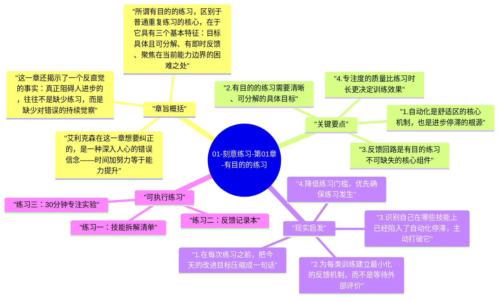
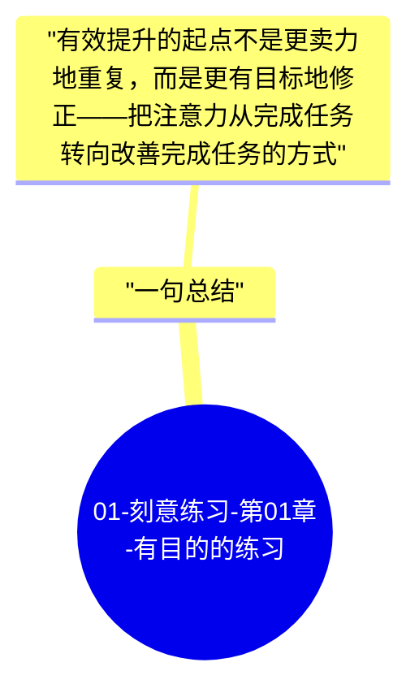

# 01-刻意练习-第01章-有目的的练习

很多人有过这样的体验：在某件事上花了大量时间，进步却迟迟不来。学了多年英语，开口依然磕磕绊绊；打了几十年乒乓球，水平却始终在同一层级徘徊；写了多年代码，能力并没有呈现出应有的跃升。这种停滞让人沮丧，而大多数人的第一反应是"我可能天赋不够"。艾利克森在本章用大量研究证据回应了这一误解：停滞的根本原因，不是天赋，而是练习方式本身出了问题。

作者把问题指向一个关键区分：做得久和做得强，是两件不同的事情。大多数人的练习模式，本质上是在反复巩固已经会的东西，而不是在持续突破不会的边界。这种重复不是毫无价值，但它能带来的提升极为有限。一旦某项技能进入自动化阶段，大脑就会把注意力从改进中撤走，把这件事交给"后台程序"处理，于是练习变成了维持而非成长。本章正是要拆解这种陷阱，并给出一种名为"有目的的练习"的改进策略，作为通向真正刻意练习的第一步。

本章在全书中起到奠基作用。艾利克森并非一开始就抛出最高难度的"刻意练习"标准，而是先让读者学会区分低效重复与有效训练。理解了"有目的的练习"之后，后续章节关于心理表征、黄金标准和应用策略才有了清晰的对照基础。如果跳过这一章直接去看方法论，就会缺乏对"为何大多数练习徒劳无功"的深刻感受。

## 章旨概括

艾利克森在这一章想要纠正的，是一种深入人心的错误信念——时间加努力等于能力提升。这个信念的问题在于，它把"练习量"当成了进步的充分条件，却忽视了练习质量。研究显示，在很多领域，从业年限与实际水平的相关性远低于人们预期。医生的误诊率并不随工龄线性下降，教师的教学效果也并不随教龄自动提高。经验积累之所以经常无法转化为持续进步，是因为人在熟练之后就不再对任务保持认知投入，自动化的重复会把错误和局限一并固化。

所谓有目的的练习，区别于普通重复练习的核心，在于它具有三个基本特征：目标具体且可分解、有即时反馈、聚焦在当前能力边界的困难之处。有目的的练习并不是要求人每次都竭尽全力，而是要求每次练习都对准一个明确的改进点，让注意力保持在正在突破的那个细节上，而不是在整体任务中漫游。一次只改正一个发音、一次只打磨一个代码模块、一次只完善一个论证逻辑，这种针对性的聚焦，才是让练习变得有效的关键机制。

这一章还揭示了一个反直觉的事实：真正阻碍人进步的，往往不是缺少练习，而是缺少对错误的持续觉察。人在做熟练的事情时，大脑会自动减少对细节的监控，因为这样更节省认知资源。这种机制在日常生活中非常有用，但在需要持续提升的技能学习中，它却是进步的障碍。有目的的练习要求人有意识地逆转这种自动化趋势，把注意力重新拉回到具体的改进点上，从而打开被舒适区封闭的成长空间。

## 关键要点

### 1. 自动化是舒适区的核心机制，也是进步停滞的根源

当一个人刚开始学习一项技能时，大脑必须全力以赴，每个动作都需要有意识地控制。但随着重复次数增加，大脑会逐渐把这项任务"下包"给更底层的神经网络处理，原本需要专注的事变得越来越自动化。这种自动化本身并不是坏事，它让我们能在不消耗大量注意力的情况下完成日常任务。问题在于，一旦技能进入自动化阶段，大脑便不再主动寻找错误、调整策略，进步也就随之停止。

很多人之所以误以为练习年限会带来持续提升，恰恰是因为他们忽视了自动化的这种双重性。他们感觉自己在"做"，但大脑实际上早已把这件事当成了维持性工作而非挑战性成长。真正有效的练习，必须打破这种自动化惯性，持续向大脑提供它无法轻松应对的挑战，使神经系统持续处于主动调整状态。只有这样，才能把练习时间真正转化成能力增长。

### 2. 有目的的练习需要清晰、可分解的具体目标

笼统的目标，比如"练好钢琴""提高表达""写好代码"，几乎不会带来实质性改变，因为它们太宽泛，无法引导注意力聚焦在真正需要改进的具体环节上。有目的的练习的起点，是把大目标分解成若干个具体的子技能，然后在每次训练中只处理其中的一个细节。这种分解并不是降低要求，而是提高精度，让改进变得可测量、可操作。

艾利克森以音乐演奏为例说明了这种精度的价值。顶尖演奏家在练习时，不会从头到尾顺着弹，而是会把困难的小节单独拿出来，设置具体目标，比如在这四个小节里把节奏控制到误差不超过十毫秒，反复练习直到稳定，再移向下一个难点。这种对目标颗粒度的控制，让每一次练习都有清晰的起点和终点，也让大脑始终处于主动解决问题的状态，而不是被动地进行机械重复。

### 3. 反馈回路是有目的练习不可缺失的核心组件

练习没有反馈，就像在黑暗中射箭，无论动作多么标准，也无从知道是否命中目标。反馈之所以关键，是因为人类的自我监控能力有限，尤其是对自己已经习惯的错误模式，往往浑然不觉。反馈能让人在错误固化之前及时修正，防止错误模式被重复强化到无法改变的程度。

反馈的形式可以多样：可以是教练的即时点评，可以是录像复盘中自己观察到的偏差，可以是数据指标显示的绩效曲线，也可以是对练习结果的自我对照检验。但无论形式如何，反馈必须足够及时，足够具体，并且与练习目标直接对应，否则它就无法驱动大脑进行有针对性的调整。那些能持续进步的人，通常都是在刻意建立并维护这种反馈机制的人。

### 4. 专注度的质量比练习时长更决定训练效果

很多人相信努力的计量单位是时间——每天练多少小时，坚持多少年。但艾利克森的研究表明，练习时间并不是决定进步的关键变量，决定进步速度的是练习期间的注意力质量。一小时高度专注的练习，其效果可以远远超过三小时漫不经心的重复，因为只有在主动投入注意力的情况下，大脑才会真正参与调整和学习。

这一发现对于学习策略的影响非常深远。它意味着精力管理比时间管理更重要，疲惫状态下的延时练习可能不仅无益，甚至会强化错误习惯。顶尖表现者普遍遵循一个规律：每次专注练习控制在可维持高度注意力的时长内，然后主动休息，以确保下次练习时仍能维持同样的专注质量。练习的密度，永远比练习的总量更重要。

### 5. 走出舒适区是有目的练习的必要条件，但需要刻意设计

有目的的练习必须把目标设置在当前能力边界的稍外侧，这个区域既不是轻松区（轻松意味着没有挑战，大脑不会改变），也不是崩溃区（过难意味着无法有效处理反馈）。艾利克森把这个有效地带描述为"需要努力才能完成，但努力之后确实有可能完成"的范围，这与维果茨基"最近发展区"的概念异曲同工。

走出舒适区需要刻意设计，而不是随机增加难度。最有效的方式，是在充分理解当前瓶颈的基础上，有针对性地提高目标难度，同时确保还有足够的支撑资源（反馈、方法、资料）来处理这个新难度。如果只是盲目加难，没有配套的学习机制，往往会引发挫败感，反而动摇人继续练习的意愿。设计良好的挑战梯度，是维持长期训练动力的重要保障。

### 6. 心态与练习设计需要同步调整

很多人在意识到练习需要改变时，只从外部调整——换教材、换环境、增加时间——却忽视了心理层面的适应。有目的的练习需要人主动接受"暂时变慢、暂时变笨"的过程，因为当你把注意力拉回到某个具体错误上时，整体表现往往会先下降，然后才会提升。这个下降期会让人感到不舒服，容易产生"越练越差"的错觉，从而退回到原有的自动化练习模式中。

应对这种心理反应的方式，是在训练前明确设定练习的阶段性目标和评价标准，让自己在短期波动中不失去方向感。此外，接受练习过程中的失败和错误，把每一次错误视为信息而非失败，是维持长期有效练习的心理基础。高手之所以比普通人进步更快，不仅在于练习方法，也在于他们对待错误的方式：普通人会回避，高手会专门为错误设计练习。

## 现实启发

### 1. 在每次练习之前，把今天的改进目标压缩成一句话

很多人在练习前没有任何具体意图，只是到了该练习的时间就开始做，到时间了就停下来。这种做法最多只能维持现有水平，无法带来实质提升。在每次练习开始前，用一句话写下今天要突破的具体问题，例如"今天专项改正商务汇报中前三分钟节奏拖沓的问题"或"今天只练这个函数的边界条件处理，其他部分不动"，这种事前明确化能极大提升练习的有效性。

这个习惯初看很简单，却需要克服"想一次练很多"的冲动。覆盖面越广的练习目标，往往注意力越分散，改进效果越差。接受每次只改进一点、但这一点真正改进到位的节奏，需要耐心和对复利效应的信任。

### 2. 为每类训练建立最小化的反馈机制，而不是等待外部评价

很多人认为反馈只能来自老师或评委，但实际上大量有效反馈可以自行设计。录下自己的演讲然后回放，会发现语速、停顿、用词上的问题；把自己写的代码打印出来隔天重读，会发现逻辑漏洞；把自己的决策过程写下来，之后对照实际结果，会发现判断误差的规律。等待外部反馈是低效的，因为它不及时、不持续，且往往不够具体到可操作的层面。

主动构建反馈机制的人，等于把"自我教练"的能力内化进了自己的练习系统。这种能力本身也是一种可以持续提升的元技能，越早建立，它带来的学习加速效应越显著。

### 3. 识别自己在哪些技能上已经陷入了自动化停滞，主动打破它

可以用一个简单的信号来识别停滞：如果你做某件事的时候大脑可以同时想别的事情，说明你在维持而非成长。这时候正确的做法不是"再多练一会儿"，而是找到一个具体难点，强迫自己把全部注意力集中回来，让练习重新变得有一点困难。

这种刻意的"破自动化"操作，在技能学习的各个阶段都会周期性地出现需求。每隔一段时间检视一下自己在核心技能上是否已经进入自动化巡航，是保持持续成长的重要自我管理习惯。

### 4. 降低练习门槛，优先确保练习发生

有目的的练习需要专注，而专注需要精力。很多人把练习设计得太重，要求自己每次都高度集中地练习一到两小时，结果因为启动成本太高，实际上很少真正开始。更有效的策略是降低单次练习的时长要求，确保练习以高频次、小剂量的方式发生，而不是以低频次、高负担的方式偶尔出现。

每天20分钟高质量的有目的练习，长期效果远远超过每周一次两小时的松散训练。关键不是每次投入多少，而是让练习成为一种稳定的日常节奏，不需要每次都依赖高涨的动力才能开始。

## 可执行练习

### 练习一：技能拆解清单

选择你目前最想提升的一项技能，花15分钟把它拆分成至少8个可以单独训练的子技能，例如演讲可以拆成开场钩子、数据呈现、过渡逻辑、结尾设计、眼神分配、语速控制等。写完之后，给每个子技能按照当前掌握程度打分（1-10分），找出分数最低的两个，这就是下一阶段练习的优先目标。这个练习让你在开始训练之前就拥有了清晰的地图，而不是在漫无目的地全面推进。

### 练习二：反馈记录本

选择一个你每周都会进行的练习活动，从下一次开始，每次结束后用3分钟记录三件事：我今天练习的目标是什么；我在过程中发现的最具体的一个错误是什么；下次如何针对这个错误调整。坚持记录四周，回头阅读这些记录，你会发现自己对自身能力边界的认识发生了显著变化，并且能够更早识别出重复出现的系统性问题。

### 练习三：30分钟专注实验

挑选一个你认为自己已经相当熟练的技能，设计一个专门针对它的难点变体，让这个任务对你来说有一点吃力。然后完全隔绝干扰，高度专注地练习30分钟，期间不接受任何干扰，并在结束后立即记录自己在哪些细节上感到吃力、哪些地方有了意外的发现。重复三次这样的实验，观察每次的感受变化。这个练习能帮助你建立对"高质量专注"的身体记忆，让你未来更容易进入有效训练状态。

## 一句总结

有效提升的起点不是更卖力地重复，而是更有目标地修正——把注意力从完成任务转向改善完成任务的方式。

---

## Mermaid 思维导图

### 图1

### 图2

