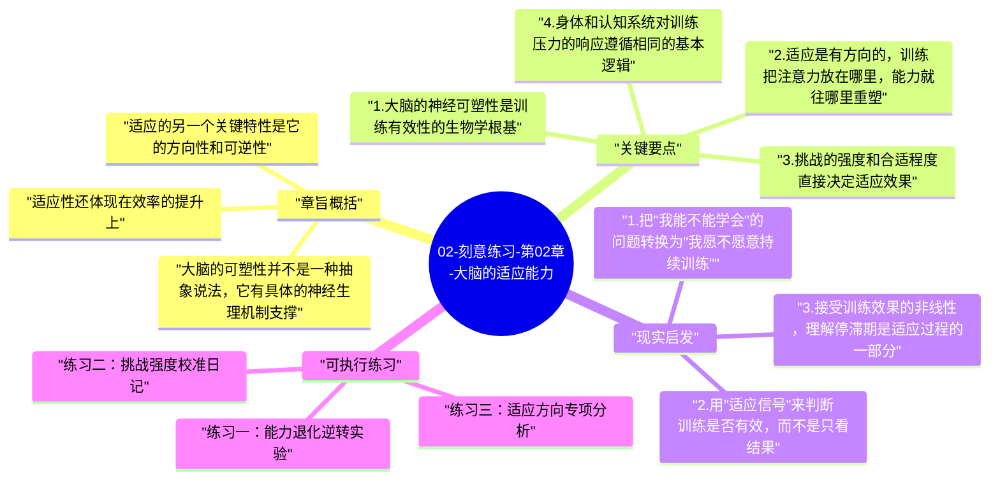

# 02-刻意练习-第02章-大脑的适应能力

艾利克森在这一章要回答一个根本性的问题：训练为什么能让人变强？这个问题看似简单，但它的答案颠覆了很多人对天赋和潜能的直觉假设。大多数人隐约相信，人的能力在成年之后就基本固定了，学习能改变知识量，但改变不了底层的处理能力。艾利克森用神经科学和训练研究的双重证据否定了这一假设：大脑和身体都具有惊人的可塑性，它们会顺着训练压力持续重塑自己，而这种重塑并不是随机的，它具有方向性，朝着训练所施加的挑战方向发生。

这一章是理解整本书的生物学基础。如果说第一章回答的是"什么是有效练习"，那么第二章回答的是"有效练习为什么有效"。理解了大脑的适应机制，人就不会再把进步当成神秘事件，也不会再把停滞归结为命运。进步和停滞都有其清晰的生理解释：当训练持续给系统施加合适的压力，适应就会发生；当训练停止挑战，适应也就停止。这个机制具有高度的一致性，无论对运动员、音乐家还是认知工作者都同样适用。

本章的重要性还在于，它为后文的高强度训练要求提供了合理性依据。当艾利克森要求读者持续走出舒适区时，背后的逻辑恰恰就是这一章描述的适应机制——系统只有在被充分挑战时才会重塑，而重塑的结果就是更强的能力。理解了这一点，人就不会把训练过程中的吃力感视为危险信号，而会把它视为适应正在发生的证明。

## 章旨概括

大脑的可塑性并不是一种抽象说法，它有具体的神经生理机制支撑。研究显示，当人持续接受特定类型的认知挑战时，大脑中负责处理该任务的区域会发生实质性变化：神经元之间的连接密度增加，信号传递的效率提高，甚至在某些条件下，负责该任务的皮层区域面积也会扩大。伦敦出租车司机的研究是艾利克森引用的经典案例——长期在复杂路网中导航的司机，其海马体（负责空间记忆的区域）显著大于普通人，而且工龄越长，这种差异越明显。这不是选择效应，而是训练本身塑造了大脑的物理结构。

适应性还体现在效率的提升上。同样的任务，熟练者处理时消耗的神经资源远低于新手，这不是因为熟练者"更聪明"，而是因为重复训练让大脑找到了处理这类任务的最优回路，省去了大量低效尝试。这种效率提升的背后，是髓鞘化过程（神经纤维外层绝缘物质的增厚），它让神经信号传递得更快、更精准。从这个角度看，训练的本质是一种对神经基础设施的持续优化工程。

适应的另一个关键特性是它的方向性和可逆性。大脑会顺着挑战的方向发生改变，但如果挑战停止，这种改变会逐渐消退。这意味着能力不是一次性获得的固定财产，而是需要持续投入来维持的动态结果。这一点对于理解为什么长期保持专业水平需要持续训练具有重要意义，也解释了为什么短暂的高强度冲刺练习往往不如持续的规律练习效果更稳定。

## 关键要点

### 1. 大脑的神经可塑性是训练有效性的生物学根基

神经可塑性指的是神经系统根据经验改变自身结构和功能的能力。这种能力并不局限于儿童期，成年大脑同样具备显著的可塑性，只是可塑的方式和速度与早期发育阶段有所不同。艾利克森强调，这一发现极大地拓展了人类对自身潜能边界的认识，它意味着成年后的学习并非只是在固有能力上叠加知识，而是可以真正改变处理能力本身的运作方式。

这种可塑性的实践意义非常重要：它说明能力提升不是隐喻，而是字面意义上的神经结构改变。当一个人通过训练变得更擅长某件事时，他的大脑真的和训练前不同了。反过来，这也意味着那些声称"某人天生就有这方面能力"的说法，大部分时候需要追问：这种差异是真的源于遗传，还是来自更早、更高质量的训练积累？

### 2. 适应是有方向的，训练把注意力放在哪里，能力就往哪里重塑

大脑的适应具有高度的特异性，它不会因为一个人在某个领域接受训练就泛化地变得"更聪明"。练习钢琴会提升手指的精细运动控制和音乐节奏感知，但并不会直接提升数学推理能力。这种特异性一方面限制了训练的迁移范围，另一方面也保证了训练的针对性：你在哪个方向持续施加压力，能力就在那个方向发生精确的改变。

这一发现对训练设计有直接指导意义。如果目标是提升某种特定能力，训练就必须聚焦在与该能力直接相关的任务上，而不是泛泛地进行"自我提升"。很多人花大量时间在边缘性活动上，例如读了大量关于写作的书却很少实际写作，读了很多关于编程的理论却很少动手解决具体问题，这种做法之所以低效，正是因为大脑的适应需要直接的、与目标技能高度相关的实践压力来触发。

### 3. 挑战的强度和合适程度直接决定适应效果

适应并不是线性的，也不是无限的。如果挑战强度不足，大脑不会产生足够的应激反应来触发实质性改变；如果挑战强度过高，系统会进入过载状态，反而无法进行有效的学习和整合。最优的训练压力，存在于一个让系统有点吃力但仍能有效运作的区间内。运动生理学把这称为"超量恢复"区域，认知训练领域有类似的规律。

确定合适的挑战强度，需要对当前能力边界有准确的自我认知。这正是为什么好教练比自我训练往往更有效——教练能从外部客观地判断学员当前的能力水平，并据此精确地调整训练难度，使其始终处于最优适应区间内。对于无法获得教练的情况，自我评估能力的培养就变得尤为重要，因为它是确保训练强度适当的替代机制。

### 4. 身体和认知系统对训练压力的响应遵循相同的基本逻辑

虽然体能训练和认知训练在表面上差异很大，但它们背后的适应逻辑高度一致：施加合适的压力，系统会在恢复期重建到更高水平；持续维持在舒适区，系统会维持现状；长期不施加任何压力，系统能力会逐渐退化。这种统一性说明刻意练习原则并不是专为认知技能发明的，而是对人类学习机制的普遍描述。

理解这种统一性的实践价值，在于它允许人们把不同领域的训练经验进行类比和参照。一个有运动训练经验的人，对"超量恢复""渐进超负荷""专项性"这些概念会有直觉认识，而这些概念在认知技能训练中同样适用。跨领域的训练思维迁移，可以帮助人更快建立对新技能训练逻辑的理解。

### 5. 适应需要时间，但可以通过设计训练结构来加速

大脑的物理变化需要时间来完成，这是无法绕过的生理限制。但训练的设计质量可以显著影响适应的速度和方向。高质量的训练设计能减少无效练习的比例，让系统的每一次压力响应都指向目标方向，从而在同样的时间内积累更多有效适应。相反，低质量的训练设计不仅带来更少的适应，还可能在错误方向上固化不良习惯，而纠正这些习惯有时比从零开始学习更困难。

早期学习阶段的训练设计尤为关键，因为早期形成的神经模式会成为后续学习的基础结构。如果早期在正确方向上建立了扎实的基础，后续提升会更顺畅；如果早期形成了错误模式，后续的每一步提升都要先克服旧模式的干扰。这一规律解释了为什么很多领域都强调"从一开始就跟好教练"的重要性。

### 6. 停止训练会导致能力退化，能力不是一旦获得就永久保有的

大脑的可塑性是双向的：它既能因为持续训练而增强，也会因为长期不使用而减弱。这并不意味着所有训练成果都是脆弱的——深度的、长期积累的能力通常比表浅的记忆更持久——但它确实意味着高水平的专业能力需要持续的维护性练习来保持。运动员在休赛期后需要重新进入状态，乐器演奏家在长期不练习后会发现流畅度下降，这些都是能力退化的表现。

对于普通学习者来说，这一规律的实践含义是：比起偶尔的密集练习，持续的规律练习在维持能力方面更加有效。即使每次练习时长较短，只要保持规律性，就能有效防止能力退化，并为进一步的提升维持基础条件。建立可持续的训练节奏，优先于任何短期的冲刺计划。

## 现实启发

### 1. 把"我能不能学会"的问题转换为"我愿不愿意持续训练"

大多数技能的上限，与其说是由先天能力决定，不如说是由训练质量和持续性决定。当你在某件事上感到进展缓慢时，首先应该追问的是训练方法是否有效、难度是否合适、反馈是否及时，而不是"我是不是这块料"。神经可塑性的证据告诉我们，只要方法正确，大多数人都能在大多数领域实现显著的提升。

这种认知转换本身就具有解放性意义。它把"能不能"的问题从天赋领域搬到了方法和投入领域，而后者是可控的。一旦认识到这一点，人对学习困难的心理反应就会从"我不行"转向"我需要调整策略"，这种转变会显著影响学习的持续性。

### 2. 用"适应信号"来判断训练是否有效，而不是只看结果

训练有效的一个可靠指标，是在练习过程中感受到"有一点难，但能够完成"。如果练习对你来说完全轻松，说明没有发生新的适应；如果练习让你感到完全无从下手，说明难度过高，同样无法有效适应。这种对吃力程度的细腻感知，是判断训练质量的重要工具，值得刻意培养。

随着训练的进行，上周觉得困难的事这周变得容易，这本身就是适应发生的证明。利用这个信号来调整难度，确保训练始终保持在合适的挑战强度，比按照固定计划机械推进更符合大脑适应的实际规律。

### 3. 接受训练效果的非线性，理解停滞期是适应过程的一部分

训练效果并不是线性的，它往往呈现出阶梯式或波浪式的进展曲线——一段时间快速提升，然后进入平台期，然后再次突破。平台期令人沮丧，很多人在这个阶段放弃。但从神经适应的角度理解，平台期并不代表进步停止，它可能代表的是大脑正在整合和巩固已有进步，为下一次跃升做准备。

识别自己处于平台期而非真正停滞，需要比较练习的质量而不只是结果的数字。如果你在平台期仍然在做高质量的有目的练习，停滞只是暂时的；如果你在停滞中还在做低质量的自动化重复，那才是真正需要改变的信号。

## 可执行练习

### 练习一：能力退化逆转实验

选择一项你曾经学过但已经很久没有练习的技能，花两周时间以每天20分钟的频率重新系统地练习它，并在开始前和结束后各做一次同样的测试。记录退化程度和两周恢复的幅度，用这个实验建立对"能力退化和恢复速度"的直觉感知，理解持续维护对保持能力的重要性。

### 练习二：挑战强度校准日记

连续两周，在每次练习结束后用1-2句话记录今天的练习对你来说属于哪个强度区间：太轻松、刚好合适、太困难。根据这个记录调整下次练习的难度，目标是让大多数练习处于"刚好有点吃力"的区间。两周后回顾记录，分析自己在难度调整上的规律，找出是否有系统性地回避某类困难的倾向。

### 练习三：适应方向专项分析

写下你目前最重要的一个技能提升目标，然后分析你当前的练习方式究竟在训练哪些具体的神经能力。把练习活动和目标能力逐一对照，找出哪些练习与目标直接相关，哪些是边缘性活动（比如读书而非实践、思考而非执行）。把下个月练习时间的70%集中在与目标直接相关的实践性活动上，观察进步速度是否有变化。

---

## Mermaid 思维导图

### 图1

