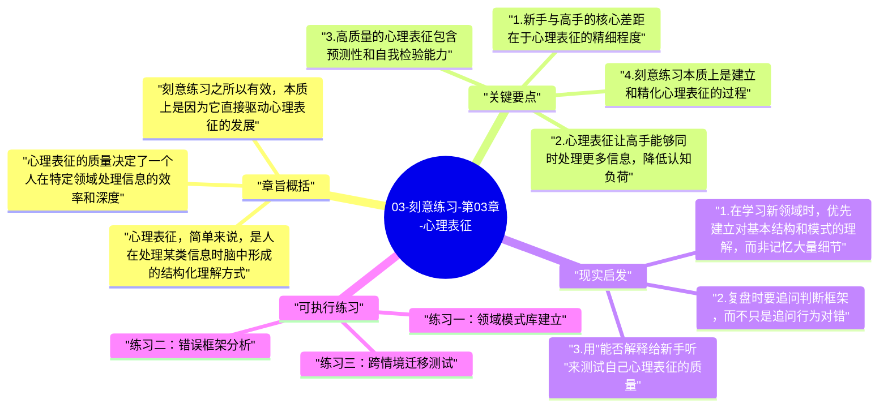

# 03-刻意练习-第03章-心理表征

在前两章，艾利克森告诉我们练习方式决定进步，大脑会因为训练而改变。但这里有一个还没有回答的关键问题：高手究竟在脑中发生了什么变化，让他们看上去能够轻松处理对新手来说极其复杂的局面？为什么国际象棋大师能在数秒内看出十步后的危机，而新手面对同一棋局却一头雾水？为什么资深外科医生在手术中遭遇意外时能迅速作出正确判断，而实习医生却可能陷入混乱？本章给出的答案是：心理表征。

心理表征是艾利克森在整本书中最重要的理论贡献之一。它指的是人在某一领域通过长期训练形成的内部结构化认知模板，是高手和新手之间最核心的差异所在。这个概念解释了为什么高手在处理本领域问题时能够调用远比新手更高效、更精准的思维资源，也解释了为什么刻意练习在本质上是一种对心理表征的持续打磨和精化过程。理解心理表征，是理解刻意练习整个理论框架最关键的一步。

本章在全书中扮演着理论核心的角色。它把前两章关于练习方式和大脑变化的讨论，与后续章节关于黄金标准和训练设计的内容连接起来，提供了"刻意练习到底在优化什么"这个问题的深刻答案。没有心理表征这个概念，刻意练习就只是一套操作程序；有了它，刻意练习才成为一套有内在逻辑的认知科学理论。

## 章旨概括

心理表征，简单来说，是人在处理某类信息时脑中形成的结构化理解方式。当你看到"三角形"这个词，你的大脑立刻能调用出关于三角形的所有相关信息——它的定义、属性、与其他图形的关系等，这就是一种简单的心理表征。在专业技能领域，心理表征更加复杂和丰富：国际象棋大师看到棋局时，看到的不是32枚棋子的位置，而是若干个有意义的棋子组合模式，每个模式都与他脑中存储的大量知识和策略直接挂钩。新手看到的是零散的数据点，高手看到的是组织化的模式网络。

心理表征的质量决定了一个人在特定领域处理信息的效率和深度。高质量的心理表征具有几个特征：它能把大量细节压缩成少数有意义的单元，减轻认知负荷；它能快速识别当前情境与已知模式的相似之处，加速判断；它包含对情境演变的预测性理解，让人能提前看到别人还没注意到的可能性；它还附带自我检验能力，让高手能迅速发现自己的判断是否与实际情况不符。

刻意练习之所以有效，本质上是因为它直接驱动心理表征的发展。每一次针对错误的精准反馈，都是在修正心理表征中不准确的部分；每一次在困难情境中成功应对，都是在向表征系统中添加新的有效模式。这种累积性的表征发展，不会因为练习量的简单增加而自动发生，它需要刻意的反馈机制和对边界情境的持续挑战。

## 关键要点

### 1. 新手与高手的核心差距在于心理表征的精细程度

1973年，心理学家西蒙和蔡斯做了一个影响深远的实验：他们给国际象棋大师和新手分别展示棋局5秒钟，然后让他们复原棋盘。大师的复原准确率远超新手，但关键发现是，当棋子被随机摆放（打乱正常棋局逻辑）时，大师的优势几乎消失。这个结果清楚地表明，大师的优势并非来自更好的"记忆力"，而是来自对真实棋局模式的深度识别能力——他们的大脑存储了数以千计的有意义棋局模式，看到真实棋局时能迅速把整个局面组织成少数几个有意义的模块。

这个实验的深刻含义在于，它把高手的优势从神秘天赋领域转移到了可以通过训练发展的认知结构领域。新手缺乏的不是智力，而是经过长期训练形成的领域特异性模式库。这个模式库是可以建立的，而刻意练习正是建立这个库的最有效方式。每一次针对具体模式的专项练习，都在向这个库中添加一条高质量的条目。

### 2. 心理表征让高手能够同时处理更多信息，降低认知负荷

认知心理学有一个著名的发现：人类工作记忆的容量非常有限，大约同时只能处理7个左右的独立信息单元。但高手在处理复杂领域问题时，显然能够同时考虑远超7个的信息维度。他们是如何做到的？答案是，通过心理表征把大量低层次的细节"打包"成少数高层次的有意义单元，从而在不突破工作记忆限制的情况下，实际处理了远更多的信息内容。

这种"打包"能力的建立，需要在正确的信息层次上进行大量的刻意练习。初学者需要把注意力放在每一个基础细节上，而高手的心理表征让他们能够把这些细节自动归类到高层次模式中，把认知资源集中用在真正需要决策的关键节点上。这种认知资源的有效再分配，是高手能够在高压情境中保持清晰判断的重要原因。

### 3. 高质量的心理表征包含预测性和自我检验能力

优秀的心理表征不只是对过去所见模式的存储，它还包含对该领域规律的深度理解，使人能够对尚未发生的情境进行有根据的预测。顶尖足球运动员在接球之前就已经预判了三步后的最优传球路线，优秀的音乐演奏者在演奏一个音符时已经在内心"听到"了整个乐句的走向。这种预测能力来自表征系统对领域内在规律的深度编码，而不是简单的经验积累。

更重要的是，高质量的心理表征附带自我检验能力：当表征给出的预测与实际情况不符时，高手能够迅速察觉到这种不一致，并触发主动的错误纠正。这个自我检验机制，使得高手在没有外部教练的情况下仍然能够持续自我修正。相比之下，新手缺乏这种自检能力，他们无法可靠地判断自己的动作是否正确，这正是为什么新手在没有教练情况下的独立练习往往低效的根本原因。

### 4. 刻意练习本质上是建立和精化心理表征的过程

如果说心理表征是高手拥有的东西，那么刻意练习就是获得心理表征的过程。每一次针对具体错误的专项练习，都是在修正心理表征中不精确的部分；每一次在新情境中成功应对挑战，都是在向表征网络中添加新的有效节点；每一次复盘和反思，都是在提高表征系统的元认知精度。从这个角度看，刻意练习的本质不是重复动作，而是反复精化内部认知地图。

这一理解改变了对训练目标的认识。训练的目标不是让人能够机械地执行某个动作序列，而是让人建立起对该领域足够丰富、精确和灵活的内部模型，使他能够在各种情境下都能快速调用合适的理解框架和应对策略。两者之间的差别，正是"会做"与"懂得"之间的差别，也是经验丰富的平庸者与真正的高手之间的差别。

### 5. 心理表征的质量决定了错误检测的速度和精度

高手与新手在纠错能力上的差异，往往被误解为"自律性"或"专注力"的差异。实际上，这种差异更多来自心理表征系统的完善程度。一个演奏家的心理表征越完善，他就越能在演奏的实时过程中立刻感知到哪个音符偏了、哪个节奏出了问题，甚至在手指执行动作之前就能通过内部预测"听到"可能出现的偏差，并提前调整。

这种近乎即时的自我纠错能力，是通过大量的刻意练习——尤其是聚焦在错误识别和修正上的练习——逐渐建立起来的。仅仅重复大量正确的动作，并不能有效建立这种纠错能力；反而，刻意在困难情境和边界案例中练习，让系统经历各种错误并学会识别它们，才是建立高质量纠错心理表征的有效路径。

### 6. 语言能够帮助组织心理表征，但语言本身并不等于表征

一个有趣的悖论是：很多顶尖高手很难用语言准确描述自己是怎么做到某件事的。这不是因为他们的心理表征不丰富，恰恰相反，是因为他们的表征太丰富、太自动化，已经深嵌入非语言性的直觉和感知系统中了。这一现象说明，心理表征的核心不是语言性的命题知识，而是更深层的模式识别和情境感知能力。

但语言仍然在表征发展中扮演重要角色：清晰的语言描述能帮助人把模糊的直觉认识整理成更系统的概念结构，有助于和他人沟通以获得反馈，也有助于自我复盘时识别认知的空白。教师和教练的一个重要工作，正是帮助学习者把他们已经拥有的直觉性表征转化成可以被讨论、被检验、被修正的显性知识，从而使进一步的提升更加有目的性和方向感。

## 现实启发

### 1. 在学习新领域时，优先建立对基本结构和模式的理解，而非记忆大量细节

新手在学习时最常见的误区，是把注意力放在大量细节记忆上，却没有建立起理解这些细节的组织框架。这样学习的结果，是知识呈碎片状存在，难以整合和调用。更有效的学习策略，是先理解该领域的基本结构——核心概念之间的关系、典型问题的基本分类、判断优劣的核心标准——然后在这个框架下理解细节，让细节有所归属。

这种先建框架再填内容的学习顺序，实际上是在模拟高手心理表征的形成路径。当然，这个框架一开始是粗糙的，需要通过大量实践不断精化，但有框架的学习总比无框架的碎片堆积更高效。

### 2. 复盘时要追问判断框架，而不只是追问行为对错

复盘的常见形式是"这件事我做错了，下次要避免"。但从心理表征的角度看，更有价值的复盘应该追问：我当时是用什么框架理解这个情境的？这个框架的哪个部分导致了错误的判断？正确的框架应该是什么？这种追问方式直接作用于心理表征的修正，而不只是修正表面行为。

把复盘从"行为纠错"升级为"框架校正"，能让每次失败都产生更深层的学习价值，而不只是增加一条"注意事项"。随着时间积累，这种复盘方式会让心理表征的精度持续提升，使判断力在相同经历量的情况下比普通复盘方式增长得更快。

### 3. 用"能否解释给新手听"来测试自己心理表征的质量

心理表征是否真正扎实，一个可靠的测试方法是尝试向完全不懂这个领域的人解释某个概念或过程。如果你解释不清楚，或者只能用大量专业术语，说明你的表征仍然依赖语境，还没有转化为真正灵活可调用的结构化理解。能够用简单语言解释复杂概念的能力，是深度理解的一个可靠外在指标。

这并不是说用简单语言讲清楚就是全部——实际操作中的表征往往比语言描述复杂得多。但这个练习至少能帮助你发现自己理解中的空白和模糊之处，从而更有针对性地进行补充训练。

## 可执行练习

### 练习一：领域模式库建立

选择你目前正在学习的一个技能领域，花一个月时间刻意收集该领域的"典型模式"：典型的问题类型、典型的解法结构、典型的错误形态。每周整理5个有代表性的案例，分析它们背后的共同模式，并尝试用自己的语言写出你对这个模式的理解。这个练习在显性层面帮你建立该领域的模式库，让学习从碎片积累进化为结构化认知。

### 练习二：错误框架分析

在未来一个月，每次遇到自己做错的事情，不只记录"错了什么"，而是追加分析"当时我用了什么框架理解这个情境"和"正确的框架是什么"。月底汇总，看是否有重复出现的框架性偏差，这往往指向心理表征中最需要重建的部分，也是最值得集中训练的方向。

### 练习三：跨情境迁移测试

选择一个你认为自己已经掌握得不错的概念或技能，把它拿到三种不同的新情境中应用，例如向不同背景的人解释、解决一个和原始情境差异较大的问题、用这个概念理解一个看似无关的现象。记录哪些迁移顺畅，哪些遇到了障碍。障碍出现之处，往往是心理表征不够灵活或不够深入的地方，是值得集中练习的优先节点。

---

## Mermaid 思维导图

### 图1

