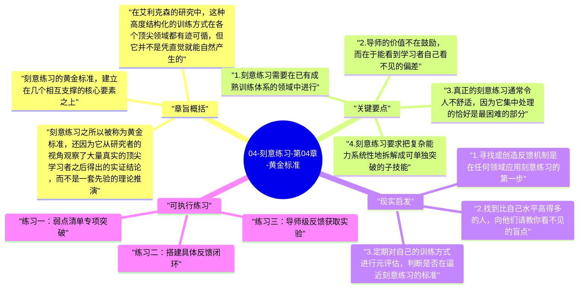

# 04-刻意练习-第04章-黄金标准

经历了前三章的铺垫——什么是有目的的练习、大脑为何能适应训练、心理表征如何构成高手优势——艾利克森在第四章终于亮出了全书最核心的理论构建：刻意练习的黄金标准。这个标准并不是艾利克森凭空发明的，而是他在研究顶尖表演者几十年后归纳出的共同特征：凡是真正能够制造出高水平表现的训练，都在几个关键维度上具有相同的结构。理解了这个结构，就理解了"什么样的训练真正有效"这个问题的本质答案。

在此之前，"刻意练习"这个词在流行文化中被使用得相当随意，很多人把它简单理解为"努力练习"或"专注练习"，甚至有人把它混同于马尔科姆·格拉德威尔在《异类》中著名的"一万小时定律"。艾利克森本人对这种简化深感不满，他指出"一万小时"只是一个统计上的平均数，而且并非所有一万小时的练习都能产生同样的效果——关键不在时长，而在练习的结构和质量。本章正是要厘清这个混淆，给出"刻意练习"的精确定义。

本章是全书的理论高峰，也是此后所有应用讨论的基准参照。理解了黄金标准，读者就能在之后的章节中看清，如何在工作、日常生活、教育等不同场景中，尽可能地逼近这个标准，或者在无法完全达到时如何找到最佳近似。

## 章旨概括

刻意练习的黄金标准，建立在几个相互支撑的核心要素之上。第一是领域中已有明确的专家表现标准，使得训练有客观的目标锚点可供对照；第二是训练者与这个标准之间存在可衡量的差距，使得改进方向清晰；第三是训练设计针对具体的差距，聚焦在最需要改进的子技能上；第四是高质量的即时反馈，使训练者能在每次练习后立刻知道自己的表现与目标之间的差距是缩小了还是扩大了；第五是持续迭代，把每次练习的反馈结果作为下一次训练设计的输入。这五个要素构成一个闭环，正是这个闭环使刻意练习区别于一切形式的普通训练。

在艾利克森的研究中，这种高度结构化的训练方式在各个顶尖领域都有迹可循，但它并不是凭直觉就能自然产生的。音乐、体育、棋类这些领域之所以产生了最多被研究的高手，很大程度上是因为这些领域历史悠久，已经形成了系统化的教学传统和明确的评价标准，使得刻意练习的条件更容易得到满足。而在很多职业领域，这些条件并不天然具备，需要训练者主动创造。

刻意练习之所以被称为黄金标准，还因为它从研究者的视角观察了大量真实的顶尖学习者之后得出的实证结论，而不是一套先验的理论推演。它的说服力来自事实：那些被公认为世界顶尖水平的表现者，他们的训练方式在结构上高度相似，而这种相似恰好完全符合刻意练习的理论框架。这种一致性，是这个理论最有力的支撑。

## 关键要点

### 1. 刻意练习需要在已有成熟训练体系的领域中进行

艾利克森特别强调，刻意练习最容易实施的领域，是那些已经有成熟教学传统、明确评价标准和大量优秀教师的领域，例如古典音乐、国际象棋、竞技体育的技术项目。在这些领域，前人已经通过几代人的经验积累，摸索出了哪些训练方式有效、哪些无效，并形成了一套可以传授的系统。对于学习者来说，这个已有的训练体系是巨大的财富，它意味着你不需要从零开始摸索有效的训练方法，而是可以站在前人肩上。

当你试图把刻意练习的原则应用到那些尚未有成熟训练体系的领域时，挑战就会大得多。你需要自己摸索什么是这个领域的专家表现、什么是有效的训练单元、如何获得及时反馈。这不是不可能，但它需要更多的元认知投入和试错代价。理解这一前提，有助于对不同学习情境中的进步速度建立合理预期。

### 2. 导师的价值不在鼓励，而在于能看到学习者自己看不见的偏差

好的导师在刻意练习中扮演着不可替代的角色，但他们的价值往往被误解。很多人认为好导师是那种会鼓励学生、让学生充满信心的人。艾利克森的研究给出了不同的答案：顶尖表演者的教练，其核心价值在于他们能够从外部客观地观察学习者的表现，发现学习者自己因为视角局限而看不到的偏差，并把这些偏差用具体且可操作的方式指出来。

能力越强的教练，通常越能发现越细微的偏差。当学习者认为自己"已经做得很好了"的时候，高水平教练往往能指出那些只有在达到下一个层级时才会成为瓶颈的细节问题。这种前瞻性的偏差识别，正是顶尖教练与普通教练最大的差距所在，也是为什么在某些精英领域，换一位更高水平的导师往往能带来跃跃性进步的原因。

### 3. 真正的刻意练习通常令人不舒适，因为它集中处理的恰好是最困难的部分

刻意练习具有一个令很多初学者感到意外的特点：它通常不令人愉快。不是所有练习都是这样——当人处于心流状态时，练习可以非常享受。但严格意义上的刻意练习，聚焦于当前能力边界的最困难之处，这意味着它大部分时间都在让人面对自己最不擅长、最容易犯错的环节。这种持续暴露在弱点面前的过程，在心理上是有一定压力的。

艾利克森的研究显示，顶尖表演者通常能够接受并适应这种不舒适，甚至把它视为进步正在发生的标志。他们学会了把"吃力"和"崩溃"区分开来：前者是有效训练的正常感受，后者才是需要调整的危险信号。建立这种对吃力感的正确诠释，是维持长期刻意练习的重要心理条件，也是区分认真训练者和偶尔尝试者的关键特征之一。

### 4. 刻意练习要求把复杂能力系统性地拆解成可单独突破的子技能

任何复杂技能都是由多个子技能组成的系统，要显著提升整体表现，必须先识别出当前的瓶颈子技能，然后设计专门针对该子技能的集中训练。一位钢琴演奏家如果想提升整体演奏水平，仅仅反复演奏完整曲目是低效的；更有效的方法是识别出自己在哪种和弦转换、哪类节奏型或哪个技术难点上存在弱点，然后把那个部分单独拿出来反复练习，直到该弱点消除，再重新整合到完整演奏中。

这种拆解训练的思路，要求学习者对自己的能力结构有清晰的元认知意识，即不只是知道自己"不够好"，还要知道自己在哪个具体维度上不够好，以及提升那个维度的训练方法是什么。这种元认知能力本身也是需要刻意培养的，它越清晰，训练设计就越精准，进步效率就越高。

### 5. 即时反馈是刻意练习效能的关键放大器

反馈的时效性对学习效果有决定性影响。心理学研究表明，如果反馈被延迟，大脑将很难把反馈信息与产生该结果的具体行为准确关联起来，导致学习效率大幅下降。刻意练习强调即时反馈，是因为只有及时的反馈才能让大脑在行为与结果之间建立精确的因果连接，从而有效更新行为模式。

在真实训练环境中，做到完全即时的反馈往往需要特殊设计。顶尖音乐教师会在学生演奏时实时指出错误；体育教练会在动作完成的瞬间提供纠正；利用录像等技术手段可以把时间延迟的反馈压缩到最短。对于那些反馈天然延迟的领域，例如管理、写作、决策等，主动创造快速反馈条件——模拟环境、专家评审、数据跟踪——是使训练接近刻意练习标准的关键补偿手段。

### 6. 一万小时理论的误解与刻意练习真正的时间观

"一万小时定律"被艾利克森视为对他研究的最大误解之一。他的原始研究数据确实显示，小提琴顶尖演奏者在20岁时积累了约一万小时的练习，但这个数字只是一个平均值，且其中大部分时间是刻意练习，而非普通重复。更重要的是，不同的训练质量在同样的时间内会产生极为不同的效果。一万小时的漫不经心练习，远远比不上五千小时的高质量刻意练习。

时间在刻意练习理论中的正确地位，是作为质量加权后的累积效应变量，而非简单的线性积累量。这意味着投入时间是必要的，但不是充分的。真正重要的问题不是"我练了多少小时"，而是"我练习中有多少比例是真正有目的性、有反馈、有反思的高质量训练"。提高这个比例，比单纯延长总时长，对于加速能力发展更有直接意义。

## 现实启发

### 1. 寻找或创造反馈机制是在任何领域应用刻意练习的第一步

在很多职业和日常技能领域，即时反馈并不天然存在。如果你想在这些领域实施刻意练习，首要任务是为自己创建一套反馈系统。例如，写作者可以建立一个固定的读者群提供具体反馈；软件工程师可以引入代码审查机制；管理者可以建立定期的360度反馈收集流程。这些反馈机制的质量越高，训练的有效性就越接近黄金标准。

创建反馈机制时，反馈的具体性比频率更重要。"写得很好"这样的反馈没有任何训练价值；"第三段的逻辑跳跃太大，从A到B之间缺少一个过渡论据"这样的具体反馈，才能驱动有针对性的改进。培训自己请求和接受具体反馈的能力，是开始实施刻意练习的重要前提。

### 2. 找到比自己水平高得多的人，向他们请教你看不见的盲点

单靠自我训练很难触及所有盲点，因为你的心理表征还没精细到能识别所有偏差的程度。定期向比自己水平高的人展示自己的工作，请他们指出你自己没有意识到的问题，是获得高质量外部反馈的最有效途径。这不需要是正式的师徒关系，可以是同行交流、专业社群的作品展示，或者主动向专家请教某个具体问题。

这种高质量外部反馈的价值在于，它能告诉你那些你还没有能力自己发现的盲点，而这些盲点往往恰好是当前阶段最限制你进步的关键因素。收集这类反馈需要放下自我防卫，把批评视为礼物，这是实施刻意练习的心理素质要求。

### 3. 定期对自己的训练方式进行元评估，判断是否在逼近刻意练习的标准

每隔一段时间，用刻意练习的黄金标准来评估自己当前的训练方式：我的训练是否有明确的改进目标？是否有即时反馈？是否聚焦在当前的弱点上？是否在走出舒适区？这个定期的元评估，能防止训练在不知不觉中退化为自动化重复，帮助你始终保持对训练质量的主动控制。

特别要警惕"感觉在努力"的错觉。疲惫感、时间投入和情绪代价，并不等同于训练的有效性。真正有效的训练应该让你感到有针对性的、可追踪的具体改进，而不只是感到疲惫。

## 可执行练习

### 练习一：弱点清单专项突破

对于你目前最重要的一项技能，写出五个你认为是自己最薄弱的子技能，然后按薄弱程度排序。选出最薄弱的那个，用接下来两周的练习时间专门攻克它，每次练习只针对这一个弱点，不分心到其他方面。两周后评估这个弱点是否有所改善，然后移向下一个。这种专项突破的节奏，比均匀练习所有方面的进步速度快得多。

### 练习二：搭建具体反馈闭环

选择一个你目前练习时缺乏反馈的技能，在接下来一个月内为它搭建一套最简化的反馈系统。可以是找一个固定的反馈伙伴、使用数据追踪工具、定期录制自己的表现来复盘，或者加入一个有专业评审机制的社群。具体方式取决于技能类型，但目标是确保每次练习后都有某种具体的、与训练目标直接相关的反馈信息可供参考。

### 练习三：导师级反馈获取实验

在未来一个月内，至少向一位比自己水平高得多的人展示你的工作，并明确请求他们指出你看不见的三个盲点或最需要改进的地方。把这三个反馈整理成具体的训练任务，在接下来的两个月内专项练习。记录这次导师级反馈与你自己评估的差异，分析哪些盲点是你的现有心理表征无法独立发现的，这种差异本身就是一份关于你当前能力边界的宝贵地图。

---

## Mermaid 思维导图

### 图1

