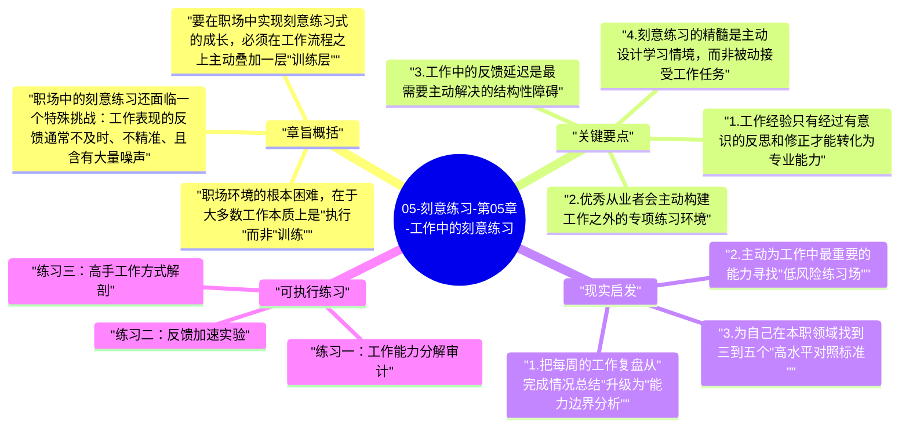

# 05-刻意练习-第05章-工作中的刻意练习

前四章建立了刻意练习的理论基础，但一个显而易见的现实问题随之而来：这套理论是否只适用于音乐家、棋手、运动员这些能够脱产进行系统训练的专业表演者？绝大多数人的主要学习时间，都是在职场中度过的，而职场与专业训练场的环境差异极大。职场通常缺少明确的评价标准，缺少高水平的实时反馈，缺少可以随意反复的模拟练习机会，更缺少专业导师的持续指导。在这种条件下，刻意练习是否还能发挥作用？艾利克森在本章给出了肯定的答案，同时也诚实地指出了障碍和应对策略。

这一章的现实意义，在于它把刻意练习从精英训练场带到了普通人最熟悉的每日生活中。对于大多数读者来说，职场是他们投入时间最多、最希望持续进步的领域。但职场进步的逻辑往往是不透明的——有人工作10年却能力平平，有人工作3年就已经超越了大多数同龄人，这种差距的根本原因是什么？艾利克森的答案是：前者把工作当成了自动化重复，后者把工作当成了系统性学习。

本章也是全书最具实操意义的章节之一，因为它直接面对了最多人会遇到的情境：没有教练、没有标准化训练程序、没有明确的能力评价体系，只有每天重复的工作任务。在这种条件下如何仍然设计出接近刻意练习标准的成长路径，是这一章要解决的核心问题。

## 章旨概括

职场环境的根本困难，在于大多数工作本质上是"执行"而非"训练"。当一个人完成一份报告、处理一个客户问题、写一段代码时，他的主要目标是把这件事做完并达到可接受的标准，而不是通过做这件事来突破自己的能力边界。这种目标导向使得工作自然地向"做熟悉的事、用熟悉的方式"演化，而不是向"挑战弱点、获得反馈、系统精化"演化。结果，工作经验的积累并不自动等于专业能力的提升。艾利克森引用了多项研究表明，在很多职业中，从业者的表现在积累了几年经验并达到可接受的水平之后，往往就进入长期停滞，甚至某些技能会随时间退化。

要在职场中实现刻意练习式的成长，必须在工作流程之上主动叠加一层"训练层"。这层训练层不能取代工作本身，但必须与工作紧密结合，因为职场中的时间和注意力资源有限，脱离工作情境的纯学习往往难以持续。最有效的职场学习策略，是在完成工作任务的过程中，有意识地设置针对当前能力弱点的挑战性变体，并建立获取和处理反馈的机制，使每次工作经历都能产生超出完成任务本身的能力积累价值。

职场中的刻意练习还面临一个特殊挑战：工作表现的反馈通常不及时、不精准、且含有大量噪声。绩效评估往往每年才有一次，且评估标准常常模糊；客户反馈受多种因素影响，很难单独反映个人能力的某个维度；同事的评价受人际关系影响，也难以作为客观的能力校准依据。在这种反馈稀缺的环境中，从业者需要主动设计反馈获取机制，而不是被动等待外部评价。

## 关键要点

### 1. 工作经验只有经过有意识的反思和修正才能转化为专业能力

艾利克森引用了一个令人深思的研究结论：在很多职业领域，工作经验年限与实际专业水平之间几乎没有相关性。他以放射科医生为例——读X光片是一项高度依赖经验的技能，但研究显示经验丰富的放射科医生并不比刚开始执业几年的医生更准确，因为他们从未建立系统性的反馈机制，无法知道自己的诊断究竟有多少是正确的。相反，那些通过参加系统诊断挑战赛、追踪自己误诊记录的医生，能力提升明显更快。

这个案例揭示了工作经验的一个根本局限：经验本身并不携带学习信号，学习信号需要通过反思和反馈来提取。如果一个人在工作结束后不复盘、不追踪、不对照标准，那么即使他做了同样的工作一千次，他的能力也只是停留在"做熟了"的水平，而不会持续提升到更高层次。把反思从偶尔为之变成每次工作后的固定习惯，是在职场实施刻意练习的最低要求。

### 2. 优秀从业者会主动构建工作之外的专项练习环境

观察真正持续进步的职场人，会发现一个共同模式：他们通常有某种形式的工作之外的专项练习活动，用来专门打磨那些在日常工作中无法系统强化的能力。顶尖律师会反复演练庭审辩论技巧；优秀的销售人员会模拟各种客户拒绝场景并练习应对；优秀的管理者会研读大量真实管理案例并分析自己会如何处理。这些"工作外练习"的共同特征，是它们允许人在低风险、可重复的环境中专注于能力的某个具体维度，而不必像在真实工作中那样同时应对各种实际压力。

这种工作外练习的价值，在于它创造了刻意练习所需的"可控训练环境"，弥补了真实工作环境因为目标导向而天然缺乏的那些训练条件。很多顶尖职场人的成长速度远超同龄人，不只是因为他们更努力地工作，还因为他们在工作之外维持着高质量的专项能力训练。这部分"隐性训练"往往是普通人看不见的，因此也经常被误解为"天赋"。

### 3. 工作中的反馈延迟是最需要主动解决的结构性障碍

真实职场中的反馈通常具有三个不利特征：延迟（往往要等到项目结束甚至绩效评估才有反馈）、模糊（"做得不错"或"需要提高"这类笼统评价无法驱动具体改进）、噪声干扰（结果受团队、市场、运气等多种因素影响，难以单独归因于个人能力）。这三个特征共同造成了职场反馈的低学习效用，使得从工作结果中提取准确的能力信息极为困难。

应对这个挑战的策略是主动缩短反馈回路。具体方式包括：在项目进行中设置阶段性里程碑并请求具体的即时反馈，而不是等到结束；主动记录自己的决策过程和预期结果，事后对照实际发生的情况进行归因分析；为高频重复的工作建立量化追踪指标，使进步或退步有数据可依；请求比自己水平高的同事或上级针对具体行为（而非整体表现）给出评价。这些策略本质上都是在人为地把延迟反馈转化为即时反馈，从而为职场中的刻意练习创造必要条件。

### 4. 刻意练习的精髓是主动设计学习情境，而非被动接受工作任务

接受任务并完成任务，是工作的基本模式。但如果一个人只是被动地接受任务、完成任务，没有对任务进行任何能力角度的二次解读，那么工作永远只是消耗，而非投资。主动的学习者会在接受每个任务时额外问自己：这个任务中哪个部分是我目前最薄弱的？我如何在完成任务的同时，让这个薄弱环节得到针对性的训练？这种视角的转变，把同样的工作任务变成了双目标活动：既完成工作，又提升能力。

更高阶的做法，是主动寻求那些恰好能挑战自己当前能力边界的任务，而不是总选择自己已经驾轻就熟的类型。这种主动寻求挑战的倾向，是高速成长型职场人与经验丰富但能力停滞型职场人之间最重要的行为差异之一。它意味着接受短期的表现不确定性，以换取长期的能力积累，这需要对学习逻辑有清晰的理解和对长期视角的坚持。

### 5. 榜样研究和刻意模仿是职场中实施刻意练习的重要补充手段

在没有专业导师指导的情况下，对同行中顶尖表现者进行系统性研究，是弥补反馈缺失的有效补充策略。这种研究不是泛泛地"向高手学习"，而是具体分析：他们在处理某类任务时的决策逻辑是什么？他们的表达方式、分析框架、工作流程与自己有何具体差异？他们在应对困难情境时调用了哪些自己目前还不具备的能力？

把这种分析转化为具体的模仿练习，是接近刻意练习中"专项突破弱点"要求的实用方法。模仿不是抄袭，而是通过刻意使用他人的有效模式来加速自己在该维度上的心理表征建立。随着练习的深入，模仿会逐渐转化为内化，内化再经过反复使用就会成为自己独特风格的一部分。

### 6. 建立个人成长的"训练预算"——专门用于提升而非执行的时间投入

在工作中实施刻意练习面临的最大现实障碍，是时间和注意力的稀缺性。当所有工作时间都被执行性任务占满时，就没有空间进行反思、练习和系统性能力构建。优秀的职场成长者，往往会主动维护一定比例的"训练预算"——专门用于技能打磨、案例研究、复盘反思和专项练习的时间，而不把所有时间都投入到即期任务中。

这个训练预算的比例因人因职而异，但关键是它必须存在，且必须被保护起来不被日常执行任务侵占。没有训练预算的职场人，实际上是在短视地把所有时间都用于当期产出，却在牺牲长期能力资产的积累。建立并维护这个训练预算，是把刻意练习引入职场的最基本的时间管理动作。

## 现实启发

### 1. 把每周的工作复盘从"完成情况总结"升级为"能力边界分析"

大多数职场复盘只回答一个问题：我这周做了什么？更有价值的复盘应该回答三个问题：这周的工作中，我在哪个具体环节表现弱于自己的预期？这个弱点背后是能力不足还是方法不当？下周我应该设计什么样的练习或调整来针对性地改善这个弱点？这种复盘方式能把工作经验转化为系统性的能力改进计划，而不只是停留在任务完成的层面。

### 2. 主动为工作中最重要的能力寻找"低风险练习场"

很多职场关键能力——例如高压谈判、危机沟通、复杂决策——很难在真实工作场景中反复练习，因为每次失误都有实际代价。解决这个问题的方法，是主动寻找低风险的等效练习场：参加辩论社团来练习即兴论证、参加模拟商业竞赛来练习战略分析、通过写公开文章来练习复杂逻辑的表达。这些活动与真实工作有足够的相似性，又提供了真实工作难以提供的反复练习机会。

### 3. 为自己在本职领域找到三到五个"高水平对照标准"

缺乏明确的高水平对照标准，是职场刻意练习比专业训练难实施的根本原因之一。主动解决这个问题的方法，是在自己的职业领域找到三到五个公认的高水平实践者或作品，作为自己追踪进步的参照系。这些对照标准越具体越好——不是"行业里最优秀的人"，而是"在某个具体维度上显著超越自己当前水平的具体实例"。有了这样的对照系，自己的进步方向和当前差距都会变得更加清晰。

## 可执行练习

### 练习一：工作能力分解审计

花一个下午，把你目前岗位上最关键的三项工作能力各拆解出至少5个子能力，并对每个子能力的当前水平和提升迫切性打分。找出最值得优先提升的3个子能力，然后为每个子能力设计一个可以每周执行一次的专项训练活动。把这份清单打印出来贴在工作区域显眼处，每周检查执行情况。这个练习把职场能力提升从模糊的愿望转化为有具体结构的训练计划。

### 练习二：反馈加速实验

选择你工作中的一个重要技能，设计一套能让你每周都获得一次高质量具体反馈的机制。可以是找一个每周一次的反馈伙伴，可以是每周提交一次作品到专业社群请求点评，也可以是建立一个数据追踪表格每周记录某个可量化指标的变化。坚持执行两个月，对比第一个月和第二个月的反馈质量和能力进步速度，评估这套机制的实际效果并做相应优化。

### 练习三：高手工作方式解剖

选择你职业领域中一位你非常敬佩的高水平实践者，花一个月时间系统研究他的工作方式。可以通过阅读他写的文章、演讲、采访，分析他处理复杂问题时的思维过程；可以寻找机会直接向他请教；如果有机会，观察他如何处理一个具体的实际问题。整理出他与你在工作方式上的五个最重要的具体差异，然后选择其中一个，设计一个专门针对这个差异的两周训练计划并执行。

---

## Mermaid 思维导图

### 图1

