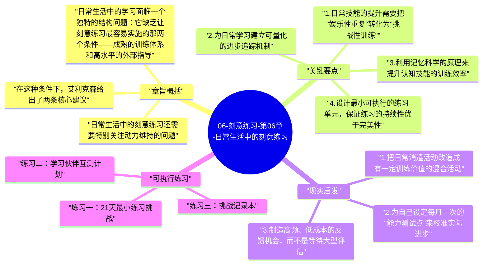

# 06-刻意练习-第06章-日常生活中的刻意练习

上一章解决了职场中如何实施刻意练习的问题，但人的生活并不只由职业构成。人们还想提升身体健康、增强人际关系能力、提高记忆力、改善专注度、学习新的乐器或语言，或者在各种日常生活技能上变得更好。这些日常生活领域的能力提升，是否也能受益于刻意练习的原则？本章的答案是肯定的，但同时也指出日常学习场景的特殊挑战：在没有导师、没有标准化课程、没有明确评价体系的条件下，如何自己为自己设计接近刻意练习标准的训练计划。

这一章的意义在于彻底打破"刻意练习只是精英训练法"的误解。艾利克森希望说明，无论你是想学一种新语言、提高记忆力、改善人际沟通方式还是掌握一项运动技能，刻意练习的核心原则都是适用的。你不需要是职业运动员或音乐学院学生才能从中受益，你只需要愿意认真对待自己的成长，并有意识地设计训练方式。这种"人人可用"的主张，是《刻意练习》作为一本面向大众的书籍最核心的价值所在。

本章还特别关注一个日常生活中的常见误区：很多人在日常生活中的"练习"，实际上不过是重复他们已经会的东西。下班后打高尔夫，他们打的是已经熟悉的球道；看外语剧，他们选的是已经能理解大半的难度；跑步，他们跑的是固定的距离和速度。这些活动有娱乐价值，但它们不是练习，它们是消遣。真正的日常练习，需要在这些活动中注入目标、反馈和持续的挑战性，才能把娱乐时间转化为成长时间。

## 章旨概括

日常生活中的学习面临一个独特的结构问题：它缺乏让刻意练习最容易实施的那两个条件——成熟的训练体系和高水平的外部指导。在职业化的专业技能领域，几百年的训练传统已经帮助人类总结出了"什么有效、什么无效"，这些经验被编码进了教学体系、课程设计和导师培训中。但当你想在日常生活中提升记忆力、改善睡眠管理或学会演讲时，你面对的是一个相对混乱的信息环境：大量的自助建议彼此矛盾，缺少基于严格证据的训练方案，也很难找到真正懂得如何指导你提升这些能力的专业人士。

在这种条件下，艾利克森给出了两条核心建议。第一，尽可能寻找那些已经有系统性训练传统的方法，哪怕这个传统不如音乐或体育领域成熟，它也比自己随机摸索更有效率。例如，记忆力训练领域有相对成熟的"记忆宫殿"方法；语言学习领域有大量基于认知科学的系统性方法；体能训练领域有科学的周期训练理论。充分利用已有的系统性知识，是提升日常学习效率的第一步。第二，无论在哪个领域，都要尽量把训练设计得符合刻意练习的基本要素：目标清晰、难度适当、反馈及时、聚焦弱点。即使无法做到完整的刻意练习，能满足这四个要素中的两三个，也会比随意练习有效得多。

日常生活中的刻意练习还需要特别关注动力维持的问题。专业训练者通常有外在的竞争压力、职业责任或经济利益来维持训练动力，而日常生活中的自我提升往往完全依赖内在动力。这种内在动力是波动的，在初始热情消退、进步速度放缓、训练变得枯燥时，很容易消失。如何设计能持续激活内在动力的训练节奏，是日常刻意练习成功的关键非技术因素。

## 关键要点

### 1. 日常技能的提升需要把"娱乐性重复"转化为"挑战性训练"

很多人认为自己一直在练习某项日常技能，但仔细分析就会发现，他们做的更多是娱乐性重复——用已经熟悉的方式做已经熟悉的事。打网球时总是选择自己擅长的正手拍；练吉他时总是弹已经会的曲子；学习语言时总是在自己能舒适阅读的难度上读材料。这些活动是享受，但它们不是训练。真正的训练需要主动选择那些让自己感到有一点不舒服、需要额外努力才能完成的内容。

把娱乐性重复转化为挑战性训练的具体操作，是每次开始时问自己：这次我要超越哪个上次的限制？这次我要挑战哪个自己还不熟练的部分？这个简单的问题，能把同样的时间投入从消遣模式切换到训练模式，其效果差异在几个月内就会变得显著可见。

### 2. 为日常学习建立可量化的进步追踪机制

日常技能的提升往往是缓慢的、渐进的，如果没有量化追踪，人很容易感觉到"看不见进步"而失去动力。建立量化追踪机制有两个价值：一是让进步可见，即使每次进步都很微小，累积的数据也会给出清晰的成长曲线；二是让退步可察，当练习方法不当或训练强度不够时，数据会比主观感受更早发出信号。

量化追踪不需要复杂的工具，简单的练习日记就能胜任。记录每次练习的时长、目标、遇到的困难和每周的小测试结果，就能形成一个基本的追踪系统。随着时间积累，这些记录还能帮助人识别出自己在哪些条件下学习效率最高，哪些练习方式产生了实际效果，从而持续优化训练设计。

### 3. 利用记忆科学的原理来提升认知技能的训练效率

记忆科学领域积累了大量关于如何更高效地学习认知型技能的实证研究，而这些研究往往能直接应用于日常生活中的任何需要记忆、理解和运用信息的学习活动。间隔重复原则（信息在遗忘边缘时复习，比密集复习更高效）、主动提取原则（通过测试自己而非被动重读来巩固记忆）、交错练习原则（混合不同类型的练习比纯粹重复单一类型更有效），这些原则都有坚实的实验证据支撑，且都适合在日常学习中应用。

不了解这些原则的人，往往会选择直觉上看起来合理但实际上低效的学习方式——例如在考前密集重读笔记，或者把相同类型的练习题连续做很多遍。了解了这些原则并有意识地应用它们，能在不增加练习时间的情况下显著提升学习效率。

### 4. 设计最小可执行的练习单元，保证练习的持续性优于完美性

日常刻意练习面临的最大障碍，不是缺乏正确的方法，而是缺乏持续执行的能力。很多人在开始时设计了完美的训练计划，但几周后就因为计划太重而放弃。解决这个问题的关键，是把每个练习单元设计得足够小，小到即使在最忙、最疲惫的日子里也能完成。这种"最小可执行练习单元"的设计，优先保证的是练习的持续性，而不是单次练习的完美性。

心理学研究表明，习惯的形成主要依赖重复次数和一致性，而非单次行为的强度。每天10分钟的一致练习，在建立习惯和维持能力方面，通常优于每周一次的两小时密集训练。因此，日常刻意练习的设计哲学应该是"可持续优先"，确保训练能在各种现实条件下稳定发生，然后在此基础上逐渐增加深度和强度。

### 5. 找到兴趣与挑战的平衡点，避免训练变成纯粹的苦差事

有目的的练习本质上需要关注弱点、接受失败、持续努力，这些都是心理上有一定压力的活动。如果训练完全失去了吸引力，变成了纯粹的苦差事，那么长期持续下去是不现实的。因此，日常刻意练习需要在挑战性和趣味性之间维持一个动态平衡：训练必须有足够的挑战来带来真正的进步，但也必须保留足够的愉悦感来维持可持续的动力。

保持这种平衡的一个实用方法，是把练习进度的可视化和阶段性成就的庆祝纳入训练设计中。当人能够清晰地看到自己的进步时，即使过程有困难，也更容易保持动力。此外，把枯燥的训练内容与有趣的应用场景结合——例如把语言练习融入对感兴趣内容的阅读，把体能训练融入自己喜欢的运动——能在不降低训练有效性的情况下显著提升体验质量。

### 6. 社交支持和学习社群能显著增强日常练习的持续性

人类是高度社会性动物，群体对行为的塑造力不可低估。独自一人维持长期的高强度自我训练，在心理上是非常困难的。而当一个人处于一个共同追求某种能力提升的社群中时，群体规范、互相监督、共享进步和竞争压力都会成为维持训练动力的强大辅助力量。这就是为什么健身房比在家锻炼更容易坚持，读书会比独自阅读更容易深入理解，业余乐队比独自练琴更容易保持练习频率。

在日常技能提升中，主动寻找或建立一个学习共同体，是把刻意练习坚持下去的重要社会性策略。这个共同体不需要成员数量众多，两三个有共同目标的学习伙伴，加上定期的相互检验和反馈交换机制，就能产生显著的坚持效果增强。对于很难找到真实社群的技能领域，在线社区也能发挥相当程度的社交支持功能。

## 现实启发

### 1. 把日常消遣活动改造成有一定训练价值的混合活动

不需要把所有娱乐时间都转化成训练，但可以把某些日常消遣活动进行轻度改造，在不大幅降低享受感的情况下增加一点训练价值。例如，散步时把路线设计成对熟悉景点的主动记忆练习；看外语内容时选择略高于当前水平的难度；打游戏时选择需要战略思考的类型而非纯粹反射性操作。这种"轻度训练化"不是要让所有时间都变得严肃，而是减少纯消耗时间的比例，让部分消遣时间产生额外的成长价值。

### 2. 为自己设定每月一次的"能力测试点"来校准实际进步

日常练习很容易陷入"一直在练但不知道有没有进步"的感知误区。解决这个问题的方法，是每月为核心训练技能设置一次固定的能力测试，用客观可量化的方式检验进步。例如外语学习者可以每月做一次固定难度的阅读理解测试；体能训练者可以每月做一次固定动作的最大次数记录；记忆训练者可以每月做一次标准记忆量测试。这些定期测试的作用，是用客观数据来校正主观感受，防止因为感知延迟而对训练效果产生误判。

### 3. 制造高频、低成本的反馈机会，而不是等待大型评估

日常生活中的技能反馈往往来源有限，但可以主动创造高频的小型反馈机会。把学到的新知识用自己的语言向朋友解释，通过对方的反应可以得到即时的理解质量反馈；把新学的写作技巧用到日常工作邮件中，观察读者的反应；把新的人际沟通方式用到具体对话中，对照期望结果来评估效果。这些都是把学习与实践紧密结合、获取高频小型反馈的有效方式。

## 可执行练习

### 练习一：21天最小练习挑战

选择一项你想提升的日常技能，设计一个每天只需要10-15分钟的最小练习单元，这个练习必须有明确的目标、有轻微的挑战性、有某种形式的即时反馈。在接下来的21天内，每天不管怎样都完成这个最小练习。不允许因为"今天没时间做完整练习"而跳过——10分钟的最小单元在任何情况下都能找到时间。21天结束后评估：这个技能有没有可见的进步？这个练习习惯有没有建立起来？根据结果决定是否增加强度或调整方式。

### 练习二：学习伙伴互测计划

找到一位在某个共同学习目标上的同伴，建立每两周一次的互相测试机制：每个人准备五道关于该技能某个具体方面的测试题，互相作答并讨论答案。这个机制同时满足了主动提取练习（对记忆最有效的复习方式）和外部反馈（通过伙伴的测题可以发现自己的盲点）两个刻意练习要素。坚持三个月，对比与独自学习时的进步速度差异。

### 练习三：挑战记录本

购买一个专用笔记本，用它来记录你在日常技能练习中遇到的所有"挑战点"：每次练习时遇到的具体困难、每次测试时发现的弱项、每次反馈中收到的批评。不分析、不评价，只是持续记录。三个月后回顾这个记录本，分析哪些挑战重复出现、哪些已经被克服、哪些形成了你的系统性弱点。这份记录既是你能力边界地图的素材，也是证明你成长历程的有力证据，对维持长期训练动力有独特的心理价值。

---

## Mermaid 思维导图

### 图1

