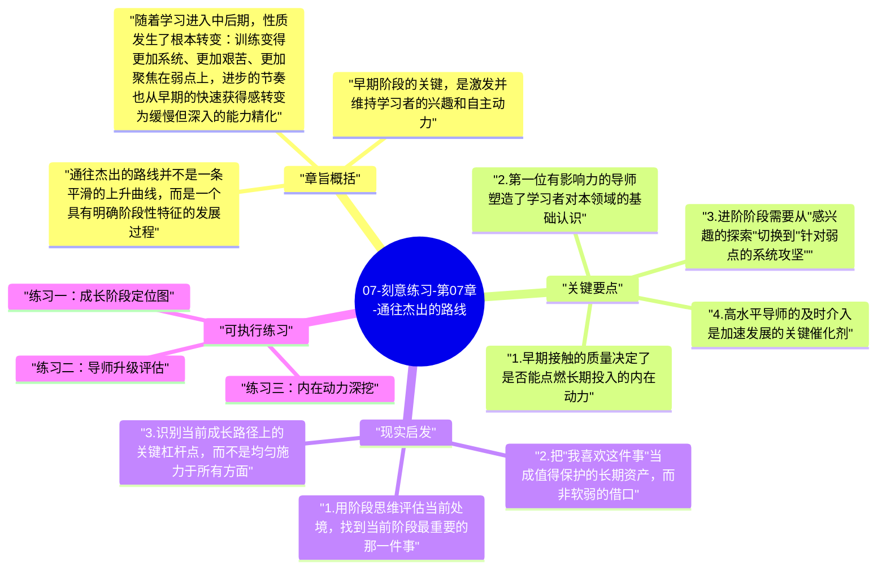

# 07-刻意练习-第07章-通往杰出的路线

在前几章，艾利克森把刻意练习拆解成了一套可操作的训练原则，但还有一个大问题没有回答：一个从零开始的人，如何一步步走向真正的杰出？从完全的新手到可靠的初学者，从初学者到有一定专业水平的人，从有一定水平到真正意义上的高手，再到少数人才能达到的顶尖表现者——这条路有多长？有哪些关键转折点？每个阶段分别需要什么样的支持和训练重点？本章正是要把这条路绘制成一幅可以参照的成长地图。

这一章有一个重要的反主流叙事意义。在很多人的想象中，成为杰出者要么需要天赋，要么需要某种神奇的机遇或顿悟，总之是一个充满不确定性、难以复现的神话过程。艾利克森的研究描绘了一幅非常不同的图景：成为杰出者确实需要极长时间的高质量训练，但这个过程本身是可理解的、可规划的、在某种程度上是可预测的。它不是神话，而是一个有阶段性结构的长期工程。理解这个结构，能帮助人对自己所处的位置有更清晰的认知，也能帮助父母、教师和教练更好地设计针对不同阶段的支持策略。

本章也是全书最具人文温度的一章，因为它正视了卓越之路的真实代价：极长的时间投入、对家庭支持的深度依赖、在进步缓慢期维持动力的心理挑战、以及在巅峰期之后如何持续维持高水平的现实难题。艾利克森没有把这条路描述得比实际更容易，但他的描述也充满了一种基于证据的乐观——这条路是真实存在的，而且曾经有无数人走过。

## 章旨概括

通往杰出的路线并不是一条平滑的上升曲线，而是一个具有明确阶段性特征的发展过程。艾利克森把这个过程大致划分为几个阶段：早期接触和兴趣萌发阶段、有意识学习和基础能力建立阶段、系统性专业训练阶段，以及少数人才能进入的精英突破阶段。每个阶段都有其独特的训练重点、关键挑战和所需的外部支持类型。理解这种阶段性，能帮助人避免用错误阶段的方法去处理当前阶段的问题，例如用精英阶段的高强度专项训练去对待刚开始接触某领域的初学者，往往适得其反。

早期阶段的关键，是激发并维持学习者的兴趣和自主动力。艾利克森的研究发现，大多数后来成为顶尖表现者的人，在早期学习阶段都经历过一个充满游戏感和探索乐趣的阶段，在这个阶段他们的进步速度快，初级成就感频繁，外部认可度高。这个阶段的作用不是打好严格的专业基础，而是建立"我喜欢这件事，我愿意继续深入"的内在驱动力，这种内在驱动力是后续长达多年的高强度刻意练习的心理燃料。

随着学习进入中后期，性质发生了根本转变：训练变得更加系统、更加艰苦、更加聚焦在弱点上，进步的节奏也从早期的快速获得感转变为缓慢但深入的能力精化。这个阶段的维持动力，越来越依赖内在的掌握感和对自我提升的深层认同，而非外部奖励或赞美。从外部动力主导到内部动力主导的这个转变，是通往杰出之路最关键的心理转折点，也是大多数学习者发生分化的地方——一些人在这个转变中成功建立了内在驱动力，另一些人则在外部奖励减少时选择了退出。

## 关键要点

### 1. 早期接触的质量决定了是否能点燃长期投入的内在动力

艾利克森的研究显示，大多数后来成为顶尖表现者的人，都有一个相对愉快的早期学习经历。这不是说早期不需要努力，而是说早期的环境通常足以让努力产生频繁的正向反馈，使学习者能在相对短的时间内看到明显的进步，并由此建立"我擅长这件事，我喜欢做这件事"的自我认同。这种早期正向认同，会转化为后续高强度训练的心理资本。

这对父母和教育者有直接的指导意义：在孩子学习某种技能的早期阶段，保护他们对这件事的热情和自主感，比强行灌输严格的专业训练更重要。过早引入高压专项训练，可能在孩子建立内在动力之前就损坏了他们的学习热情，使他们以后即使技术层面有能力，也缺乏维持长期高强度训练的意愿。

### 2. 第一位有影响力的导师塑造了学习者对本领域的基础认识

在成为专业人士之前的早期学习阶段，学习者的第一位有影响力的导师，往往对他们的基础技术和对领域的基本认知有深远影响。一位好的早期导师，不仅能帮助学习者建立正确的基础动作和基础认知，还能点燃学习者的好奇心，展示这个领域的深度和魅力，使学习者愿意继续探索。相反，一位基础教学能力不强或者方法刻板的早期导师，可能在不知不觉中使学习者建立了错误的基础习惯，或者在早期就损害了学习者的学习热情。

这解释了为什么在很多顶尖表现者的成长故事中，都有一两位被频繁提及的关键导师。这些导师不一定是技术上最顶尖的专家，但他们擅长激发特定阶段学习者的内在动力，理解如何在正确时间提供正确类型的挑战，并具有足够的敏感性来调整教学方式以适应学习者的个体特点。这种"对的导师在对的时间出现"，在优秀表现者的成长路径中是一个几乎普遍的共同要素。

### 3. 进阶阶段需要从"感兴趣的探索"切换到"针对弱点的系统攻坚"

在度过了早期相对愉快的探索阶段之后，真正想走向杰出的学习者必须经历一个训练性质的根本转变：从宽泛的领域探索，转向针对当前能力瓶颈的系统性专项突破。这个转变是必要的，因为广泛探索能建立基础，但无法把任何单一能力维度推向顶尖；只有聚焦式的专项突破，才能把最关键的能力推向真正的高水平。

这个转变也是心理上最困难的阶段，因为它意味着减少那些令人愉快的宽泛探索，增加令人不舒适的弱点直面时间。很多学习者在这个转变点上选择了"保持在有点擅长的阶段就好"，因为继续前进意味着更多的挫败感和更少的即时满足感。真正通往杰出的路，恰恰是那些愿意长期忍受这种不舒适的人走的。

### 4. 高水平导师的及时介入是加速发展的关键催化剂

随着学习者水平的提升，需要的导师类型也必须随之升级。初级导师能帮助学习者建立基础，但到了进阶阶段，初级导师已经无法识别学习者在更高层次上的具体偏差，自然也无法设计针对性的训练来突破这些偏差。这就是为什么顶尖表现者的成长路径中，几乎都有过意识到需要换一位更高水平导师的转折点——这个转折往往带来跃跃性的快速进步。

主动寻找更高水平的指导，而不是习惯于现有导师关系，是持续进步的主动性要求。这需要学习者对自己当前能力边界有清晰的感知，能够判断什么时候当前导师已经无法再提供新的改进方向，以及有足够的社会能动性去寻找和接触更高水平的指导者。

### 5. 平台期是通往杰出之路的必经考验，但不同平台期需要不同应对策略

在通往杰出的路线上，每个人都会经历多次进步平台期。这些平台期的原因各不相同：有些是因为当前训练方法已经耗尽了对应的改进空间，需要切换到更高阶的训练方式；有些是因为一个特定弱点已经成为瓶颈，必须被攻克才能解锁下一阶段的进步；有些则是大脑和身体在整合和巩固已有进步，为下一次跃升做生理准备。

正确识别当前平台期的类型，是选择合适突破策略的前提。如果是方法耗尽型的平台期，需要引入新的训练方法或更高水平的导师；如果是瓶颈型平台期，需要识别出那个关键弱点并进行专项集中突破；如果是整合期，则需要耐心等待同时保持质量稳定的维持性训练。把所有平台期都用同一种方式应对（通常是"更卖力地练同样的内容"），往往是在平台期停滞太久的根本原因。

### 6. 动力维持需要在外部奖励和内在掌握感之间实现转换

研究通往杰出之路的心理学发现了一个重要规律：外部奖励（比赛名次、他人认可、物质奖励）在学习早期是有效的动力来源，但随着训练难度增加和外部奖励频率降低，这类外在动力会越来越难以维持高强度的持续训练。真正走向杰出的人，通常在某个阶段完成了动力来源的内化转换——他们开始从技能本身的掌握感、从解决困难问题的智识满足感、从不断精化细节的内在审美感中获得驱动力，而不再主要依赖外部评价来维持练习动力。

这种内在动力的建立，部分来自对领域的深入理解（理解得越深，就越能感受到精进的价值和乐趣），部分来自训练过程中积累的"我能做到"的自我效能感，部分来自与志同道合的学习共同体的互动。主动培养这种内在动力，比单纯依赖意志力更可持续，也是在高强度训练长跑中保持稳定前进的关键心理资本。

## 现实启发

### 1. 用阶段思维评估当前处境，找到当前阶段最重要的那一件事

很多人在学习中感到焦虑，是因为他们试图同时处理所有阶段的问题。入门者担心自己没有顶尖者的效率，进阶者试图模仿大师的全面训练方法。用阶段思维来重新审视自己的位置，问自己"我现在处于哪个阶段，这个阶段最关键的任务是什么"，能大幅减少不必要的焦虑，并把有限的精力集中在真正有杠杆效应的事情上。

处于入门阶段的人，最重要的任务是建立正确的基础习惯和保护内在动力；处于进阶阶段的人，最重要的任务是识别并系统攻克关键瓶颈；处于高水平阶段的人，最重要的任务是在越来越精细的边界上持续优化。用错阶段的方法，轻则低效，重则产生反效果。

### 2. 把"我喜欢这件事"当成值得保护的长期资产，而非软弱的借口

在推崇"刻意练习"的语境下，很容易产生一个误解：训练必须始终严肃、艰苦、无聊，才算真正认真。但艾利克森的研究表明，对领域的热情和兴趣是长期高强度投入的必要心理基础，而不是应该被克服的软弱。当练习完全失去内在吸引力时，仅凭意志力维持是不可持续的，而且会在心理上产生对该领域的负面联结，长期损害学习效果。

保护对学习领域的兴趣和热情，意味着偶尔允许自己做不那么严格但很享受的练习，意味着把领域内让自己真正着迷的部分纳入学习计划，意味着关注在高强度训练阶段不要让疲惫变成持久性的厌倦。这不是在为拖延找借口，而是在为长期可持续的高质量投入做心理层面的保护。

### 3. 识别当前成长路径上的关键杠杆点，而不是均匀施力于所有方面

在成长的每个阶段，都存在一些对当前进步有最高杠杆效应的关键因素，解决它们会带来不成比例的大幅提升。找到并集中攻克这些关键杠杆点，比均匀地在所有方面进行"全面提升"有效得多。这需要对自己当前的能力结构有清晰的元认知，也需要对该领域高水平表现的核心要素有足够的了解。

定期进行这种"关键杠杆点识别"，是保持成长路径效率的持续性工作。随着阶段的推进，关键杠杆点会发生变化，能够及时发现变化并相应调整训练重点，是通往杰出之路上的重要自我管理能力。

## 可执行练习

### 练习一：成长阶段定位图

拿出纸笔，对自己目前最重要的一项技能做一次诚实的阶段定位：写出你认为通往该领域高手水平大约需要经历哪些主要阶段，然后标出你目前大致处于哪个阶段，分析当前阶段的主要特征和最关键的成长任务是什么。再写出：你目前的训练方式是否与当前阶段的需求匹配？有哪些方面需要调整？这个练习能帮助你建立一个相对清晰的阶段性成长框架，避免用错误阶段的方法处理当前阶段的问题。

### 练习二：导师升级评估

对于你目前正在学习的技能，评估你当前的指导来源（老师、导师、社群、书籍等）是否仍然处于你能力的前沿，还是已经无法再提供新的有价值反馈。如果你感觉现有指导来源已经无法再帮你发现更精细的改进方向，列出三个获取更高水平指导的可能途径，并在接下来一个月内采取至少一个具体行动。这个练习迫使你直面"是否需要换一位更高水平的导师"这个通往杰出之路上的关键判断点。

### 练习三：内在动力深挖

写下你在学习这项技能过程中体验到的最强的内在满足感来自什么时刻——不是被别人认可，不是在比赛中获奖，而是在练习本身中让你感到深度满足的时刻。仔细分析这些时刻有什么共同特征，然后思考如何在日常训练设计中更多地创造这类时刻。长期训练的动力不是靠外部强制维持的，而是靠不断强化这类内在满足感来滋养的。这个练习帮助你找到自己内在动力引擎的具体运作方式。

---

## Mermaid 思维导图

### 图1

