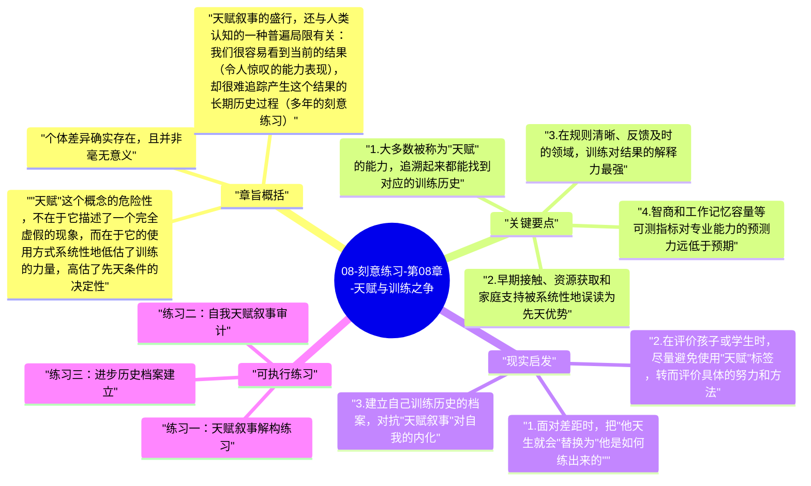

# 08-刻意练习-第08章-天赋与训练之争

这是全书最具争议性的一章，因为它正面挑战了人类社会中一个深入人心、几乎无处不在的信念：高手是天生的。这个信念以各种形式出现——"他天生就有音乐细胞""她天生就适合做领导""这个孩子天赋异禀"——它如此普遍，以至于大多数人从来没有认真质疑过它的合理性。艾利克森花了几十年时间研究顶尖表现者，他在本章提出的答案是：天赋叙事在绝大多数情况下是一种误解，它遮蔽了大量不可见的训练历史，并通过一种看似善意的方式，系统性地阻止了更多人真正挖掘自己的潜能。

这一章的写作初衷，并不是要完全否定个体差异的存在。艾利克森并没有说所有人在所有方面的起点完全相同，那显然不是事实。他真正要说的是：被误认为天赋的东西，绝大部分时候其实是早期训练、环境优势和高质量指导的结果，只是这些因素发生得足够早、足够隐蔽，以至于旁观者无法看到背后的积累，只能看到令人惊叹的结果，然后把这个结果归因为"天生如此"。这种归因不只是不准确，它还有一个深层的危害：它让相信这个叙事的人放弃了自己本有能力达到的更高水平。

本章在全书中的位置是一种思想清场：在艾利克森完整阐述了刻意练习的理论和应用之后，他必须正面回应最大的隐性异议——"这些都很好，但如果我天赋不够怎么办？"本章的答案是：先质疑"天赋不够"这个前提本身。

## 章旨概括

"天赋"这个概念的危险性，不在于它描述了一个完全虚假的现象，而在于它的使用方式系统性地低估了训练的力量，高估了先天条件的决定性。在很多被当作天才神话来讲述的故事背后，仔细追踪会发现密集的早期训练、高度支持性的家庭环境、接触到优质指导资源的幸运机遇，以及在关键发展窗口期的大量练习积累。莫扎特的故事是最常被讲述的"天才案例"，但历史研究显示，莫扎特从3岁起就在父亲（一位经验丰富的音乐教师）的密集指导下接受音乐训练，他12岁时已经积累了超过3500小时的专业练习，他的"神奇"作品普遍出现在大量早期练习积累之后，而非之前。

个体差异确实存在，且并非毫无意义。但艾利克森指出，在训练质量相同的条件下，个体差异对最终能力的影响，远小于人们通常认为的程度。更重要的是，在现实中，训练质量对结果的解释力，远远大于可测量的先天特征对结果的解释力。当两个人之间存在明显的能力差距时，这个差距来自训练质量差异的可能性，通常比来自天赋差异的可能性大得多。这不是一种激励性的口号，而是基于系统性研究证据的结论。

天赋叙事的盛行，还与人类认知的一种普遍局限有关：我们很容易看到当前的结果（令人惊叹的能力表现），却很难追踪产生这个结果的长期历史过程（多年的刻意练习）。这种看不见的过程，在我们需要解释当前结果时，就很容易被替换成"天生如此"这样的简单归因。正是这种认知局限，让天赋叙事即使在面对大量反例时，仍然能维持其解释效力。

## 关键要点

### 1. 大多数被称为"天赋"的能力，追溯起来都能找到对应的训练历史

艾利克森对多位被公认为天才的表演者进行了细致的历史考察，结论几乎一致：在那些让旁观者感到"天生如此"的超凡能力背后，都有一段足够早期、足够密集、足够高质量的训练历史。这段历史往往因为发生得太早（婴幼儿期到学龄前）或太隐蔽（在家庭内部，不对外显示）而被大众看不见。当旁观者初次遇到这个人时，看到的是多年积累的成果，而训练过程已经变成了不可见的背景。

这个发现并不是要否认那些高手的成就——他们确实做到了非常难的事情，并为此付出了巨大的努力和时间。但它确实要求我们把他们的成就从"天生的奇迹"重新理解为"努力的杰作"，这种重新理解既是对他们努力的更公平的认可，也是对其他人更诚实的激励。

### 2. 早期接触、资源获取和家庭支持被系统性地误读为先天优势

在才能研究中，有一个反复出现的发现：高水平表现者通常来自高度支持其技能发展的家庭环境。这些家庭不仅提供经济资源（乐器、教练、训练设施），还提供时间投入（父母陪伴练习、接送参加比赛）、情感支持（在艰难训练时期的鼓励和陪伴）和价值观塑造（把努力和坚持视为值得赞扬的品质）。这些环境因素对高水平能力发展的贡献，比大多数人认为的要大得多。

问题在于，这些环境优势对旁观者来说通常是不可见的，而结果——令人印象深刻的高水平能力——是显而易见的。在这种信息不对称下，很自然地，外界会把可见的结果归因于不可见的"天赋"，而忽视了那些实际上更具解释力的可见但被忽略的环境因素。改变这种归因习惯，需要主动追问"他是怎么练出来的"而不是"他天生就会什么"。

### 3. 在规则清晰、反馈及时的领域，训练对结果的解释力最强

艾利克森指出，天赋对结果的解释力，在不同类型的领域中差异很大。在那些规则清晰、评价标准明确、反馈即时的领域（例如国际象棋、古典音乐、竞技体育的技术项目），研究反复显示训练质量是最强的结果预测变量，先天特征的解释力相对有限。相反，在那些规则模糊、结果评价主观、反馈延迟的领域（例如创意艺术、领导力、创业），先天特征的解释力确实更难排除，因为这些领域本身的复杂性使得研究更难控制变量。

这个区分的实践意义在于，对于大多数技术性、可测量的技能学习，天赋论的悲观主义是最没有根据的。如果你想学一门乐器、掌握一种运动技能、提升编程能力或学习一门新语言，这些都属于训练效力最强的领域，在这些领域用天赋论来为进步缓慢辩护，是最缺乏证据支撑的。

### 4. 智商和工作记忆容量等可测指标对专业能力的预测力远低于预期

人们通常认为，智商更高的人在需要认知能力的任务上应该有系统性优势。但艾利克森引用的研究表明，在大多数专业技能领域，一旦智商高于某个最低阈值（大约能理解和处理该领域基本信息的程度），更高的智商对最终专业水平的额外贡献非常有限，训练质量和数量对专业水平的解释力远超智商差异。

这一发现对"聪明但懒"与"普通但勤奋"的对比结果预测有深刻含义。在足够长的时间维度上，高质量、高强度的刻意练习能够使具有中等认知能力的人达到，甚至超过，那些依靠天然认知优势但缺乏系统训练的人。这不是一种励志口号，而是训练效力研究的实证结论。当然，这并不排除极端认知能力情形下的特殊性，但对于绝大多数现实技能学习场景，这一结论的适用性是有研究支持的。

### 5. 迷信天赋叙事会造成系统性的自我限制和培养资源浪费

天赋叙事的危害，不只是在个人层面让人放弃努力，它在系统层面还会导致培养资源的严重浪费。如果教育机构和训练系统相信"有天赋的人自然能冒头"，就倾向于把有限的优质培养资源集中在那些早期就表现出色的学习者身上，而忽视那些因为起步较晚或早期训练环境不理想而尚未展现潜力的学习者。这种"选拔而非培养"的系统偏向，会系统性地错过大量本有潜力的人才。

更深层的问题是，早期的"天赋筛选"往往是在筛选早期的训练结果，而非真正的先天潜力。在同一群孩子中，那些在7岁时就被认定为"有天赋"的，很可能只是那些更早接触了高质量训练的孩子，而那些被筛掉的，可能只是缺少了同样的早期训练机会。这种用训练结果来替代潜力筛选的做法，既不公平，也不准确。

### 6. 正确看待个体差异：它影响起点，但不决定上限

艾利克森并不否认个体差异的存在，他否认的是个体差异决定上限这个推断。个体差异确实意味着，在训练条件完全相同的情况下，不同的人起步速度可能不同、对某些类型任务的早期适应程度可能不同。但这些早期速度差异，并不能可靠地预测经过长期高质量训练之后能够达到的最终水平。

研究反复表明，那些在早期进步最快的人，并不总是那些在长期训练后达到最高水平的人。长期高质量训练的累积效应，能够显著抹平甚至逆转早期的起步差异。这意味着"起点低不代表上限低"这个命题，在可测量的技能领域是有实证支撑的。接受这一点，能帮助人在面对早期进步缓慢时，不过早放弃，而是把注意力放在训练质量的持续改善上。

## 现实启发

### 1. 面对差距时，把"他天生就会"替换为"他是如何练出来的"

每次你对某人的能力感到惊叹，并产生"他肯定有天赋，我不行"的念头时，主动用一个更有成长价值的问题来替代它："他是通过什么样的训练达到这个水平的？"这个问题的答案，往往会发现大量你可以参照的具体路径，而不是一扇你无法打开的天赋之门。这种问法的转变，能把你从旁观者的崇拜状态，带入学习者的探究状态。

这个习惯对于学习动力的维持有实际价值。天赋叙事是一种让人放弃的叙事，而"他是怎么练的"是一种驱动探究和行动的叙事。在面对技能差距时，你选择哪种叙事框架，直接影响后续的行为模式。

### 2. 在评价孩子或学生时，尽量避免使用"天赋"标签，转而评价具体的努力和方法

研究表明，被贴上"天才"或"有天赋"标签的孩子，往往会发展出对失败的过度恐惧——因为他们的自我价值感与"天赋"挂钩，一旦在某件事上失败，就会觉得自己的"天赋"受到了威胁，从而回避挑战以保护自我形象。相反，那些被评价"你努力得很好""你用了一个聪明的方法"的孩子，更倾向于把自我价值感与努力和方法挂钩，从而对挑战更开放、对失败更有韧性。

这个研究发现（卡罗尔·德韦克关于"成长型思维"的研究与艾利克森的训练理论在这一点上高度吻合）有直接的家庭和教育实践含义。称赞"你真聪明"和称赞"你真努力"，在心理上对孩子产生的影响是截然不同的，前者固化自我认知，后者培养成长导向。

### 3. 建立自己训练历史的档案，对抗"天赋叙事"对自我的内化

当你自己对训练进展感到气馁时，"我可能真的没有这方面天赋"的念头会悄然出现。对抗这种念头最有效的方式，是保有清晰的个人训练历史记录：我从什么时候开始、用什么方式、投入了多少时间和精力进行这项技能的训练？这份记录能帮助你把当前的能力水平放在一个公平的时间维度上去评价，而不是用当前水平与他人的长期积累结果作横向比较。

这种历史视角的维持，对于长期坚持训练具有重要的心理保护作用。它能防止在某次挫败后产生的"也许我真的不行"的判断过度泛化，让你把暂时的困难理解为训练路径上的正常成本，而不是天赋不足的证明。

## 可执行练习

### 练习一：天赋叙事解构练习

选择一位你非常仰慕其能力的人——一位运动员、艺术家、科学家或职场高手——花一天时间尽可能详细地调查他的早期经历：他从多早开始接触这个领域？他有哪些特别的训练机会或高水平指导？他的家庭和环境提供了什么样的支持？他的能力是一夜之间显现的，还是有清晰的渐进积累过程？写出你的发现，并分析其中有多少是你原来认为的"天赋"，有多少实际上是可以追溯的训练历史。

### 练习二：自我天赋叙事审计

列出你目前认为自己"没有天赋"因而放弃或从未认真尝试的三件事。对每一件事，诚实回答：你实际上在这件事上投入了多少高质量的练习时间？你曾经尝试过系统性的学习方法，还是只是随意尝试过几次就放弃了？你有没有获得过高质量的指导？分析过后，判断你对"没有天赋"的结论，是基于充分的系统性训练经验，还是基于有限的非系统性尝试。

### 练习三：进步历史档案建立

从现在开始，为你最重要的一项成长目标建立一个清晰的个人训练历史档案。记录每周的训练内容、时长、当周遇到的困难和当周达到的具体进步。这个档案的价值不只在于追踪当前进度，更在于在未来遭遇困难时，能回头看到自己走过的路，用真实的历史证据代替"我可能没天赋"的念头。三个月后，回顾这份档案，写一篇简短的分析，评估自己的进步与训练质量之间的关系。

---

## Mermaid 思维导图

### 图1

