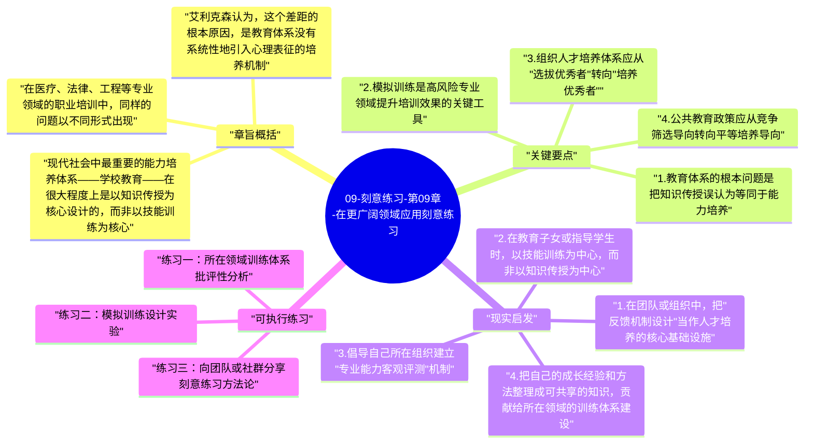

# 09-刻意练习-第09章-在更广阔领域应用刻意练习

全书行至最后一章，艾利克森把视角从个人技能提升的层面，大幅拓展到社会、教育、医疗、商业等宏观领域。这个拓展不是随意的，而是基于一个重要的洞察：刻意练习不只是一套个人成长技术，它本质上是一种对"人类如何习得能力"的深度理解，而这种理解如果能系统性地渗入学校教育、职业培训、组织人才发展和社会公共政策，将会产生远比个人受益更大的集体影响。艾利克森在这一章既是在为自己多年的研究做社会层面的价值论证，也是在向读者传递一种更宏大的愿景：如果我们作为一个社会，能够更科学地理解和设计能力培养体系，人类整体的潜能将远未得到充分释放。

这一章也是全书最具批评精神的一章。艾利克森对现有的教育体系、医疗培训体系和组织人才发展体系，都提出了来自刻意练习理论视角的批评：它们普遍过于依赖知识传授而非技能练习，过于依赖单次选拔而非持续培养，过于依赖被动学习而非主动训练，过于忽视反馈机制的设计而非将其作为培养体系的核心要素。这些批评不是为了批评而批评，而是指向一个建设性的问题：如果我们用刻意练习的原则重新设计这些培养体系，会有什么不同，会产生什么更好的结果？

本章在整本书的结构中扮演着向外延伸的角色，它把读者从"我如何用刻意练习提升自己"这个个人问题，引向"我们如何用刻意练习的理念改善我们共同生活的各种机构和系统"这个更大的社会问题。这是一种从个人到集体的自然延伸，也让《刻意练习》从一本个人成长书籍升格为一套可以指导社会实践的方法论框架。

## 章旨概括

现代社会中最重要的能力培养体系——学校教育——在很大程度上是以知识传授为核心设计的，而非以技能训练为核心。学生被要求学习大量知识内容，并在考试中展示对这些知识的记忆和理解，但很少被系统性地训练如何将这些知识转化为高效的实践能力，也很少得到基于刻意练习原则的针对性、个性化的技能反馈。这种以知识为主轴的教育模式，培养出了很多拥有大量知识的人，但能真正运用这些知识出色地解决复杂实际问题的人，比例远低于应有水平。

艾利克森认为，这个差距的根本原因，是教育体系没有系统性地引入心理表征的培养机制。知识是告诉人"这是什么"，而心理表征决定了人"如何在实际情境中看待和处理这件事"。要建立有效的心理表征，必须通过大量的真实情境练习、针对性反馈和自我修正——而这些，恰恰是传统知识型教育最缺乏的部分。如果学校能够系统性地引入基于刻意练习原则的技能训练环节，哪怕只是在最重要的几个核心能力上，教育效果将会有根本性的提升。

在医疗、法律、工程等专业领域的职业培训中，同样的问题以不同形式出现。这些领域的培训普遍存在一个共同问题：学员在接受大量理论教育和有限的实践机会之后，就被投入到真实的高风险专业实践中，在完全缺少系统性刻意练习基础的情况下，边工作边"积累经验"。这种"边做边学"的模式，效率远低于在可控环境中进行大量模拟练习的模式，而且风险极高——学员的早期错误往往发生在真实的客户或患者身上。引入更多基于模拟和反馈的刻意练习环节，在高风险专业领域既能提升培训效果，也能显著降低初学者错误对真实服务对象造成的伤害。

## 关键要点

### 1. 教育体系的根本问题是把知识传授误认为等同于能力培养

传统教育模式建立在一个隐含假设上：如果学生充分理解了知识内容，就能在需要时有效地运用它。但认知科学和技能学习研究的大量证据表明，这个假设在大多数情况下是错误的。知识理解和知识运用是两种不同类型的能力，前者需要的是记忆和理解，后者需要的是大量在实际情境中练习和犯错后修正所形成的心理表征和直觉判断能力。仅仅学习了知识，不经过系统性的应用练习，绝大多数人都无法把知识有效转化为实际能力。

更具体地说，学校课堂上学到的物理公式、历史事件、数学定理，在没有大量问题解决练习的情况下，通常只能以"考试知识"的形式存在于学生脑中，而无法以"解决真实问题的工具"的形式存在。这种知识-能力鸿沟，正是很多人在离开学校后发现"学的东西没用"的根本原因。弥补这个鸿沟，需要在教育体系中系统性地引入真实情境练习和即时反馈机制。

### 2. 模拟训练是高风险专业领域提升培训效果的关键工具

在医疗、航空、军事等高风险专业领域，模拟训练已经被证明是极为有效的技能培训手段，因为它能在不危及真实人员安全的条件下，提供大量可重复的真实情境练习和即时反馈。飞行员在真实飞行之前会在飞行模拟器上积累大量处理各种紧急情况的经验；外科医生在接触真实患者之前会在模拟器和离体组织上反复练习关键操作技术；急诊医护人员会通过标准化患者演练来掌握危机处理流程。这些模拟训练的共同特点，是它们能够提供现实训练无法提供的高频率、可重复、可调节难度的专项练习机会。

艾利克森认为，模拟训练在高风险专业领域的应用还远未达到其应有的覆盖率。大量依然采用"跟着做"或"边做边学"模式的专业培训，如果能系统性地引入更多基于刻意练习原则的模拟训练环节，将既能提升培训效果，又能降低初学者实践错误的代价。这不是一种技术上的奢侈，而是一种投入产出比极高的培训升级。

### 3. 组织人才培养体系应从"选拔优秀者"转向"培养优秀者"

很多组织的人才发展策略，本质上是一种"选拔"而非"培养"的逻辑：招到有潜力的人，然后通过工作任务淘汰表现不达标的，留下来的就是"人才"。这种策略的问题在于，它把人的成长主要归结为先天潜力的自然展现，而忽视了培养体系质量对人才成长速度和上限的决定性影响。

一个基于刻意练习理念的组织人才培养体系，应该首先问自己：我们的培养体系是否为员工提供了足够清晰的成长目标？我们是否为他们提供了高质量、及时的绩效反馈？我们是否系统性地帮助员工识别并攻克其能力发展中的关键瓶颈？我们是否为不同发展阶段的员工配备了相应水平的指导者？这些问题的答案，往往能解释为什么同一组织内部，不同团队之间的人才成长速度存在如此显著的差异。

### 4. 公共教育政策应从竞争筛选导向转向平等培养导向

在公共教育政策层面，天赋论和筛选主义长期以来主导了资源分配逻辑：把有限的优质教育资源集中在那些早期就展现出"优异潜力"的学生身上，让他们在精英轨道上快速成长，而对其他学生提供相对有限的培养资源。艾利克森认为，这种政策取向在刻意练习的理论视角下是难以辩护的，因为早期的能力表现，更多反映的是训练历史而非先天潜力，因此基于早期表现的选拔筛选，实际上在很大程度上是在奖励那些获得了更好早期训练机会的孩子，而不是在识别真实的潜力分布。

更公平且更有效率的公共教育政策，应该把投资重心从精英培养转向普惠性的高质量训练体系建设：确保更多孩子能在关键发展窗口期获得高质量的早期学习支持和技能训练指导，而不是只为已经有良好起点的孩子提供进一步加速的机会。这种转变不只是公平性的要求，也是效率的要求——一个能够充分挖掘更多人才潜能的教育体系，在总体社会产出上必然优于只为少数早熟者提供精英培养的体系。

### 5. 医疗领域的能力维持需要系统性的刻意练习机制

医疗是刻意练习理念应用最迫切的领域之一，原因很简单：医疗能力的下降直接导致患者伤害，而医疗能力的下降在现有体系中极难被及时发现和纠正。执业医师获得资格认证后，在很多地方几乎没有系统性的能力维持和提升要求，也缺少客观的能力退化监测机制。个别研究显示，在某些医疗操作和临床判断能力上，执业年限与能力水平之间的关系是非线性的，甚至有能力随年限增加而退化的证据。

艾利克森认为，解决这个问题需要在医疗培训和继续教育体系中系统性地引入刻意练习原则：建立针对特定临床技能的客观能力测试机制，为执业者提供基于诊断准确率等客观数据的个性化能力反馈，并设计针对已识别弱点的系统性复训机制。这不是对医生专业能力的不信任，而是对人类能力维持机制的科学尊重。

### 6. 刻意练习的社会应用需要文化层面的转变，而非只是方法层面的改变

把刻意练习原则大规模应用到社会各领域，面临的最深层障碍不是技术性的，而是文化性的。社会对"天才"和"天赋"的迷恋，学校和组织普遍存在的"输出导向而非成长导向"的文化，以及对短期成果的过度关注而对长期能力投资的忽视，这些文化因素共同形成了刻意练习理念广泛普及的阻力。改变这些文化的难度，远大于设计一套新的培训方案。

但艾利克森对这种文化转变保持谨慎的乐观，因为他相信证据的力量。当越来越多的组织和机构真正严格地比较了基于刻意练习设计的培养方案和传统培养方案的效果之后，证据会说话。而当足够多的证据积累起来，文化的改变虽然缓慢，但也是可能发生的。这种基于长期证据积累的文化演进，正是艾利克森在整个学术生涯中所相信并一直在推动的事情。

## 现实启发

### 1. 在团队或组织中，把"反馈机制设计"当作人才培养的核心基础设施

无论你是否处于管理岗位，在你能够影响的范围内，把建立高质量的反馈机制当作提升团队能力的最优先投资。这个机制不需要复杂——定期的一对一能力讨论、项目结束后的具体行为复盘、可量化的绩效追踪指标——但它必须存在，且必须足够具体，能够驱动有针对性的改进。在一个团队中，每个成员都清楚自己在哪些具体维度上需要提升，并有相应的支持资源来进行针对性训练，这个团队的能力提升速度将会显著高于没有这套机制的团队。

### 2. 在教育子女或指导学生时，以技能训练为中心，而非以知识传授为中心

知识当然重要，但真正决定一个人未来能力水平的，是他能够用这些知识做什么，而不只是他知道什么。在帮助孩子或学生学习时，要问的核心问题是：他们是否有机会反复地、在有反馈的条件下，练习把所学知识应用于解决真实问题？学校作业是否只是检验记忆和理解，还是也包含了运用能力的挑战性练习？课外时间是否有针对关键能力的有目的练习，还是只有消遣性的活动？这些问题的答案，决定了学习投入能否真正转化为持久的实际能力。

### 3. 倡导自己所在组织建立"专业能力客观评测"机制

在很多组织中，绩效评估与实际专业能力之间的联系非常薄弱——评估往往反映的是完成任务的数量、与上级的关系质量和各种行为印象，而不是真正的核心专业能力水平。倡导在关键岗位上建立客观的专业能力评测标准，使能力评估有清晰的客观维度，能够帮助组织更准确地了解成员的实际能力分布，也为个性化的针对性培训提供依据。这不是要取代主观评估，而是为主观评估补充客观视角。

### 4. 把自己的成长经验和方法整理成可共享的知识，贡献给所在领域的训练体系建设

在任何领域中工作一段时间后，人都会积累一些关于"什么方法真正有效、什么方法看似努力却收效有限"的一手经验。把这些经验系统整理，并以可共享的方式（写作、讲授、带徒弟、建立社群文档）传播出去，是对所在领域整体训练体系的贡献。每一个领域的刻意练习体系，都是由无数这样的个人经验积累和系统化整理共同构成的。参与这个积累过程，不只是利他，也是深化自己学习的有效方式。

## 可执行练习

### 练习一：所在领域训练体系批评性分析

花一天时间，系统地分析你所在领域（职业、学科或爱好社群）的主流训练体系：它在哪些方面符合刻意练习的原则（有目标、有反馈、有针对性练习、有专项弱点突破）？在哪些方面存在明显的不足（过多的理论讲授、缺少即时反馈、不提供针对个人弱点的专项训练机会）？写出你的分析结果，并提出三个具体的改进建议。这个练习能同时加深你对刻意练习原则的理解，和你对所在领域培养体系的批判性认识。

### 练习二：模拟训练设计实验

选择你工作或学习中一项重要但高风险的技能（例如面试表达、危机处理、复杂问题分析），设计一套低风险的模拟练习方案：选择等效但代价较低的场景来反复练习这个技能，设计即时反馈机制，规划六周的练习计划。执行这个方案，在结束后评估模拟练习与真实场景练习在效果上的差异，分析哪些方面可以通过模拟训练有效提升，哪些方面仍然需要真实场景经验的补充。

### 练习三：向团队或社群分享刻意练习方法论

把《刻意练习》的核心概念整理成一个20分钟的分享材料，在你的团队、家庭、读书会或学习社群中做一次讲解。分享的目的，是把刻意练习的理念从你个人的私有认知，转化为你所在群体的共同参照框架。准备过程会迫使你把书中的概念以自己的语言重新表达，这本身就是一次高质量的心理表征精化练习；而分享的结果，则可能开启你与周围人之间更有深度的学习方式探讨，形成相互促进的共同成长氛围。

---

## Mermaid 思维导图

### 图1

