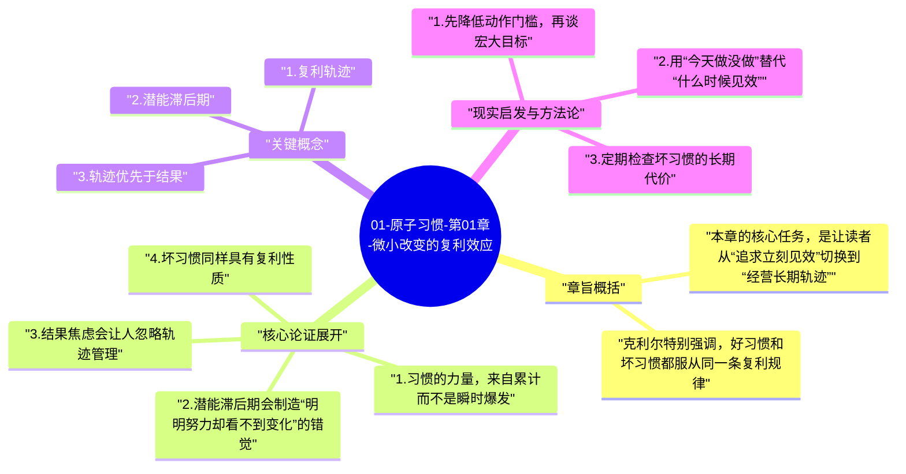
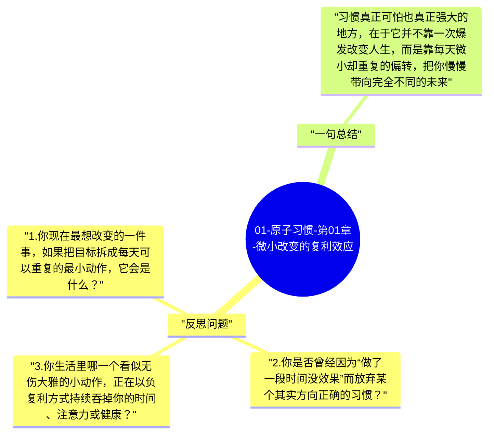

# 01-原子习惯-第01章-微小改变的复利效应

很多人一谈改变，脑子里首先出现的是剧烈转折：明天开始早起、下周开始健身、这次一定彻底戒掉坏习惯、今年必须完成一个大目标。詹姆斯·克利尔在第一章要拆掉的，正是这种对“爆发式改变”的迷恋。他提醒读者，真正持续有效的改变，往往并不以戏剧化的方式出现，而是以一种几乎不起眼的形式，藏在每天重复的微小动作里。

这一章的重要性在于，它替整本书重新定义了“进步”这件事。进步不只是结果层面的跨越，更是轨迹层面的偏转。哪怕你今天看不到巨大差异，只要每天的方向略微调整一点，时间就会把这种差异逐渐放大；反过来，坏习惯同样不会立刻毁掉人生，却会在不知不觉中把人推向越来越差的轨迹。第一章真正要建立的，不是励志感，而是时间尺度上的现实感。

## 章旨概括

本章的核心任务，是让读者从“追求立刻见效”切换到“经营长期轨迹”。习惯之所以强大，不是因为某一次执行很厉害，而是因为它具有复利性质。一次俯卧撑、一页阅读、十分钟散步，看起来都微不足道，但如果这些动作在几个月、几年里不断叠加，它们的意义就会变得完全不同。

克利尔特别强调，好习惯和坏习惯都服从同一条复利规律。也就是说，习惯本身并不偏向善恶，它只是持续把你推向某个方向。正因为短期差异不明显，人们才更容易忽视它；也正因为长期差异会被放大，习惯才值得被认真设计。

## 核心论证展开

### 1. 习惯的力量，来自累计而不是瞬时爆发

大多数人对改变的误解，在于太看重某一个节点。例如一次长跑、一次通宵学习、一次极度自律的高效日，都会让人产生一种“我在进步”的满足感。但克利尔真正关心的是，这种动作能否被重复，能否稳定进入生活结构。如果不能，那么它的意义就很有限。

习惯之所以像复利，是因为它把单次看似微弱的投入，变成可重复、可累计、可被时间放大的轨迹。日拱一卒本身并不惊人，可一旦形成稳定节律，原本微小的优势就会越拉越开。很多人不是没有努力，而是努力方式太像短跑，结果把需要时间积累的东西误当成可以立刻兑现的成果。

### 2. 潜能滞后期会制造“明明努力却看不到变化”的错觉

这一章最有现实感的一点，是它解释了为什么许多人在习惯建立早期会放弃。原因并不总是方法错了，而是因为结果还没显现。复利本来就有滞后性，前期变化很小，后期才会越来越明显。可人类的耐心往往只愿意为立刻回报买单，于是很多正确动作会在价值显现前就被中断。

这就形成了一个常见困局：你以为自己做了却没效果，于是停止；真正的问题却可能是你还没走到效果显现的区间。习惯建设的难度，不只在行动本身，也在于穿过这个潜能滞后期时不轻易怀疑一切。

### 3. 结果焦虑会让人忽略轨迹管理

克利尔并不是说目标完全不重要，而是说如果一个人只盯着结果，就会不断陷入焦虑和摇摆。结果太远、太大、太抽象，于是容易让人产生挫败感；轨迹更具体、更可控，它让你每天都知道自己正在做什么、正在朝哪个方向偏转。

从这个角度看，习惯管理其实是在教人把注意力从“我什么时候才能变好”转到“我今天有没有做那个让我变好的动作”。这种变化看似小，实际上是在重塑行动焦点。一个人一旦能稳定关注轨迹，情绪就没那么容易被短期结果牵着走。

### 4. 坏习惯同样具有复利性质

许多人在理解习惯时，只愿意看到正向一面，好像习惯天然是自律与成长的代名词。克利尔提醒我们，坏习惯同样服从复利逻辑。熬夜、分心、拖延、暴饮暴食、随手刷短视频、长期缺乏运动，这些事情也往往不会在第一天就产生灾难性后果，因此很容易被轻视。但正因为伤害是缓慢累积的，人们才更容易放松警惕。

这意味着，习惯的管理不仅是“添加什么好动作”，也是“停止哪些会在时间里不断吞噬你的动作”。成长不是纯加法，有时更是减法。

## 关键概念

### 1. 复利轨迹

复利轨迹强调的不是一次表现，而是长期方向。哪怕每天只偏转一点，时间都会把这点差异放大。因此，评估习惯时不应只看当下有没有立刻见效，而要看它是否在不断把你推向更好的路径。

### 2. 潜能滞后期

潜能滞后期是指前期努力尚未表现为明显结果的阶段。理解这一点很重要，因为它能帮助人减少“做了几天没变化所以放弃”的冲动。许多正确方法，不是无效，而是尚未穿透时间的迟滞。

### 3. 轨迹优先于结果

结果是某一时点的呈现，轨迹是长期方向的累积。克利尔更在意后者，因为结果可能带有运气成分，而轨迹更能说明你每天在重复什么。

## 现实启发与方法论

### 1. 先降低动作门槛，再谈宏大目标

如果你总把改变设计成很大动作，就会不断在开始前耗尽意志。更有效的方式，是先问自己：这个行为能不能小到几乎没有借口拒绝？真正重要的是让行为开始发生，并且容易重复。

### 2. 用“今天做没做”替代“什么时候见效”

这是一种非常实用的心态切换。前者让你关注可控动作，后者让你被未知结果折磨。习惯建设最怕的，不是慢，而是因为太急而放弃。

### 3. 定期检查坏习惯的长期代价

对坏习惯最有效的纠偏之一，是把它的时间尺度拉长。问自己：如果这个动作每天重复一年，会把我带到哪里？这个问题通常比一时快感更能暴露真相。

## 反思问题

1. 你现在最想改变的一件事，如果把目标拆成每天可以重复的最小动作，它会是什么？
2. 你是否曾经因为“做了一段时间没效果”而放弃某个其实方向正确的习惯？
3. 你生活里哪一个看似无伤大雅的小动作，正在以负复利方式持续吞掉你的时间、注意力或健康？

## 一句总结

习惯真正可怕也真正强大的地方，在于它并不靠一次爆发改变人生，而是靠每天微小却重复的偏转，把你慢慢带向完全不同的未来。

---

## Mermaid 思维导图

### 图1

### 图2

