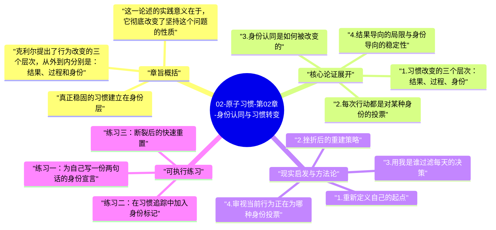

# 02-原子习惯-第02章-身份认同与习惯转变

很多习惯改变的努力在执行层面看起来无懈可击，却最终归于失败。你制定了计划，设置了提醒，甚至持续了几周，但某天行为开始瓦解，最后一切回到原点。詹姆斯·克利尔在第二章提出，问题的根源往往不在技巧，而在于改变发生在错误的层次上。他认为，大多数人改变的方式是由外向内的：先想"我要达到什么结果"，再想"我要走什么流程"，最后才偶尔触碰"我是什么样的人"。而这个顺序恰恰颠倒了。

真正持久的习惯改变，应该是由内向外的。改变必须从身份认同开始，即你对自己是谁的基本信念。当行为开始服务于身份，它就不再是努力维持的任务，而是你自然想去做的事，因为它是你这种人本来就会做的。这是第二章最核心的翻转：习惯的根基不是目标，而是身份。

这一章在全书中扮演哲学奠基的角色。第一章建立了微小改变有复利的时间观，第二章则建立了行为与身份互相塑造的人格观。这两者加在一起，构成后续所有方法论的底层逻辑。不理解第二章，后面那些技术会显得是表面工夫；理解了第二章，它们才有了真正的意义。

## 章旨概括

克利尔提出了行为改变的三个层次，从外到内分别是：结果、过程和身份。结果是你想得到什么，过程是你所做的事情，而身份则是你相信自己是什么样的人。大多数目标设定集中在结果层，例如我想减重十斤我要存到这笔钱。这些目标并非无用，但如果没有更深的身份支撑，它们会在压力和诱惑面前变得脆弱。关注过程的人稍好一些，但流程层同样缺少持久的内驱力，因为流程本身并不解释为什么坚持。

真正稳固的习惯建立在身份层。当你开始用我是一个每天读书的人而不是我想读完一百本书来定义自己，读书这件事就从一项外部任务变成了一种内部表达。行为成为你身份的延伸，而非对某个目标的追逐。克利尔特别指出，身份本身也并非固定不变，而是通过每一次行为的累积来不断被重写。这就意味着，改变身份不需要宣言，也不需要某个戏剧性的转折点，它只需要一次又一次地做出与新身份一致的微小行动。

这一论述的实践意义在于，它彻底改变了坚持这个问题的性质。当习惯的支撑点是身份而非结果时，偶尔的挫折就失去了摧毁整个计划的力量。一个把自己定义为健康的人的人，即便某天没有锻炼，他下一次运动时的起跑线依然是我是健康的人。而一个只关注结果的人，每一次失败都直接动摇了目标本身的可信度。

## 核心论证展开

### 1. 习惯改变的三个层次：结果、过程、身份

行为改变的三层模型是本章最具结构性的概念框架。最外层是结果，它回答的是我想要什么；中间层是过程，回答的是我如何执行；最内层是身份，回答的是我是谁。克利尔的主张是，改变的方向应该是从里向外：先确立身份，再选择过程，最后结果会随之而来。然而大多数人做的恰恰相反，他们先盯着结果，然后试图用强迫性的流程去实现它，却始终没有触及最底层的身份层。

这种由外向内的改变方式有一个天然弱点：当结果无法立刻兑现，或者过程遇到阻力时，整个建筑就开始摇晃。因为没有更深的支撑点，意志力就成了唯一的支柱，而意志力是有限且不稳定的资源。相比之下，当一个人开始认同我就是那种每天冥想的人，即便某天他不想做，他也会多出一重动力——不是因为目标很远，而是因为不做这件事会让他感到与自己不一致。这种一致性压力，是比外部目标更稳定的行动燃料。

### 2. 每次行动都是对某种身份的投票

克利尔引入了一个极为形象的比喻：习惯执行就是在为某种身份投票。每次你选择去健身，就为我是一个爱护身体的人投了一票；每次你选择在待办列表上完成最难的任务，就为我是一个不回避困难的人投了一票。没有任何单次投票会决定选举结果，但如果绝大多数票都指向同一个方向，身份就会被逐渐固化。

反过来，坏习惯同样在不断投票。每次你无故爽约，就在为不可信赖的人投票；每次你把重要任务推到明天，就在为拖延的人投票。这些投票单独看似乎无关紧要，但长期累积下来，它们会真实改变你对自己的认知，从而影响你在新情境中做出的选择。理解这个机制，能帮助人从单次行为的道德判断切换到长期身份的建设视角，让每次小行动都有了更深的重量。

### 3. 身份认同是如何被改变的

很多人误以为，改变身份认同需要某种顿悟、某次深刻的情绪冲击，或者一个彻底的人生转折点。克利尔明确否定了这种看法。他认为，身份不是通过宣言改变的，而是通过证据积累改变的。改变身份的方式，是从今天起开始做与新身份一致的行为，哪怕极其微小，然后让证据一点点堆积起来，直到新身份有了足够的支撑而不再摇晃。

这个观点有深刻的心理学基础。自我认知研究表明，人们在很大程度上是通过观察自己的行为来推断自己是什么样的人，而不是相反。当你反复做出某类行为，大脑会开始把它纳入自我概念，渐渐地，那个行为就变成了你这种人本来就会做的事。这意味着身份改变的关键不是等待正确的心情，而是创造正确的行为记录。

### 4. 结果导向的局限与身份导向的稳定性

结果导向思维是大多数人自我提升时的默认模式，因为目标具体、可测量，给人以方向感。然而克利尔指出，结果导向有一个系统性弱点：目标达成后会产生那然后呢的空洞感，而目标未达成则会持续消耗动力。许多人在成功减重后反弹，在考试结束后立刻停止阅读，在完成马拉松后再也不跑步，原因就在于驱动他们行动的是目标而不是身份。一旦目标消失，行为也就失去了存在的理由。

身份导向思维则不依赖目标的存在与否。我是一个持续成长的人这种身份认同不会在某个节点上实现并消失，它只会随着时间不断加深和拓展。习惯因此获得了一种内在的自我更新动力：因为身份是持续性的，与之匹配的行为也就没有终点。这种稳定性是结果导向无法提供的，因为结果是时间点，而身份是时间线。

### 5. 身份认同与习惯之间的双向塑造

本章有一个微妙而重要的双向性：不仅是身份塑造习惯，习惯也反过来塑造身份。这个互动循环意味着，你不需要先完全相信新身份才开始行动。实际上，行动先于相信，或者说行动才是相信的路径。你不需要先成为一个健康的人才去锻炼；你通过锻炼，逐渐成为了那个健康的人。

这种双向塑造关系对实践有巨大的解放意义。它告诉人们，改变不需要等待信心成熟、条件具备或内心准备好。只要今天的行为略微向期望身份靠拢，就算完成了一次对新自我的投票。积累足够多的投票，身份就会移动；身份一旦移动，行为就变得更自然；行为越自然，习惯就越稳固。这个循环一旦启动，就具有自我强化的性质。

## 现实启发与方法论

### 1. 重新定义自己的起点

在尝试建立新习惯之前，值得做一件事：明确地问自己，建立这个习惯的人，是什么样的人？不是问结果，而是问身份。想养成每天阅读的习惯，那个人是一个渴望持续学习的人；想开始健身，那个人是一个把自己的身体当做长期资产来维护的人。把这种身份具体化，然后每次执行习惯时，提醒自己是在为这种身份投票，而不只是完成一个任务。这种重新定义看起来只是换了一种说法，但它的心理效应是真实的。当动作与身份挂钩，执行的内在逻辑就改变了，它不再是我应该做，而是我这种人就会这样做，后者的驱动力远比前者持久。

### 2. 挫折后的重建策略

每个人都会经历习惯的断裂：出差几天没能运动、生病期间没能读书、高压时期重新开始刷手机。身份导向思维在这类情形下特别有用，因为它提供了一个比失败更稳定的叙事框架。不是我又失败了，我就是做不到，而是我错过了几次投票，但选举还没结束。把挫折理解为证据链上的一个空缺，而不是整条链条的断裂，这是维持长期习惯的重要心理技术。某一天的行为不等于全部，重要的是下一次的行为继续为那个目标身份投票。

### 3. 用我是谁过滤每天的决策

一旦清晰地定义了自己希望成为的身份，就可以在日常决策中使用它作为过滤器。面对某个选择时，不是问我现在想做什么，而是问我想成为的那种人会怎么做。这个问题虽然简单，但它能在关键时刻把行动从情绪牵引拉回身份轨道。例如，你定义自己是有执行力的人，当你面对一个不想打的重要电话时，问自己有执行力的人会怎么做，通常这个问题的答案是清晰的，而正因为答案清晰，行动阻力会降低。

### 4. 审视当前行为正在为哪种身份投票

这是一个常被忽视的反向练习：不只是规划未来想成为谁，也要检视当前习惯正在强化什么样的身份。每天刷两个小时短视频，是在为被动消费者投票；每次遇到分歧就沉默，是在为回避冲突的人投票。清楚地看见这些行为指向的身份，能帮助你更有意识地决定是否要继续。真正的习惯审计，不只是列出好习惯和坏习惯，而是看清每个习惯正在塑造哪个版本的你。

## 可执行练习

### 练习一：为自己写一份两句话的身份宣言

选择一个你当前最想建立的习惯，然后把它转化成身份语言。不要写我要每天运动三十分钟，而是写我是一个把身体健康当做优先事项的人，每天的运动是我表达这一承诺的方式。把这两句话写在纸上，贴在你每天能看到的地方。宣言本身不会改变习惯，但它为行为投票提供了一个清晰的目标方向。每次执行习惯时，提醒自己正在为这个身份积累证据，而不只是完成一个日程条目。

### 练习二：在习惯追踪中加入身份标记

在习惯追踪日志的旁边，加一栏简短的身份标注。每次完成习惯时，不只打勾，而是写一个短语，比如学习者的一票或健康人的一票。这个小动作能持续强化行为与身份之间的连接，让每次执行都不只是机械打卡，而是一次有意义的自我声明。几周后回看，你会看到一份关于你在成为谁的真实记录，这份记录本身会成为强化新身份的证据，形成正向循环。

### 练习三：断裂后的快速重置

下次习惯中断后（无论是一天还是一周），不要用从头来过的心态重启，而是用继续投票的心态重启。写下一句话：我是[身份]，我今天继续为它投票。然后做一个最小版本的习惯行为，哪怕只有两分钟。这个练习的目的不是弥补过去的缺口，而是重新激活身份认同与行为的连接，让下一次执行的门槛变低。长期来看，比从不中断更重要的能力，是中断后快速回来。

---

## Mermaid 思维导图

### 图1

