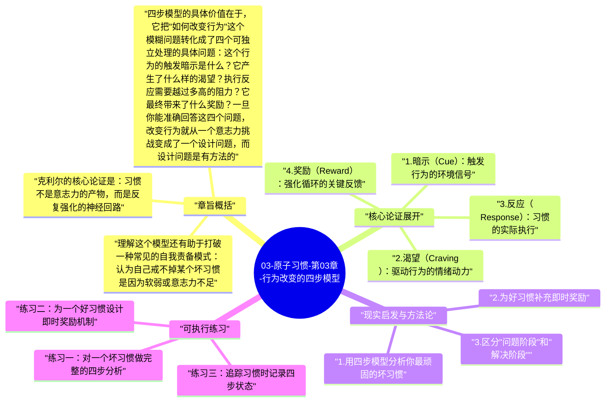

# 03-原子习惯-第03章-行为改变的四步模型

如果第二章是全书的哲学地基，那么第三章就是工程蓝图。詹姆斯·克利尔在这一章引入了贯穿全书的核心框架：习惯由四个步骤构成，分别是暗示、渴望、反应和奖励。这不只是一个描述性的学术模型，而是一个具有实用诊断价值的行动框架。读懂这个循环，你就能在面对任何具体习惯时，准确找到它的杠杆点在哪里，从而做出有针对性的干预，而不是笼统地责怪自己"不够自律"。

这一章的洞察在于，习惯并非偶发的心理事件，而是大脑为了节省认知能量而形成的自动化程序。大脑本质上是一个预测机器，它不断扫描环境，寻找可以预期的奖励模式，一旦某种模式被反复证实，大脑就会把对应的行为路径固化，使其在特定情境下自动触发。这个机制本身没有善恶之分，它既能帮助人建立积极的早晨例程，也会让人在压力下条件反射地打开手机。理解这一点，是所有后续干预策略的出发点。

四步模型之所以强大，还在于它建立了习惯建立的四条基本法则——让它显而易见、让它有吸引力、让它易于执行、让它令人满足——这四条法则正好对应四个步骤。这意味着本章不只是在解释习惯是什么，更是在为后续所有章节搭建统一的概念脚手架。读者后面学到的每一种技术，都是对这四步中某一步的深度展开。

## 章旨概括

克利尔的核心论证是：习惯不是意志力的产物，而是反复强化的神经回路。每次习惯被执行，神经通路就加深一分；每次被跳过，神经通路就减弱一分。这种机制是中性的，意味着好习惯和坏习惯都遵从同样的规律。因此，建立好习惯不需要在意志力上更努力，而是需要更聪明地利用这个机制。

四步模型的具体价值在于，它把"如何改变行为"这个模糊问题转化成了四个可独立处理的具体问题：这个行为的触发暗示是什么？它产生了什么样的渴望？执行反应需要越过多高的阻力？它最终带来了什么奖励？一旦你能准确回答这四个问题，改变行为就从一个意志力挑战变成了一个设计问题，而设计问题是有方法的。

理解这个模型还有助于打破一种常见的自我责备模式：认为自己戒不掉某个坏习惯是因为软弱或意志力不足。实际上，任何根深蒂固的习惯都有其完整的四步循环支撑，即触发它的暗示无处不在、它满足的渴望强而有力、执行起来几乎毫不费力、带来的奖励又快又直接。对抗这样一个完整的系统，纯粹靠意志力确实是以弱击强。正确的做法是系统地改变循环的各个组成部分，让好习惯的循环强化，让坏习惯的循环弱化。

## 核心论证展开

### 1. 暗示（Cue）：触发行为的环境信号

暗示是大脑开始预测某种奖励的信号，它是习惯循环的起点。暗示可以是时间（每天八点），地点（走进厨房），情绪状态（感到无聊或焦虑），前置行为（结束工作会议），或者他人的存在与行为。重要的是，暗示不需要是显眼的或有意识的，事实上大多数习惯暗示都是环境中不被注意到的背景元素。这就是为什么很多人说不清自己"为什么"做了某件事，因为触发点在意识关注范围之外。

暗示的力量在于它对大脑的预测系统有激活作用。当大脑识别出一个曾经预测过奖励的信号，它会立刻提升对即将到来奖励的预期，并产生渴望。这意味着暗示不只是启动行为，它在行为发生之前就已经改变了人的情绪状态和动机水平。这也是为什么管理暗示如此重要——很多时候，在暗示出现之前做出干预，比在渴望激发之后再去抵抗要容易得多。

### 2. 渴望（Craving）：驱动行为的情绪动力

渴望是四步模型中最容易被误解的一步，因为它往往不是对行为本身的渴望，而是对行为背后状态改变的渴望。你并非真的渴望刷手机这个动作本身，你渴望的是刷手机带来的短暂放松和新鲜感；你也不是真的渴望运动，你渴望的是运动后那种精力充沛的状态。理解这一点至关重要，因为它意味着：如果能找到其他方式来满足同样的渴望，就可以替换触发渴望的行为。

渴望的强度决定了你愿意为一个行为付出多大的努力。如果渴望足够强烈，人会克服相当大的障碍去执行；如果渴望微弱，即便执行障碍很低，人也可能不行动。这个机制解释了为什么单纯降低好习惯的执行难度有时还不够——如果那个习惯根本没有产生值得期待的渴望，它依然不会稳定发生。后续章节关于"让它有吸引力"的法则，本质上就是在针对渴望这个环节做设计。

### 3. 反应（Response）：习惯的实际执行

反应是习惯的可见部分，即实际发生的行为或思维动作。反应能否发生，取决于执行它所需付出的努力与能力之间的比例——克利尔称之为"动力方程"。如果一个行为需要的努力超过了你当时的能力或意愿阈值，它就不会发生。这就是为什么让好习惯容易执行如此重要：降低摩擦力不是走捷径，而是顺应了大脑总是选择最省力路径的本能。

反应层面的干预有两个方向：对好习惯降低执行阻力，对坏习惯提高执行阻力。前者的典型手段是减少所需步骤（把运动装备放在床边）、降低开始门槛（每次只做两分钟）；后者的典型手段是增加摩擦（把游戏从手机里删掉、把遥控器放在不顺手的地方）。这些操作看起来简单，却是基于对反应层运作逻辑的深刻理解。

### 4. 奖励（Reward）：强化循环的关键反馈

奖励完成了两件事：一是满足渴望，让你在当下感到愉悦或得到回报；二是教导大脑"这个行为值得重复"，在神经层面强化这条回路。克利尔特别指出，奖励不一定必须是外部奖励，行为本身带来的内在满足感、完成感或状态改变，同样可以承担奖励的功能。问题在于，好习惯的回报往往是延迟的（健康、知识积累），而坏习惯的回报往往是即时的（快感、放松），这种时间不对称是好习惯难以建立的深层原因。

理解奖励机制还能帮助人避免一个常见陷阱：用立刻消除奖励来戒除坏习惯。这种策略通常会失败，因为它消灭的是回报，但没有触碰更深的渴望。更有效的策略是为好习惯引入即时的、有体验感的奖励，让大脑在执行好习惯时能够快速感受到正向反馈。长期来看，好习惯本身的内在收益会变得足够显著，但在早期，制造及时的满足感是稳定习惯的重要手段。

### 5. 四步模型与四条基本法则的对应关系

四步模型的最大价值，不只在于解释习惯，而在于它直接生成了干预的策略框架。每一步对应一条基本法则：要建立好习惯，让暗示显而易见（针对暗示）、让渴望有吸引力（针对渴望）、让执行容易发生（针对反应）、让结果令人满足（针对奖励）；要破除坏习惯，则相应地：让暗示不可见、让渴望缺乏吸引力、让执行困难、让结果令人不满。

这种对应关系赋予了本书一种系统性的力量。当你面对任何习惯问题，都可以用这个矩阵来定位：这个问题是暗示层的问题，还是渴望层、反应层或奖励层的问题？不同层次的问题需要不同类型的干预。这种诊断能力，是真正理解第三章后最重要的实践收获。

## 现实启发与方法论

### 1. 用四步模型分析你最顽固的坏习惯

选取一个你想戒掉却总是失败的坏习惯，然后系统地拆解它的四步循环。它的暗示是什么，什么情境或情绪总是触发它？它满足的渴望是什么，你真正期待的是什么感觉？它的执行多容易，需要几步就能开始？它的即时奖励有多强，好处来得多快多明显？完成这个分析之后，你会发现这个习惯之所以顽固，是因为它的每一步都被优化过了。这份清醒本身，就是制定更聪明替代方案的起点。

### 2. 为好习惯补充即时奖励

好习惯的一个普遍弱点是奖励延迟。今天的健身要等几周才能看到身形变化；今天的读书要等几年才能看到知识积累。在这段时间里，习惯需要依靠什么来维持？克利尔的建议是，人为地为好习惯引入即时奖励，比如运动后允许自己听最喜欢的播客，完成重要工作后买一杯好咖啡。这些即时奖励不是贿赂，而是帮助大脑在奖励尚未自然显现之前，先建立起"执行这个习惯是值得的"的情绪记忆。

### 3. 区分"问题阶段"和"解决阶段"

克利尔将暗示和渴望合称为"问题阶段"，将反应和奖励合称为"解决阶段"。这个区分在实践中很有用：大多数关于习惯的干预策略集中在解决阶段（"我要更努力地执行"），而真正有效的干预往往发生在问题阶段（"让暗示不出现"或"让渴望转向更好的选项"）。如果你总是在渴望已经强烈时才开始抵抗，你几乎注定会失败。在问题阶段提前干预，是更省力也更持久的策略。

## 可执行练习

### 练习一：对一个坏习惯做完整的四步分析

找一张纸，画四列，分别标注暗示、渴望、反应、奖励。选一个你最想改变的坏习惯，在这一周内，每次习惯被触发时，都在对应列记录下来。一周后，回看这张表，你会发现某些暗示反复出现，某种渴望一再驱动行为。这种可见性是改变的前提——你无法改变你不了解的东西。带着这份数据，再决定从哪一步入手干预，通常比空泛地"下定决心"要有效得多。

### 练习二：为一个好习惯设计即时奖励机制

选择一个你想建立但总是难以坚持的好习惯，然后为它设计一个即时、具体、有体验感的奖励。奖励不必昂贵，但必须是你真正期待的东西，比如执行完好习惯后才能听某首歌、喝某种饮料、看一段短视频。关键是：这个奖励只在完成好习惯后才享受，不在其他时间使用。坚持这样做两到三周，观察好习惯的执行率是否有变化。

### 练习三：追踪习惯时记录四步状态

在习惯追踪表格中，不只记录"完成/未完成"，而是在旁边加一列简短备注，描述当天执行时在哪一步感受到了最大阻力。是暗示不够清晰？渴望不够强？执行障碍太高？还是奖励感不足？坚持两周后，这些备注会帮助你清楚地看到习惯的薄弱环节在哪里，从而针对性地加以强化。

---

## Mermaid 思维导图

### 图1

