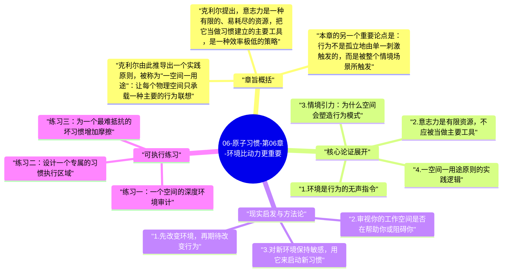

# 06-原子习惯-第06章-环境比动力更重要

绝大多数人在思考自我改变时，都在问同一个问题：我怎样才能更有动力？怎样才能让自己更自律？这个问题的前提假设是，行为的主要决定因素是内部心理状态——动力、意志力、自律性。詹姆斯·克利尔在第六章有力地挑战了这个假设。他的论点是：人的行为在很大程度上不是由内在心理状态决定的，而是由外部环境的结构决定的。换句话说，你在什么样的环境里，往往比你有多大的意愿，对你最终会做什么影响更大。

这个洞察来自一个简单但深刻的观察：人类是视觉动物。我们倾向于与当前环境中最显眼、最触手可及的事物产生互动。如果桌上摆着一碗糖果，你就会吃；如果书架上的书被尘埋，你就不会读。这不是意志力失守，这只是人类认知系统面对刺激时的默认反应。理解了这一点，改变行为的最有效路径就从"强化内心动力"转向了"重新设计外部环境"。

第六章是第一条法则"让它显而易见"的深度延伸，但它的视角比第四章更宏观。第四章讲的是单个暗示的识别和管理，而第六章讲的是整个生活空间的系统性设计。克利尔认为，真正有能力进行持久自我改变的人，不只是在管理自己的意志力，而是在主动塑造自己所在的环境，让那个环境持续地推动他们做出想要的选择。

## 章旨概括

克利尔提出，意志力是一种有限的、易耗尽的资源，把它当做习惯建立的主要工具，是一种效率极低的策略。相比之下，环境设计是一种无需反复消耗意志力的持续性力量：一旦环境被重新配置，它就会自动、持续地影响行为，而无需你每次都重新做决定。这就是为什么环境设计是比自律更根本的力量——自律依赖于人，而设计良好的环境不依赖于人的当下状态。

本章的另一个重要论点是：行为不是孤立地由单一刺激触发的，而是被整个情境场景所触发。一个特定的空间会聚合许多暗示和联想，形成一种"情境引力"，自动把人拉向在那个空间里最常发生的行为。这就是为什么人们在图书馆里容易集中注意力，在卧室里容易感到困倦，在厨房里容易想吃东西。空间不只是背景，它是行为的主动塑造者。

克利尔由此推导出一个实践原则，被称为"一空间一用途"：让每个物理空间只承载一种主要的行为联想。办公区只用来工作，休闲区只用来放松，卧室只用来睡觉。一旦一个空间被多种行为联想污染，它对任何单一行为的触发力都会减弱，并且会产生行为冲突和切换阻力。这个原则对于很多在家办公或生活空间有限的人来说尤其重要。

## 核心论证展开

### 1. 环境是行为的无声指令

环境通过两种方式影响行为：一是通过视觉暗示触发特定行为（桌上的吉他提醒你练习，沙发旁的水瓶提醒你补水）；二是通过摩擦力差异影响行为选择（冰箱里的健康食物比外卖app更容易获取时，你更可能选择前者）。这两种机制共同构成了环境对行为的隐性影响力，而这种影响力往往比人们意识到的要大得多。

重要的是，环境对行为的影响是不由分说的，它不会等你心情好再施加影响，也不会在你疲惫时放你一马。环境的引力时刻都在运作。这意味着，如果你的环境没有被有意识地设计，它就是在随机甚至反向地影响你的行为。在一个充满令人分心的物品的空间里试图专注工作，就像在逆水中游泳——你不是在挑战自己的能力，而是在不必要地增加阻力。

### 2. 意志力是有限资源，不应被当做主要工具

大量心理学研究表明，意志力和自控力会随着使用而耗尽，这一现象被称为"自我损耗"（ego depletion）。一个人早上用来抵抗吃甜点冲动的意志力，和下午用来抵抗分心的意志力，来自同一个有限的心理储备。换句话说，一个人在生活的每一个领域都持续进行高强度自控，是不可能的，也是不可持续的。

克利尔并不是说意志力毫无价值，而是说把它当做习惯建立的主要燃料是一种误用。更聪明的做法是：把意志力节省起来，用于真正无法绕开的关键时刻，而把日常行为的发生尽量交给环境和结构来保证。一个经过良好设计的环境，能让很多本来需要消耗意志力才能完成的行为变成阻力最小的自然选择，从而把有限的意志力资源解放出来，用于真正需要的地方。

### 3. 情境引力：为什么空间会塑造行为模式

人类大脑不只是对单一刺激做出反应，而是对整个情境场景做出反应。一个熟悉的空间会激活与它反复关联的行为记忆和期望，形成一种强大的"情境引力"。这就是为什么很多人在去健身房的路上就开始进入运动状态，而在卧室里完全无法写作，即便他们在写作区放了一台电脑。空间本身携带着行为期望，这些期望会在进入该空间时自动激活。

情境引力的力量意味着，改变行为的一个非常有效的方法，是进入新空间。当你进入一个与目标行为强关联的新环境（比如加入一个健身房、租一个共享办公室、去图书馆学习），即便没有更多的内在动力，情境本身就会提供一部分驱动力。相反，如果你试图在充满旧行为联想的环境里建立新习惯，你始终在与那些旧联想作斗争。

### 4. 一空间一用途原则的实践逻辑

"一空间一用途"原则的核心是减少情境混乱。当一个空间只承载单一的主要行为联想，大脑在进入那个空间时就能更清晰地识别"我在这里应该做什么"，而不是在多种行为可能性之间犹豫和切换。这种清晰性不只节省了决策能量，还强化了空间与行为之间的神经连接，让相关行为随时间越来越容易被那个空间自动触发。

这个原则对于小型居住空间的人来说并不意味着必须有多个房间。即便是在同一个房间里，也可以通过区域划分来实现一空间一用途。工作角只放工作相关的物品，阅读角只放书和笔记，休息角不放手机和电脑。通过物理分区和视觉边界，同样可以实现不同区域对不同行为的专属引力。关键不是空间的大小，而是空间和行为之间联想的纯粹性。

### 5. 让好选择成为默认选项

环境设计的终极目标，是让你想要执行的好习惯成为最省力的选择，让你想要避免的坏习惯成为需要额外努力才能发生的选择。克利尔称这种设计为"让好选择成为默认选项"。例如，如果你想吃得更健康，就把蔬果切好放在冰箱的最显眼位置，把不健康的零食放在高处难取的柜子里。这样，当你感到饥饿想要取食时，最省力的路径是健康选项。

这种默认选项设计的力量，可以从行为经济学的研究中得到佐证。当养老金自动加入变成默认选项时，参与率大幅提升；当器官捐献变成默认选项时，捐献率显著上升。在个人习惯管理中，同样的逻辑适用：不要靠意志力去选择好选项，而是设计环境让好选项成为不需要思考的第一选项。

## 现实启发与方法论

### 1. 先改变环境，再期待改变行为

如果你想在今天开始建立一个新习惯，最有效的第一步不是宣言，而是改变你的物理环境。把那个习惯需要用到的工具放在视线最容易触达的位置；把可能干扰它的物品移到视线之外或增加取用阻力。做好这些物理调整之后，你会发现执行好习惯的起步摩擦明显降低了。这不是在靠环境代替你做决定，而是在用环境支持你的决定。

### 2. 审视你的工作空间是否在帮助你或阻碍你

花五分钟观察你的主要工作或学习空间。这个空间里有多少东西是在触发你想做的事，又有多少是在触发你不想做的事？手机是否就在旁边发出通知？令你分心的网站是否还开着标签页？把这个空间的当前状态与你理想中的高效状态对比，找出差距，然后做出一两个具体的调整。不需要完全重新装修，只需要减少一到两个主要的干扰暗示。

### 3. 对新环境保持敏感，用它来启动新习惯

当你搬入新居、更换新工作场所、开始新的生活阶段时，这是建立新习惯的绝佳时机。此时，旧空间对旧行为的情境引力暂时失效，新空间还没有建立强烈的行为联想。在这个空白窗口期，新习惯更容易成为新空间的默认行为。如果你意识到自己正处于这样的过渡期，要主动抓住这个机会，有意识地把新空间的行为联想设计成你希望维持的模式。

## 可执行练习

### 练习一：一个空间的深度环境审计

选择你每天使用最多的一个空间（书桌、客厅或厨房），做一次彻底的环境审计。列出所有放在视线范围内的物品，然后为每件物品标注：它在触发你想要的行为，还是你不想要的行为，还是中性的？把触发坏习惯的物品移走或增加其取用阻力，把支持好习惯的物品移到最显眼、最触手可及的位置。只这一项调整，就能让这个空间对你的行为产生实质性影响。

### 练习二：设计一个专属的习惯执行区域

为你最想建立的一个习惯设计一个专属区域，哪怕只是房间里的一个角落。这个区域里只放与这个习惯相关的物品，并且只用来执行这个习惯，不做其他事情。坚持在这个区域执行习惯两到三周，然后观察：当你走进这个区域时，是否自然地进入了执行状态，而不需要再做很多心理准备？这个实验能帮助你直接体验情境引力的作用。

### 练习三：为一个最难抵抗的坏习惯增加摩擦

选择你最难抵抗的一个坏习惯，设计一种物理摩擦来提高它的执行阻力。方案越具体越好：把那个app从手机第一屏移走、从购物清单上删掉不健康的食物、把游戏手柄放进储物盒再放进柜子而不是放在沙发旁。执行这个摩擦设计一周后，记录这个坏习惯发生的频率变化。大多数人会发现，仅仅增加几秒到几分钟的摩擦，就足以显著降低坏习惯的触发频率。

---

## Mermaid 思维导图

### 图1

