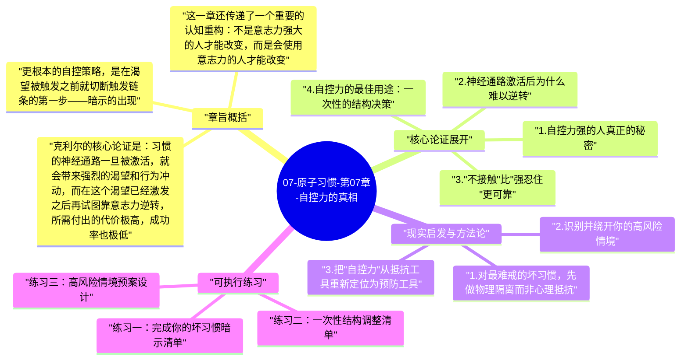

# 07-原子习惯-第07章-自控力的真相

关于自控力，社会上存在一个根深蒂固的叙事：意志力强的人能克服诱惑，意志力弱的人则一再失守。这个叙事把自我管理问题变成了人格问题，暗示那些无法抵抗诱惑的人天生就是软弱的。詹姆斯·克利尔在第七章有力地拆解了这个叙事。他引用了一系列研究指出，那些看起来最有自控力的人，并非每天都在进行激烈的内心对抗，他们真正的秘密在于：他们很少把自己置于需要高强度自控的情境之中。

这个发现有一个重要的反直觉含义：真正有效的自控不是"面对诱惑，忍住"，而是"预先设计，让诱惑少出现"。这意味着自控力的有效使用，不是一场持续的消耗战，而是一场预防性的架构设计。把自控力当做对抗诱惑的盾牌，是对一种有限资源的低效使用；把它用在改变情境结构上，让自己少进入高风险场景，才是真正聪明的应用方式。

第七章与第六章形成自然的延伸关系。第六章强调正向面：用环境设计让好习惯显而易见；第七章则强调负向面：用环境设计让坏习惯不可见。这两章共同完成了第一条法则的完整闭环，也为读者建立了一个清晰的认知：行为改变的杠杆点在情境结构，而不在意志力强度。

## 章旨概括

克利尔的核心论证是：习惯的神经通路一旦被激活，就会带来强烈的渴望和行为冲动，而在这个渴望已经激发之后再试图靠意志力逆转，所需付出的代价极高，成功率也极低。这就是为什么很多人明知道某件事有害却依然做了——不是因为他们不想抵抗，而是因为他们选择了在错误的时间点进行抵抗。一旦渴望的开关被打开，神经系统就已经调动了大量资源来驱动那个行为，此时的抵抗是以弱击强。

更根本的自控策略，是在渴望被触发之前就切断触发链条的第一步——暗示的出现。如果你没有接触到诱惑，渴望就不会产生；渴望不产生，反应就不会被驱动；反应不发生，坏习惯的神经通路就得不到强化。这就是为什么"让坏习惯不可见"比"面对坏习惯时努力克制"更有效，它在系统的上游就解决了问题。

这一章还传递了一个重要的认知重构：不是意志力强大的人才能改变，而是会使用意志力的人才能改变。有效地使用意志力意味着把它从日常消耗战中解放出来，将其集中用于最关键的结构性决策：今天要不要把那个app删掉？要不要去超市时不经过零食区？要不要告诉朋友自己不喝酒了？这些一次性的结构决策，比每次面对诱惑时的临场抵抗，对行为的长期影响要大得多。

## 核心论证展开

### 1. 自控力强的人真正的秘密

研究者威廉·霍夫曼（Wilhelm Hofmann）和他的团队对数百人进行了连续追踪研究，发现那些自我报告自控力强的人，并不是每天都在进行更激烈的内心对抗。恰恰相反，他们面临的诱惑冲突更少。原因不是诱惑找不上他们，而是他们的生活安排和习惯结构让他们自然地减少了接触诱惑的频率。他们不是在更努力地抵抗，而是更少进入需要抵抗的场景。

这个发现从根本上改变了我们应该如何思考自控力的培养问题。传统观点认为，通过不断抵抗诱惑可以像锻炼肌肉一样增强意志力。但如果高自控力者的策略是减少暴露，那么让自己反复暴露于诱惑然后努力抵抗，不只效率低下，还可能是错误的训练方向。真正需要培养的能力，不是抵抗力，而是预防性的情境安排能力。

### 2. 神经通路激活后为什么难以逆转

习惯的神经通路一旦被暗示激活，整个大脑的资源分配就开始向那个习惯倾斜：相关记忆被激活、预期奖励的多巴胺释放、注意力被导向执行路径。此时靠意志力逆转，相当于在高速行驶的列车上用手刹紧急制动。不是不可能，但需要极高的能量，且效果不稳定，因为列车（渴望的神经回路）依然有强大的惯性。

理解这个机制，能帮助人对自己的失控行为产生更客观的认知，而不只是自我责备。每次你在渴望已经激发的情况下"又没忍住"，这不只是意志力失守，这是生理机制在按预期运作。问题不在那个时刻的你不够坚强，问题在于你把自己放进了一个依赖意志力才能成功的高风险情境。更聪明的策略是，避免让自己到达那个高风险时刻。

### 3. "不接触"比"强忍住"更可靠

克利尔提出，最持久的自控不是每次都靠临场意志力克制欲望，而是预先切断接触诱惑的渠道。这在心理学上对应着一个重要的策略区分：情境选择（选择不进入诱惑环境）远比情境修改（进入了诱惑环境后再试图忽视它）更有效，而情境修改又远比注意力部署（身处诱惑中转移注意力）更有效。越早介入，代价越低，效果越稳。

在实践层面，这意味着一系列具体可执行的操作：从手机删除容易上瘾的app（而不是承诺每次看到它时都不点开）；去超市前先吃饱，并且严格按照购物清单采购（而不是靠在零食区的自制力）；在睡前把手机放到另一个房间充电（而不是每次拿到手机时都努力克制看的冲动）。这些操作的共同逻辑是：把意志力的使用从临场抵抗前移到结构设计，一次性决策换来持续的保护。

### 4. 自控力的最佳用途：一次性的结构决策

如果意志力是有限的，那么应该把它用在哪里？克利尔的答案是：用在那些一次性执行但能产生长期保护效果的结构决策上，而不是用在每天重复的诱惑抵抗上。这类决策包括：决定不在家里存放某种食物、决定删除某个app、决定在特定时间关闭手机通知、决定把工作设备和娱乐设备分开。每一个这样的一次性决策，都能为你后续数百次需要自控的时刻提供保护，这是意志力性价比最高的使用方式。

反过来，意志力性价比最低的使用方式，是在每次面对诱惑时临场发力。因为诱惑会反复出现，每次都需要消耗相当数量的意志力，而且成功率会随着意志力的耗尽而下降。把意志力用在这里，就像用一个容量有限的水桶去应对一场持续降雨，无论你怎么努力，最终都会溢出。把重要的结构决策做好，是给水桶加盖，从源头减少需要处理的水量。

### 5. 坏习惯的路径依赖性

坏习惯之所以难以戒除，不只是因为它满足某种深层需求（这是第十章的主题），还因为它具有强烈的路径依赖性：习惯的神经通路越走越顺，一个反复被激活的习惯回路会变得越来越敏感，越来越容易被触发，执行起来也越来越流畅。这就是为什么一个已经形成多年的坏习惯会感觉"几乎停不下来"，因为它的神经通路已经被磨得极为光滑。

克利尔指出，让坏习惯不可见的重要性还在于：每次坏习惯被触发，即便你最终抵抗了执行，但触发本身已经在激活和强化那条神经通路。也就是说，接触诱惑暗示本身，就已经在维持坏习惯的神经基础。减少接触频率，不只是减少行为发生的次数，也是减少神经通路被激活和强化的次数，从而让那条通路随时间逐渐弱化。

## 现实启发与方法论

### 1. 对最难戒的坏习惯，先做物理隔离而非心理抵抗

如果你有一个反复戒了又犯的坏习惯，停止把精力集中在"下次我要更努力忍"上，转而问自己：有什么方法可以减少我接触这个诱惑暗示的频率？对于刷手机，把手机放到另一个房间；对于抽烟，不在家里存放香烟；对于暴食，不在家里存放触发食物。这些措施不需要任何意志力来维持，它们只需要一次性的执行。用有限的意志力做一次性的结构调整，而不是用它每天参与无数次的诱惑对抗。

### 2. 识别并绕开你的高风险情境

每个人都有一些固定的高风险情境，某些时间、地点或社交环境会大幅提升坏习惯发生的概率。例如，深夜一个人在沙发上是大量刷手机的高风险情境；压力大的下午是冲动消费的高风险情境；特定的朋友聚会是过量饮酒的高风险情境。把这些情境识别出来，然后主动设计绕开或改变它们的方案，比在情境中随机发挥意志力要有效得多。情境识别不是为了回避生活，而是为了在最关键的地方提前做好防护设计。

### 3. 把"自控力"从抵抗工具重新定位为预防工具

重新定义你对自控力的使用策略：不再把它主要用于"在诱惑面前抵抗"，而是主要用于"在诱惑出现之前设计情境"。每周花一次自控力，思考本周哪些情境最可能触发你不想要的行为，然后做一个具体的预防性安排。这种元层面的自控，比对象层面的抵抗要有效和持久得多，因为它一次性地提升了整个系统的防护水平，而不是在每次战斗中重复消耗。

## 可执行练习

### 练习一：完成你的坏习惯暗示清单

选你最想戒掉的三个坏习惯，对每个习惯分别回答：它通常在什么情境下发生（时间、地点、状态）？触发它的最关键暗示是什么？根据这个分析，设计一个具体的暗示移除或阻断措施，使你接触到这个暗示的频率减少至少一半。把这三个措施写下来，在接下来两周内逐一实施，记录每个坏习惯的发生频率变化。

### 练习二：一次性结构调整清单

花十分钟，列出所有如果你现在做了、未来就不需要反复用意志力抵抗的一次性决定。这可以是删除某个app、把客厅电视拔掉、从购物清单里移除某种食物、在手机上设置应用使用时间限制、安排固定的"不使用手机时段"等。把这个清单列出来，然后在这一周内逐一落实。每完成一项，就是一次性地节省了未来大量的意志力消耗。

### 练习三：高风险情境预案设计

列出你每周最容易失控的三个场景，然后为每个场景写一个"如果-那么"预案："如果我发现自己在[高风险情境]，我将立刻[具体替代行为]。"预案越具体越好，不要写"我会努力控制自己"，而要写"我会立刻站起来倒一杯水"或"我会给自己设一个十分钟的计时器，计时结束前不打开那个app"。把这三个预案记在手机备忘录里，以便在高风险情境来临前能快速查看和激活。

---

## Mermaid 思维导图

### 图1

