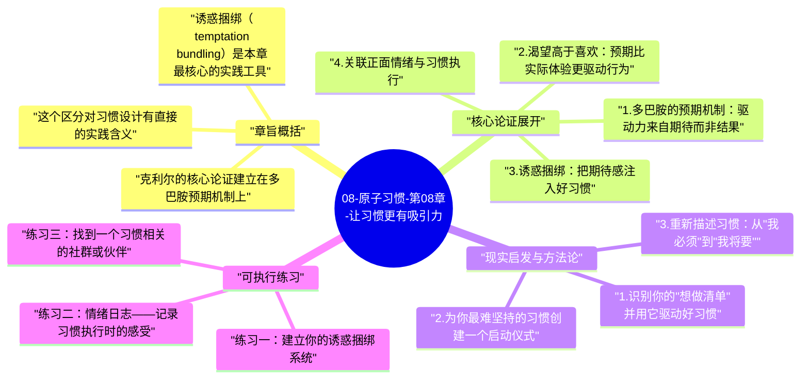

# 08-原子习惯-第08章-让习惯更有吸引力

如果一个好习惯从根本上让人感到无聊甚至厌倦，再好的触发系统也难以让它持续运转。詹姆斯·克利尔在第八章开启了第二条基本法则"让它有吸引力"，他在这一章揭示了一个深刻的神经科学事实：人们坚持做某件事，不是因为他们"应该"做，而是因为他们有某种期待想要满足。吸引力不是习惯的附加条件，而是习惯能否持续的核心驱动力之一。没有吸引力的习惯，会在每次执行时消耗你的意志力；有吸引力的习惯，则会在每次想到它时就产生一种期待的拉力。

这一章的神经科学基础来自于对多巴胺的研究。许多人以为多巴胺是"快感物质"，在行为完成后释放；但研究表明，多巴胺的释放高峰其实在行为预期阶段，也就是当你预见到即将到来的奖励时，多巴胺就已经大量分泌了。这意味着，人们真正被驱动去做某件事，是因为他们对那件事的结果有强烈的预期，而不只是因为实际结果有多好。正因如此，设计好习惯的吸引力，很大程度上是在设计预期体验，而不只是实际体验。

本章在全书的位置，是方法论框架的第二层展开。第一条法则（让它显而易见）解决的是行为是否被触发的问题；第二条法则（让它有吸引力）解决的是行为是否值得被期待的问题。一个被看见但不被期待的习惯，会面临执行时的持续阻力；一个既被看见又被期待的习惯，则会开始产生自发的驱动力。这种驱动力才是长期习惯得以维持的真正燃料。

## 章旨概括

克利尔的核心论证建立在多巴胺预期机制上。他引用了神经科学家肯特·贝里奇（Kent Berridge）的研究区分了"喜欢"（liking）和"渴望"（wanting）这两个概念。喜欢是在执行行为时体验到的实际愉悦感，渴望则是在行为开始前对那个愉悦感的预期。研究发现，是渴望（预期）而不是喜欢（实际体验）驱动了行为。这意味着，即便某件事实际执行起来并不那么让人愉快，如果它能产生强烈的预期感，它依然能推动人去做。

这个区分对习惯设计有直接的实践含义。很多好习惯之所以难以持续，不是因为执行本身很痛苦，而是因为在它们开始之前，你对它们没有任何期待感。每天读书、每天冥想、每天记录支出，这些习惯的实际体验并不坏，甚至可以相当好，但如果在执行之前脑子里没有任何值得期待的图像，行为就没有预期阶段的多巴胺推动，启动阻力就会保持很高。

诱惑捆绑（temptation bundling）是本章最核心的实践工具。它的逻辑是把你"想做的事"和"该做的事"配对：只在做某件不那么愉快的事情时，才允许自己做那件令人期待的事情。例如，只有在健身时才能听最喜欢的播客；只有在整理财务报告时才能喝那杯特别的咖啡。随着时间推移，大脑会开始把那件原本不够吸引人的事情，与那件令人期待的事情联系起来，前者会逐渐吸收后者的吸引力，从而变得更容易启动。

## 核心论证展开

### 1. 多巴胺的预期机制：驱动力来自期待而非结果

神经科学家的研究揭示，当大鼠学会预测食物何时到来时，多巴胺的释放高峰会从食物实际到来时前移至预测信号出现时。这意味着，驱动动物趋近行为的，是对奖励的预期，而不是奖励本身。在人类行为中，同样的机制运作：当你预见到即将到来的某种愉快体验，多巴胺就开始释放，这种释放产生了一种推动你去行动的欲望感。

这个机制解释了为什么人们会在开始某件事之前就感到兴奋，也解释了为什么习惯的吸引力不只是事后的满足感，更是事前的期待感。一个习惯如果在开始之前就能激活期待系统，它的启动阻力就会大幅降低，因为大脑已经在预期奖励，而预期奖励本身就是开始行动的燃料。这就是为什么让习惯有吸引力，不只是让执行过程更愉快，更重要的是让期待阶段充满正向信号。

### 2. 渴望高于喜欢：预期比实际体验更驱动行为

贝里奇的研究中有一个令人震惊的发现：即便科学家通过化学手段阻断了实验动物的"喜欢"系统（使得食物不再产生实际愉悦感），动物依然会努力获取食物。但是当"渴望"系统被阻断时，动物即便面前就有食物，也失去了获取的动力。这说明，是渴望（预期）而非喜欢（实际享受），在驱动着行为的发生。

对我们的日常习惯来说，这个发现意味着：你可能每次跑完步之后都感觉很好（喜欢），但如果你在跑步开始之前完全没有任何期待感（缺少渴望），你依然会面临每次启动时的高阻力。而一旦你能在跑步开始之前产生期待感——比如期待听播客、期待跑完后的那杯咖啡、期待追踪数据的满足感——跑步这件事就获得了预期阶段的多巴胺支持，启动就会变得容易得多。

### 3. 诱惑捆绑：把期待感注入好习惯

诱惑捆绑的操作逻辑非常清晰：识别你的"想做清单"（真正期待的活动）和"该做清单"（重要但不够吸引人的习惯），然后把它们配对：只在执行"该做清单"时，才允许自己享受"想做清单"中的内容。这个配对有两个效果：一是它立即为好习惯注入了预期奖励，让习惯执行前就有值得期待的内容；二是随着时间推移，"该做的事"和"想做的事"在大脑中形成关联，前者逐渐吸收后者的正向情绪色彩，变得本身更有吸引力。

诱惑捆绑的设计要注意两点。第一，配对必须真实——被绑定的"想做的事"必须是你真正期待的，否则捆绑没有驱动力。第二，规则要坚守——"想做的事"只在做"该做的事"时才享受，如果允许在任何时候随意享受，捆绑的效果就会消失，因为"该做的事"失去了独特的奖励优势。这两点是诱惑捆绑能否真正发挥作用的关键条件。

### 4. 关联正面情绪与习惯执行

除了诱惑捆绑这种外部捆绑方式，克利尔还提到了一种更内在的方法：通过有意识地在习惯执行时创造正面情绪联想，逐渐改变大脑对这个习惯的情绪评价。这不是靠欺骗自己，而是通过反复的正面联想，让习惯本身开始变得更具吸引力。

具体做法包括：在开始执行习惯前，做一个简短的启动仪式，比如泡一杯喜欢的茶、播放一首喜欢的曲子；在执行时，有意识地关注任何令你满意的细节，而不是关注枯燥的部分；在完成后，进行简短的庆祝或确认（即便只是在心里说"很好，我做到了"）。这些小动作在神经层面持续地为习惯执行建立正面情绪标签，随着重复，这些标签会逐渐成为习惯触发时的一部分预期场景。

### 5. 社会影响力对吸引力的放大作用

克利尔还指出，习惯的吸引力不只来自个人内心的期待，也来自社会认同的驱动。当一个习惯与某个你认同的群体的行为相关联，或者当执行这个习惯能获得你所在社群的认可时，它的吸引力会大幅提升。这是因为人类的社会需求（归属感、被认可）是非常强大的动力源，当好习惯能同时满足这些需求时，它就有了多重驱动力的加持。

这一点对于那些觉得好习惯"枯燥无聊"的人来说是一个重要的实践方向：找到一个与你目标习惯相关的社群，把习惯执行变成社群参与的一部分。在健身社群里，坚持运动不只是为了健康，也是为了归属感；在阅读小组里，每天读书不只是为了知识，也是为了能参与讨论。社会维度为习惯注入了超越个人利益的吸引力，这往往是在个人内在驱动力减弱时，习惯能够继续维持的重要支撑。

## 现实启发与方法论

### 1. 识别你的"想做清单"并用它驱动好习惯

花几分钟，列出你每天最期待的五到十件事，无论大小——可以是一首歌、一种饮料、一个节目、一项活动。然后把这张清单与你想建立的好习惯对应，为每个好习惯配一个"想做的事"作为捆绑奖励。只在执行好习惯时才享受那个捆绑奖励。这种设计不是在奖励自己，而是在为好习惯建立预期感，让它在开始之前就有值得期待的东西。

### 2. 为你最难坚持的习惯创建一个启动仪式

选出你最难启动的一个好习惯，为它设计一个简短（一到两分钟）的启动仪式：可以是一个固定的肢体动作、一段特定的音乐、一杯特定的饮料，或者几次深呼吸。在接下来的四周里，每次执行这个习惯前都先进行这个仪式。仪式本身会逐渐成为习惯的暗示，同时它也会把"开始"这个动作与特定的正面体验联结起来，降低每次启动时的心理阻力。

### 3. 重新描述习惯：从"我必须"到"我将要"

语言是构建情绪体验的工具。当你对自己说"我必须去运动"时，大脑会把它注册为一种负担；当你说"我将要去运动"时，语言语气的细微变化会带来轻微但真实的情绪转变。克利尔建议，把所有关于好习惯的自我叙述，从"必须/应该"改成"将要/想要"，把习惯描述为一种机会而不是义务。这不是自我欺骗，而是一种有意识的情绪引导，帮助大脑逐渐把好习惯注册为期待的事而不是被迫的事。

## 可执行练习

### 练习一：建立你的诱惑捆绑系统

列出三个你想建立的好习惯，以及你每天最享受的三件事。把它们配对，建立"只有在做[好习惯]时，我才可以做[享受的事]"的规则。在手机里设置一个提醒，在每次好习惯执行的时间到来时，同时提醒你激活捆绑奖励。坚持两周，每天记录执行情况，以及那个捆绑奖励是否真的提升了你对好习惯的期待感。

### 练习二：情绪日志——记录习惯执行时的感受

在接下来两周内，每次完成一个核心习惯后，用一到两句话记录你在执行时和执行后的情绪状态。不要评判，只是观察。两周后，回看这些记录，找出哪些习惯执行后的感受是正面的（即便过程枯燥），然后把这些正面感受在下次执行前就提前想一遍。用实际的情绪记录来构建更真实的预期，比空想"这对我有好处"更能激活预期系统。

### 练习三：找到一个习惯相关的社群或伙伴

选择你最想坚持的一个习惯，主动寻找一个与之相关的社群、小组或伙伴，哪怕只是一个也在做同样事情的朋友。约定每周分享各自的执行情况。社交维度为习惯注入了归属感和被认可的预期，这两种感受在动力不足时，往往比任何个人策略更能提供启动能量。习惯在孤独中容易枯萎，在社群中容易生长。

---

## Mermaid 思维导图

### 图1

