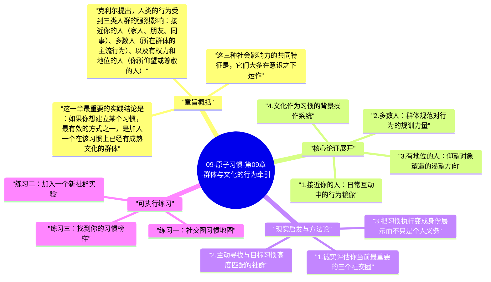

# 09-原子习惯-第09章-群体与文化的行为牵引

我们通常把习惯理解为个人的事情，是内心状态和个人意志的产物。但詹姆斯·克利尔在第九章揭示了一个我们往往低估的力量：你所在的群体和文化，对你的行为有着深远而持续的塑造作用。这种塑造不是通过明确的规则或命令发生的，而是通过社会规范、群体期望和可见的榜样行为，悄无声息地定义着什么是"正常的"、什么是"值得的"、什么是"人们在这里该做的事"。这些隐性定义渗透在日常环境里，持续地推动着人的行为，无论你是否意识到它的存在。

克利尔的核心论点是：人是社会动物，我们的大脑对归属感有深层的渴望。这种渴望驱动着我们去模仿、去适应、去融入。当一个习惯被你所在的群体视为正常甚至值得尊敬时，它就拥有了远超个人意志力的驱动力——因为执行它不只是在满足个人目标，也是在维护和加深你的群体归属感。反过来，当你的目标行为与你所在文化的默认模式背道而驰时，即便你个人动力充足，你也会持续面临来自社会规范的阻力，而这种阻力是隐性的但极为持久的。

本章在全书的位置是对第二条法则"让它有吸引力"的延伸深化。第八章讨论的是如何通过个人体验的设计增强习惯的吸引力，第九章则揭示了另一个维度的吸引力：社会认同和群体归属感。这两个层面的吸引力加在一起，才构成了一个完整的习惯驱动力图景。忽视社会维度，等于只用了一半的力量。

## 章旨概括

克利尔提出，人类的行为受到三类人群的强烈影响：接近你的人（家人、朋友、同事）、多数人（所在群体的主流行为）、以及有权力和地位的人（你所仰望或尊敬的人）。这三类人群都通过不同的机制影响着你的习惯：接近你的人通过日常互动提供持续的模仿素材和反馈；多数人通过设定"正常标准"让偏离显得怪异；有地位的人则提供了一种渴望成为的榜样形象。

这三种社会影响力的共同特征是，它们大多在意识之下运作。你不会主动意识到自己在模仿朋友的饮食习惯，不会意识到你的工作时长被办公室文化所定义，不会意识到你对某种生活方式的渴望来自于对某个你仰慕的人的效仿。但这些影响是真实的、持续的，并且在很多情况下，比你自己的理性计划更能决定你的实际行为。认识到这一点，不是为了感到无力，而是为了能主动地选择让哪种社会影响力来支持你的目标。

这一章最重要的实践结论是：如果你想建立某个习惯，最有效的方式之一，是加入一个在该习惯上已经有成熟文化的群体。在那个群体里，你想要的行为是默认的、被期待的、被认可的；在那个群体里，做这件事不需要解释，不做才需要解释。这种文化背景为习惯提供了无需消耗个人意志力就能持续获得的社会驱动力。

## 核心论证展开

### 1. 接近你的人：日常互动中的行为镜像

人类天生具有镜像学习的能力。我们从出生起就通过观察、模仿和跟随来习得行为模式。这种能力在成人阶段并没有消失，它只是变得更加无意识。你最常接触的人，他们的习惯、态度和行为节奏，会在潜移默化中成为你的参照系。如果你的家人习惯晚睡，你保持早睡就需要持续对抗环境压力；如果你的朋友圈里人人都定期健身，你开始健身就会感到更自然，因为它是"这个圈子里的人做的事"。

这种影响的强度，在一项著名的社会学研究中得到了清晰的呈现：当你的直接朋友肥胖时，你自己变得肥胖的概率会上升约45%；而当朋友的朋友肥胖时，这个概率依然上升约10%，即便你从未见过那个人。这说明，社会影响力是通过网络传播的，而不只是通过直接接触。在实践层面，这意味着你的社交圈不只是你生活的背景，它实实在在地参与塑造了你是谁、你做什么。

### 2. 多数人：群体规范对行为的规训力量

当一个群体的多数成员都在做某件事时，这件事就获得了一种强大的"正常性背书"。正常性是行为的最强驱动力之一，因为违背正常性需要主动解释自己，而符合正常性则完全不需要任何理由。当你所在的工作环境里大家都在十一点后下班，早早离开就需要承受不合群的压力；当你所在的社交圈里大家都在大量消费，节制反而显得奇怪。

这种群体规范的力量，解释了为什么很多人在换了一个环境之后，行为会发生意想不到的快速改变。进入一所以自律著称的学校，很多原本散漫的学生会逐渐变得更勤奋，不是因为他们突然改变了内心，而是因为他们周围的人改变了"正常行为"的定义。这种效应的反面也同样真实：进入一个低效的团队，原本高效的人往往也会逐渐降低标准，即便他们完全没有这种意识。

### 3. 有地位的人：仰望对象塑造的渴望方向

人类不只模仿身边的人，也模仿那些在社会结构中处于更高地位的人。这种向上模仿有一个进化逻辑：观察成功者的行为策略，是提升自己生存和发展机会的捷径。在现代社会，这种机制体现为：人们会渴望拥有他们仰慕之人的生活方式、思维习惯和行为模式。一个年轻人仰慕某位创业者，他可能会开始模仿那个人的阅读量、工作节奏和自我反思习惯，不是因为被要求，而是因为"成为那种人"本身就具有强烈的吸引力。

这种向上模仿机制可以被有意识地利用。如果你想建立某个习惯，找到一个拥有这个习惯并且你真心仰望的人，把他的相关言行作为参照。这不是简单的偶像崇拜，而是一种身份图像的借用：通过关注那个人在习惯上的样子，你在为自己构建一个"我想成为的那种人"的具体形象。当这个形象足够清晰，它会持续激活你的渴望系统，为习惯执行提供方向感和动力。

### 4. 文化作为习惯的背景操作系统

文化是所有社会影响力的集成背景。它不只是某些人的行为，而是整个群体对"什么是正常、正确、值得的"的集体共识，并且这种共识会通过语言、仪式、奖惩机制和日常互动持续地再生产和强化。文化的影响是无处不在的，而正因为无处不在，它才最容易被忽视。你不会意识到某种工作文化在推动你加班，因为"大家都是这样的"；你不会意识到某种消费文化在影响你的购物决策，因为"这就是正常的生活方式"。

克利尔的主张是，文化可以成为习惯最强大的盟友，也可以成为习惯最顽固的阻力。关键在于，你选择把自己置身于什么样的文化背景中。如果你想要的习惯恰好与某个群体的文化高度吻合，你就拥有了文化这个无形的助推力；如果你想要的习惯与你所在文化格格不入，你就在用个人意志力对抗一个持续运作的社会力场。明智的选择是，尽可能让你的目标习惯和文化背景处于同一方向。

### 5. 主动选择你的文化背景

认识到文化和群体的力量，最重要的实践含义是：你可以主动选择把自己置身于什么样的文化背景中，从而让社会力量成为习惯建立的助力而非阻力。这不意味着要抛弃现有的所有关系，而是意味着要有意识地寻找和加入那些你希望行为向之靠拢的群体。线下的俱乐部、社团、工作坊，线上的社群、论坛、学习群组，都是建立新文化背景的可能入口。

克利尔特别指出，当你加入一个把某个好习惯视为默认规范的群体时，有几件事会同时发生：执行那个习惯的社会摩擦减少了（不需要解释和说服自己）；不执行的社会代价增加了（可能感到与群体脱节）；你开始接触到更多与那个习惯相关的信息、技巧和支持；而且你的身份认同会逐渐向这个群体靠拢。这四种效应叠加起来，会为习惯提供远超个人努力所能产生的推动力。

## 现实启发与方法论

### 1. 诚实评估你当前最重要的三个社交圈

把你每周花最多时间相处的五到十个人写下来，然后想想他们各自最显著的行为习惯是什么。这些习惯里有多少是你想要强化的，有多少是你想要避免的？这个评估不是为了批判任何人，而是为了清楚地看见你的社交环境正在对你施加什么样的引力。如果你发现某个重要圈子里主流的行为模式与你的目标方向相反，这是一个值得认真对待的信息，它可能比你的个人意志力更能决定你的实际行为走向。

### 2. 主动寻找与目标习惯高度匹配的社群

对于你最难坚持的一个好习惯，主动找到一个以这个行为为核心的社群。不要等到你"足够好了"再加入，在起点就加入才能最大化地利用文化效应。在这个社群里，你的习惯是被期待的，而不是需要被解释的。哪怕一开始你感到格格不入，这种不适感会随着参与的深入而消退，而在那之后，群体规范会开始为你的习惯提供持续的社会支撑。

### 3. 把习惯执行变成身份展示而不只是个人义务

当一个习惯与你的群体身份联系起来，它就从个人义务变成了群体表达。每次执行那个习惯，不只是在为自己做事，也是在表达"我是这个群体的一员"。这种身份与习惯的双向强化，会让习惯在群体背景中变得更加自然和持久。想建立这种连接，可以主动在所在社群中分享自己的习惯执行情况，让习惯执行具有社会可见性，从而激活群体认可对习惯的强化作用。

## 可执行练习

### 练习一：社交圈习惯地图

制作一张"社交圈习惯地图"：列出你的主要社交圈（家庭圈、工作圈、朋友圈），在每个圈子旁边写出这个圈子里最显著的三个行为规范。然后对每条规范标注：它在推动你向目标前进还是偏离？这张地图会给你一个清晰的社会环境视图，让你能更有意识地决定在哪些圈子里增加投入、在哪些圈子的影响中建立更清晰的边界。

### 练习二：加入一个新社群实验

选出你最想建立的一个习惯，在接下来两周内找到至少一个与这个习惯相关的社群并主动参与（线上或线下均可）。参与方式不需要复杂，可以只是在社群里定期报告自己的执行情况，或者阅读他人的分享。两周后，评估这种社群参与是否改变了你对这个习惯的感受——特别是，在这个社群里执行这个习惯是否比在没有社群背景时感觉更自然、更有意义？

### 练习三：找到你的习惯榜样

选择一个你真心仰望的人，他或她具备你想建立的习惯，并且在这个习惯上有公开的记录或分享（比如博客、视频、书籍、访谈）。花两周时间深入了解这个人在这个习惯上的实践方式、坚持逻辑和对它的意义表达。这个了解过程会帮助你构建一个更具体的"我想成为的那种人"的形象，并且为你的习惯执行提供一种来自仰望对象的隐性认可感，这种感觉比单纯的自我督促更能激活行动动力。

---

## Mermaid 思维导图

### 图1

