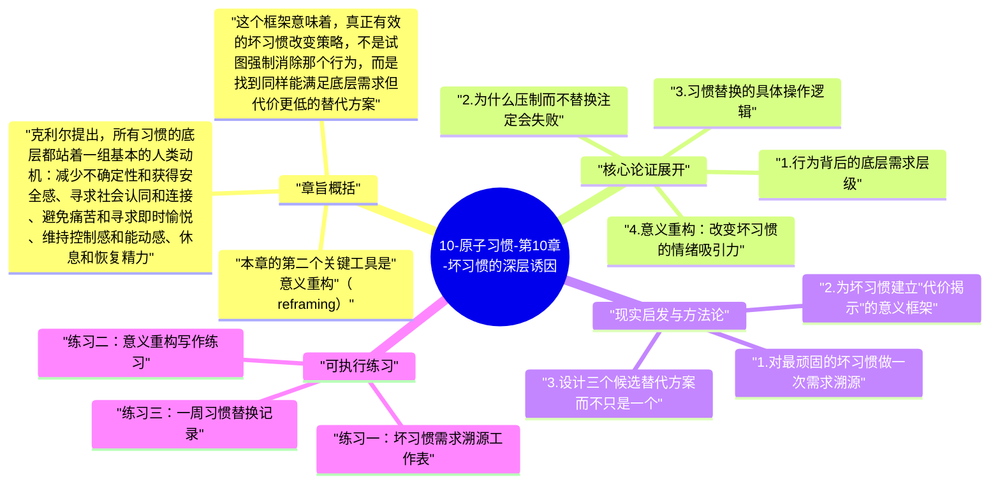

# 10-原子习惯-第10章-坏习惯的深层诱因

为什么有些坏习惯如此难以戒除，即便你完全清楚它们有害？这个问题的表面答案是：因为它们带来快感。但詹姆斯·克利尔在第十章提供了一个更深层的答案：坏习惯之所以难以撼动，不只是因为它们令人愉快，而是因为它们在满足某种更根本的人类需求。这些需求——安全感、放松、归属感、控制感、即时的满足——是进化塑造的深层驱动力，它们不会因为你知道某个行为有害就消失。坏习惯的顽固性，根植于它们作为"解决方案"的有效性：它们虽然不是最好的解决方案，但它们是当下可得的、快速的、可预测的解决方案。

克利尔的论点有一个重要的解放意义。当你反复陷入某个坏习惯时，这不是因为你在道德上软弱或在人格上有缺陷，而是因为你有一种真实的需求，而这个习惯恰好提供了满足那种需求的一条路径，尽管是有代价的路径。理解这一点，能帮助你把对自己的评判从"为什么我总是这样"转换到"这个行为在试图满足什么"，从而找到更根本的干预点。

本章是第二条法则"让它有吸引力"的逆向应用。前面的章节讨论如何让好习惯更有吸引力；本章则讨论如何让坏习惯变得不那么吸引人。克利尔的策略不是压制欲望——这几乎注定会失败——而是通过理解欲望的真正来源，找到更好的满足途径，同时重新定义坏习惯的意义，让它的吸引力从情绪层面开始瓦解。

## 章旨概括

克利尔提出，所有习惯的底层都站着一组基本的人类动机：减少不确定性和获得安全感、寻求社会认同和连接、避免痛苦和寻求即时愉悦、维持控制感和能动感、休息和恢复精力。这些动机没有好坏之分，它们是人类作为进化产物的基本需求。问题在于，现代环境提供了大量能以廉价方式暂时满足这些需求的选项（社交媒体满足连接需求、垃圾食品满足即时愉悦需求、过度消费满足控制感），而这些廉价满足往往带有代价，并且无法真正解决需求，只是暂时压制了它。

这个框架意味着，真正有效的坏习惯改变策略，不是试图强制消除那个行为，而是找到同样能满足底层需求但代价更低的替代方案。克利尔称此为"习惯替换"：不是在坏习惯和什么都不做之间选择，而是在坏习惯和更好的替代方案之间选择。替代方案必须能真实地满足那个底层需求，否则它终究无法取代原有行为，因为需求会持续地推动大脑去寻找满足它的路径。

本章的第二个关键工具是"意义重构"（reframing）。克利尔指出，我们对习惯的情绪体验，很大程度上取决于我们用什么框架来解释它。同样的行为，被描述为"我必须"会产生压力感，被描述为"我将要"会产生自主感；同样的习惯，被关联到负面意义（戒烟是因为身体状况很差）和正面意义（戒烟是因为我重视健康）会产生截然不同的情绪体验。通过有意识地为坏习惯附加不吸引人的意义框架，可以从情绪层面降低它的吸引力。

## 核心论证展开

### 1. 行为背后的底层需求层级

克利尔借鉴了人类学家爱德华·霍尔（Edward Hall）和进化心理学的研究，提出人类的行为都在试图满足一组稳定的底层需求。这些需求包括：节约能量（大脑倾向于选择最省力的路径）、获得食物和水（基本生存需求）、寻找安全（避免危险和不确定）、繁殖后代（交配和社交连接）、与社群融合（归属感和被接纳）、获得社会地位（被尊重和被认可）。这些需求在进化中被固化，不会因为文明的进步而消失。

理解这个层级的重要性在于：当一个坏习惯反复出现，背后必然有一个真实的底层需求在驱动。暴食通常不只是因为食物好吃，而是因为它提供了即时愉悦、短暂逃避压力或对放松的满足；酗酒通常不只是因为酒的味道，而是因为它提供了放松、连接或麻痹不适情绪的功能；购物成瘾通常不只是因为喜欢东西，而是因为它提供了控制感、期待感或对现状无力感的暂时抵消。识别这个底层需求，是找到有效替代方案的第一步。

### 2. 为什么压制而不替换注定会失败

很多人戒坏习惯的方式是单纯的抑制：我不应该做这件事，我要靠意志力不做它。这种方式短期内可能有效，但长期来看几乎注定失败。原因在于，压制只处理了行为（反应层），却没有处理驱动行为的需求（渴望层）。被压制的需求会以更强的强度回来，或者以另一种形式找到出口——这就是为什么戒掉一个坏习惯的人，常常会发展出另一个坏习惯。

心理学中有一个著名的"白熊实验"：当被要求"不要想白熊"时，人反而会更频繁地想到白熊。这种反弹效应揭示了直接抑制的低效性。更有效的策略是"接受并替换"：不是压制需求，而是承认它的存在，然后找到一个更好的满足途径。当那个更好的替代方案能真正满足底层需求时，旧行为会因为失去需求支撑而逐渐变得不那么有吸引力。

### 3. 习惯替换的具体操作逻辑

习惯替换的操作分为三步：首先，准确识别坏习惯正在满足的底层需求；其次，设计一个能满足同一需求但代价更低的替代行为；最后，在原有暗示出现时，用替代行为代替旧反应。这三步听起来简单，但每一步都需要认真思考，尤其是第一步——底层需求的准确识别，因为这一步最容易被表面解释所掩盖。

例如，一个每天下午三点去买甜食的人，他的坏习惯表面上是嗜糖，但底层需求可能是：缓解下午的工作疲惫、短暂脱离工作、获得一个小的愉悦奖励。一旦识别出这是"短暂的休息和奖励"需求，替代方案就可以是：下午三点离开工位做五分钟散步，或者泡一杯有仪式感的茶。这个替代方案的成立条件是，它必须真实地提供那种"短暂脱离和愉悦"的体验，否则它终将无法竞争过甜食的即时快感。

### 4. 意义重构：改变坏习惯的情绪吸引力

坏习惯的吸引力有一部分来自于我们对它的意义框架。克利尔提出，可以通过重新定义习惯的意义来改变它的情绪体验。这种策略不是靠理性说服（告诉自己这不好），而是通过改变与习惯相关的叙事框架来产生情绪层面的变化。

一个具体的例子：许多人把运动框架为"痛苦的义务"，把它和乏味、身体不适联系在一起。如果把框架换成"这是我给身体充电的方式"或"这是唯一属于我自己的时段"，同样的行为就会产生截然不同的情绪体验。反过来，对于坏习惯，可以为它建立一个揭示代价的意义框架：不是"刷手机是放松"，而是"刷手机是用未来的注意力换取当下的麻木感"。这种重新描述不会立刻消除诱惑，但它会逐渐为坏习惯附加一种认知上的"代价感"，让它的净吸引力随时间缓慢下降。

### 5. 理解而非评判：改变坏习惯的正确起点

克利尔在本章有一个反复出现的底层姿态：对坏习惯的理解，比对它的评判更有用。当你把坏习惯视为"我的软弱和失败"，你就关闭了理解它的空间；当你把它视为"大脑在试图解决某个真实问题，只是方式不太好"，你就打开了探索更好解决方案的可能性。理解不等于接受，也不等于放弃改变，而是为改变提供了一个更清醒、更有洞察力的出发点。

这种态度转变也有直接的神经科学支持。自我批评和羞愧感会激活大脑的威胁反应系统，而在威胁模式下，大脑实际上更难做出理性的行为选择，更容易回到已经固化的旧模式。自我理解和自我慈悲（self-compassion）则能激活大脑的探索模式，在这种模式下，人更能够思考替代方案和长期策略。改变坏习惯，需要的不是更严厉的自我批评，而是更清醒的自我理解。

## 现实启发与方法论

### 1. 对最顽固的坏习惯做一次需求溯源

选出你最难改变的一个坏习惯，然后在纸上认真回答这几个问题：这个习惯在我感到什么状态的时候最容易发生？我做这件事的时候，在意识层面和无意识层面期待得到什么感受？这件事结束后，我实际的感受和期待的感受有多大差距？通过这几个问题，你通常能够识别出这个习惯正在服务的底层需求。识别出来之后，就可以开始思考：有没有其他方式能提供同样的满足，但代价更小？

### 2. 为坏习惯建立"代价揭示"的意义框架

对于你最想戒掉的坏习惯，写一段话，描述它每次发生时真实的代价：不只是长期的健康或时间代价，也包括每次执行后的即时感受变化——那种执行完毕后的平静是真实的放松，还是只是短暂的麻木之后又回到了原有的不适？把这段话打印出来或写在便利贴上，贴在你容易触发这个习惯的场景附近。这个"代价揭示框架"的目的不是靠理性说服，而是通过反复提醒，让坏习惯的意义从"解决问题"逐渐重塑为"制造问题"。

### 3. 设计三个候选替代方案而不只是一个

很多习惯替换失败的原因是只设计了一个替代方案，当这个方案因为各种原因无法执行时，就回归旧习惯。更稳健的做法是为每个坏习惯设计三个候选替代方案，覆盖不同的情境和状态：一个高意愿版（状态好时）、一个中意愿版（状态一般时）、一个低门槛版（状态很差时）。这样，即便你在最疲惫或最低落的时刻，也有一个几乎不需要意志力就能执行的替代选项，而不是面对"要么旧习惯要么强忍"的二元选择。

## 可执行练习

### 练习一：坏习惯需求溯源工作表

制作一份工作表，分三列：坏习惯名称、触发情境描述、底层需求猜测。对你最想戒掉的三个坏习惯逐一填写。然后在"底层需求猜测"栏旁边增加一列：已有的能满足同一需求的更健康行为。完成后，选出一个你认为最容易从中做出改变的行，优先实施习惯替换实验。从最有把握的一个开始，成功一次会提升你对整个策略的信心。

### 练习二：意义重构写作练习

找一个你反复陷入的坏习惯，用两种方式各写一段话：第一段，用最诚实的语言描述这个习惯真正带给你的感受（包括执行后的感受，不只是执行中的快感）；第二段，描述如果你把这段时间和精力用在替代行为上，你会得到什么样的感受。把这两段话并排放在一起，反复阅读。目的不是压制旧习惯的吸引力，而是让你在触发时能同时看到两个版本的真实代价与收益，从而做出更清醒的选择。

### 练习三：一周习惯替换记录

选出一个坏习惯和它对应的替代方案，在接下来一周内，每次坏习惯被触发时，尝试执行替代方案而不是原有行为。每次执行替代方案后，用一到两句话记录：这个替代方案是否真的满足了你当时的那个需求？满足程度如何（0-10分）？一周后，根据这些记录评估替代方案的有效性。如果满足程度持续低于5分，说明替代方案没有真正击中底层需求，需要重新设计；如果持续高于6分，这个替代方案就有成为新习惯的潜力。

---

## Mermaid 思维导图

### 图1

