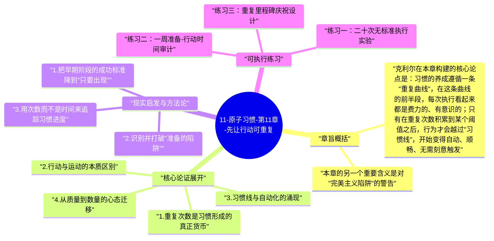

# 11-原子习惯-第11章-先让行动可重复

第三定律"让它变简单"的核心洞见并不是告诉人们要把事情做得更轻松，而是揭示了一个更根本的真相：习惯的形成取决于重复的次数，而不是单次执行的质量。詹姆斯·克利尔在第十一章一开始就用一个摄影课的经典实验说明这个道理——一组学生被要求在学期末提交数量最多的照片，另一组被要求只提交一张最完美的照片；学期结束后，照片质量最高的反而来自数量组。原因很简单：数量组的学生在拍了几百张照片的过程中，不断发现问题、调整技术，逐渐变得越来越好；而质量组的学生大部分时间都花在构思和准备上，真正按下快门的机会少之又少。

这个实验触达了一个反直觉的真理：在习惯建立的早期阶段，行动的质量远不如行动的频率重要。很多人在开始一项新习惯时，会把大量精力投入到如何把事情做到最好，于是反复推敲计划、研究方案、购置装备，但真正开始实践的时间却一再推迟。克利尔将这种状态称为"处于运动"（being in motion）而非"真正行动"（taking action）——处于运动是在准备、计划和学习，感觉有所为但实际上没有产出；真正行动才会触发反馈、形成重复、沉淀为习惯。问题在于，处于运动能给人一种进步的错觉，却不会真正推进习惯的神经编码。

从神经科学的角度来看，习惯的形成是大脑对特定行为路径不断强化的结果。每一次重复，神经元之间的突触连接都会略微加强，这个过程被形象地称为"髓鞘化"——相关神经回路外层包裹的髓鞘越来越厚，信号传递越来越快，行为也就越来越自动。这意味着，习惯不是在某个特定的时间节点突然形成的，而是在每一次重复中一点一点被编织进去的。重复的总次数，而不是时间的长短，才是习惯形成的真正货币。这一章的论点直接挑战了那种认为习惯需要完美执行才算数的执念，并用这个神经机制的理解来解放读者：先做，做到，再优化。

## 章旨概括

克利尔在本章构建的核心论点是：习惯的养成遵循一条"重复曲线"，在这条曲线的前半段，每次执行看起来都是费力的、有意识的；只有在重复次数积累到某个阈值之后，行为才会越过"习惯线"，开始变得自动、顺畅、无需刻意触发。这条曲线的斜率因人因习惯而异，但普遍规律是一致的：没有重复，就没有自动化；没有自动化，就没有真正意义上的习惯。因此，任何试图跳过重复阶段直接进入自动化状态的努力，都是一种对习惯形成机制的误解。

本章的另一个重要含义是对"完美主义陷阱"的警告。完美主义往往以"我要等准备好再开始"的面目出现，其本质是一种回避机制——通过无休止的准备来推迟真正行动所带来的不确定性和可能的失败感。克利尔指出，这种心态在习惯建立的语境中尤其有害，因为它系统性地减少了重复的机会，而重复恰恰是习惯形成的唯一路径。真正有效的习惯建立者，会接受早期阶段的粗糙和不完美，把每一次不完美的执行都视为一次神经回路的加固，而不是一次需要等到更好状态才能进行的高风险考试。

## 核心论证展开

### 1. 重复次数是习惯形成的真正货币

克利尔明确区分了两种对习惯进度的衡量方式：一种是以时间为单位（"我已经坚持这个习惯三周了"），另一种是以次数为单位（"我已经做了这个动作四十次了"）。研究表明，后者更能准确预测习惯的形成程度。时间本身不形成习惯，时间里发生的重复才形成习惯。因此，如果一个人每天重复一次，和另一个人每天重复三次，同样经过一个月，他们的习惯形成程度是截然不同的——不是差一倍，而是由于神经强化的非线性效应，差距可能更大。

这一洞见有直接的实践含义：在习惯建立的早期，最重要的目标不是做得多好，而是做得多频繁。对于一个想养成写作习惯的人，每天写一段破碎不完整的文字，远比每周精心写出一篇完整文章更有利于习惯的形成，因为前者积累的重复次数更高，神经回路的强化更充分。这一认知能帮助人们重新定义早期阶段的"成功"——不是今天写出了多少好的内容，而是今天是否坐下来写了。

### 2. 行动与运动的本质区别

"处于运动"和"真正行动"是本章最有价值的概念区分之一。处于运动的人在做研究、制定计划、参加课程、订阅播客——这些事情感觉有用，但它们只是准备，不是习惯本身的执行。真正行动才会触发实际结果：写字、跑步、练习、创作。克利尔并不否认准备的价值，但他指出，处于运动在心理上有一种欺骗性——它让人感觉自己在前进，从而减弱了立刻行动的紧迫感，而实际上它并没有增加重复次数，也就没有推进习惯的神经编码。

更深层的问题是，处于运动往往是一种精心伪装的回避策略。计划永远还有可以更完善的地方，研究永远还有可以更深入的维度，因此一个本质上在逃避行动的人，可以无限期地以"还没准备好"为由推迟真正的执行。打破这个陷阱的方法只有一个：把"开始行动"的条件设定得极低，低到不需要任何准备就能立刻执行，然后行动起来，哪怕今天的执行质量很差。第一次糟糕的执行，比第一百次完美的计划，更能推进习惯的形成。

### 3. 习惯线与自动化的涌现

习惯形成的过程不是线性的，而是有一个明显的相变点——克利尔将其比喻为"习惯线"。在习惯线之前，每次执行都需要意识参与、需要做决定、需要一定程度的意志力；在习惯线之后，行为开始越来越多地发生在意识层面之下，触发变得自然，执行变得顺畅，维持变得不再费力。这个相变不是突然发生的——它是无数次重复悄悄积累的结果在某个时刻的集中显现，就像水在99℃时还是液态，到100℃却突然沸腾，但实际上分子运动早就在一步步加速。

理解习惯线的存在，能帮助人们在早期阶段保持耐心。很多人在重复了几周之后，发现习惯仍然需要努力维持，就开始怀疑这个习惯是否适合自己，或者这个方法是否有效。但实际上，他们只是还没有到达习惯线，只要继续重复，自动化终将到来。困难期不是失败的信号，而是还在习惯线之前的正常状态，是每一个习惯建立者必须经过的必要阶段。最危险的时刻，恰恰是在习惯线刚刚触手可及之前的那个阶段——因为感觉还是费力的，所以很容易在这里放弃。

### 4. 从质量到数量的心态迁移

这章对大多数人的最大冲击，是要求他们在习惯建立的早期阶段主动放弃对质量的执念。这对于追求卓越、习惯以高标准要求自己的人来说，在心理上是反直觉甚至反舒适区的。但克利尔的论点非常清晰：你可以有高标准，但高标准必须在足够的重复之后才能实现；如果你在还没有建立重复基础的时候就强迫自己达到高标准，结果往往是频繁失败、挫败感累积，最终放弃习惯本身。正确的顺序是：先建立重复（数量），再在重复中提升（质量）。

具体来说，这意味着在习惯建立的最初阶段，对自己的要求应该只有一个：做到。不是做好，不是做完整，只是做到——出现了，完成了基本动作，打上勾。这种"只要出现就算赢"的心态，会显著降低习惯的执行门槛，从而保证重复的频率。随着时间推移和重复次数的增加，你自然会发现自己开始关注如何做得更好，因为在那个阶段，行为已经足够自动，认知资源可以开始分配给质量的提升，而不是消耗在启动的挣扎上。

### 5. 长期重复与习惯身份的深化

本章还有一个隐含的主题与全书的身份认同理论相呼应：每一次重复，不只是在强化神经回路，也在强化一个关于"我是谁"的自我叙事。每次你坐下来写，你就在向自己证明"我是一个写作者"；每次你穿上跑鞋出门，你就在强化"我是一个跑步者"的身份认同。重复的累积，因此有双重效果：一方面让行为越来越自动，另一方面让身份越来越稳固。这两个效果相互强化——越来越稳固的身份认同会让你更难容忍不执行习惯，而越来越自动的行为又让执行变得越来越轻松。

这个双重强化效应意味着，早期的重复在某种程度上是"最贵的"——不是因为它们最费力，而是因为它们奠定了整个系统运转的基础。如果一个人在早期阶段放弃了，不只是失去了几次重复，而是失去了整个身份认同建立的起点。相反，那些在早期阶段即便质量很差也坚持重复的人，实际上是在做一种高回报的投资——他们正在同时积累神经习惯路径和自我身份认同的双重资本，而这两种资本的复利效应，会在后期的某个节点显现为一种看起来像是"天赋"或"自律"的自然状态。

## 现实启发与方法论

### 1. 把早期阶段的成功标准降到"只要出现"

最直接的应用是重新定义早期阶段的成功。如果你正在建立一个新习惯，在最初的四到六周内，唯一的成功标准是：今天我出现了，我做了这个动作。不是做了多长时间，不是做了多好，只是做了。把这个标准严格执行，会显著提高重复的频率，从而加速越过习惯线的进程。当你发现自己开始用"今天的质量不如昨天"来评价自己的时候，要意识到你在错误地应用质量标准，把注意力重新拉回到"我今天出现了吗"这个更根本的问题上。

这个方法论有一个重要的心理机制：它把每次执行的情绪成本从"我需要做得很好"降低到"我只需要出现"，从而显著降低了拖延和逃避的驱动力。"做得很好"是一个开放性要求，没有确定的完成标准，容易让人焦虑和回避；"只需要出现"是一个封闭性要求，只要坐下来做了就算完成，给人确定的完成感，而这种完成感本身就是一个小奖励，会进一步促进下次的执行。

### 2. 识别并打破"准备的陷阱"

建立一个检查机制，定期反思自己是否陷入了"准备的陷阱"。具体方法是，每周检查一次：过去这一周，你在某个习惯上花了多少时间在"运动"（准备、计划、研究），花了多少时间在"行动"（真正执行）？如果"运动"的时间超过"行动"的时间，那你的习惯建立进程很可能正在被准备工作稀释，需要强制削减准备时间，增加行动时间，哪怕行动的质量因此下降。

识别准备陷阱的另一个信号是：你能非常流畅、详细地描述你的习惯计划，但当你实际去执行的时候，总会遇到各种障碍。这个信号表明你在认知层面对习惯的模拟已经很充分了，但缺乏真实执行的经验积累。这时候需要的不是更好的计划，而是更多的粗糙尝试——就算做得乱七八糟，也比再做一次完美的计划演练更有价值。

### 3. 用次数而不是时间来追踪习惯进度

在习惯追踪工具（无论是应用、日历还是纸质本）中，同时记录执行次数和执行日期，而不只是打勾表示做了。每两到三周查看一次累计次数，把它作为习惯形成进度的主要指标。当你看到次数从20增长到50、从50增长到100的时候，你能直观地感受到自己正在逐渐靠近习惯线，这种感受本身就有维持动力的效果。相比之下，只记录天数有一个缺陷——如果某天没做，连续性就断了，很容易产生"我又失败了"的挫败感，而以次数为单位则更能体现累积的真实价值，某天没做只是少了几次，不会消除之前所有的积累。

## 可执行练习

### 练习一：二十次无标准执行实验

选出一个你最近一直在计划但没有真正开始或坚持不稳定的习惯，为它设定一个"二十次无标准执行"的实验。规则只有一条：接下来二十次执行，不对质量有任何要求，唯一的要求是完成基本动作。例如，写作习惯的基本动作是"打开文档并写下至少一句话"；运动习惯的基本动作是"换上运动服并做至少一组动作"。每次完成后在日历上标记，专注于把二十个标记集满。在这二十次之后，再评估习惯的感受——你很可能会发现它已经比开始时轻松了不少，这就是重复积累的神经效果在发挥作用。

### 练习二：一周准备-行动时间审计

在接下来的一整周内，对你正在建立的一个关键习惯进行时间审计。记录每天在这个习惯上花费的时间，并把每段时间标记为"准备类"（研究、计划、购置工具、构思）或"行动类"（实际执行习惯本身）。一周结束后，计算两类时间的比例。如果准备类时间超过行动类时间的三分之一，就需要在下一周强制压缩准备时间，把那些时间转化为直接执行。这个练习的目的是让你对自己实际的时间分配有清醒的数据认知，而不是依赖感觉——很多人感觉自己"已经很努力了"，但审计之后往往发现大部分精力都花在了运动而非行动上。

### 练习三：重复里程碑庆祝设计

为你当前最重要的一个习惯设计四个重复里程碑：第20次、第50次、第100次、第200次。为每个里程碑准备一个小型自我庆祝方式——不需要隆重，可以是给自己发一条消息、买一件小东西、或者告诉一个朋友。从今天开始，在日记或追踪工具中记录每一次执行的累计次数。当你到达每个里程碑时，实施对应的庆祝，让大脑把"达到重复里程碑"和"愉悦感"联系在一起。这个练习的效果是双重的：一方面把次数可视化，让你看到积累的真实进展；另一方面用即时奖励强化重复行为本身，逐渐让"继续重复"变成一件本身有吸引力的事。

---

## Mermaid 思维导图

### 图1

