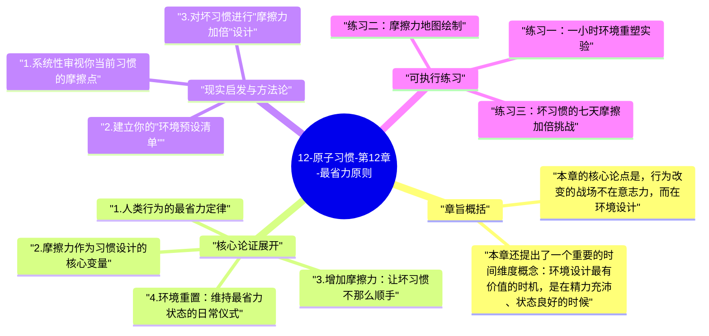

# 12-原子习惯-第12章-最省力原则

人类大脑天然遵循一条经济学原则：在所有可以达到同一目标的路径中，优先选择消耗能量最少的那条。这并不是人类的弱点，而是进化亿万年塑造出来的生存策略——在食物稀缺的原始环境中，不必要地消耗精力意味着生存风险。詹姆斯·克利尔在第十二章将这一原则直接应用于习惯设计的语境中，得出了一个深刻的推论：当你为了让自己执行某个习惯而依赖意志力和自律时，你实际上是在用有限的认知资源逆流而上；但如果你能通过环境设计让好行为成为阻力最小的选项，你就是在顺流而行，让人类大脑的天然节能倾向为你服务。

这个视角彻底改变了人们理解"自律"的方式。很多人相信，那些能够保持良好习惯的人是因为拥有更强的意志力，但克利尔指出，更准确的描述是：他们居住在一个使好行为更容易、坏行为更麻烦的环境中。那些看起来像是自律的表现，实际上往往是精心设计的环境在发挥作用——跑步者的跑鞋就摆在床边、健康饮食者的冰箱里预先备好了切好的蔬菜、作家的写作桌上只有稿纸和笔。这些安排看起来微不足道，却在每天的关键决策时刻将阻力大幅降低，使好习惯几乎不需要自我说服就能自然发生。

最省力原则的逆向应用同样有力：如果说好行为的关键是降低摩擦，那么坏行为的关键就是增加摩擦。当一个行为的执行路径中多了几个额外步骤，执行概率就会显著下降，尤其是在意志力最弱的时刻——深夜、疲惫时、情绪低落时。克利尔用"增加阻力"的策略来对付坏习惯：把电视遥控器放在难够到的地方、把手机充电器放在卧室外、把垃圾食品放在最高的柜子里。这些摩擦力本身不足以让人完全放弃坏习惯，但它们在最脆弱的时刻打断了自动触发的链条，给理性思考留出了足够的空间。

## 章旨概括

本章的核心论点是，行为改变的战场不在意志力，而在环境设计。克利尔引入了"摩擦力"这一概念作为分析工具：好习惯的摩擦力是指执行好习惯所需的努力和障碍；坏习惯的摩擦力是指执行坏习惯所需的努力和障碍。在没有刻意设计的默认环境中，好习惯往往有高摩擦力（需要额外的准备、工具、时间）而坏习惯往往有低摩擦力（随手就能做、无需任何准备）。这种不对称是大多数人习惯建立失败、坏习惯难以戒除的结构性原因，而不是意志力不足的个人原因。

本章还提出了一个重要的时间维度概念：环境设计最有价值的时机，是在精力充沛、状态良好的时候。因为高能量状态下做出的环境安排，会在低能量状态下发挥保护作用。换句话说，好的环境设计是一种跨时间的自我保护机制——你在状态好的时候为状态差的时候创造了一个更容易做对选择的环境，让未来的自己不需要重新消耗意志力就能维持好行为。这个思路与第十四章的"承诺装置"紧密相连，共同构成了第三定律"让它变简单"的完整框架。

## 核心论证展开

### 1. 人类行为的最省力定律

行为经济学和进化心理学都支持同一个观察：当面对两种能达到相同目标的选项时，人倾向于选择需要更少认知负担和身体努力的那种。这不是懒惰，而是大脑资源分配的理性选择——大脑是人体最耗能的器官，消耗的能量约占全身的20%，因此在其他条件相同时，节约认知资源是有进化价值的。这个偏好在日常决策中以各种形式出现：为什么人们倾向于点菜单上排在前面的菜？为什么超市入口处的商品卖得更好？为什么默认选项往往被大多数人保留？答案都是最省力原则在不同情境下的表达。

应用到习惯设计上，这意味着每一个习惯的执行路径上的每一个额外步骤，都会消耗一点执行概率。如果你想做某件事，需要先找工具、然后准备材料、再清理空间，这三个额外步骤分别消耗了一点动力，到真正开始执行的时候，最初的动力可能已经损耗了一大半。反之，如果这三个准备步骤在前一天晚上就已经完成——工具就摆在桌上，材料已经备好，空间已经清理——那么第二天的执行几乎不需要克服任何阻力，就能自然开始。这就是环境设计中"提前准备"策略的核心逻辑。

### 2. 摩擦力作为习惯设计的核心变量

克利尔提出，摩擦力是习惯设计中最重要的可调节变量之一，远比动机、承诺或自律更容易被有意识地操控。动机是心理状态，会随时间和情境波动；自律是有限资源，容易耗尽；但摩擦力是物理和流程层面的现实，一旦被设计好，就会持续发挥效果，不需要每次执行时重新投入认知资源来维持。从这个角度来看，环境设计是一种"一次投入，长期收益"的习惯支撑策略，相比依靠每日意志力的策略，其成本效益比要高得多。

具体来说，降低好习惯的摩擦力有几种典型方式：减少执行好习惯所需的准备步骤（提前准备好所有工具和材料）、缩短从触发到执行的物理或时间距离（把相关物品放在触发场景的附近）、以及消除执行好习惯的障碍（清除可能打断流程的干扰因素）。这些方法不神秘，但执行起来需要一定的预见性和设计意识，即在不执行习惯的时刻主动思考"下次执行时，什么因素会阻碍我"，然后提前消除那些因素。

### 3. 增加摩擦力：让坏习惯不那么顺手

最省力原则的反向应用是本章最实用的工具之一：通过在坏习惯的执行路径上有意增加摩擦，来降低它在低能量时刻的执行概率。这个策略的前提是承认一个现实：在意志力最弱的时刻，人不太可能依靠理性判断来抵抗诱惑，但如果执行诱惑需要额外的几个步骤，这几个步骤本身就有可能打断自动触发的链条，让理性有机会介入。克利尔把这个原理总结为：增加摩擦不会让坏习惯变得不可能，但会让它不再是阻力最小的路径。

实际操作中，这可能意味着：把社交媒体应用从手机主屏幕移走，需要多一步搜索才能打开；把电视遥控器放进抽屉，需要有意识地去取才能开始看；把零食放在不那么方便看见的地方，需要专门去找才能取用。这些摩擦都很小，单独来看可能显得微不足道，但它们发挥作用的时刻恰恰是人最脆弱的时刻——那些无意识地伸手去拿手机、或者随手打开电视的反射性瞬间。在这些瞬间，哪怕多出一个步骤的摩擦，就足以让无意识的自动触发失效，把行为的控制权还给有意识的自我。

### 4. 环境重置：维持最省力状态的日常仪式

克利尔提出了一个被他称为"环境重置"的日常习惯——在每天或每次使用某个环境之后，把它恢复到最有利于下次执行好习惯的状态。这个概念把环境设计从一次性的布置变成了一个持续维护的动态过程。想象一下一个作家在一天工作结束时，把明天要用的笔记本摊开放好、把需要阅读的参考材料叠放在桌上、把手机充电器插在桌子对面而不是伸手可及的地方——这些看似细微的安排，会让第二天的写作启动顺畅得多，同时降低分心工具的干扰概率。

环境重置的心理价值不只在于物理摩擦的调整，还在于它建立了一种"为未来的自己负责"的心理习惯。每次在环境重置上花几分钟，都是在对未来的自己做一次低成本投资——你知道明天某个时刻的自己可能比现在更疲惫、更没有动力，而今天的这几分钟布置，会让那个未来的自己更容易做出好选择。这种时间折叠的自我关怀，是高效能人士的共同特质之一，而克利尔的最省力原则为它提供了一个清晰的机制解释。

### 5. 减法思维：砍掉步骤而不是增加动力

在面对习惯执行困难时，大多数人的本能反应是"我需要更多动力"或"我需要更强的自律"——这是一种加法思维。但最省力原则引导出的是减法思维："执行这个习惯需要哪些步骤？哪些步骤可以被消除或提前完成？"这两种思维的差异是根本性的：加法思维依赖于每次执行时内部资源（意志力、动机）的补充，是不稳定的；减法思维通过降低执行的外部成本来实现稳定，一旦设计完成，效果持续发挥而不消耗执行时的资源。

减法思维在日常实践中可以产生出乎意料的效果。一个发现自己很难坚持早晨冥想的人，用加法思维会尝试"更努力地提醒自己"或"订阅更好的冥想课程"；用减法思维则会问："冥想的前置步骤里，哪一个最容易造成放弃？是找不到安静的地方？是不知道冥想多久？是必须先打开某个应用？"针对最具体的摩擦点进行消除，往往能以最小的投入解决最大的执行障碍，这就是减法思维在习惯设计中的杠杆效应。

## 现实启发与方法论

### 1. 系统性审视你当前习惯的摩擦点

对每个你想建立的好习惯，做一次完整的"执行流程图"：从你决定要做这件事，到真正开始执行，中间经过哪些步骤？每一步需要哪些准备？每一步有哪些可能的中断点？把这个流程图画出来或写下来，然后逐一审视哪些步骤可以提前完成或直接消除。这个练习通常会揭示出一些被忽视的摩擦点——它们太习以为常了，以至于人们不把它们视为障碍，但它们确确实实在每次执行时消耗着宝贵的启动能量。

### 2. 建立你的"环境预设清单"

为每个关键习惯建立一份"环境预设清单"，列出在执行习惯之前需要提前完成的所有准备工作，并把这些准备工作安排到一个固定的时间节点（通常是前一天晚上或当天早晨第一件事）。例如，运动习惯的预设清单可能包括：运动服装折叠好放在床边、水瓶装好放在包里、耳机充好电、运动计划写在便利贴上贴在运动服旁边。每次按清单完成预设，就是在为明天的执行降低摩擦，这比任何自我激励都更可靠。

### 3. 对坏习惯进行"摩擦力加倍"设计

选出你最想减少的一个坏习惯，识别它的触发路径中最短、最无意识的那个环节，然后在那个环节前增加至少两个额外步骤。这两个步骤不需要让坏习惯完全不可能，只需要让它不再是"伸手就能做"的事。增加步骤之后，坚持执行四周，记录这个坏习惯每周发生的频率。你很可能会发现，频率的下降并不是因为你变得更有自律，而是因为在那些最脆弱的时刻，额外的步骤打断了自动触发，让理性有机会重新介入。

## 可执行练习

### 练习一：一小时环境重塑实验

选择你家中或工作场所的一个特定区域，它与你最想强化的一个好习惯密切相关。花一个小时对这个区域进行彻底的摩擦力重设：把执行好习惯所需的所有工具和材料前置到触手可及的位置，把可能造成分心或增加摩擦的物品移走。然后在接下来的两周内，观察这个好习惯在这个区域的执行频率是否提高。这个实验的目的不只是验证最省力原则，更是让你亲身体验环境设计的杠杆效应——一次小时级别的投入，换来两周甚至更长时间的行为改变。

### 练习二：摩擦力地图绘制

对你的三个最难坚持的好习惯，各绘制一张"摩擦力地图"：横轴是执行步骤（从触发到完成），纵轴是摩擦力强度（1-5分）。绘制完成后，识别每个习惯中摩擦力最高的那个节点，专注于消除或降低那一个节点的摩擦，而不是试图在所有地方同时改善。每次只解决一个最高摩擦点，然后观察整体执行难度是否降低。这个练习培养的是一种"找到瓶颈再突破"的系统性思维，而不是漫无目的地提高整体努力程度。

### 练习三：坏习惯的七天摩擦加倍挑战

选出一个你最希望减少的坏习惯，在接下来七天内每天记录：这个坏习惯今天发生了几次？每次发生前，有没有经过那个额外步骤？额外步骤有多少次成功打断了自动触发？一周后，根据数据评估哪种摩擦最有效——是物理距离的增加（把诱惑源放得更远）、是时间延迟（规定要等五分钟才能执行）、还是额外认知负担（要先在纸上写下执行理由才能开始）。找到对你最有效的摩擦类型，然后把它系统化应用到所有你想减少的坏习惯上。

---

## Mermaid 思维导图

### 图1

