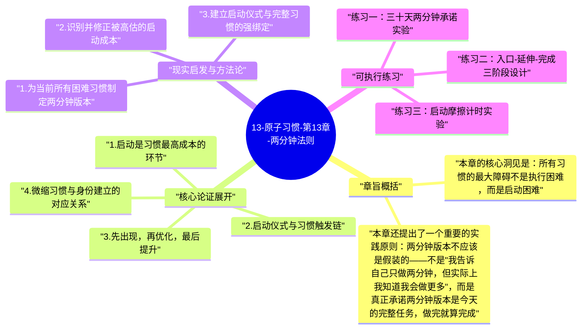

# 13-原子习惯-第13章-两分钟法则

在所有习惯建立的工具中，两分钟法则可能是最简单却最被低估的一个。它的前提来自一个深刻的观察：大多数习惯的失败不是发生在习惯本身执行的过程中，而是发生在习惯还没开始之前的那几秒钟。那几秒钟里，大脑在评估启动所需的能量成本，而这个评估经常因为过高估计而触发回避。两分钟法则的解决方案是极端直接的：把任何习惯都压缩为一个最多只需要两分钟就能完成的起步版本，让这个微型版本成为习惯的官方入口，无论你今天的状态多差、时间多紧、意志多弱，这个入口都必须足够小，小到连最差状态的自己都无法合理拒绝。

詹姆斯·克利尔给出了一系列令人信服的例子：阅读每天三十页，两分钟版本是"翻开书"；做三十分钟瑜伽，两分钟版本是"摊开瑜伽垫"；学习一门外语，两分钟版本是"打开语言学习应用"；做一顿健康的晚餐，两分钟版本是"准备好刀和砧板"。这些例子揭示了两分钟法则的核心逻辑：它不是在说你只需要做这么一点点，而是在说，每个习惯的最关键步骤是启动，而启动可以被设计成一个无论如何都做得到的微小动作。一旦启动发生，惯性和情境会共同推动后续步骤的进行，而且通常比预期进行得更多。

两分钟法则的深层价值不在于它让你做了两分钟的事，而在于它训练了一种心理基础设施：你成为了那种"开始"的人。每次成功执行两分钟版本，你都在向自己的神经系统证明"我是一个开始的人"，而不是"我是一个计划的人"。随着这个身份认同的积累，启动变得越来越自然，习惯的完整版本也越来越容易在启动之后自然延伸。这就是为什么克利尔说，两分钟法则不是在缩小你的野心，而是在为你的野心建立一个稳固的出发台。

## 章旨概括

本章的核心洞见是：所有习惯的最大障碍不是执行困难，而是启动困难。这是一个心理现实，也是一个神经现实——大脑在启动一个陌生或不够自动化的行为时，需要消耗额外的认知能量来克服"切换成本"，而这个切换成本在人的主观感受中会被系统性地高估，尤其是在疲惫或情绪低落的时候。两分钟法则通过把启动本身变成习惯的全部要求，消除了切换成本的心理障碍——当你告诉自己"我只需要翻开书"的时候，大脑评估的是翻开书这一动作的成本，而不是读三十页的成本，前者几乎为零，后者足以让人望而却步。

本章还提出了一个重要的实践原则：两分钟版本不应该是假装的——不是"我告诉自己只做两分钟，但实际上我知道我会做更多"，而是真正承诺两分钟版本是今天的完整任务，做完就算完成。这个承诺的重要性在于，它保证了即便在最差的状态下（真的只有两分钟时间，或者真的疲惫到只能做这么少）也能完成任务，从而保持连续性。连续性在习惯建立中的价值是非线性的——即使今天只做了两分钟，也远好于完全不做，因为完全不做会打断神经回路的强化进程，而哪怕两分钟的执行也在维持那个回路的活跃度。

## 核心论证展开

### 1. 启动是习惯最高成本的环节

行为科学中有一个概念叫"切换成本"（switching cost）：从一种状态或活动切换到另一种，需要额外的认知资源来重新定向注意力和建立新的工作状态。这个成本在习惯执行的情境中尤为显著——从"休息或做别的事情"切换到"执行习惯"，是一个需要跨越内部阻力的过渡，而大脑对这个跨越所需能量的预测性评估，往往是悲观和高估的。这就是为什么人们常常把某件事拖了很久，真正开始做之后却发现"其实没有想象中那么难"——障碍不在过程中，而在启动的那一刻。

两分钟法则直接针对这个启动成本问题。把启动本身变成习惯的两分钟版本，意味着大脑评估的不再是完整习惯的成本，而是这个微小启动动作的成本。打开书的成本、摊开瑜伽垫的成本、打开写作文档的成本——这些动作的实际能量消耗接近于零，因此大脑的预测性评估也会相应降低，从"这需要很大努力"变为"这不需要什么努力"。一旦这个评估发生，执行的阻力就消失了大半，而一旦行为真正开始，惯性会接替意志力继续驱动后续步骤。

### 2. 启动仪式与习惯触发链

两分钟版本的另一个价值是它可以被训练成一个条件反射式的启动仪式。当你连续多次做某个微型动作之后（翻开书、摊开垫子、打开文档），大脑会把这个微型动作和紧随其后的更完整习惯行为联系起来，形成一个习惯触发链。最终，这个微型动作本身会成为习惯的触发器，做了它，后续步骤就自然而然地发生了，不需要重新做决定。这就是为什么克利尔把两分钟版本称为"入口"而不是"全部"——它是一个启动机制，而不是目标本身。

理解这个触发链的逻辑，能帮助人们更好地设计两分钟版本。最好的两分钟版本是那个与完整习惯有最强直接连接的启动动作，而不是一个仅仅在时间上接近习惯的不相关动作。例如，"换上运动服"比"设置明天早晨的闹钟提醒自己运动"更好，因为前者是完整运动习惯的物理起步，穿上运动服之后继续做准备活动是自然而然的；而后者只是在时间上的计划，并没有真正启动习惯的执行链。两分钟版本与完整习惯的内在连接越强，启动仪式的效果就越好。

### 3. 先出现，再优化，最后提升

两分钟法则的使用有一个隐含的时间轴逻辑：它不是永远只做两分钟，而是在习惯建立的早期阶段专注于出现，在出现稳定之后逐渐延伸，在延伸稳定之后开始优化。克利尔把这个进程分为四个阶段：首先，只要出现（两分钟版本）；其次，出现后稳定执行（习惯的基本完整版）；再次，稳定执行后开始优化质量（做得更好）；最后，高质量执行后开始精进（追求卓越）。这四个阶段有严格的先后顺序——跳过出现阶段直接追求精进，是大多数习惯失败的根本原因。

这个时间轴逻辑有一个深刻的含义：在正确的习惯建立顺序中，两分钟法则的使用是暂时的，但它的功效是持久的。它在最关键的出现阶段保护了习惯不因为高标准的执行要求而被扼杀，让习惯的神经基础有机会得到足够的重复积累，然后在这个基础上逐步建立质量和精进。如果没有两分钟法则保护的出现阶段，很多习惯会在建立质量的尝试中就已经胎死腹中，因为在神经回路还没有充分强化之前，高质量执行所需的意志力消耗是不可持续的。

### 4. 微缩习惯与身份建立的对应关系

每一次执行两分钟版本的习惯，都在做一件比完整版更重要的事：强化"我是那种做这件事的人"的身份认同。在克利尔的整体框架中，身份认同是习惯建立的最终目标和最强动力。当你连续两周每天翻开书（哪怕只读了两页），你会越来越强烈地感受到自己是一个读书的人；当你连续三周每天摊开瑜伽垫（哪怕只做了三分钟），你会越来越清晰地认同自己是一个有运动习惯的人。这个身份认同的建立，反过来又会促进更完整、更高质量版本习惯的执行，因为人倾向于以符合自己身份认同的方式行动。

这个机制解释了为什么两分钟法则在心理上的价值，远超过它在实际完成量上的价值。每天翻开书两分钟，你实际读到的内容很少；但每天翻开书这一动作本身，在身份层面的累积效果是巨大的。四十次打开书的动作，意味着四十次"我是读书人"的自我确认；而四十次自我确认之后，"读书"对你来说已经不再是一个需要靠意志力支撑的外部任务，而是一件符合自我定义的内在事情。这才是两分钟法则真正的长期价值所在。

### 5. 当心两分钟法则的误用

克利尔在本章也对两分钟法则的潜在误用做了预警。最常见的误用是把两分钟法则变成一种自我欺骗——表面上承诺只做两分钟，实际上每次都以"既然开始了就多做一点"为由无限延伸，直到有一天真的只有两分钟也完不成，才发现习惯已经因为无法完成"自我认知中的标准版本"而陷入困境。真正的两分钟法则要求真诚地承认：两分钟版本是今天的完整任务，做完就真的做完了，哪怕旁边还有更多可以做的事。只有在这种真诚的条件下，两分钟法则才能有效发挥作用，尤其是在状态最差的日子里。

另一种误用是选错了两分钟版本的内容，把它变成了一个与完整习惯关联很弱的象征性动作。例如，有人把"每天只穿上运动鞋坐五分钟"作为运动习惯的两分钟版本——穿上鞋之后继续坐着并不会自然触发运动，因为穿鞋这个动作与运动的完整行为之间缺乏直接的物理连接。更好的两分钟版本应该是完整行为的头两分钟本身——真正开始做第一组动作，而不是只做准备的准备。两分钟版本的选择应该遵循一个原则：做完它之后，继续做下去是阻力最小的选择，而不是需要重新做决定的事情。

## 现实启发与方法论

### 1. 为当前所有困难习惯制定两分钟版本

盘点你目前所有"想做但总是拖延"的习惯，为每一个设计一个真实的两分钟版本——不是"做完整习惯的前两分钟"（这仍然可能要求很多），而是"启动习惯的最小动作"：翻开书、摊开垫子、打开文档、套上耳机。把这些两分钟版本写在一张纸上，贴在习惯对应的场景附近。接下来的三周内，把所有精力放在完成两分钟版本上，而不是完整版本。三周后评估：哪些习惯因此变得更稳定了？那些习惯里，两分钟版本完成后通常能继续做多久？

### 2. 识别并修正被高估的启动成本

当你发现自己在某个习惯上持续拖延时，做一个快速的成本评估练习：把你预期的启动成本（"开始这件事需要多少精力"）和实际的启动成本分开记录。在接下来一周内，每次你执行某个一直在拖延的习惯时，在完成后记录：实际开始的困难程度，比你预期的困难程度高还是低？大多数人会发现，实际困难程度远低于预期——而这种预期高估正是拖延的核心驱动力之一。持续记录这个差距，能逐渐校准大脑对启动成本的过度悲观估计。

### 3. 建立启动仪式与完整习惯的强绑定

不只是设计两分钟版本，还要确保两分钟版本与完整习惯之间的连接足够强。具体做法是：在执行两分钟版本的同时，置身于完整习惯的环境中——在书桌前翻开书，而不是在沙发上翻开书后又换地方；在瑜伽垫上摊开垫子，而不是在床上摊开再移过去。环境本身也是触发器，把两分钟版本和完整习惯的环境融为一体，能强化两者之间的神经连接，让启动仪式更有效地触发完整行为。

## 可执行练习

### 练习一：三十天两分钟承诺实验

选出一个你连续尝试建立但始终不稳定的习惯，在接下来三十天内，正式承诺只执行它的两分钟版本——不多不少，就两分钟。每天完成后在日历上打勾，无论今天做了什么，只要完成了两分钟版本就算完整成功。在这三十天内，禁止用"既然开始了就多做一点"来延伸任务，除非今天的两分钟结束后你自然而然想继续（这是允许的，但不是要求）。三十天结束后，观察习惯的稳定性、完成后的持续时长平均值，以及你对这个习惯的身份认同是否有所改变。

### 练习二：入口-延伸-完成三阶段设计

为你最重要的一个习惯，设计一个"入口-延伸-完成"三阶段版本：入口是两分钟版本（最小启动动作）；延伸是十到十五分钟版本（能在大多数普通状态下完成的标准版）；完成是三十分钟以上的完整版（最佳状态下的理想版）。把这三个版本写在一张卡片上，放在习惯场景附近。每次执行前，根据当天状态快速选择从哪个版本开始。这个三阶段设计的目的是，即便在最差的状态下（只能做入口），也有一个合法的"今天完成了"选项，而不是面对"要么完整要么不做"的二元选择，因为后者在状态差的日子里几乎总以"不做"告终。

### 练习三：启动摩擦计时实验

选出一个你最常拖延的习惯，用手表或手机计时，记录从你"决定要做了"到你真正开始执行的时间。连续记录一周，然后分析：平均启动时间是多少？哪些因素导致了更长的启动时间（找不到工具、需要切换到特定环境、需要先做准备）？根据分析结果，专门针对最耗时的启动因素进行消除或预置，目标是把启动时间降低到三十秒以内。当启动时间低于三十秒，拖延的核心阻力就基本消除了，习惯的执行频率通常会随之显著提升。

---

## Mermaid 思维导图

### 图1

