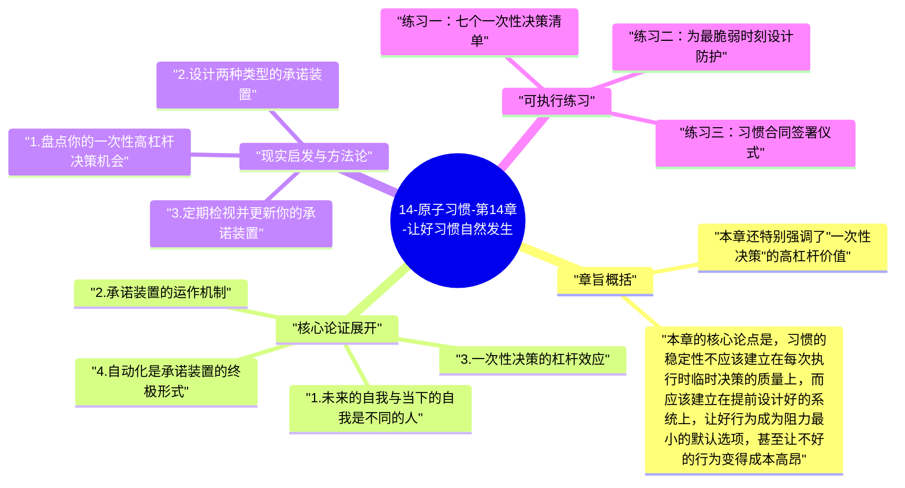

# 14-原子习惯-第14章-让好习惯自然发生

人类在当下状态下做决定的能力，远不如我们自以为的那么可靠。我们的决策受到当时的情绪、精力水平、环境暗示和即时诱惑的深刻影响，这意味着在每天最关键的执行时刻——通常也是意志力最薄弱的时刻——我们最需要依赖的"当下判断"恰恰是最不可靠的。詹姆斯·克利尔在第十四章提出了一个根本性的解决方案：与其试图在每次执行时做出正确决定，不如在状态最好的时候做一次性决策，用这个决策的结果提前锁定未来的行为，让好习惯在未来自动发生，而无需在当下重新做任何决定。

这个思路的核心工具是克利尔所称的"承诺装置"（commitment device）——一种在当下做出的、能约束未来选择的决定或安排。承诺装置的逻辑是利用当下清醒状态下的理性判断，去约束未来情绪化或疲惫状态下的自我，从而把好行为从"每次都需要重新选择"变成"系统默认发生"。历史上有大量经典的承诺装置案例：奥德修斯命令水手把自己绑在桅杆上才能听塞壬的歌声；维克多·雨果在截稿日期临近时把自己的衣服锁起来让自己无法外出；现代人预购一整学期的健身课并为请假设置高额惩罚。这些都是用"当下的理性"来管理"未来的冲动"的机制。

承诺装置的普遍性在于它承认了一个现实：人不是单一的、理性的决策者，而是存在于不同时间点、有着不同动机和偏好的"多个自我"的集合体。早晨精神饱满时的自我和深夜疲惫时的自我，面对同一个选择时几乎像是两个不同的人。承诺装置是让早晨的自我为深夜的自我设置防护网的机制，是让状态好时的智慧为状态差时的行为负责的机制。克利尔指出，这不是软弱或缺乏自律的表现，而是对人类决策本质的清醒认识，是真正成熟的自我管理策略。

## 章旨概括

本章的核心论点是，习惯的稳定性不应该建立在每次执行时临时决策的质量上，而应该建立在提前设计好的系统上，让好行为成为阻力最小的默认选项，甚至让不好的行为变得成本高昂。克利尔把这类设计工具分为两类：自动化（让系统自动执行好行为，不需要人的介入）和承诺装置（提高未来做出坏选择的成本，或提前锁定好选择）。两类工具的共同点是，它们都在"系统层面"而不是"意志力层面"解决问题，把好行为的保证从人的心理状态转移到了环境和制度的设计上。

本章还特别强调了"一次性决策"的高杠杆价值。有些决策一旦做出，就会长期影响无数个未来决策——订阅一个自动投资计划，未来每月的储蓄就自动发生；把家里的电视从客厅移走，未来每个晚上的刷电视时间就自动减少；在健康餐配送服务上设置固定订单，未来每周的饮食安排就自动倾向健康。这类一次性决策的回报率极高，因为一次投入就能产生长期、持续的行为影响，远比每天靠意志力做出的一次性决策更有效率。

## 核心论证展开

### 1. 未来的自我与当下的自我是不同的人

行为经济学中有一个重要概念叫"时间不一致性"（temporal inconsistency）：人对未来选择的预期，与真正面对选择时的实际决定，往往不一致。周日的自己可以非常理性地计划下周五要去健身，但到了周五下班后疲惫的那一刻，那个充满动力的周日自我似乎消失了，取而代之的是一个只想回家躺着的周五自我。这两个自我是同一个人，但他们在不同时间点有着不同的偏好权重和能量资源，因此做出了不同的决定。时间不一致性不是道德问题，而是人类决策机制的内在特征。

理解这个特征，对习惯设计有根本性的启示：如果你的习惯系统依赖于"未来某个时刻的自己做出正确决定"，那么你实际上是在赌博，赌那个未来的自己在那个特定时刻的状态和动机恰好足以支撑正确决定。更稳健的策略是承认未来的某些时刻你会状态差、动机低，然后在当下就为那些时刻设置防护网——通过承诺装置，把好行为提前锁定，让坏选择的成本足够高，从而让时间不一致性失去破坏习惯的能力。

### 2. 承诺装置的运作机制

承诺装置通过两种主要机制发挥作用：一是增加不好选择的成本（使违约变得不合算），二是把好选择设为系统默认（使好行为无需额外决策就自动发生）。前者的典型例子是健身打卡应用中设置"失败罚款"功能，或者与朋友签订"如果我这周没去健身就请你吃饭"的口头契约——在这些安排中，放弃锻炼的成本从"什么都没有"变成了"经济损失或社会尴尬"，这种成本的增加会显著改变大脑在做选择时的权重分配。

后者的典型例子包括：预付一整期的课程费（使出席成为已付成本，缺席才是额外损失）、把健康食物预先切好放在冰箱显眼位置（使健康饮食成为拿起来就能吃的默认选项）、在路由器上设置社交媒体网站访问时间限制（使刷网站需要额外步骤才能绕过，而不是触手可及）。这些安排的共同特点是，它们在系统层面改变了选择的成本结构，使好行为不需要意志力就成为了最自然的选择，而坏行为需要额外的努力才能执行。

### 3. 一次性决策的杠杆效应

克利尔特别强调了识别和充分利用"一次性高杠杆决策"的重要性。这类决策的特点是：只需要做一次，但其影响会持续作用于未来无数个时间点。投资习惯中的自动扣款设置是最典型的例子——只需要花五分钟在银行账户上设置自动转账，之后每个月的储蓄就自动发生，不需要每月重新做"这个月要不要存钱"的决定。同样的逻辑可以应用于几乎所有领域：提前购买健身年卡（一次决策，影响一整年的运动选择）；预约固定时段的健康检查（一次预约，保证一年后真的去做）；删除手机上的某些应用（一次操作，减少未来无数次的诱惑暴露）。

这类一次性决策之所以如此有价值，是因为它们把习惯的维持从"每次都需要做决定"变成了"只需要做一次决定"。从认知成本的角度来看，这是巨大的节省——每次需要做决定都会消耗认知资源，而如果某个领域的决定可以一次性锁定，那个领域的认知资源就可以完全节省出来用于其他地方。高效能人士普遍有减少日常决策数量的习惯，很大程度上正是通过这类一次性决策实现的。

### 4. 自动化是承诺装置的终极形式

随着技术的发展，很多原本需要依赖人的意志力的行为，现在可以通过数字工具实现真正的自动化。克利尔把技术自动化视为承诺装置的终极形式：当好行为不只是"成本降低"而是"完全自动发生，不需要任何人工介入"时，习惯的稳定性就达到了最高水平。自动投资、自动储蓄、自动定期体检预约、自动外卖健康餐订阅——这些都是让好行为脱离人的决策链条、直接变成系统自动执行的方式。一旦设置好，这些行为就不再依赖于任何特定时刻的动机状态，因此可以保持高度的一致性。

但克利尔也指出，自动化并不适用于所有习惯。有些习惯的价值本身在于有意识地参与——冥想需要注意力的主动投入，锻炼需要身体的有意识感知，阅读需要主动的认知处理。这些习惯不能被自动化，但可以用其他形式的承诺装置（如预付费用、设置固定时间）来提高其执行的稳定性。理解哪些习惯适合自动化、哪些需要有意识参与，是设计有效习惯系统的重要前提。

### 5. 减少未来自我的决策负担

本章还有一个与认知科学紧密相关的含义：每一个通过承诺装置锁定的未来行为，都在减少未来自我的决策负担，而决策负担的减少本身就会提高执行的质量和一致性。这个现象有一个名称叫"决策疲劳"（decision fatigue）——大脑做决定的能力会随着一天内决策次数的增加而下降，早晨第一个决策和晚上第一百个决策消耗的认知资源是不同的。如果好习惯的执行恰好排在一天中最后那几个决策位置（下班后、晚饭后），它面对的是最疲惫的大脑，执行概率自然会下降。

减少未来自我的决策负担，意味着尽量把好习惯的触发机制从"每次重新做决定"变成"自动或半自动发生"。即便无法完全自动化，也可以通过提前设定固定时间、固定地点、固定前置步骤来减少习惯执行时的决策成本——当你每天早上7点都会在固定的书桌前打开写作文档，"今天要不要写作"这个问题就被转化成了"7点到了书桌旁边"这个物理事实，前者是需要消耗认知资源的决定，后者是不需要任何决策的自然触发。

## 现实启发与方法论

### 1. 盘点你的一次性高杠杆决策机会

花三十分钟，把你当前生活中所有"需要反复做的决策"列出来，然后识别其中哪些可以通过一次性安排来锁定。重点关注那些你已经知道正确答案却每次都需要重新决定的事情——"我知道我应该存钱，但每月还是要再决定一次"、"我知道我应该少用社交媒体，但每天晚上还是要重新抵抗诱惑"。把这些已知正确答案的决策，通过自动化或承诺装置提前锁定，就能把那部分认知资源从每日决策消耗中解放出来，用于真正需要思考的事情。

### 2. 设计两种类型的承诺装置

分别为"增加坏行为成本"和"把好行为设为默认"各设计一个承诺装置。"增加成本"类型可以是与他人的公开承诺、金钱惩罚机制或社会代价安排；"设为默认"类型可以是自动化设置、固定时间预约或环境预置安排。这两种类型的承诺装置互补：前者在你试图违约时给出即时的成本信号，后者让你完全不需要做违约的决定。两种类型一起使用，能从两个方向加固习惯的稳定性——一方面让放弃变得代价高昂，另一方面让执行变得几乎不需要主动选择。

### 3. 定期检视并更新你的承诺装置

承诺装置不是一劳永逸的——它们会随着时间推移失去效力（你对惩罚麻木了），或者变得不再适用（你的生活情况改变了）。建立每季度一次检视承诺装置的习惯，评估哪些还在有效发挥作用，哪些已经形同虚设，哪些需要更新或替换。这个定期检视的习惯本身，也是一种元层面的系统维护，能确保你的习惯支撑系统始终与当前的生活状态和目标保持同步，而不是成为一套僵化的旧机制继续消耗能量却不再产生价值。

## 可执行练习

### 练习一：七个一次性决策清单

在这周内，识别并实施至少七个"一次性高杠杆决策"，每一个都能在接下来三个月内持续影响你的行为。这七个决策可以覆盖不同的生活领域：财务（设置自动转账到储蓄账户）、健康（预约三个月内每两周一次的固定运动时段）、饮食（设置健康食材的固定配送订单）、学习（预付一门课程）、数字习惯（在手机上设置社交媒体使用时间限制）等。每个决策花费的时间不超过十五分钟，但产生的影响会延伸到未来的每一天。这个练习的目的是让你亲身体验一次性决策的杠杆效应——以一次投入换取持续影响。

### 练习二：为最脆弱时刻设计防护

识别你一天中意志力最薄弱的两个时刻（通常是下班后的第一小时、深夜入睡前的时段），以及在这两个时刻你最容易陷入的坏习惯。为每个坏习惯设计一个在这两个时刻发挥作用的承诺装置，专门针对最脆弱时刻的行为进行保护。例如，如果下班后第一件事总是打开电视，可以把遥控器锁进抽屉并把钥匙放在另一个房间，同时在客厅摆上一本当前正在读的书——这样，下班到家后的环境安排会自动引导向读书而非看电视，不需要任何主动决策。坚持这个安排两周，记录在这两个时刻的行为模式变化。

### 练习三：习惯合同签署仪式

为你正在尝试建立的一个最重要的习惯，起草一份正式的"习惯合同"：写明这个习惯的具体内容（什么时候、什么地点、做什么）、如果连续两天未执行的具体后果（明确的、可执行的惩罚），以及如果连续完成四周的具体奖励。找一个你信任且会真正执行约定的朋友或家人签署这份合同，并把它打印出来贴在每天能看到的地方。这个练习的价值不在于惩罚本身，而在于通过公开承诺和社会见证为习惯增加了一个外部问责层，让违约的心理成本从"只对自己失望"提升到"在他人面前失信"，这个提升对很多人来说是决定性的行为约束力量。

---

## Mermaid 思维导图

### 图1

