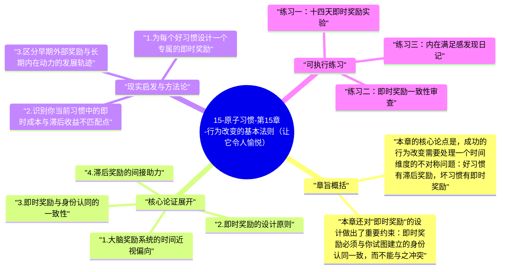

# 15-原子习惯-第15章-行为改变的基本法则（让它令人愉悦）

第四定律"让它令人愉悦"触及了人类行为改变中最根本的一个悖论：那些对长期最有益的行为，往往在短期内并不令人愉悦；而那些对长期最有害的行为，往往能提供立即的愉悦感。吃健康食物、坚持锻炼、勤奋工作、节制消费——这些行为的回报都在遥远的未来，而回报的延迟使得大脑的奖励系统无法在执行时给出强烈的正向信号。相比之下，垃圾食品的口感奖励在咀嚼的瞬间就到达，刷手机的多巴胺回馈在滑动的瞬间就触发，这种即时性使得坏习惯在神经层面有着天然的竞争优势。詹姆斯·克利尔在第十五章正面应对这个悖论，提出了一个简单但深刻的策略：不要试图让好行为的滞后奖励变成即时奖励（那通常是不可能的），而是通过人工附加的即时愉悦感，给好习惯的每次执行都增加一个现实的即时回报。

理解大脑奖励系统的运作方式是这一章的基础。大脑的多巴胺系统是习惯形成的核心神经机制——当一个行为产生奖励时，多巴胺释放，大脑记录这个"行为-奖励"的关联，并在下次遇到相同情境时给出"去做"的冲动。问题是，大脑的奖励系统在时间上有严重的近视偏向：距离越近的奖励，权重越高；距离越远的奖励，权重越低。这个偏向在进化中是合理的——原始环境中，未来充满不确定，即时的食物或安全比模糊的未来利益更可靠。但在现代社会，这个近视偏向成了阻碍长期最优行为的系统性错误。

克利尔的解决方案是直接干预这个时间权重的不对称：通过给好习惯的每次执行附加一个即时愉悦感，制造一个大脑能在当下识别和回应的即时奖励信号。这个即时奖励不需要与好习惯的长期收益等价，它的作用只是给大脑的奖励系统提供一个"这件事感觉好"的当下体验，让大脑愿意在同样情境下再次触发这个行为。随着重复的积累，习惯本身的执行过程会逐渐内化为一种满足感，即时奖励的作用会逐渐减弱，最终好习惯能依靠自身的内在满足感维持。

## 章旨概括

本章的核心论点是，成功的行为改变需要处理一个时间维度的不对称问题：好习惯有滞后奖励，坏习惯有即时奖励。在没有干预的情况下，大脑的近视偏向会系统性地为坏习惯的执行提供更强的触发动力，而让好习惯在与坏习惯的竞争中处于不利位置。解决这个问题的有效策略不是试图消除大脑的近视偏向（那是不可能的），而是通过设计即时奖励，把第四定律引入好习惯的执行循环，让大脑在执行好习惯时也能得到即时的满足感，从而逐渐建立对好习惯的神经层面的正向关联。

本章还对"即时奖励"的设计做出了重要约束：即时奖励必须与你试图建立的身份认同一致，而不能与之冲突。如果你的即时奖励本身就是一种坏习惯（比如"完成健身后奖励自己吃一块蛋糕"），那么你在强化好习惯的同时也在强化坏习惯，两个习惯会相互缠绕，最终可能导致两者都无法稳定建立。克利尔建议，即时奖励应该是一种让你感觉好但不会破坏长期目标的体验——一首喜欢的音乐、一段放松的休息、一个有仪式感的记录动作、或者任何对你有意义但不会产生负面后果的小满足。

## 核心论证展开

### 1. 大脑奖励系统的时间近视偏向

神经科学的研究表明，大脑在评估奖励时使用的是一种"双曲折扣"（hyperbolic discounting）函数：奖励的主观价值随着时间距离的增加而迅速衰减，且衰减速度在短期内极快，在长期内趋于平缓。这意味着今天的十元钱比一周后的十五元钱在主观上感觉更有价值，尽管理性计算上后者明显更优。应用到习惯层面：今晚锻炼三十分钟的即时疲劳感，在主观权重上会压过六个月后的健康改善，因为前者是确定的、当下的，后者是模糊的、遥远的。这不是理性与否的问题，而是大脑奖励系统在时间维度上的结构性特征。

这个特征的实践含义是：任何只依赖滞后奖励来维持的习惯，都会在神经层面与即时奖励的坏习惯处于不平等竞争。这就解释了为什么人们在知道某件事对自己有益的同时，仍然很难坚持做它——"知道有益"是理性层面的判断，但习惯的触发主要受多巴胺系统（而非理性系统）控制，而多巴胺系统对滞后奖励几乎没有直接反应。因此，单纯依赖"知道这件事对我好"来维持习惯，是在用理性系统对抗神经奖励系统，而这场对抗中，长期大多数人都会输给后者。

### 2. 即时奖励的设计原则

即时奖励的有效性取决于几个关键条件：时间紧密性（奖励必须在习惯完成后立刻发生，延迟超过几分钟会显著降低效果）、一致性（每次执行后都能得到，而不是随机发放）、感官或情绪满足性（必须是大脑能真实体验到愉悦感的事情，而不只是抽象的积分或记录）。符合这些条件的即时奖励，能有效在好习惯的执行与大脑奖励系统之间建立条件反射式的正向关联，从而随着时间推移逐渐提高好习惯对大脑的吸引力。

克利尔还区分了"结果奖励"和"身份奖励"：结果奖励是外部的、行为之后给予的东西（完成锻炼后可以听喜欢的播客）；身份奖励是内部的、来自于行为本身对身份认同的确认（完成锻炼后，你更加确认自己是一个有运动习惯的人）。在习惯建立的早期，结果奖励更有效，因为身份认同还没有充分建立；但随着习惯的深化，身份奖励会逐渐取代结果奖励成为主要驱动力，这是习惯真正内化的标志。最终成熟的习惯，其最重要的奖励是"这就是我"这一自我叙事，而不是任何外部给予的东西。

### 3. 即时奖励与身份认同的一致性

克利尔特别强调，即时奖励的内容必须与你想建立的身份认同一致，这是一个非常具体的约束条件，在实践中经常被忽视。一个常见的错误是用与目标方向相反的东西作为奖励——比如用"完成健身后吃甜食"作为即时奖励，这实际上是在强化"运动是一种痛苦，需要用甜食来弥补"的神经关联，而不是"运动本身是一种值得重复的体验"的关联。这种不一致性会在无意识层面强化对运动的负面定性，长期来看反而会降低运动习惯的稳定性。

真正有效的即时奖励应该强化的叙事是："我是那种做这件事的人，而做这件事感觉很好。"完成锻炼后允许自己听一集特别喜欢的播客，这个奖励在强化的是"做了值得被奖励的事"的叙事，而不是在否定锻炼的价值。完成写作后泡一杯喜欢的茶在书桌旁享用，强化的是"写作是我生活中一件美好的部分"的叙事。即时奖励的内容越能与目标习惯产生正向的意义关联，其建立持久习惯的效果就越好。

### 4. 滞后奖励的间接助力

尽管大脑无法直接对遥远的滞后奖励产生即时的多巴胺反应，但滞后奖励并非完全无用——它们可以通过可视化和追踪工具间接转化为当下可体验的进展感。当你能在追踪工具上看到"我已经连续锻炼二十一天了"这个可视化的进展，这个视觉信息会触发一种"我正在成为我想成为的人"的即时满足感，而这种满足感在心理机制上与直接的即时奖励有类似的激励效果。这就是第十六章习惯追踪的核心价值——它把时间上遥远的滞后奖励（健康改善、能力提升），转化成了当下可见的进展感，填补了好习惯在即时奖励上的天然缺失。

克利尔的这个分析指向了一个重要的实践结论：第四定律的完整应用，不是单一地依赖某一种即时奖励机制，而是组合使用多种工具——人工附加的即时奖励（结果奖励）、进度可视化工具（把滞后奖励转化为当下进展感）、以及随着时间积累逐渐发展出的内在满足感（身份奖励）。这三种机制在习惯建立的不同阶段有不同的权重：早期主要依赖人工即时奖励和进度可视化，中期逐渐融入内在满足感，成熟期则以内在满足和身份认同为主要驱动，人工奖励可以逐步减少。

### 5. 令人满意与令人愉悦的微妙差异

本章还有一个值得关注的细节：克利尔区分了"令人满意"（satisfying）和"令人愉悦"（pleasurable）两个概念。真正有利于长期习惯建立的，是前者而非后者。令人愉悦强调的是感官层面的即时刺激，这种刺激强度虽高，但容易产生适应性下降（越刺激越需要更强的刺激才能满足），最终导致回报递减和对习惯的倦怠感。令人满意强调的是一种更持久的、来自于完成某事、进展某事的内在充实感，这种满足感不会因为重复而减弱，反而可能因为技能的提升和习惯的深化而增强。

因此，最理想的即时奖励设计，不是追求强烈的感官刺激，而是寻找那种"小而真实的完成感"——打开书并读了几页之后的那种轻微的充实感，锻炼结束后身体的舒展感，写完一段话后的那种轻微的满足感。这些感受都不强烈，但它们是真实的内在体验，不会产生适应性下降，并且会随着习惯的深化而逐渐增强。帮助学员识别和放大这些细微的内在满足感，是习惯教练工作中最有价值的技能之一。

## 现实启发与方法论

### 1. 为每个好习惯设计一个专属的即时奖励

为你的三个最重要的好习惯，各设计一个专属的即时奖励，要求这个奖励：在习惯完成后立刻发生、每次执行后都能得到、有真实的感官或情绪愉悦感、不与目标习惯的方向冲突。奖励不需要昂贵或复杂，一首特别喜欢的歌、一杯特定的饮品、五分钟的特定休息活动都可以。把这个奖励设计写下来，然后严格执行——每次习惯完成后立刻给自己这个奖励，不要推迟或跳过，让大脑有机会建立"习惯执行-即时愉悦"的神经关联。

### 2. 识别你当前习惯中的即时成本与滞后收益不匹配点

审视你所有困难习惯，找出那些让你感觉"我知道应该做但就是做不到"的项目。对每一个这样的习惯，分析它的即时成本（执行时当下感受如何）和即时回报（执行当下有哪些立即的正向体验）。通常你会发现，这些困难习惯的即时成本高（疲惫、不适、无聊）而即时回报几乎为零（所有回报都在遥远的未来）。基于这个分析，为每个习惯设计一个能提供即时回报的奖励机制，专门补偿当下的即时成本，让即时层面的成本-收益方程更加平衡。

### 3. 区分早期外部奖励与长期内在动力的发展轨迹

明确区分习惯建立的不同阶段，并相应调整奖励策略。在最初四到八周（建立阶段），主要依赖外部即时奖励来驱动执行，同时用习惯追踪工具把进展可视化。在接下来二到四个月（稳定阶段），注意观察内在满足感的自然涌现——有哪些执行之后的感受开始成为你期待的？这些感受是未来内在驱动力的种子，需要被有意识地识别和命名。在六个月之后（成熟阶段），逐渐减少对外部奖励的依赖，让习惯越来越多地由内在满足感驱动，同时保留偶尔的外部奖励作为仪式感的强化。

## 可执行练习

### 练习一：十四天即时奖励实验

选出一个你认为"应该做但缺乏动力"的好习惯，为它设计一个专属即时奖励，然后严格执行十四天——每次完成习惯后立刻给自己这个奖励，不跳过、不推迟、不因为"今天做得不够好"而取消奖励。十四天结束后，评估两件事：这个习惯在这十四天内的执行频率，相比之前有没有提高？在执行这个习惯时，你是否开始注意到某种内在的轻微愉悦感，哪怕很微弱？这个练习的目的是在你的神经系统中建立"这件事完成之后感觉好"的初始关联，为长期习惯建立奠定神经基础。

### 练习二：即时奖励一致性审查

对你已经在使用的所有即时奖励进行一次一致性审查：检查每个奖励是否与对应习惯的方向一致，还是存在"用坏习惯奖励好习惯"的矛盾。如果发现矛盾，设计一个替代方案——一个能提供相似满足感但不冲突的奖励。这个练习需要你诚实地审视自己当前的奖励机制，有时候你会发现一些有趣的矛盾：例如"完成工作后刷一小时手机"这个奖励，虽然当下令人愉悦，但它实际上在强化"工作-被迫忍受-手机-解脱"的框架，而不是"工作-自我成就-充实感"的框架，长期来看会影响工作习惯的内在驱动力。

### 练习三：内在满足感发现日记

在接下来的两周内，在每次完成一个好习惯之后，花三十秒在日记中记录：执行完之后，你的身体或情绪有什么感受，哪怕是非常细微的感受？不要只记录"没什么感觉"，而是仔细聆听——是有一丝轻松感？一种模糊的充实感？身体的某种放松？还是一种轻微的自我尊重感？把这些感受写下来，无论多么细微。两周后回顾这些记录，你会开始发现某些模式：哪些习惯执行后有更多的内在满足感？这些感受是你长期习惯内在驱动力的真实来源，识别它们，放大它们，让它们成为未来执行的核心理由。

---

## Mermaid 思维导图

### 图1

