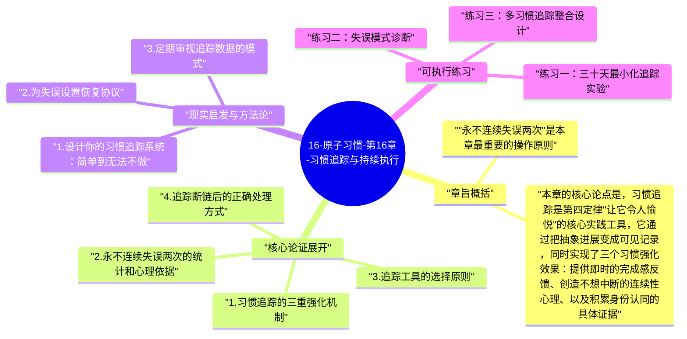

# 16-原子习惯-第16章-习惯追踪与持续执行

想象你有一条正在生长的链条，每一天你完成某个习惯，就向它加入新的一环；而每一天你没有完成，那条链条就在那里断开了。这个简单的意象，就是喜剧演员杰瑞·宋飞著名的"不要打破链条"系统的核心——他在日历上每天完成写作后就画一个叉，当叉越来越多形成连续的链条之后，"不要打破链条"就成了一种强大的内在驱动力。詹姆斯·克利尔在第十六章把这个直觉系统化，深入分析了习惯追踪（habit tracking）为什么有效，并提出了在追踪中最重要的一条原则：永不连续失误两次。这两个核心洞见共同构成了让好习惯在真实生活中保持长期稳定的实践基础。

习惯追踪之所以有效，不只是因为它帮助你记录了历史，更是因为它同时激活了习惯建立的多个核心机制。第一，追踪让进度变得可见——把原本抽象的"坚持"变成了具体的、每天可以看到的证据，满足了大脑对即时反馈的需求。第二，追踪本身成为一种仪式，标记动作（画一个叉、移动一颗石子、在应用里打勾）提供了一种小而真实的即时满足感，强化了第四定律"让它令人愉悦"。第三，追踪记录形成了身份认同的累积证据——每一个标记都在说"我是那种做这件事的人"，大量标记的积累会显著强化对应的自我认同。三重机制同时运作，使习惯追踪成为整个习惯建立系统中效率最高的支撑工具之一。

但克利尔没有回避习惯追踪的局限和误区。最常见的陷阱是追踪对象变成了目标本身，而不是服务于目标的工具——人们开始为了"连续打卡"而执行习惯，而不是为了习惯本身的内在价值。这种"追踪上瘾"会产生一个危险的后果：当某一天因为不可抗力无法执行时，断链带来的挫败感变得如此强烈，以至于人们开始用低质量的形式执行习惯只是为了维持打卡记录，而不是因为那次执行真正有意义。克利尔的解决方案是重新定义追踪的意义：连续性不是目标，执行的整体频率才是；一次失误不是灾难，连续两次失误才是需要警惕的信号。

## 章旨概括

本章的核心论点是，习惯追踪是第四定律"让它令人愉悦"的核心实践工具，它通过把抽象进展变成可见记录，同时实现了三个习惯强化效果：提供即时的完成感反馈、创造不想中断的连续性心理、以及积累身份认同的具体证据。但克利尔同时强调，追踪必须服务于习惯，而不能本末倒置。追踪工具应该足够轻便，不能成为习惯执行本身的额外负担；追踪记录应该诚实，不能为了好看的数字而妥协执行质量；追踪断链时的正确反应是尽快恢复，而不是陷入自责或放弃。

"永不连续失误两次"是本章最重要的操作原则。它来自一个深刻的统计和心理洞察：习惯建立过程中，偶尔的失误（一次）对长期趋势的影响极为有限，就像一颗石头落入河流不会改变河流的方向；但连续的失误（两次及以上）会触发心理机制上的崩塌——"我已经连续两次没做了"这个感受，比"我昨天没做"要更强烈地激活"反正已经失败了"的放弃心理，从而把偶然的偏差变成持续的放弃。因此，在偶尔失误后的第二天立刻回归，是保护习惯整体连续性最高效的策略。

## 核心论证展开

### 1. 习惯追踪的三重强化机制

习惯追踪在神经和心理层面同时触发三个强化机制，这种多重效应使它成为习惯建立工具箱中性价比最高的工具。第一个机制是即时反馈——追踪记录在每次执行后提供了一个可见的确认信号（一个叉、一个勾、一颗被移动的石子），让大脑的奖励系统得到一个当下可体验的满足感，填补了好习惯在即时奖励上的天然缺失。这个信号虽然微小，但由于它的即时性和一致性，能有效与习惯执行建立条件反射式的正向关联。

第二个机制是连续性效应——当追踪记录形成一条可见的连续链条之后，"不要打破链条"成为一种独立的驱动力，使习惯的执行不再只依赖当天的动机，而是额外受到"保护已有成果"的心理驱动。这个机制在心理学中被称为"沉没成本效应"的正向应用——已经积累的连续记录成为一种心理资产，人会本能地不想让这个资产被清零。第三个机制是身份认同的强化——每一个追踪标记都是对"我是那种坚持做这件事的人"这一身份的具体确认，大量标记的积累会显著加深对应身份认同的稳固程度，而稳固的身份认同反过来会进一步支持习惯的持续执行。

### 2. 永不连续失误两次的统计和心理依据

克利尔的"永不连续失误两次"原则，在数学上有非常直观的依据。如果你一年里的习惯执行率是85%（大约一年中有55天没有执行），在习惯的长期积累效果上，这和100%执行率的差距是微小的。但如果这55天的失误都集中在少数几次连续断链（比如5次连续十天的放弃），那么这些集中的断链可能足以完全打断习惯的神经强化进程，让前面积累的工作大打折扣。反之，如果这55天是分散的、各自孤立的偶尔失误，每次失误后第二天立刻恢复，那么总体的执行频率和习惯强化效果几乎不受影响。从统计上看，同样是55天没有执行，孤立失误的集合和集中断链的集合对习惯强化的破坏程度是截然不同的。

心理层面的依据同样有力。单次失误触发的认知反应通常是"今天没做，明天补上"——这是一个可以轻易恢复的状态。但连续两次失误触发的认知反应会出现质变："我已经连续两次没做了，是不是这个习惯本来就不适合我"或者"反正已经断了，不如等到下周一重新开始"——后一种认知模式会产生大量的合理化借口，将偶然的连续失误转化为系统性的放弃。因此，在第一次失误发生后的第二天立刻执行，是成本最小、效果最显著的习惯保护策略。

### 3. 追踪工具的选择原则

克利尔对追踪工具有一个核心原则：工具应该足够轻便，轻便到追踪本身的成本不会成为习惯执行的额外负担。如果追踪工具需要每天花费五分钟来更新，那么对于简短的日常习惯（如每天冥想五分钟）来说，追踪成本占比过高，会产生"做了还得记录，增加一道程序"的心理阻力。最理想的追踪工具是与习惯执行无缝整合的——翻完书后在书签上做一个标记，锻炼结束后在日历上画一个叉，无需切换应用或记录复杂数据，只需要一秒钟就能完成。

不同性质的习惯适合不同的追踪方式。对于需要精确数据追踪的习惯（如体重管理、财务储蓄），使用电子表格或专业应用是合理的，因为数据本身有分析价值。但对于绝大多数日常行为习惯，简单的纸质日历打叉、一罐子里的石子计数、或者一个最简单的习惯追踪应用，都足以提供所需的连续性感和即时完成感，而不会增加无谓的操作复杂性。克利尔的原则是：能一秒完成追踪的，不要用需要一分钟的方案，因为追踪的目的是服务于习惯，而不是成为一种独立的额外任务。

### 4. 追踪断链后的正确处理方式

习惯追踪系统中最重要的紧急处理流程是：在失误发生时，立刻降低第二天执行的要求。这个策略基于一个心理现实：失误通常发生在特殊情境下（出差、生病、重要事件），而在失误之后的第二天，你可能仍然处于状态不佳的余波中，如果要求自己完整执行习惯，遭遇第二次失败的风险很高，这正是连续失误的主要来源。解决方案是：失误后第二天，把习惯的要求降低到第十三章"两分钟法则"的水平——只要做最小版本，重新打一个标记，恢复链条，这比什么都不做要好得多，也比勉强完整执行后再次失败的心理伤害要轻得多。

克利尔还强调了一个重要的心态转变：失误是数据，不是道德评判。当你在某天没有执行习惯时，正确的反应不是陷入自责（"我又失败了"），而是记录这个数据，并反思它反映了什么：是昨天的特殊情境造成的一次性失误？还是某个系统性问题导致了习惯的持续困难？前者只需要第二天恢复就可以；后者则需要重新审视习惯的设计，找出造成反复失误的结构性原因。把失误当作反馈而不是失败，是一种更成熟的习惯建立态度，也是避免单次失误引发习惯彻底崩溃的心理保护机制。

### 5. 习惯追踪与目标追踪的区别

克利尔在本章做了一个重要的区分：习惯追踪和目标追踪是不同的活动，混淆两者会产生系统性的问题。目标追踪关注的是结果的量化（体重降低了多少、阅读了多少页）；习惯追踪关注的是行为的发生（今天执行了吗）。前者的问题是，结果受到很多超出习惯执行控制范围的因素影响（体重受到水分摄入、肌肉量等因素影响），因此纯粹的结果追踪会让人在做了对的事情却没有看到预期结果时产生错误的挫败感，进而放弃习惯。后者只关注行为本身是否发生，与结果解耦，让人能专注于"做了这件事"这一事实，而不受结果波动的干扰。

这个区分有一个深刻的实践含义：对于同一个目标，追踪习惯（每天锻炼）比追踪结果（每天体重）更能产生稳定的长期执行动力。原因在于，习惯追踪的记录总是随着执行而增长，给人持续的正向反馈；而结果追踪的记录可能因为各种外部因素在短期内停滞甚至下降，产生大量挫败感，而这个挫败感与实际的习惯执行质量并不相关，却足以打击执行的意愿。因此，在习惯建立阶段，克利尔建议主要以行为追踪为主，把结果追踪降低到补充角色，而不是主要评价指标。

## 现实启发与方法论

### 1. 设计你的习惯追踪系统：简单到无法不做

设计一个追踪系统的黄金标准是：每次执行后完成追踪，所需时间不超过三十秒。如果你的当前追踪方式需要超过这个时间，就需要简化。最简单的方案之一：在书桌上方的墙面贴一张本月日历，每天完成关键习惯后用马克笔在对应日期画一个圆圈。这个追踪方式提供了极强的视觉冲击——一整排连续的圆圈会在视觉上产生"一条链条"的强烈感受，"不要打破链条"的心理驱动会在这种视觉呈现下发挥最大的效力。对于每个你认真对待的关键习惯，都应该有一个这样简单而可见的追踪系统。

### 2. 为失误设置恢复协议

提前制定好习惯追踪断链后的恢复协议，不要等到失误发生后再临场决定如何处理。恢复协议应该明确规定：一旦某天发现打卡记录中出现空白，第二天的执行要求自动降低到两分钟版本，且这个降低是合法的——不需要感到羞耻，不需要补偿性地做额外任务，只需要做到两分钟版本就重新打上标记，链条恢复。把这个协议写在追踪工具附近（贴在日历旁边或写在笔记本的首页），让它在需要时能立刻被看见和执行。提前存在的协议消除了失误后的认知不确定性，减少了"现在应该怎么处理"的额外决策负担。

### 3. 定期审视追踪数据的模式

每月末花十五分钟回顾当月的追踪记录，不只是计算打卡率，更要寻找模式：失误都集中在哪些特定的星期几或时段？是否有某些特定情境（出差、加班、社交活动）反复触发失误？这些模式揭示的是习惯系统的弱点，而弱点一旦识别，就可以通过针对性的设计改进来加固。例如，如果发现失误总是发生在周五晚上，就为周五专门设计一个特别简单的备用版本，确保即便在最疲惫的周五夜里也能完成；如果出差总是导致连续断链，就为出差状态专门准备一套极简版习惯清单，保证在最受限的条件下仍然有可执行的版本。

## 可执行练习

### 练习一：三十天最小化追踪实验

选出你最希望稳定执行的一个习惯，设计一个最简单的追踪系统（建议：在一张A4纸上手画三十个方格，代表接下来三十天，每天完成后在对应方格内画圆圈）。在三十天内，执行追踪的唯一规则是：完成就标记，没完成就留空，永不连续留空两个。如果某天留空了，第二天必须做到至少两分钟版本并重新标记。三十天结束后，数一数圆圈的数量，计算执行率，并评估这个习惯与三十天前相比的感受变化。这个实验的目的是让你亲身体验追踪对习惯稳定性的实际影响，以及"永不连续失误两次"原则在实践中的可操作性。

### 练习二：失误模式诊断

翻出过去三到六个月内你曾经尝试追踪的任何习惯的记录（如果有的话），或者在接下来两周内专门追踪你认为最难坚持的一个习惯，然后对失误进行系统分析：失误发生在哪些日期？那些日期有什么共同特征（星期几、前一天发生了什么、当天的日程如何）？找出你个人的"高风险失误情境"，并为每一种高风险情境设计一个专属的备用执行方案，确保即便在最困难的情境下也有一个可以执行的版本。这个练习把对失误的消极情绪反应，转化为对系统性弱点的主动识别和改进。

### 练习三：多习惯追踪整合设计

如果你当前有多个正在尝试建立的习惯，设计一个整合追踪系统，把所有习惯的追踪整合到同一个界面上（同一张日历、同一个笔记本页面、或者同一个简单的应用视图）。设计原则是：每天最多花一分钟完成所有习惯的追踪标记，且一眼就能看到所有习惯的当前连续状态。整合追踪的价值在于，它让你对整体习惯系统的健康状态有一个即时的全局视图，而不是孤立地查看每个习惯；同时，它创造了一种整体性的"我的系统"感，强化了"我是一个认真建立习惯系统的人"的身份认同，这比单独追踪每个习惯的身份强化效果更强。

---

## Mermaid 思维导图

### 图1

